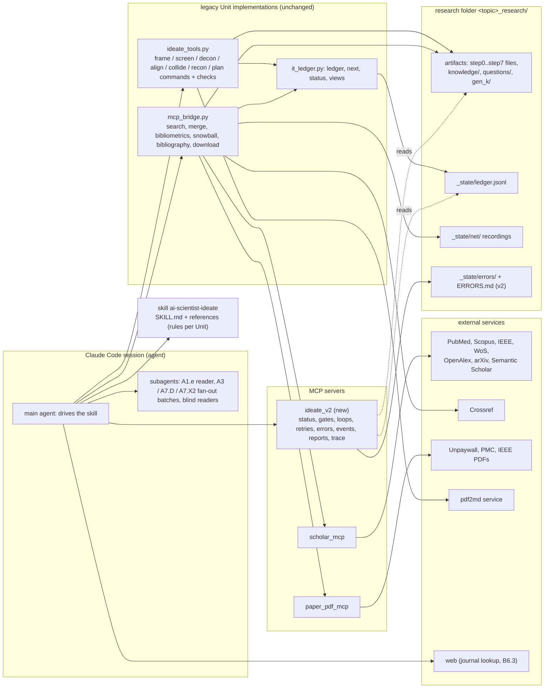
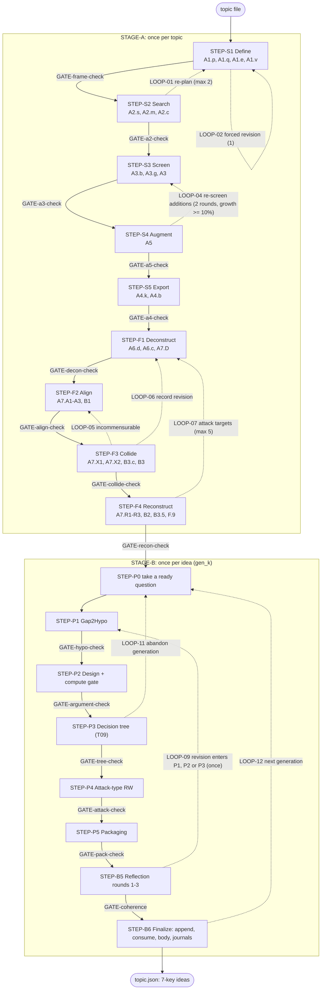
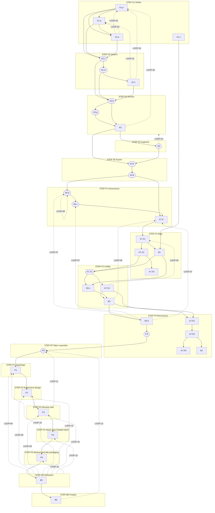
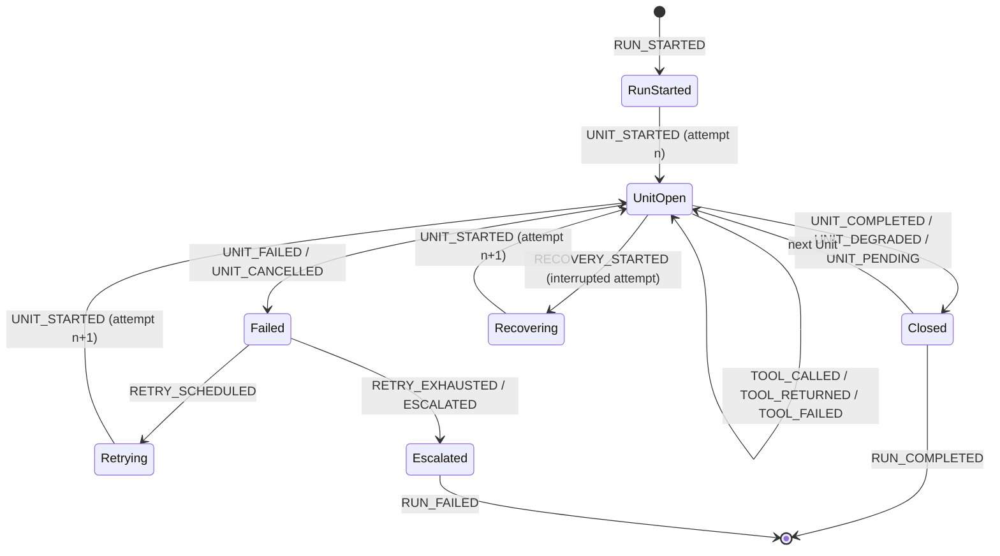
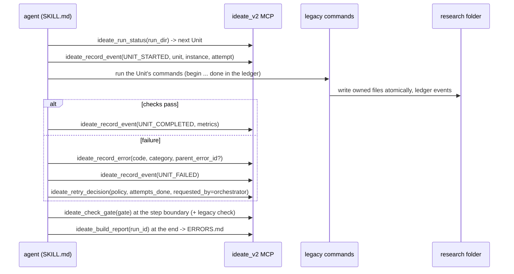

# ARCHITECTURE v2 — AI Scientist ideate (slides 3–5)

| | |
|---|---|
| Status | Draft 2.0.0, 2026-10-22 |
| Scope | The ideate stage of the six-skill pipeline: literature search (slide 3), literature fusion (slide 4), paper planning (slide 5) |
| Single source of truth | [`contracts/`](contracts/): `architecture.json` + `units/*.json` (v2 decisions) and `legacy_snapshot.json` (implementation facts, hash-pinned). Every block marked *generated* below is rendered from them by `scripts/render_docs.py`; `scripts/validate_architecture.py` fails when this file and the contracts disagree. |
| Module | [`ai-scientist-ideate-harness/`](./): skill definition, contracts, the `ideate_v2` core, the `ideate_v2` MCP server, evals, references, scripts |
| Supersedes | The Chinese `ARCHITECTURE_v2.md` v0.4 next to the legacy skill (its decisions D1–D9 are carried into the decision log, §10.2) |

---

## 1. Executive Summary

**Purpose and scope.** This document turns slides 3–5 of `aiscientist_architecture` into an engineering specification for
the ideate stage: from a topic file to a list of 7-key research ideas. It covers 3 blocks, 17 steps, 38 Units and
31 substeps, 15 handover gates, 12 declared loops (7 with a numeric iteration bound, LOOP-12 bounded by
`max_num_generations`, 4 still unbounded — OQ-07) and 66 data artifacts, with a contract for each, a necessity verdict
per Unit, an error and observability model, a comparison with the original architecture, a migration plan and a
verification strategy. Slides 1, 2 and 6–11 are context only.

**What the new architecture changes.**

1. *From steps to Units.* The original 9-step engine (and the legacy ideate flow of slides 2 and 6) ran a few large
   LLM steps. Slides 3–5 split them into Units that each make one decision, own named files, and are closed by a tool
   that checks what they wrote (13 search Units, 17 fusion Units including the full-text pair, 8 planning Units).
2. *Gates between steps.* Every step boundary is a handover check that refuses the next step while the previous one
   fails (green arrows on the slides).
3. *Fusion before planning.* Comparison of papers moved out of a single SOTA prompt into deconstruct → align → collide
   → reconstruct, run once per topic; ideas are planned from a ranked list of research questions, one per idea.
4. *Planning as argument.* A hypothesis's form follows the collision behind its gap (P1), its design must be able to
   refute it (P2), every outcome is decided in advance with a gate on weak outcomes (P3), Related Work becomes an
   attack plan (P4), and the abstract is written last (P5), inside three reflection rounds (B5).
5. *Ledger, replay, caveats.* A per-Unit ledger with input and output hashes makes staleness, resume and trace
   mechanical; network answers are recorded for offline replay; weaknesses travel as must-disclose caveats.
6. *v2 contract and orchestration layer (this repository).* A machine-checkable registry of every Unit, gate, loop and
   artifact; a stdlib core and an MCP server that report state, evaluate gates and loop bounds, own retry decisions,
   record structured errors and lifecycle events, and build step and overall reports.

**Expected benefits.** Auditable decisions (every inclusion, collision, gap and question points to a record);
resumable, partially re-runnable runs; failure isolation per Unit; contract tests per Unit; ideas whose likeliest
outcome is publishable; and, with v2, one error model, end-to-end traces and drift detection between the documented
architecture and the implementation.

**Major risks.** (1) Stage B (P0–P5, B5, B6) is not on the ledger (maturity L0), so it cannot be resumed or made
stale like Stage A (OQ-06). (2) The legacy implementation fails 18 of 495 tests on Windows (CRLF writes, symlinks,
path escaping, POSIX-only `fcntl` in the scholar server) — the supported platforms are undecided (OQ-08). (3) The
quality of model judgements has no acceptance thresholds (OQ-11). (4) Four loops have no numeric bound (OQ-07).
(5) A `.env` file ships inside the unpacked legacy archive (OQ-13).

**Assumptions.** The PDF export of the deck equals the `.pptx`, which was locked by PowerPoint during the analysis
(OQ-01). The legacy skill at the pinned hashes is the implementation of slides 3–5. The run is fully automatic (no
human checkpoints; D-09).

**Unresolved questions** are listed with owners in §10.1; the most consequential are OQ-04 (is the fusion exit's
ready-question target a hard gate?), OQ-06, OQ-08 and OQ-02 (the `scholar_research/v2` harness the v0.4 document
describes is not in this repository).

---

## 2. Sources, Evidence and Provenance

Every statement in this document and in the contracts is labelled by where it comes from:

| Label | Meaning |
|---|---|
| **PPT** | Stated on slides 3–5 of the deck |
| **PPT-OTHER** | Stated on another slide (1, 2, 6–11); context only |
| **IMPL** | Verified in the legacy implementation at the pinned hashes (registry, code, references, tests) |
| **INF** | Inferred from the slides and the implementation; not stated verbatim anywhere |
| **PROP** | A v2 proposal or decision (with a decision id, §10.2) |

| Source | Pinned by | Used for | Verified |
|---|---|---|---|
| `aiscientist_architecture.pdf` (11 pages, PDF export of the deck) | sha256 `cef8aa73…` | slides 3–5 (primary), 1, 2, 6–11 (context) | yes |
| `aiscientist_architecture.pptx` | — | not read: locked open by PowerPoint during the analysis; speaker notes and hidden slides unverified | **no** (OQ-01) |
| Legacy skill `ai-scientist-ideate` (`research_agent_v2/`, unpacked from a macOS zip, not under version control) | registry sha256 `de276792…`, SKILL.md `c006bee7…` | implementation facts per Unit; snapshot in `contracts/legacy_snapshot.json` | yes |
| Legacy `ARCHITECTURE_v2.md` v0.4 (Traditional Chinese) | sha256 `d09a3bbb…` | decisions D1–D9, error-report layout | yes; its §8 claims about `scholar_research/v2` could **not** be verified (no branch of this repository contains it; OQ-02) |
| Archived 9-step engine `archived/scholar_research/` (this repository) | git `bf67322` | the original architecture (§7) | yes |
| Decision documents `docs/decisions/PLAN_ideate_*.md` | — | cited by the legacy code; not available | **no** (OQ-03) |

**Slide numbering.** PDF page *n* is slide *n*. Slide 3 = literature search (13 Units), slide 4 = literature fusion
(15 Units, plus the A6 card), slide 5 = paper planning (P1–P5 wrapped by B5, then B6). The v0.4 document treated
slide 5 as the older per-idea B1–B6 table; in the current deck that table is slide 6 — the v0.4 document is out of
date on this point.

**Contradictions and gaps found between sources** (each resolved by a decision or tracked as a question):

| # | Finding | Sources | Resolution |
|---|---|---|---|
| 1 | Slide 2 puts export before snowball; slide 3 puts snowball before export | PPT-OTHER vs PPT; IMPL follows slide 3 | D-14 (slide 3 holds) |
| 2 | Slide 4 draws one A6 card; the implementation has two Units A6.d and A6.c | PPT vs IMPL | D-04 |
| 3 | Slide 4 states "ready ≥ max(generations, 3) + 2" as an exit condition; the code warns (Y09) and adds a must-disclose caveat | PPT vs IMPL | OQ-04; the v2 gate follows the code and reports a WARN |
| 4 | A1.v is in step Define on slide 3 but in block "planning" in the registry, and nothing requires it | PPT vs IMPL | D-12, OQ-05 |
| 5 | `references/planning/README.md` lists K01–K10; the code emits K01–K11 (slide 5: "K06–11") | IMPL vs IMPL | OQ-10 |
| 6 | `research-cycle.md` §6 says "return to B2" after B6; slide 5 takes the next question | IMPL vs PPT | OQ-14 |
| 7 | Slides 3 and 4 claim every Unit is L4 (12/12); the registry shows A6.d and A6.c at L2 (11/12) | PPT vs IMPL | the slide counts 15 fusion Units without A6; both statements hold (§5.3) |
| 8 | The slides give no numeric bound for four loops | PPT | OQ-07 |

---

## 3. Architecture Overview

### 3.1 Hierarchical breakdown

```
PIPE-ideate (topic file -> <topic>.json, 7-key ideas)
├── STAGE-A Literature base — once per topic
│   ├── BLK-search (slide 3)   STEP-S1 Define -> S2 Search -> S3 Screen -> S4 Augment (-> S3) -> S5 Export
│   │     units: A1.p A1.q A1.e A1.v | A2.s A2.m A2.c | A3.b A3.g A3 | A5 | A4.k A4.b
│   └── BLK-fusion (slide 4)   STEP-F1 Deconstruct -> F2 Align -> F3 Collide -> F4 Reconstruct
│         units: A6.d A6.c A7.D | A7.A1 A7.A2 A7.A3 B1 | A7.X1 A7.X2 B3.c B3 | A7.R1 A7.R2 A7.R3 B2 B3.5 F.9
└── STAGE-B Paper planning — once per idea (generation gen_k)
    └── BLK-planning (slide 5) STEP-P0 Take a question -> P1 Gap2Hypo -> P2 Design -> P3 Decision tree
                               -> P4 Attack-type RW -> P5 Packaging -> B5 Reflection (3 rounds) -> B6 Finalize
          units: P0 P1 P2 P3 P4 P5 B5 B6 (substeps P1/C25 ... B6/journals)
```

Granularity: a **step** is a slide column; a **Unit** is one decision with its own files, checks and ledger entry; a
**substep** is a stage inside a Unit that the slides draw as its own card (A5's routes, the P-cards, B5's rounds,
B6's parts) or that has its own failure behaviour (the fan-out stages of A3, A7.D, A7.X2). Substeps inherit every
contract field from their Unit except those listed for them.

### 3.2 Component inventory

<!-- BEGIN GENERATED:inventory (scripts/render_docs.py - do not edit by hand) -->
**Steps** (hierarchy: stage > block > step > unit > substep)

| Step ID | Block | # | Name | Slide name | Units | Entry gate | Exit gate | Prov. |
|---|---|---|---|---|---|---|---|---|
| STEP-S1 | BLK-search | 1 | Define | 定義 | A1.p, A1.q, A1.e, A1.v | - | GATE-frame-check | PPT |
| STEP-S2 | BLK-search | 2 | Search | 搜尋 | A2.s, A2.m, A2.c | GATE-frame-check | GATE-a2-check | PPT |
| STEP-S3 | BLK-search | 3 | Screen | 篩選 | A3.b, A3.g, A3 | GATE-a2-check | GATE-a3-check | PPT |
| STEP-S4 | BLK-search | 4 | Augment | 增補 | A5 | GATE-a3-check | GATE-a5-check | PPT |
| STEP-S5 | BLK-search | 5 | Export | 匯出 | A4.k, A4.b | GATE-a5-check | GATE-a4-check | PPT |
| STEP-F1 | BLK-fusion | 1 | Deconstruct | 解構 | A6.d, A6.c, A7.D | GATE-a4-check | GATE-decon-check | PPT |
| STEP-F2 | BLK-fusion | 2 | Align | 對齊 | A7.A1, A7.A2, A7.A3, B1 | GATE-decon-check | GATE-align-check | PPT |
| STEP-F3 | BLK-fusion | 3 | Collide | 碰撞 | A7.X1, A7.X2, B3.c, B3 | GATE-align-check | GATE-collide-check | PPT |
| STEP-F4 | BLK-fusion | 4 | Reconstruct | 重構 | A7.R1, A7.R2, A7.R3, B2, B3.5, F.9 | GATE-collide-check | GATE-recon-check | PPT |
| STEP-P0 | BLK-planning | 0 | Take a question | 取題 | P0 | GATE-recon-check | - | PPT |
| STEP-P1 | BLK-planning | 1 | Gap2Hypo | 缺口決定假設的形式 | P1 | - | GATE-hypo-check | PPT |
| STEP-P2 | BLK-planning | 2 | Experiment design | 實驗設計 | P2 | GATE-hypo-check | GATE-argument-check | PPT |
| STEP-P3 | BLK-planning | 3 | Decision tree | 決策樹 | P3 | GATE-argument-check | GATE-tree-check | PPT |
| STEP-P4 | BLK-planning | 4 | Attack-type Related Work | 攻擊型 RW | P4 | GATE-tree-check | GATE-attack-check | PPT |
| STEP-P5 | BLK-planning | 5 | Abstract and title packaging | 摘要標題封裝 | P5 | GATE-attack-check | GATE-pack-check | PPT |
| STEP-B5 | BLK-planning | 6 | Reflection | 反思 | B5 | GATE-pack-check | GATE-coherence | PPT |
| STEP-B6 | BLK-planning | 7 | Finalize | 定稿 | B6 | GATE-coherence | - | PPT |

**Units**

| Unit ID | Name | Slide name | Step | Kind | Deterministic | LLM | Ledger | Maturity | Prov. |
|---|---|---|---|---|---|---|---|---|---|
| A1.p | Protocol | 協議 | STEP-S1 | model | partial | yes | yes | L4 | PPT |
| A1.q | Query strategy | 查詢策略 | STEP-S1 | hybrid | partial | yes | yes | L4 | PPT |
| A1.e | Protocol evaluation | 協議評估 | STEP-S1 | subagent | no | yes | yes | L4 | PPT |
| A1.v | Context | 情境 | STEP-S1 | model | partial | yes | yes | L4 | PPT |
| A2.s | Retrieval | 檢索 | STEP-S2 | script | partial | no | yes | L4 | PPT |
| A2.m | Merge | 合併 | STEP-S2 | script | yes | no | yes | L4 | PPT |
| A2.c | Per-query check | 逐條檢查 | STEP-S2 | hybrid | partial | yes | yes | L4 | PPT |
| A3.b | Bibliometrics | 書目計量 | STEP-S3 | script | partial | no | yes | L4 | PPT |
| A3.g | Mechanical gate | 機械門檻 | STEP-S3 | script | yes | no | yes | L4 | PPT |
| A3 | Scoring and shortlist | 評分與名單 | STEP-S3 | fanout | partial | yes | yes | L4 | PPT |
| A5 | Snowball | 增補 | STEP-S4 | script | partial | no | yes | L4 | PPT |
| A4.k | Citation keys | Citation key | STEP-S5 | script | yes | no | yes | L4 | PPT |
| A4.b | BibTeX | BibTeX | STEP-S5 | script | partial | no | yes | L4 | PPT |
| A6.d | Fetch full texts | 全文 (取得) | STEP-F1 | script | partial | no | yes | L2 | IMPL |
| A6.c | Convert full texts | 全文 (轉換) | STEP-F1 | script | partial | no | yes | L2 | IMPL |
| A7.D | Per-paper deconstruction | 逐篇拆解 | STEP-F1 | fanout | no | yes | yes | L4 | PPT |
| A7.A1 | Vocabulary | 詞彙 | STEP-F2 | hybrid | partial | yes | yes | L4 | PPT |
| A7.A2 | Coordinates | 座標 | STEP-F2 | hybrid | partial | yes | yes | L4 | PPT |
| A7.A3 | Concept points | 概念點 | STEP-F2 | hybrid | partial | yes | yes | L4 | PPT |
| B1 | Lens | 視角 | STEP-F2 | hybrid | partial | yes | yes | L4 | PPT |
| A7.X1 | Collision candidates | 候選 | STEP-F3 | script | yes | no | yes | L4 | PPT |
| A7.X2 | Collision judgement | 判定 | STEP-F3 | fanout | no | yes | yes | L4 | PPT |
| B3.c | Lens collisions | 視角碰撞 | STEP-F3 | hybrid | no | yes | yes | L4 | PPT |
| B3 | Gap list | 缺口清單 | STEP-F3 | hybrid | partial | yes | yes | L4 | PPT |
| A7.R1 | Lines and findings points | 線＋發現點 | STEP-F4 | hybrid | partial | yes | yes | L4 | PPT |
| A7.R2 | Planes | 面 | STEP-F4 | hybrid | partial | yes | yes | L4 | PPT |
| A7.R3 | Descriptive body | 描述性體 | STEP-F4 | model | no | yes | yes | L4 | PPT |
| B2 | Synthesis (SOTA) | 綜整 | STEP-F4 | model | no | yes | yes | L4 | PPT |
| B3.5 | Research questions | 研究問題 | STEP-F4 | hybrid | partial | yes | yes | L4 | PPT |
| F.9 | Index and views | 索引與視圖 | STEP-F4 | script | yes | no | yes | L4 | PPT |
| P0 | Take a question | 取題 | STEP-P0 | script | yes | no | no | no card | PPT |
| P1 | Gap2Hypo | 缺口決定假設的形式 | STEP-P1 | hybrid | partial | yes | no | L0 | PPT |
| P2 | Experiment design | 實驗設計 | STEP-P2 | hybrid | partial | yes | no | L0 | PPT |
| P3 | Decision tree | 決策樹 | STEP-P3 | hybrid | partial | yes | no | L0 | PPT |
| P4 | Attack-type Related Work | 攻擊型 RW | STEP-P4 | hybrid | partial | yes | no | L0 | PPT |
| P5 | Abstract and title packaging | 摘要標題封裝 | STEP-P5 | hybrid | partial | yes | no | L0 | PPT |
| B5 | Reflection | 反思 | STEP-B5 | hybrid | no | yes | no | no card | PPT |
| B6 | Finalize | 定稿 | STEP-B6 | hybrid | partial | yes | no | no card | PPT |

**Substeps**

| Substep ID | Parent | Name | Kind | Prov. |
|---|---|---|---|---|
| A3/plan | A3 | Plan batches | script | PPT |
| A3/score | A3 | Score in parallel (fan-out) | subagent | PPT |
| A3/merge | A3 | Merge answers | script | PPT |
| A3/build | A3 | Build the shortlist | script | PPT |
| A5/backward | A5 | Backward (向後) | script | PPT |
| A5/cocite | A5 | Co-citation (共被引) | script | PPT |
| A5/forward | A5 | Forward (向前) | script | PPT |
| A5/similar | A5 | Semantic neighbours (語意相近) | script | PPT |
| A7.D/plan | A7.D | Plan batches | script | IMPL |
| A7.D/read | A7.D | Read each paper on its own (fan-out) | subagent | PPT |
| A7.D/merge | A7.D | Verify and merge | script | PPT |
| A7.X2/plan | A7.X2 | Plan batches | script | IMPL |
| A7.X2/judge | A7.X2 | Judge (fan-out) | subagent | PPT |
| A7.X2/merge | A7.X2 | Check and append | script | PPT |
| P1/C25 | P1 | Derivation table (推導表) | hybrid | PPT |
| P1/C26-27 | P1 | Rivals and numbers (對手與數字) | model | PPT |
| P2/design | P2 | Section 4 design (§4 設計) | model | PPT |
| P2/compute-gate | P2 | Compute gate (compute gate) | script | PPT |
| P3/T01-08 | P3 | Nodes and branches (節點與分岔) | hybrid | PPT |
| P3/leaf | P3 | Leaves and paper types (葉與論文型別) | model | PPT |
| P3/T09 | P3 | Decision gate (決策閘) | script | PPT |
| P4/R01 | P4 | Attack targets (攻擊目標) | hybrid | PPT |
| P4/R04-09 | P4 | Weapons and landing (武器與落點) | model | PPT |
| P5/K01-05 | P5 | Abstract sentence by sentence (摘要逐句) | model | PPT |
| P5/K06-11 | P5 | Title and per-leaf packaging (標題與每葉封裝) | model | PPT |
| B5/R1 | B5 | Round 1 | hybrid | PPT |
| B5/R2 | B5 | Round 2 | model | PPT |
| B5/R3 | B5 | Round 3 | hybrid | PPT |
| B6/append | B6 | Append and consume | script | IMPL |
| B6/body | B6 | Prescriptive Body | model | PPT |
| B6/journals | B6 | Journal recommendations | model | PPT |

**Gates** (green arrows: a failing check refuses the next step)

| Gate ID | Name | Scope | From -> To | Units that must be done | Artifacts | Contract rules | Legacy command | Prov. |
|---|---|---|---|---|---|---|---|---|
| GATE-frame-check | frame check | topic | STEP-S1 -&gt; STEP-S2 | A1.p, A1.q, A1.e | ART-step0.frame, ART-step0.strategy, ART-protocol-eval | protocol_evaluation_accepted | ideate_tools.py frame check &lt;RD&gt; | PPT |
| GATE-a2-check | a2-check | topic | STEP-S2 -&gt; STEP-S3 | A2.s, A2.m, A2.c | ART-query-instances, ART-raw-papers, ART-relevance-check | - | ideate_tools.py a2-check &lt;RD&gt; | PPT |
| GATE-a3-check | a3-check | topic | STEP-S3 -&gt; STEP-S4 | A3.b, A3.g, A3 | ART-bibliometrics, ART-gate, ART-screening-scores, ART-shortlist | - | ideate_tools.py a3-check &lt;RD&gt; | PPT |
| GATE-a5-check | a5-check | topic | STEP-S4 -&gt; STEP-S5 | A5, A3 | ART-snowball | rescreened_after | ideate_tools.py a5-check &lt;RD&gt; | PPT |
| GATE-a4-check | a4-check (search exit contract) | topic | STEP-S5 -&gt; STEP-F1 | A4.k, A4.b | ART-shortlist, ART-bib, ART-citation-keys, ART-search-caveats | caveats_file_valid | ideate_tools.py a4-check &lt;RD&gt; | PPT |
| GATE-decon-check | decon-check | topic | STEP-F1 -&gt; STEP-F2 | A6.d, A6.c, A7.D | ART-decon | - | ideate_tools.py decon-check &lt;RD&gt; | PPT |
| GATE-align-check | align-check | topic | STEP-F2 -&gt; STEP-F3 | A7.A1, A7.A2, A7.A3, B1 | ART-alignment.vocab, ART-alignment.coords, ART-lens | - | ideate_tools.py align-check &lt;RD&gt; | PPT |
| GATE-collide-check | collide-check | topic | STEP-F3 -&gt; STEP-F4 | A7.X1, A7.X2, B3.c, B3 | ART-collision-candidates, ART-collisions.paper, ART-gaps | - | ideate_tools.py collide-check &lt;RD&gt; | PPT |
| GATE-recon-check | recon-check (fusion exit contract) | topic | STEP-F4 -&gt; STEP-P0 | A7.R1, A7.R2, A7.R3, B2, B3.5, F.9 | ART-questions-index, ART-gaps, ART-sota, ART-lens, ART-fusion-caveats | ready_questions_target, caveats_file_valid | ideate_tools.py recon-check &lt;RD&gt; | PPT |
| GATE-hypo-check | hypo-check | generation | STEP-P1 -&gt; STEP-P2 | - | ART-gen.question, ART-gen.p1 | - | ideate_tools.py hypo-check &lt;gen_dir&gt; | PPT |
| GATE-argument-check | argument-check | generation | STEP-P2 -&gt; STEP-P3 | - | ART-gen.p1, ART-gen.p2 | - | ideate_tools.py argument-check &lt;gen_dir&gt; --no-idea | PPT |
| GATE-tree-check | tree-check (includes the T09 decision gate) | generation | STEP-P3 -&gt; STEP-P4 | - | ART-gen.tree | decision_tree_weak_mass | ideate_tools.py tree-check &lt;gen_dir&gt; | PPT |
| GATE-attack-check | attack-check | generation | STEP-P4 -&gt; STEP-P5 | - | ART-gen.attack | - | ideate_tools.py attack-check &lt;gen_dir&gt; | PPT |
| GATE-pack-check | pack-check | generation | STEP-P5 -&gt; STEP-B5 | - | ART-gen.packaging | abstract_word_limit | ideate_tools.py pack-check &lt;gen_dir&gt; --idea &lt;gen_dir&gt;/idea_draft.json | IMPL |
| GATE-coherence | coherence gate (B5 round 3) | generation | STEP-B5 -&gt; STEP-B6 | - | ART-gen.p2, ART-gen.tree, ART-gen.attack, ART-gen.packaging, ART-gen.reflection | decision_tree_weak_mass | argument-check, tree-check, attack-check and pack-check with --idea idea_draft.json | PPT |

**Loops** (back-edges, each bounded)

| Loop ID | Name | From | To | Bound | On exhaustion | Prov. |
|---|---|---|---|---|---|---|
| LOOP-01 | Re-plan a query, add or retire terms | A2.c | A1.q, A1.p | max 2; min_new_share 0.05 | accept-weak verdicts with caveat accept-weak (must disclose) | PPT |
| LOOP-02 | Protocol evaluation forced revision | A1.e | A1.p, A1.q | max 1 | final.status accepted-with-doubts, caveat protocol-doubts (must disclose) | PPT |
| LOOP-03 | Criteria amendment | A3 | A1.p | no numeric bound; TBD: no numeric bound stated; each amendment needs a reason (OQ-07) | n/a | PPT |
| LOOP-04 | Snowball additions screened again | A5 | STEP-S3 | max 2; min_growth 0.1 | stop snowballing; A4 export proceeds | PPT |
| LOOP-05 | Incommensurable collision back to the vocabulary | A7.X2 | A7.A1 | no numeric bound; TBD: unbounded in the slides; unresolved ones become caveat incommensurable-open (OQ-07) | caveat incommensurable-open (must disclose) | PPT |
| LOOP-06 | Source check revises a paper record | B3 | A7.D | no numeric bound; TBD: unbounded; queued revisions become caveat record-revisions-queued (OQ-07) | caveat record-revisions-queued | PPT |
| LOOP-07 | Attack targets fetched in full text | B3.5 | A6.d, A6.c, A7.D | max 1; max_items 5 | targets stay abstract-only; recorded on the question | IMPL |
| LOOP-08 | Paywall top-up | A6.d | A6.d | max 1 | caveat fulltext-short | IMPL |
| LOOP-09 | Round-2 revision re-enters planning | B5 | P1, P2, P3 | max 1 | finalize with the doubt recorded in Risk Factors | PPT |
| LOOP-10 | Coherence-gate failure | GATE-coherence | P1, P2, P3, P4, P5 | max 1 | finalize; doubts into Risk Factors; or LOOP-11 | PPT |
| LOOP-11 | Decision gate failure abandons the generation | P3 | P0 | no numeric bound; TBD: bounded by the ready questions available | finalize with 'Uninformative branch likely' in Risk Factors | PPT |
| LOOP-12 | Next generation | B6 | P0 | no numeric bound | stop: report the archive | PPT |

**Artifacts** (data contracts; owners write, everyone else reads)

| Artifact ID | Path | Part | Kind | Owner(s) | Schema |
|---|---|---|---|---|---|
| ART-topic | &lt;topic&gt;.md | - | external | - | markdown (# Title, ## Keywords, ## TL;DR, ## Abstract) |
| ART-human-overrides | _human/search_overrides.json | - | external | - | list of {kind include\|exclude\|reread\|seed\|known_item, id\|title\|doi, reason, by} |
| ART-step0.frame | step0_session_config.json | topic, topic_file, depth, timestamp, protocol | part | A1.p | ideate-protocol/1 |
| ART-step0.strategy | step0_session_config.json | queries, dropped_terms, anchor_terms, sources, queries_history, known_items, scope_probe, strategy_basis | part | A1.q | step0.queries[] / known_items[] / scope_probe |
| ART-step0.context | step0_session_config.json | target_venues, expert_domain, local_environment (except probe) | part | A1.v | {artefacts[], cached_data[], packages_present[], packages_missing[]} |
| ART-step0.probe | step0_session_config.json | local_environment.probe | part | B1 | env-probe output |
| ART-step0.consumed | step0_session_config.json | consumed | part | B6 | list of consumed questions / (gap, angle) pairs |
| ART-protocol-view | step1_protocol.md | - | view | derived from ART-step0.frame, ART-step0.strategy | rendered markdown (PRISMA-ScR style) |
| ART-protocol-eval | step1_protocol_evaluation.json | - | file | A1.e | ideate-protocol-eval/1 |
| ART-query-instances | step2_queries/&lt;id&gt;@&lt;hash&gt;.json | - | file | A2.s | ideate-query-instance/1 |
| ART-raw-papers | step2_raw_papers.json | - | file | A2.m | merged collection with found_by, stable ids, PRISMA identification counts |
| ART-paper-ids | _state/paper_ids.jsonl | - | file | A2.m (minted_by A2.m), A5 (minted_by A5) | append-only {id, doi\|arxiv\|title, minted_by} |
| ART-relevance-check | step2_relevance_check.json | - | file | A2.c | verdicts per query and round (ok\|replan\|accept-weak), caveats |
| ART-bibliometrics | step3_bibliometrics.json | - | file | A3.b | per candidate: type, retraction, language, normalised citations, SNIP, impact |
| ART-gate | step3_gate.json | - | file | A3.g | mechanical exclusions X-RET / X-TYPE / X-LANG |
| ART-screening-scores | screening_scores.json | - | file | A3 | per paper: verbatim evidence, relevance, quality, exclusions, criteria_amendments |
| ART-shortlist | step3_shortlist.json | all but citation_key, access_level | part | A3 | included papers: composite, tier, roles |
| ART-shortlist.citation_key | step3_shortlist.json | citation_key | part | A4.k | projected from step4_citation_keys.jsonl |
| ART-shortlist.access_level | step3_shortlist.json | access_level | part | A6.c | full-text \| abstract-only \| pdf-only |
| ART-screening-results | step3_screening_results.md | - | file | A3 | PRISMA screening box (markdown) |
| ART-screening-all | step3_screening_all.json | - | file | A3 | ideate-screening-all/1: the archived engine's ScreeningRecord - every candidate with its screening decision (included, borderline = tier 4, excluded), the criteria and the tier names |
| ART-snowball | step2b_snowball_papers.json | - | file | A5 | ideate-snowball/2: additions by route and round, caveats |
| ART-citation-keys | step4_citation_keys.jsonl | - | file | A4.k | append-only key log (+ .md view) |
| ART-bib | step4_references.bib | - | file | A4.b | BibTeX (+ step4_bib_metadata.json) |
| ART-search-caveats | search_caveats.json | - | view | derived from ART-step0.strategy, ART-protocol-eval, ART-raw-papers, ART-relevance-check, ART-bibliometrics, ART-shortlist, ART-snowball, ART-bib, ART-citation-keys | ideate-search-caveats/1 {schema, at, caveats[{code, unit, text, must_disclose}], must_disclose[]} |
| ART-status-view | STATUS.md | - | view | derived from ART-ledger | markdown |
| ART-tier1 | step3_tier1_candidates.json | - | file | A6.d | candidates with added_by depth\|top-up\|targets, top_ups |
| ART-pdfs | pdfs/&lt;key&gt;.pdf | - | file | A6.d | PDF (complete: %PDF- ... %%EOF) |
| ART-fetch-log | step5_fetch_log.json | - | file | A6.d | every attempt: route, result, reason (+ step3_missing_pdfs.md) |
| ART-fulltext | step5_full_text/&lt;key&gt;.md | - | file | A6.c | UTF-8, LF markdown (+ figure/index.json, _access_log.md) |
| ART-fulltext-caveats | fulltext_caveats.json | - | view | derived from ART-tier1, ART-fulltext | ideate-fulltext-caveats/1 |
| ART-decon | knowledge/decon/&lt;key&gt;.json | - | file | A7.D | ai-scientist-decon/1 |
| ART-notes-view | knowledge/_notes/&lt;key&gt;.md | - | view | derived from ART-decon | markdown |
| ART-alignment.vocab | knowledge/alignment.json | vocab, vocab_basis, history | part | A7.A1 | one concept per thing named; false friends split |
| ART-alignment.coords | knowledge/alignment.json | coords, coords_basis | part | A7.A2 | six coordinates per claim/assumption |
| ART-methods-input | knowledge/methods_matrix_input.json | projection | part | A7.A1 | methods matrix input rows |
| ART-methods-input.affordable | knowledge/methods_matrix_input.json | affordable | part | B1 | affordable_here flags |
| ART-methods-matrix | knowledge/methods_matrix.json | - | view | derived from ART-methods-input, ART-methods-input.affordable, ART-decon | methods matrix (build-methods) |
| ART-cards.points-align | knowledge_cards.json | points with origin align | part | A7.A3 | knowledge card (Point) |
| ART-lens | lens.json | - | file | B1 | persona, venues, compute, scope; dataset on disk; method family affordable |
| ART-collision-candidates | knowledge/collision_candidates.json | - | file | A7.X1 | candidate pairs/groups by rule, truncated[] |
| ART-collisions.paper | knowledge/collisions.jsonl | paper x paper records | part | A7.X2 | append-only {collision_id X####, result, sides, axes_differ, ...} |
| ART-collisions.lens | knowledge/collisions.jsonl | lens records | part | B3.c | convention-vs-lens \| empty-cell \| independent (severity &lt;= 3 for empty cells) |
| ART-gaps | step7_gaps.json | - | file | B3 | gaps GAP_NNN: collisions, &gt;= 2 supporting papers, type, move, scores, rank (+ step7_gap_analysis.md view) |
| ART-lines | knowledge/lines/*.md | - | file | A7.R1 | debate \| evolution \| analogy Lines |
| ART-cards.points-collide | knowledge_cards.json | points with origin collide | part | A7.R1 | knowledge card (findings Point) |
| ART-cards.planes | knowledge_cards.json | planes | part | A7.R2 | knowledge card (Plane) |
| ART-body-descriptive | knowledge/body/B_draft_&lt;topic&gt;_descriptive.md | - | file | A7.R3 | the field's seven questions |
| ART-sota | step6_sota_review.md | - | file | B2 | consensus, debates, reported numbers - each cites a collision or matrix row id, else (TBD) |
| ART-questions | questions/Q_NNN.md | - | file | B3.5 | problem + one question; screens; section 9 handover (targets, rival_accounts, magnitudes) |
| ART-questions-index | questions/index.json | - | file | F.9 | {at, target_ready, ready, questions[{id, status ready\|abandoned\|screen_unresolved, gap_rank, ...}]} |
| ART-fusion-caveats | fusion_caveats.json | - | view | derived from ART-fulltext-caveats, ART-decon, ART-lens, ART-collision-candidates, ART-collisions.paper, ART-gaps, ART-questions-index | ideate-fusion-caveats/1 |
| ART-ledger | _state/ledger.jsonl | - | infrastructure | - | append-only {ev begin\|done\|pending\|fail\|override\|revise\|..., unit, inst, at, inputs, outputs, counts, degraded, tool, model?} |
| ART-gen.question | gen_k/question.json | - | file | P0 | the question, its gap, move, collisions, section 9 (+ gen_k/step7b_problem.md) |
| ART-gen.p1 | gen_k/argument.json | claims (P1 fields), derivation, rivals[].id; step8_hypothesis.md (RQ, hypotheses, rivals); p1_prefill.json | part | P1 | ai-scientist-argument/1 |
| ART-gen.p2 | gen_k/argument.json | experiments, evidence, construction, controls, power, scope, external_check; rest of step8_hypothesis.md | part | P2 | ai-scientist-argument/1 |
| ART-gen.tree | gen_k/decision_tree.json | - | file | P3 | nodes, branches with priors (likely\|possible\|unlikely), leaves with paper types (+ .md view; claims[].outcomes projection) |
| ART-gen.attack | gen_k/attack_plan.json | - | file | P4 | targets, weapons (E-id), lands_on leaf, if_miss leaf, concessions (+ related_work.md) |
| ART-gen.packaging | gen_k/packaging.json | - | file | P5 | title, short hypothesis, abstract sentences with moves and sources, per-leaf titles, tree_gate (+ idea_draft.json) |
| ART-gen.reflection | gen_k/reflection_log.md | - | file | B5 | ## Round r/N, critique, ACTION + ARGUMENTS (+ *_r1 copies, restatement_1/2.json) |
| ART-gen.idea | gen_k/idea.json | - | file | B5 | 7 keys in order: Name, Title, Short Hypothesis, Related Work, Abstract, Experiments, Risk Factors and Limitations |
| ART-ideas-archive | &lt;topic&gt;.json | - | file | B6 | JSON list of 7-key ideas |
| ART-gen.body-prescriptive | gen_k/body/B_draft_&lt;Name&gt;.md | - | file | B6 | prescriptive Body (based_on the descriptive Body) |
| ART-gen.journals | gen_k/step8_journal_recommendations.md | - | file | B6 | journal recommendations (web lookup) |
| ART-v2.events | _state/errors/&lt;run_id&gt;/events.jsonl | - | file | @orchestrator | ideate-v2-event/1 (mcp/ideate_v2_mcp/schemas/event.schema.json) |
| ART-v2.errors | _state/errors/&lt;run_id&gt;/units/&lt;unit&gt;@&lt;instance&gt;.jsonl | - | file | @orchestrator | ideate-v2-error/1 (mcp/ideate_v2_mcp/schemas/error_record.schema.json) |
| ART-v2.reports | _state/errors/&lt;run_id&gt;/{steps/*.json, overall.json}, _state/errors/latest.json, ERRORS.md | - | file | @orchestrator | ideate-v2-report/1 |

**Infrastructure, external services, data stores, MCP servers**

| ID | Name / path | Role / used by | Implemented by / via | Prov. |
|---|---|---|---|---|
| INFRA-ledger | Ledger (_state/ledger.jsonl) | begin/done/pending/fail per Unit with input and output hashes; stale propagation; refuses a done after writes outside the card | it_ledger.py | PPT |
| INFRA-next-status | next / status / STATUS.md / *_caveats.json views | names the next Unit and its commands; rebuilds views after every done | ideate_tools.py next\|status | PPT |
| INFRA-trace | trace | follows a paper, query, collision, gap or question through every Unit decision | it_trace.py (ideate_tools.py trace) | PPT |
| INFRA-preflight | preflight | which keys are set and which services answer (cached 12 h) | mcp_bridge.py preflight | PPT |
| INFRA-human | _human/ interventions | the only way a person changes a decision; the owning Unit applies it and downstream goes stale | it_overrides.py | PPT |
| INFRA-replay | Record and replay of network answers | _state/net/ recordings; IDEATE_REPLAY=1 replays offline and fails on a missing recording | mcp_bridge.py transport | PPT |
| INFRA-units-check | units check | machine-judges each card's twelve conditions (L0-L4) against code, fixtures and infrastructure | it_units.py (ideate_tools.py units check) | PPT |
| INFRA-unit-boundary | unit-begin / unit-done | opens and closes the six Units the model writes by hand (A7.A3, A7.R1, A7.R2, A7.R3, B2, B3.5) | ideate_tools.py unit-begin\|unit-done | PPT |
| INFRA-paper-ids | Stable paper id registry | paper_NNN minted once by DOI, arXiv id, normalised title; never reused | it_search.py assign_ids | IMPL |
| INFRA-embeddings | SPECTER2 (local, CPU) | sem_sim / sem_pct percentiles for merge, screening and snowball | allenai/specter2_base via mcp_bridge | PPT |
| INFRA-v2-orchestrator | v2 orchestration MCP server (ideate_v2) | status, gate checks, loop bounds, retry ownership, structured errors and events, reports, trace | mcp/ideate_v2_mcp/server.py + ideate_v2/ | PROP |
| EXT-pubmed | PubMed (NCBI E-utilities) | used by A2.s, A1.q | MCP-scholar; credential: PUBMED_API_KEY (optional) | PPT |
| EXT-scopus | Scopus (search, SNIP/SJR) | used by A2.s, A3.b | MCP-scholar; credential: SCOPUS_API_KEY | PPT |
| EXT-ieee | IEEE Xplore | used by A2.s | MCP-scholar; credential: IEEE_API_KEY | PPT |
| EXT-wos | Web of Science | used by A2.s | MCP-scholar; credential: WOS_API_KEY | PPT |
| EXT-openalex | OpenAlex | used by A1.q, A2.s, A2.m, A3.b, A5 | MCP-scholar and direct HTTP; credential: OPENALEX_API_KEY (optional) | PPT |
| EXT-arxiv | arXiv | used by A2.s, A6.d | MCP-scholar; curl for PDFs (not replayable); credential: none | PPT |
| EXT-semantic-scholar | Semantic Scholar (search, recommendations, abstracts, DOI recovery) | used by A2.s, A2.m, A3.b, A5 | MCP-scholar; credential: SEMANTIC_SCHOLAR_API_KEY (optional; rate-limited without) | PPT |
| EXT-crossref | Crossref | used by A4.b | direct HTTP (recorded under _state/net/http/); credential: none | PPT |
| EXT-oa-pdf | Open-access PDF routes (Unpaywall, PMC, arXiv, IEEE) | used by A6.d | MCP-paper-pdf; credential: PAPER_PDF_UNPAYWALL_EMAIL | IMPL |
| EXT-pdf2md | pdf2md conversion service | used by A6.c | pdf2md.sh (fallback: local pdftotext); credential: PDF2MD_API_KEY | IMPL |
| EXT-llm | Claude model (main session and subagents) | used by A1.p, A1.q, A1.e, A1.v, A2.c, A3, A7.D, A7.A1, A7.A2, A7.A3, B1, A7.X2, B3.c, B3, A7.R1, A7.R2, A7.R3, B2, B3.5, P1, P2, P3, P4, P5, B5, B6 | Claude Code session / Agent subagents; credential: session | PPT |
| EXT-web-journals | Web lookup for journal recommendations | used by B6 | WebSearch / WebFetch; credential: none | PPT |
| STORE-run-dir | &lt;topic&gt;_research/ | one research folder per topic; every Stage A Unit reads and writes here | - | PPT |
| STORE-gen-dir | &lt;topic&gt;_research/gen_k/ | one folder per generation (idea) | - | IMPL |
| STORE-archive | &lt;topic&gt;.json | the idea archive new_run.py reads | - | IMPL |
| STORE-net | &lt;RD&gt;/_state/net/ | recorded network answers for replay (credential-free) | - | PPT |
| STORE-observability | &lt;RD&gt;/_state/errors/ | v2 events, error records and reports (ignored by the legacy ledger) | - | PROP |
| STORE-secrets | environment variables; legacy mcp/scholar_mcp/.env (gitignored) | API keys; never printed or written to tracked files | - | IMPL |
| MCP-scholar | scholar_mcp | tools: scholar_search, scholar_dedup, scholar_snowball, scholar_recover_dois, scholar_recommend, scholar_venues, scholar_abstracts | stdio - &lt;legacy&gt;/mcp/scholar_mcp/server.py | IMPL |
| MCP-paper-pdf | paper_pdf_mcp | tools: (PDF fetch by DOI over Unpaywall, PMC, arXiv, IEEE) | stdio - &lt;legacy&gt;/mcp/paper_pdf_mcp/server.py | IMPL |
| MCP-ideate-v2 | ideate_v2 | tools: ideate_list_units, ideate_get_contract, ideate_run_status, ideate_check_gate, ideate_check_loop, ideate_record_event, ideate_record_error, ideate_retry_decision, ideate_build_report, ideate_trace | stdio - mcp/ideate_v2_mcp/server.py | PROP |
<!-- END GENERATED:inventory -->

### 3.3 Architecture diagram



The v2 server never writes the legacy ledger or any artifact; it reads them and writes only `_state/errors/**` and
`ERRORS.md`, which the legacy ledger ignores (D-07). Unit work stays in the legacy commands.

### 3.4 Execution flow



### 3.5 Dependency graph

Unit-level `requires` edges (solid) and declared loops (dotted). The table lists, per Unit, its upstream, its
downstream, and the inputs it reads from a Unit it does not require — ordered only by a gate or a loop. These implicit
dependencies are computed by `ideate_v2.spec.implicit_dependencies`; the validator reports any that no gate or loop
covers as a WARN (none remain in v2; two existed in the legacy graph, §5.3).

<!-- BEGIN GENERATED:dependency-graph (scripts/render_docs.py - do not edit by hand) -->


Rounded nodes are scripts; rectangles involve a model. Solid arrows = `requires`; dotted = declared loops.

| Unit | Upstream (requires) | Downstream (required by) | Implicit inputs (ordered by) |
|---|---|---|---|
| A1.p | - | A1.q, A1.e, A2.s | - |
| A1.q | A1.p | A1.e, A2.s | - |
| A1.e | A1.p, A1.q | A2.s | - |
| A1.v | - | B1 | - |
| A2.s | A1.p, A1.q, A1.e | A2.m, A3.b | - |
| A2.m | A2.s | A2.c, A3.b | - |
| A2.c | A2.m | A3.b | - |
| A3.b | A2.s, A2.m, A2.c | A3.g, A3 | ART-snowball from A5 (loop) |
| A3.g | A3.b | A3 | - |
| A3 | A3.g, A3.b | A5, A4.k | ART-snowball from A5 (loop) |
| A5 | A3 | A4.k | - |
| A4.k | A3, A5 | A4.b | - |
| A4.b | A4.k | A6.d, A7.D | - |
| A6.d | A4.b | A6.c | - |
| A6.c | A6.d | A7.D | - |
| A7.D | A4.b, A6.c | A7.A1 | - |
| A7.A1 | A7.D | A7.A2, B1 | - |
| A7.A2 | A7.A1 | A7.A3, A7.X1 | - |
| A7.A3 | A7.A2 | - | - |
| B1 | A7.A1, A1.v | A7.X1, B3.c | - |
| A7.X1 | A7.A2, B1 | A7.X2, B3.c | - |
| A7.X2 | A7.X1 | B3, A7.R1 | - |
| B3.c | A7.X1, B1 | B3 | - |
| B3 | A7.X2, B3.c | A7.R1, B3.5 | - |
| A7.R1 | A7.X2, B3 | A7.R2 | - |
| A7.R2 | A7.R1 | A7.R3, B2 | ART-cards.points-align from A7.A3 (GATE-align-check) |
| A7.R3 | A7.R2 | - | - |
| B2 | A7.R2 | - | - |
| B3.5 | B3 | F.9 | - |
| F.9 | B3.5 | P0 | - |
| P0 | F.9 | P1 | ART-step0.consumed from B6 (loop) |
| P1 | P0 | P2 | - |
| P2 | P1 | P3 | ART-sota from B2 (GATE-recon-check) |
| P3 | P2 | P4 | - |
| P4 | P3 | P5 | - |
| P5 | P4 | B5 | - |
| B5 | P5 | B6 | - |
| B6 | B5 | - | ART-body-descriptive from A7.R3 (GATE-recon-check) |
<!-- END GENERATED:dependency-graph -->

### 3.6 Boundaries

| Concept | In this system | Responsibility | Not responsible for |
|---|---|---|---|
| **Agent** | The Claude Code session running the skill; subagents for A1.e, the fan-out batches of A3 / A7.D / A7.X2, B3.c, the blind readers of B5 | Judgement (the orange cards): protocol, verdicts, scores, records, vocabulary, collisions, gaps, questions, hypotheses, trees, attack plans, packaging | Arithmetic, ids, hashes, ranks, file ownership — tools do these |
| **Skill** | `ai-scientist-ideate` (SKILL.md + `references/`) | Which Unit runs when, the rules of each Unit, the order of commands | Executing anything itself |
| **Unit** | One registry card (38) | One decision; owns named artifacts (or parts); closed by its checks | Writing other Units' files (the ledger refuses the done) |
| **Substep** | `<unit>/<label>` (31) | A stage of a Unit with its own card or failure behaviour | Its own ledger entry (it shares the Unit's) |
| **Tool** | A legacy command (`ideate_tools.py …`, `mcp_bridge.py …`) or an MCP tool | Mechanics and checks; the Unit boundary (a command that writes a Unit's files closes it) | Decisions that need judgement |
| **Gate** | A handover check between steps (15) | Refusing the next step | Repairing the previous one |
| **MCP server** | `scholar_mcp`, `paper_pdf_mcp` (legacy); `ideate_v2` (new) | Network access to databases and PDFs (legacy); orchestration support and observability (v2) | The v2 server never calls the network and never runs a Unit |
| **External service** | Databases, Crossref, OA PDF routes, pdf2md, the model, the web | Answers | Retries — the calling transport owns them (RP-TRANSPORT) |
| **Data store** | The research folder and its `_state/` | Durable state: artifacts, ledger, recordings, v2 observability | — |
| **Orchestrator** | The agent following SKILL.md, assisted by `ideate_v2` (decision D-05 of v0.4: steps are program-orchestrated, judgement stays in Units) | Sequencing, gates, Unit-level retries, reports | Unit internals |

---

## 4. Standardized Unit Specification

### 4.1 Canonical schema

Every Unit is specified with the 27 fields below. The value of a field is content, `N/A — <justification>` or
`TBD — <follow-up action>`; the validator rejects an empty field and an N/A or TBD without its reason (C-FIELD-EMPTY).
The column *Source* says where the composed value comes from (`ideate_v2/spec.py`).

| Field | Required description | Source (v2 contract / legacy card) |
|---|---|---|
| Unit ID | Stable unique identifier | `id` (source ids are kept, D-03) |
| Name | Canonical name (English, slide name) | `name`, `name_zh` |
| Parent Step | Parent step and block | `step` → `steps[]` |
| Purpose | Business and technical objective | `purpose` or legacy `purpose` |
| Necessity | Why the Unit exists | `necessity` |
| Trigger | Conditions that start execution | `trigger` |
| Input | Required, optional and contextual inputs | `inputs.{required, optional, context}` (artifact ids) + legacy `reads` |
| Input Schema | Types and constraints of the inputs | artifact `schema` (legacy schema ids such as `ideate-protocol/1`) |
| Output | Results and side effects | `outputs.{artifacts, side_effects}` |
| Output Schema | Types and constraints of the outputs | artifact `schema` + legacy `schemas` |
| Resources | Actor, network, budget, scratch, model | legacy `actor`, `network`, `budget`, `scratch`; `llm` |
| Tools | Commands and code | `commands` + legacy `code` |
| MCP Dependencies | MCP servers and tools | `mcp` + legacy `server` |
| Preconditions | What must hold before | `preconditions` + legacy `hard_stop` |
| Postconditions | What must hold after (done_when) | legacy `done_when` checks or `postconditions` |
| Dependencies | Upstream, downstream, invalidation, revisions, implicit inputs | `requires` (+ computed), legacy `invalidates`, `revises`, `revised_by` |
| Execution Logic | Processing steps and decision rules | `logic` |
| State Management | Instances, persistence, mutation, resume | `state` + legacy `instance`, `frozen`, `resume` |
| Failure Modes | Expected failure conditions | `failure_modes` or legacy `failures` |
| Error Handling | Retry policy, local recovery, escalation, degraded paths | `error_boundary` + legacy `degraded` |
| Observability | Counts, status line, audit file, v2 events | `observability` or legacy `counts`, `status_line`, `audit` + v2 default |
| Validation | Check codes with counter-examples; maturity | legacy `done_when` + `achieved_level` |
| Idempotency | Whether safe re-execution is possible | `idempotency` + legacy `resume` |
| Security | Permissions, sensitive data, trust boundaries | `security` + legacy `forbidden` |
| Performance | Latency, tokens, scalability | `performance` or legacy `budget` |
| Testing | Unit, integration and evaluation tests | `testing` or legacy `tests` |
| Open Questions | Missing specifications | `open_questions` → §10.1 |

Each Unit also carries a one-line **classification**: kind (script, model, subagent, fan-out, hybrid), deterministic
(yes, partial, no), LLM-dependent, on the ledger, maturity, side effects and their rollback, provenance.

### 4.2 Shared definitions

To avoid repeating the same text per Unit, these definitions apply to every Unit unless its card says otherwise.

**Unit interface (IMPL, extended by PROP).** A Unit instance runs `begin` → its commands → its checks → `done`
(checks pass) or `pending` (checks fail; the command finished) or `fail` (an exception, a refusal, an injected
failure). The ledger records input hashes at `begin` and output hashes at `done`; between the two, a write outside the
Unit's declared files refuses the `done`. v2 adds a lifecycle event for each transition (`UNIT_STARTED`,
`UNIT_COMPLETED` / `UNIT_PENDING` / `UNIT_FAILED`, `TOOL_*`) and an error record per failure.

**Result states.** `todo` (no event) · `running` (begin without done: running or interrupted) · `waiting` (pending)
· `failed` · `done` (outputs and inputs still hash as recorded, every upstream done) · `stale` (an output or input
changed, or an upstream is not done). Planning Units, not yet on the ledger, are reported by file presence.

**Defaults by kind.**

| Kind | Deterministic | Retry policy | Idempotency | Observability | Security |
|---|---|---|---|---|---|
| script | yes / partial (network) | RP-NONE; RP-TRANSPORT inside for network | re-run on unchanged inputs writes identical files | counts + status line + v2 events | no secrets in outputs; recordings without credentials |
| model | no | RP-MODEL-OUTPUT (tool rejects, model fixes once) | judgement fields reach files only through the tool | the tool's findings, the model id in done | no network; declared reads only |
| subagent | no | RP-MODEL-OUTPUT | a round or batch is stored once | brief and verbatim reply kept in scratch | sees only the brief's paths |
| fanout | no (batches) / yes (plan, merge, build) | RP-FANOUT-BATCH | merge keyed by item; build all-or-nothing | per-batch files; tokens per batch (OQ-12) | each subagent sees one batch |
| hybrid | partial | the stricter of its parts | as its parts | as its parts | as its parts |

**Atomicity and rollback.** Every legacy write is a temporary file + rename (IMPL); append-only logs (key log, paper
ids, collisions, ledger) are never rewritten in place. "Rollback" therefore means re-running the Unit from the ledger
on corrected inputs, not undoing a write — except for B6's archive append (§6.3).

### 4.3 Data contracts and examples

Artifacts are the data contracts between Units (inventory in §3.2). An artifact has one owner per part; readers never
write it; revisions by another Unit are declared on both sides (`revised_by` / `revises`). Examples of the most
consulted records (abridged from the legacy schemas):

```json
{"_artifact": "ART-query-instances  step2_queries/Q1@1a2b3c.json  (ideate-query-instance/1, owner A2.s)",
 "kind": "query", "id": "Q1", "strategy": "primary", "hash": "1a2b3c", "year": "2013-2026", "limit": 50,
 "per_source": {"openalex": {"form": "boolean-nostar",
                             "attempts": [{"sent_query": "(eeg) AND (artifact OR artefact)", "at": "2026-10-17T09:00:09Z",
                                           "filters": {"from": 2013}, "returned": 50, "total": 2140}]}},
 "papers": ["paper_001", "paper_014"], "complete": true}
```

```json
{"_artifact": "ART-ledger  _state/ledger.jsonl  (one line per event)",
 "ev": "done", "unit": "A3.g", "inst": "-", "at": "2026-10-17T09:00:18+00:00",
 "inputs": {"step3_bibliometrics.json": "0f3c…", "step0:protocol[languages]": "9a1e…"},
 "outputs": {"step3_gate.json": "5be2…"}, "counts": {"excluded": 4}, "degraded": [], "tool": "3d0f…"}
```

```json
{"_artifact": "ART-questions-index  questions/index.json  (owner F.9)",
 "at": "2026-10-17T10:22:00+00:00", "target_ready": 5, "ready": 3,
 "questions": [{"id": "Q_001", "status": "ready", "gap_rank": 1, "targets": ["leeetal2021"]},
               {"id": "Q_004", "status": "screen_unresolved", "gap_rank": 4}]}
```

```json
{"_artifact": "ART-gen.tree  gen_k/decision_tree.json  (owner P3)",
 "root": "N0",
 "nodes": [{"id": "N0", "role": "instrument", "claims": [], "branches": [
              {"kind": "pass", "next": "N1", "prior": "likely"}, {"kind": "fail", "leaf": "L0", "prior": "unlikely"}]},
           {"id": "N1", "role": "tests", "claims": ["C1"], "branches": [
              {"kind": "supported", "leaf": "L1", "prior": "possible"},
              {"kind": "refuted", "leaf": "L2", "prior": "possible"},
              {"kind": "uninformative", "leaf": "L3", "prior": "unlikely"}]}],
 "leaves": [{"id": "L0", "paper": "not-publishable"}, {"id": "L1", "paper": "finding"},
            {"id": "L2", "paper": "informative-null"}, {"id": "L3", "paper": "methods-caveat"}]}
```

```json
{"_artifact": "ART-ideas-archive  <topic>.json  (owner B6; the stage's output contract, unchanged)",
 "_value": [{"Name": "lowercase_with_underscores", "Title": "…", "Short Hypothesis": "…", "Related Work": "…",
             "Abstract": "about 250 words", "Experiments": ["E1 [tests C1] …"],
             "Risk Factors and Limitations": ["…"]}]}
```

The v2 records (error record, event, tool envelope) have JSON Schemas in
[`mcp/ideate_v2_mcp/schemas/`](mcp/ideate_v2_mcp/schemas/) and examples in §6.

### 4.4 Unit specifications

Generated from the contracts; one card per Unit in pipeline order, with the Unit's substeps after it. Legacy check
codes are shown with the counter-example that proves each check (the legacy `units check` requires one per code).

<!-- BEGIN GENERATED:unit-specs (scripts/render_docs.py - do not edit by hand) -->
#### STEP-S1 Define (定義)

##### A1.p - Protocol

*kind model · deterministic partial · LLM yes · on ledger yes · maturity L4 · side effects: files only (atomic writes; rollback = re-run from the ledger) · provenance PPT*

| Field | Specification |
|---|---|
| Unit ID | A1.p |
| Name | Protocol (協議) |
| Parent Step | STEP-S1 Define (定義) in BLK-search |
| Purpose | Frame the topic before any search: review type, question framework and slots, search axes, outcomes, timeframe, eligibility criteria, completion criterion |
| Necessity | Fixes what counts as the topic before any result is seen (PRISMA-ScR), so later screening cannot drift toward convenient papers. |
| Trigger | First Unit of a topic: a topic file exists and step0 has no protocol, or the topic file's hash changed (P10 STALE). |
| Input | required: ART-topic = &lt;topic&gt;.md<br>context: files the topic file names (read-only)<br>legacy reads: topic file (hashed)<br>legacy reads: files the topic file names, read-only |
| Input Schema | ART-topic: markdown (# Title, ## Keywords, ## TL;DR, ## Abstract) |
| Output | ART-step0.frame = step0_session_config.json [topic, topic_file, depth, timestamp, protocol]<br>side effect: re-renders the view step1_protocol.md<br>side effect: ledger begin/done events |
| Output Schema | ART-step0.frame: ideate-protocol/1<br>legacy schema step0.protocol: ideate-protocol/1: {review_type: scoping, reporting_standard: PRISMA-ScR, purpose, framework {name, rationale, alternative?, slots[{slot, value, operational_role, reason}]}, axes[{id C#, kind search\|anchor\|contrast\|counter\|rigor, slot?, outcome?, name, terms[]}], outcomes[{id O#, text}], timeframe, timeframe_reason, setting, criteria {inclusion[{id IN#, text, refs[]}], exclusion[{id EX#, text, refs[]}]}, completion_criterion, topic_sha256, written_at, history[], a1p_note} |
| Resources | actor: model<br>network: none<br>budget: about 5 min; ~20-40k tokens (estimate)<br>scratch: _state/A1/protocol.json (the draft the tool reads); writes the view step1_protocol.md (rebuilt from step0, owned by no Unit)<br>model: Claude (main session or subagents) - EXT-llm |
| Tools | command: ideate_tools.py frame set-protocol $RD $RD/_state/A1/protocol.json<br>code: it_frame.py:check_protocol<br>code: it_frame.py:cmd_set_protocol<br>code: it_ledger.py:run_unit<br>code: it_trace.py:trace |
| MCP Dependencies | N/A - the Unit calls no MCP server itself; the v2 orchestrator records its lifecycle through MCP-ideate-v2 |
| Preconditions | the topic file exists and is readable<br>no Unit of the topic is running<br>hard stop if: no topic file |
| Postconditions | P01: review type scoping, reporting standard PRISMA-ScR, topic / topic_file / depth present (counter-example a1p_not_scoping)<br>P02: the framework is a known one and its slots are exactly its own (no force-filled PICO); a rationale is given (counter-example a1p_forced_pico)<br>P03: every slot has a value, an operational role and the searchability-test reason (counter-example a1p_slot_no_reason)<br>P04: the anchor slot is searched (counter-example a1p_anchor_dropped)<br>P05: 2-4 search axes, each tied to a searched slot, each with enough synonyms; terms of 1-4 words without operators (counter-example a1p_single_term_axis)<br>P05: terms carry no Boolean operators or brackets (the tool renders them) (counter-example a1p_boolean_in_term)<br>P06: outcomes listed when the frame has an outcome slot; a searched outcome slot has an axis per outcome (counter-example a1p_outcome_without_axis)<br>P07: &gt;= 1 inclusion and &gt;= 1 exclusion criterion (counter-example a1p_no_criteria)<br>P07: every outcome is referred to by an inclusion criterion (counter-example a1p_outcome_uncited)<br>P07: every eligibility-only slot is applied by a criterion (counter-example a1p_eligibility_slot_unapplied)<br>P08: timeframe YYYY-YYYY with a reason; completion criterion present (counter-example a1p_bad_timeframe)<br>P09: the axis kinds the depth needs exist (anchor; contrast from standard; counter at deep) (counter-example a1p_missing_anchor_axis)<br>P11: no protocol key without an owner (counter-example a1p_unowned_key)<br>P10: a changed topic file is reported STALE (warning) (counter-example a1p_topic_changed)<br>X01: no step0 key without an owner (warning; shared by every step0 writer) (counter-example a1_unowned_step0_key) |
| Dependencies | requires: none<br>required by: A1.q, A1.e, A2.s<br>invalidates (legacy): A1.q; A1.e; A2.*; A3 (all scores); A4; A5; fusion block<br>revised by A3: protocol.criteria via it_screen.py:cmd_amend (writes `criteria_amendments` in screening_scores.json, rendered beside the criteria; the protocol itself is not edited)<br>revised by A2.c: protocol.axes[].terms (add only) via it_frame.py:cmd_add_terms<br>revised by A2.c: protocol.axes[].retired via it_frame.py:cmd_retire_terms |
| Execution Logic | choose the question framework by the question's semantics (PICO, PECO, PCC, SPIDER, ... or custom), never force-filled<br>give every slot a value, an operational role and a searchability reason<br>write 2-4 search axes as OR-clusters of 1-4 word terms without operators<br>list outcomes and &gt;= 1 inclusion and &gt;= 1 exclusion criterion, each outcome cited by a criterion<br>write the timeframe with its reason and the completion criterion<br>submit the draft through frame set-protocol, which validates (P01-P11) and computes topic_sha256 / history |
| State Management | Instance per topic. The draft lives in _state/A1/protocol.json (scratch); the tool owns the step0 keys. Later changes go through frame set-protocol --note or A2.c's declared revisions (add/retire terms) and are logged in protocol.history.<br>legacy instance: per topic<br>legacy frozen: protocol.topic_sha256 = sha256 of the topic file when A1.p was written<br>legacy resume: skip-if-done: protocol present and `frame check --unit A1.p` passes; a changed topic file is reported STALE and re-run on request |
| Failure Modes | topic file unreadable<br>the frame does not fit the question (caught by A1.e) |
| Error Handling | retry policy: RP-MODEL-OUTPUT<br>local recovery: a draft that fails P01-P11 is corrected by the model and re-submitted; the tool never writes a failing protocol<br>escalation: framework misfit is caught downstream by A1.e (LOOP-02) |
| Observability | done counts: slots by operational role; search axes; terms per axis; outcomes; inclusion / exclusion criteria<br>status line: A1.p ✔ PICO · 2 search axes (7 terms) · O×2 · IN 3 / EX 2 · 2013–2026<br>audit: step1_protocol.md §0-§3<br>v2 events UNIT_STARTED / TOOL_* / UNIT_COMPLETED\|DEGRADED\|PENDING\|FAILED with run_id, trace_id, span_id, instance, attempt; error records in _state/errors/&lt;run_id&gt;/units/ |
| Validation | P01: review type scoping, reporting standard PRISMA-ScR, topic / topic_file / depth present (counter-example a1p_not_scoping)<br>P02: the framework is a known one and its slots are exactly its own (no force-filled PICO); a rationale is given (counter-example a1p_forced_pico)<br>P03: every slot has a value, an operational role and the searchability-test reason (counter-example a1p_slot_no_reason)<br>P04: the anchor slot is searched (counter-example a1p_anchor_dropped)<br>P05: 2-4 search axes, each tied to a searched slot, each with enough synonyms; terms of 1-4 words without operators (counter-example a1p_single_term_axis)<br>P05: terms carry no Boolean operators or brackets (the tool renders them) (counter-example a1p_boolean_in_term)<br>P06: outcomes listed when the frame has an outcome slot; a searched outcome slot has an axis per outcome (counter-example a1p_outcome_without_axis)<br>P07: &gt;= 1 inclusion and &gt;= 1 exclusion criterion (counter-example a1p_no_criteria)<br>P07: every outcome is referred to by an inclusion criterion (counter-example a1p_outcome_uncited)<br>P07: every eligibility-only slot is applied by a criterion (counter-example a1p_eligibility_slot_unapplied)<br>P08: timeframe YYYY-YYYY with a reason; completion criterion present (counter-example a1p_bad_timeframe)<br>P09: the axis kinds the depth needs exist (anchor; contrast from standard; counter at deep) (counter-example a1p_missing_anchor_axis)<br>P11: no protocol key without an owner (counter-example a1p_unowned_key)<br>P10: a changed topic file is reported STALE (warning) (counter-example a1p_topic_changed)<br>X01: no step0 key without an owner (warning; shared by every step0 writer) (counter-example a1_unowned_step0_key)<br>maturity: L4 (12/12 conditions, legacy units check) |
| Idempotency | Re-submitting the same draft rewrites identical keys; a changed draft appends to history and makes A1.q, A1.e and everything downstream stale. |
| Security | No network. Reads the topic file and the files it names only; writes only its step0 keys through the tool (atomic temp-file + rename).<br>forbidden reads: gen_*/, knowledge/, step2_*, step3_*, step0.consumed, datasets/ |
| Performance | budget (legacy estimate): about 5 min; ~20-40k tokens (estimate) |
| Testing | legacy files: tests/search/test_a1_frame.py, tests/search/test_harness.py, tests/search/test_ledger.py<br>fixtures: tests/fixtures/search/a1<br>replay: not needed (no network)<br>interrupt: tests/search/test_harness.py::TestInterrupt.test_interrupt_a1p |
| Open Questions | None open for this Unit. |

##### A1.q - Query strategy

*kind hybrid · deterministic partial · LLM yes · on ledger yes · maturity L4 · side effects: network + files (atomic writes; rollback = re-run from the ledger) · provenance PPT*

| Field | Specification |
|---|---|
| Unit ID | A1.q |
| Name | Query strategy (查詢策略) |
| Parent Step | STEP-S1 Define (定義) in BLK-search |
| Purpose | Turn the axes into query variants (Boolean + flat), name anchor terms, sources and known items, and probe the scope |
| Necessity | Turns the protocol's axes into query variants each database can parse, plus anchors and known items that later test the search. |
| Trigger | A1.p done; or A2.c revises a query (LOOP-01). |
| Input | required: ART-step0.frame = step0_session_config.json [topic, topic_file, depth, timestamp, protocol]<br>required: ART-topic = &lt;topic&gt;.md<br>legacy reads: step0.protocol (A1.p)<br>legacy reads: topic file |
| Input Schema | ART-step0.frame: ideate-protocol/1<br>ART-topic: markdown (# Title, ## Keywords, ## TL;DR, ## Abstract) |
| Output | ART-step0.strategy = step0_session_config.json [queries, dropped_terms, anchor_terms, sources, queries_history, known_items, scope_probe, strategy_basis]<br>side effect: scope probe network calls (read-only, recorded under _state/probes/A1q/)<br>side effect: re-renders step1_protocol.md |
| Output Schema | ART-step0.strategy: step0.queries[] / known_items[] / scope_probe<br>legacy schema step0.queries[]: {id, strategy primary\|synonym-swap\|loosen\|anchor-methods\|contrast\|counter-evidence\|recent\|rigor, axes {C#: "all" \| [terms]}, flat_query, rationale, year?, status active\|retired, boolean_query (rendered), query (= flat_query)}<br>legacy schema step0.known_items[]: {title \| doi, why}<br>legacy schema step0.scope_probe: {at, limit, queries[{id, flat_query, hits_per_source, openalex_total}], rough_yield, known_items[{ref, resolved, title, doi, year}]} \| {at, skipped} |
| Resources | actor: model + script (probe)<br>network: scholar + OpenAlex (probe only, read-only)<br>budget: about 5 min + probe 1-2 min; ~15-30k tokens (estimate)<br>scratch: _state/A1/strategy.json (draft); _state/probes/A1q/ (probe answers, never in the collection); _mcp_scholar.log (the scholar server's log, appended and credential-scrubbed; shared with A2.s and A5); writes the view step1_protocol.md (rebuilt from step0, owned by no Unit)<br>model: Claude (main session or subagents) - EXT-llm |
| Tools | command: ideate_tools.py frame set-strategy $RD $RD/_state/A1/strategy.json<br>command: mcp_bridge.py probe $RD<br>code: it_frame.py:check_strategy<br>code: it_frame.py:cmd_set_strategy<br>code: it_frame.py:render_boolean<br>code: it_frame.py:match_known_items<br>code: mcp_bridge.py:cmd_probe<br>code: it_ledger.py:run_unit<br>code: it_trace.py:trace |
| MCP Dependencies | MCP-scholar: scholar_search (probe)<br>legacy server: scholar.scholar_search (probe)<br>legacy server: OpenAlex /works meta.count (direct) |
| Preconditions | A1.p done and its checks pass<br>hard stop if: A1.p has errors |
| Postconditions | Q12: flat queries have 3-5 content words (counter-example a1q_long_flat)<br>Q12: every flat-query word comes from the query's own axis terms (counter-example a1q_flat_stray_word)<br>Q12: an anchor-methods flat query names one anchor (the Boolean form carries them all) (counter-example a1q_flat_two_anchors)<br>Q13: every term of every search axis is asked by an active query or dropped with a reason (counter-example a1q_term_uncovered)<br>Q11: the variants the depth needs are present (counter-example a1q_missing_variant)<br>Q03: each variant has its axis structure (loosen drops exactly one search axis, ...) (counter-example a1q_loosen_wrong)<br>Q03: a synonym-swap selects other terms than the primary (counter-example a1q_swap_same_terms)<br>Q03: exactly one active primary (counter-example a1q_two_primaries)<br>Q02: queries use only the protocol's axes and terms (counter-example a1q_new_term)<br>Q17: no two active queries with the same axes and terms (counter-example a1q_duplicate_query)<br>Q18: boolean_query and query are the rendered forms (counter-example a1q_hand_edited_boolean)<br>Q22: the rendered Boolean form fits the scholar server's query limit (no silent truncation) (counter-example a1q_boolean_too_long)<br>Q16: &gt;= 2 known items from standard, each with a why (counter-example a1q_no_known_items)<br>Q20: the scope probe ran (or its skip is recorded) from standard (counter-example a1q_no_probe)<br>Q19: every query except a loosen ANDs &gt;= 2 axes (counter-example a1q_single_axis)<br>Q15: &gt;= 2 known sources (counter-example a1q_bad_source)<br>Q14: 2-5 lower-case anchor terms (counter-example a1q_bad_anchor_terms)<br>Q01: strategy and variant names are known; every query has a rationale (counter-example a1q_bad_strategy)<br>Q21: the protocol has not changed since the strategy was written (counter-example a1q_stale_protocol)<br>Q20: the probe answered the current strategy (counter-example a1q_probe_stale) |
| Dependencies | requires: A1.p<br>required by: A1.e, A2.s<br>invalidates (legacy): A1.e; A2.s of the changed query; A2.m; A2.c; A3 (new ids only); A4; A5 if the seeds change<br>revised by A2.c: queries via it_frame.py:cmd_query_revise<br>revised by A2.c: queries[].boolean_query (re-rendered) via it_frame.py:cmd_retire_terms<br>revised by A2.c: anchor_terms via it_frame.py:cmd_anchors_revise |
| Execution Logic | compose each query as a combination of axes (Boolean form rendered by the tool, flat form of 3-5 content words)<br>add the variants the depth needs (quick 3, standard 5, deep 7)<br>name 2-5 anchor terms, &gt;= 2 sources, and &gt;= 2 known items from standard depth<br>submit through frame set-strategy (Q01-Q22)<br>run the scope probe (standard, deep) and record yields per source |
| State Management | Instance per topic; later changes are A2.c revisions, not new instances. strategy_basis pins the protocol hash it was built on (Q21); scope_probe pins the strategy hash (Q20).<br>legacy instance: per topic (later changes are A2.c revisions, not new instances)<br>legacy frozen: strategy_basis.protocol_sha = the protocol it was built on (Q21); scope_probe.strategy_sha = the strategy the probe answered (Q20)<br>legacy resume: skip-if-done: queries present and `frame check --unit A1.q` passes; re-running set-strategy with unchanged queries keeps the probe, changed queries drop it |
| Failure Modes | scholar server down during the probe<br>known items that no database has (invented or unindexed) |
| Error Handling | retry policy: RP-MODEL-OUTPUT<br>local recovery: probe failure records scope_probe.skipped (caveat probe-skipped) and the search still runs<br>escalation: hard stop when A1.p has errors<br>degraded path: scope_probe.skipped = &lt;reason&gt; (caveat `probe-skipped`): the search still runs; the missing yield estimate is reported |
| Observability | done counts: variants by strategy; terms asked / dropped; sources; known items found by the probe; OpenAlex totals<br>status line: A1.q ✔ 5 variants · terms 11/11 · 4 sources · known items 2/2 · Q1~2,140 (OpenAlex)<br>audit: step1_protocol.md §4 (Boolean and flat forms side by side)<br>v2 events UNIT_STARTED / TOOL_* / UNIT_COMPLETED\|DEGRADED\|PENDING\|FAILED with run_id, trace_id, span_id, instance, attempt; error records in _state/errors/&lt;run_id&gt;/units/ |
| Validation | Q12: flat queries have 3-5 content words (counter-example a1q_long_flat)<br>Q12: every flat-query word comes from the query's own axis terms (counter-example a1q_flat_stray_word)<br>Q12: an anchor-methods flat query names one anchor (the Boolean form carries them all) (counter-example a1q_flat_two_anchors)<br>Q13: every term of every search axis is asked by an active query or dropped with a reason (counter-example a1q_term_uncovered)<br>Q11: the variants the depth needs are present (counter-example a1q_missing_variant)<br>Q03: each variant has its axis structure (loosen drops exactly one search axis, ...) (counter-example a1q_loosen_wrong)<br>Q03: a synonym-swap selects other terms than the primary (counter-example a1q_swap_same_terms)<br>Q03: exactly one active primary (counter-example a1q_two_primaries)<br>Q02: queries use only the protocol's axes and terms (counter-example a1q_new_term)<br>Q17: no two active queries with the same axes and terms (counter-example a1q_duplicate_query)<br>Q18: boolean_query and query are the rendered forms (counter-example a1q_hand_edited_boolean)<br>Q22: the rendered Boolean form fits the scholar server's query limit (no silent truncation) (counter-example a1q_boolean_too_long)<br>Q16: &gt;= 2 known items from standard, each with a why (counter-example a1q_no_known_items)<br>Q20: the scope probe ran (or its skip is recorded) from standard (counter-example a1q_no_probe)<br>Q19: every query except a loosen ANDs &gt;= 2 axes (counter-example a1q_single_axis)<br>Q15: &gt;= 2 known sources (counter-example a1q_bad_source)<br>Q14: 2-5 lower-case anchor terms (counter-example a1q_bad_anchor_terms)<br>Q01: strategy and variant names are known; every query has a rationale (counter-example a1q_bad_strategy)<br>Q21: the protocol has not changed since the strategy was written (counter-example a1q_stale_protocol)<br>Q20: the probe answered the current strategy (counter-example a1q_probe_stale)<br>maturity: L4 (12/12 conditions, legacy units check) |
| Idempotency | set-strategy with unchanged queries keeps the probe; changed queries drop it and make A2.s instances of those queries stale. |
| Security | Outbound read-only probe to the scholar server and OpenAlex; keys from the environment; probe answers stored without credentials.<br>forbidden reads: gen_*/, knowledge/, step2_*, step3_*, step0.consumed |
| Performance | budget (legacy estimate): about 5 min + probe 1-2 min; ~15-30k tokens (estimate) |
| Testing | legacy files: tests/search/test_a1_frame.py, tests/search/test_harness.py, tests/search/test_ledger.py<br>fixtures: tests/fixtures/search/a1<br>replay: tests/search/test_harness.py::TestReplay.test_replay_a1q_probe<br>interrupt: tests/search/test_harness.py::TestInterrupt.test_interrupt_a1q |
| Open Questions | None open for this Unit. |

##### A1.e - Protocol evaluation

*kind subagent · deterministic no · LLM yes · on ledger yes · maturity L4 · side effects: files only (atomic writes; rollback = re-run from the ledger) · provenance PPT*

| Field | Specification |
|---|---|
| Unit ID | A1.e |
| Name | Protocol evaluation (協議評估) |
| Parent Step | STEP-S1 Define (定義) in BLK-search |
| Purpose | An independent reader evaluates the protocol and the strategy before any search (Kitchenham §5.5) |
| Necessity | An independent reader judges the protocol and strategy before any search (Kitchenham), which the author model cannot do for itself. |
| Trigger | A1.p and A1.q done; again after the one forced revision (LOOP-02). |
| Input | required: ART-topic = &lt;topic&gt;.md<br>required: ART-protocol-view = step1_protocol.md<br>context: nothing else: the brief names only these two paths<br>legacy reads: topic file<br>legacy reads: step1_protocol.md (the rendered view) - nothing else; the brief names only these paths |
| Input Schema | ART-topic: markdown (# Title, ## Keywords, ## TL;DR, ## Abstract)<br>ART-protocol-view: rendered markdown (PRISMA-ScR style) |
| Output | ART-protocol-eval = step1_protocol_evaluation.json<br>side effect: _state/A1e/brief_r{n}.md and the reader's verbatim reply (scratch) |
| Output Schema | ART-protocol-eval: ideate-protocol-eval/1<br>legacy schema step1_protocol_evaluation.json: ideate-protocol-eval/1: {rounds[{round, at, evaluator, model, protocol_sha, verdict approved\|approved-with-notes\|revision-required, summary, findings[{check E1-E5, result pass\|fail\|note, severity?, fix_target?, evidence, fix?}]}], final {status approved\|approved-with-notes\|pending-revision\|accepted-with-doubts, round, unresolved[]}} |
| Resources | actor: subagent<br>network: none<br>budget: one subagent, about 3 min and ~30-60k tokens per round (estimate)<br>scratch: _state/A1e/ (briefs and the reader's verbatim replies); writes the view step1_protocol.md (rebuilt from step0, owned by no Unit)<br>model: Claude (main session or subagents) - EXT-llm |
| Tools | command: ideate_tools.py frame eval-brief $RD<br>command: (one subagent reads the brief and returns JSON)<br>command: ideate_tools.py frame set-evaluation $RD $RD/_state/A1e/round_&lt;n&gt;.json<br>code: it_frame.py:cmd_eval_brief<br>code: it_frame.py:cmd_set_evaluation<br>code: it_frame.py:check_evaluation<br>code: it_ledger.py:run_unit<br>code: it_trace.py:trace |
| MCP Dependencies | N/A - the Unit calls no MCP server itself; the v2 orchestrator records its lifecycle through MCP-ideate-v2 |
| Preconditions | A1.p and A1.q have no errors (the brief is refused otherwise)<br>hard stop if: A1.p / A1.q still have errors (the brief is refused) |
| Postconditions | E02: every check E1-E6 has a finding with evidence (a round stored before E6: E1-E5) (counter-example a1e_missing_check)<br>E03: a failed check carries severity and fix target (counter-example a1e_fail_without_severity)<br>E05: the verdict agrees with the findings (counter-example a1e_approved_with_fail)<br>E01: the last round evaluated the current protocol and strategy (counter-example a1e_stale)<br>E04: the final status is approved, approved-with-notes or accepted-with-doubts (counter-example a1e_pending)<br>E06: an E6 note or fail names the criterion, the topic's word and the other reading (counter-example a1e_e6_without_reading) |
| Dependencies | requires: A1.p, A1.q<br>required by: A2.s<br>invalidates (legacy): A2.s (the search should not start on a pending evaluation) |
| Execution Logic | render a brief that names only the topic file and step1_protocol.md<br>a fresh subagent returns findings E1-E6 with evidence and a verdict<br>set-evaluation checks the findings against the verdict (E01-E06)<br>revision-required in round 1 -&gt; one forced revision of A1.p/A1.q, then round 2<br>round 2 still revision-required -&gt; final status accepted-with-doubts (caveat protocol-doubts, must disclose) |
| State Management | Rounds 1-2 stored in step1_protocol_evaluation.json with the protocol hash they judged; a brief without its stored round means 'ask the reader again'.<br>legacy instance: per topic; round 1, and round 2 after one forced revision<br>legacy frozen: rounds[].protocol_sha = the protocol and the queries as A1.q wrote them; A2.c's declared revisions after the search do not make it stale<br>legacy resume: per round: brief_r{n} without round n stored = ask the reader again |
| Failure Modes | the subagent returns malformed JSON (fixed once, then re-asked)<br>round 2 still asks for revision |
| Error Handling | retry policy: RP-GATE-REVISION<br>local recovery: malformed JSON is fixed once, then the reader is asked again (RP-MODEL-OUTPUT inside a round)<br>escalation: accepted-with-doubts travels as a must-disclose caveat into the idea's Risk Factors<br>degraded path: final.status = accepted-with-doubts: the unresolved findings travel as caveat `protocol-doubts` (must disclose) |
| Observability | done counts: rounds; failed checks by severity; unresolved findings<br>status line: A1.e ✔ approved-with-notes (round 1; 1 note)<br>audit: step1_protocol_evaluation.md<br>v2 events UNIT_STARTED / TOOL_* / UNIT_COMPLETED\|DEGRADED\|PENDING\|FAILED with run_id, trace_id, span_id, instance, attempt; error records in _state/errors/&lt;run_id&gt;/units/ |
| Validation | E02: every check E1-E6 has a finding with evidence (a round stored before E6: E1-E5) (counter-example a1e_missing_check)<br>E03: a failed check carries severity and fix target (counter-example a1e_fail_without_severity)<br>E05: the verdict agrees with the findings (counter-example a1e_approved_with_fail)<br>E01: the last round evaluated the current protocol and strategy (counter-example a1e_stale)<br>E04: the final status is approved, approved-with-notes or accepted-with-doubts (counter-example a1e_pending)<br>E06: an E6 note or fail names the criterion, the topic's word and the other reading (counter-example a1e_e6_without_reading)<br>maturity: L4 (12/12 conditions, legacy units check) |
| Idempotency | Per round: re-asking a round whose answer is stored is refused; a new round needs a changed protocol. |
| Security | Subagent sees no network, no research folder beyond the two paths, and not the main session's reasoning (isolation is the purpose).<br>forbidden reads: everything else in the research folder, network, the main session's reasoning |
| Performance | budget (legacy estimate): one subagent, about 3 min and ~30-60k tokens per round (estimate) |
| Testing | legacy files: tests/search/test_a1_frame.py, tests/search/test_harness.py, tests/search/test_ledger.py<br>fixtures: tests/fixtures/search/a1<br>replay: not needed (no network)<br>interrupt: tests/search/test_harness.py::TestInterrupt.test_interrupt_a1e |
| Open Questions | None open for this Unit. |

##### A1.v - Context

*kind model · deterministic partial · LLM yes · on ledger yes · maturity L4 · side effects: files only (atomic writes; rollback = re-run from the ledger) · provenance PPT*

| Field | Specification |
|---|---|
| Unit ID | A1.v |
| Name | Context (情境) |
| Parent Step | STEP-S1 Define (定義) in BLK-search |
| Purpose | Record the topic's context for Stage B: target venues, expert domain, local-environment prose |
| Necessity | Records who the work is for (target venues, expert domain) and what this machine has, for the lens (B1) and the journal step (B6.3). |
| Trigger | Any time after A1.p and before B1; the legacy `next` offers it right after A1.e. |
| Input | required: ART-topic = &lt;topic&gt;.md<br>context: data roots the topic file names<br>context: installed packages (import checks)<br>legacy reads: topic file<br>legacy reads: files and data roots it names<br>legacy reads: installed packages (import checks) |
| Input Schema | ART-topic: markdown (# Title, ## Keywords, ## TL;DR, ## Abstract) |
| Output | ART-step0.context = step0_session_config.json [target_venues, expert_domain, local_environment (except probe)] |
| Output Schema | ART-step0.context: {artefacts[], cached_data[], packages_present[], packages_missing[]}<br>legacy schema step0.local_environment: {artefacts[], cached_data[], packages_present[], packages_missing[], probe (B0)} |
| Resources | actor: model<br>network: none<br>budget: about 2 min; ~5-15k tokens (estimate)<br>scratch: _state/A1/context.json (draft)<br>model: Claude (main session or subagents) - EXT-llm |
| Tools | command: ideate_tools.py frame set-context $RD $RD/_state/A1/context.json<br>code: it_frame.py:check_context<br>code: it_frame.py:cmd_set_context<br>code: it_ledger.py:run_unit<br>code: it_trace.py:trace |
| MCP Dependencies | N/A - the Unit calls no MCP server itself; the v2 orchestrator records its lifecycle through MCP-ideate-v2 |
| Preconditions | step0 exists (A1.p ran) |
| Postconditions | V01: 2-4 venues, an expert domain, the four local-environment lists (counter-example a1v_no_venues) |
| Dependencies | requires: none<br>required by: B1<br>invalidates (legacy): later generations' B2 / B6.3 only<br>deviation from legacy: The legacy registry files A1.v under block 'planning' although slide 3 places it in step Define; v2 places it in STEP-S1. |
| Execution Logic | name 2-4 target venues and the expert domain<br>list artefacts, cached data, packages present and missing<br>submit through frame set-context (V01) |
| State Management | Instance per topic; may be re-run at any time; never touches local_environment.probe (B1's).<br>legacy instance: per topic<br>legacy frozen: none (Stage B reads the env-probe, not this prose, for anything a gate decides)<br>legacy resume: skip-if-done; may be re-run any time (it never touches the probe) |
| Failure Modes | a stale local environment (Stage B reads the probe instead) |
| Error Handling | retry policy: RP-MODEL-OUTPUT<br>local recovery: an empty environment is a valid answer (the lists say the machine was looked at)<br>escalation: none<br>degraded path: nothing found on this machine: the lists stay empty, which still says the environment was looked at |
| Observability | done counts: venues; packages present / missing<br>status line: A1.v ✔ 2 venues · mne present, autoreject missing<br>audit: step0_session_config.json<br>v2 events UNIT_STARTED / TOOL_* / UNIT_COMPLETED\|DEGRADED\|PENDING\|FAILED with run_id, trace_id, span_id, instance, attempt; error records in _state/errors/&lt;run_id&gt;/units/ |
| Validation | V01: 2-4 venues, an expert domain, the four local-environment lists (counter-example a1v_no_venues)<br>maturity: L4 (12/12 conditions, legacy units check) |
| Idempotency | Re-running rewrites its keys; affects only later generations' B2/B6.3. |
| Security | No network; local import checks only.<br>forbidden reads: gen_*/, step0.consumed |
| Performance | budget (legacy estimate): about 2 min; ~5-15k tokens (estimate) |
| Testing | legacy files: tests/search/test_a1_frame.py, tests/search/test_harness.py, tests/search/test_ledger.py<br>fixtures: tests/fixtures/search/a1<br>replay: not needed (no network)<br>interrupt: tests/search/test_harness.py::TestInterrupt.test_interrupt_a1v |
| Open Questions | OQ-05: A1.v is in step 'Define' on slide 3 but in block 'planning' in the registry, and no Unit or gate requires it. |

#### STEP-S2 Search (搜尋)

##### A2.s - Retrieval

*kind script · deterministic partial · LLM no · on ledger yes · maturity L4 · side effects: network + files (atomic writes; rollback = re-run from the ledger) · provenance PPT*

| Field | Specification |
|---|---|
| Unit ID | A2.s |
| Name | Retrieval (檢索) |
| Parent Step | STEP-S2 Search (搜尋) in BLK-search |
| Purpose | Run each query (and the dense instance) against its sources in the form each source parses, and record every attempt |
| Necessity | Runs every query against every chosen source in the form that source parses, and records every attempt so the search is replayable (PRISMA-S). |
| Trigger | GATE-frame-check passed; or a query's rendering changed (new instance). |
| Input | required: ART-step0.frame = step0_session_config.json [topic, topic_file, depth, timestamp, protocol]<br>required: ART-step0.strategy = step0_session_config.json [queries, dropped_terms, anchor_terms, sources, queries_history, known_items, scope_probe, strategy_basis]<br>context: _state/preflight.json (which services answer)<br>legacy reads: step0.protocol (axes, timeframe)<br>legacy reads: step0.queries (active)<br>legacy reads: step0.sources<br>legacy reads: step0.scope_probe.known_items (D1 seeds) |
| Input Schema | ART-step0.frame: ideate-protocol/1<br>ART-step0.strategy: step0.queries[] / known_items[] / scope_probe |
| Output | ART-query-instances = step2_queries/&lt;id&gt;@&lt;hash&gt;.json<br>side effect: network requests to the scholar sources, recorded under _state/net/<br>side effect: _mcp_scholar.log (credential-scrubbed) |
| Output Schema | ART-query-instances: ideate-query-instance/1<br>legacy schema step2_queries/*.json: ideate-query-instance/1: {kind query\|dense, id, strategy, hash, at, year, limit, plan {form: {query, sources}}, per_source {src: {form, attempts[{sent_query, at, filters, returned, total \| error \| skipped}]}}, papers[], complete} |
| Resources | actor: script<br>network: scholar (PubMed, Scopus, IEEE, WoS, OpenAlex, arXiv, Semantic Scholar) + S2 recommendations<br>budget: about 30-60 s per query plus waits; no model tokens<br>scratch: _state/net/scholar/ (recorded answers); _mcp_scholar.log (the server's log, credential-scrubbed; shared with A1.q and A5) |
| Tools | command: mcp_bridge.py search $RD<br>command: mcp_bridge.py search $RD --only &lt;query-id&gt; (after a revision)<br>code: it_search.py:run_search<br>code: it_search.py:run_query<br>code: it_search.py:run_dense<br>code: it_search.py:render<br>code: it_search.py:plan<br>code: it_search.py:check_instances<br>code: mcp_bridge.py:cmd_search<br>code: it_ledger.py:run_unit<br>code: it_trace.py:trace |
| MCP Dependencies | MCP-scholar: scholar_search, scholar_recommend (dense D1)<br>legacy server: scholar.scholar_search<br>legacy server: scholar.scholar_recommend |
| Preconditions | GATE-frame-check passed<br>preflight run within 12 h (recommended)<br>hard stop if: A1 not done (the search gate)<br>hard stop if: every query failed on every source |
| Postconditions | S01: every active query has a complete instance (counter-example a2s_not_run)<br>S01: an interrupted instance is not taken as done (counter-example a2s_incomplete)<br>S02: every planned source has an answer, an error or a skip (counter-example a2s_source_unanswered)<br>S03: every attempt records the string sent, the time and the filters (PRISMA-S) (counter-example a2s_attempt_unlogged)<br>S04: every paper names its query and its sources (counter-example a2s_wrong_found_via)<br>S05: the dense instance ran, or its skip is recorded (warning) (counter-example a2s_dense_skipped) |
| Dependencies | requires: A1.p, A1.q, A1.e<br>required by: A2.m, A3.b<br>invalidates (legacy): A2.m; A2.c |
| Execution Logic | for each active query: render per source (Boolean, Boolean without stars, arXiv, flat)<br>request the top 50 by relevance per source; record sent string, time, filters, returned/total or error<br>run the dense instance D1 from resolved known items (standard, deep)<br>a source failing on two queries running is benched, retried once after a wait |
| State Management | One instance file per (query id, rendering hash); 'complete' set only when every planned source answered, errored or was skipped; incremental resume re-runs only incomplete instances.<br>legacy instance: per query (id + rendering hash); D1 = the dense instance; a re-run with another rendering is a new instance<br>legacy frozen: the instance hash = sha of the per-source rendering, year window and limit<br>legacy resume: incremental: a complete instance for the current hash is not re-run; an interrupted one is re-run |
| Failure Modes | a source rate-limited or down (429, 5xx, timeout)<br>an API key missing or inactive<br>Semantic Scholar recommendations unavailable without a key |
| Error Handling | retry policy: RP-TRANSPORT<br>local recovery: bench-and-retry per source; still failing -&gt; caveat source-failed; no answer from a source at all -&gt; source-dead (must disclose); D1 skipped -&gt; dense-skipped<br>escalation: hard stop when every query failed on every source<br>degraded path: a source failing on 2 queries running is benched, then retried once after a wait; still failing = caveat `source-failed`<br>degraded path: no query got an answer from a source = caveat `source-dead` (must disclose)<br>degraded path: D1 skipped (no S2 access, or the preflight says S2 is down) = caveat `dense-skipped`<br>degraded path: scholar server unusable: s2_search.py by hand, written as instances of the same shape (references/search/A2-search.md#a2s) |
| Observability | done counts: per query and source: returned / reported total / error; benched sources; dense papers<br>status line: A2.s ✔ 5 queries × 4 sources · scopus 1 retry · D1 skipped (no S2 key)<br>audit: step2_search_summary.md, 'Per query' table<br>v2 events UNIT_STARTED / TOOL_* / UNIT_COMPLETED\|DEGRADED\|PENDING\|FAILED with run_id, trace_id, span_id, instance, attempt; error records in _state/errors/&lt;run_id&gt;/units/ |
| Validation | S01: every active query has a complete instance (counter-example a2s_not_run)<br>S01: an interrupted instance is not taken as done (counter-example a2s_incomplete)<br>S02: every planned source has an answer, an error or a skip (counter-example a2s_source_unanswered)<br>S03: every attempt records the string sent, the time and the filters (PRISMA-S) (counter-example a2s_attempt_unlogged)<br>S04: every paper names its query and its sources (counter-example a2s_wrong_found_via)<br>S05: the dense instance ran, or its skip is recorded (warning) (counter-example a2s_dense_skipped)<br>maturity: L4 (12/12 conditions, legacy units check) |
| Idempotency | Instance identity = query id + rendering hash; a complete instance is never re-run unless --force; replay mode (IDEATE_REPLAY=1) re-runs offline. |
| Security | Outbound HTTPS to PubMed, Scopus, IEEE, WoS, OpenAlex, arXiv, Semantic Scholar; keys from env/.env, never printed; recordings exclude credentials.<br>forbidden reads: gen_*/, knowledge/, step3_*, step0.consumed |
| Performance | budget (legacy estimate): about 30-60 s per query plus waits; no model tokens |
| Testing | legacy files: tests/search/test_a2_search.py, tests/search/test_harness.py, tests/search/test_ledger.py<br>fixtures: tests/fixtures/search/a2<br>replay: tests/search/test_harness.py::TestReplay.test_replay_a2s<br>interrupt: tests/search/test_harness.py::TestInterrupt.test_interrupt_a2s |
| Open Questions | OQ-08: Is Windows a supported platform? The legacy suite fails 18 of 495 tests on Windows 11 (CRLF writes, symlinks, unescaped backslash paths, POSIX-only fcntl in scholar_mcp). |

##### A2.m - Merge

*kind script · deterministic yes · LLM no · on ledger yes · maturity L4 · side effects: network + files (atomic writes; rollback = re-run from the ledger) · provenance PPT*

| Field | Specification |
|---|---|
| Unit ID | A2.m |
| Name | Merge (合併) |
| Parent Step | STEP-S2 Search (搜尋) in BLK-search |
| Purpose | Merge every instance into one collection: DOI / arXiv-id / fuzzy / exact-title merge, found_by kept, stable ids, enrichment, PRISMA identification counts |
| Necessity | Turns many query instances into one deduplicated collection with stable, never-reused ids and PRISMA identification counts. |
| Trigger | After every A2.s run. |
| Input | required: ART-query-instances = step2_queries/&lt;id&gt;@&lt;hash&gt;.json<br>required: ART-step0.strategy = step0_session_config.json [queries, dropped_terms, anchor_terms, sources, queries_history, known_items, scope_probe, strategy_basis]<br>optional: ART-paper-ids = _state/paper_ids.jsonl<br>context: _state/embeddings/ (SPECTER2 cache)<br>legacy reads: step2_queries/*.json (latest per query, active and retired, and D1)<br>legacy reads: step0.anchor_terms<br>legacy reads: step0.queries (status)<br>legacy reads: _state/paper_ids.jsonl |
| Input Schema | ART-query-instances: ideate-query-instance/1<br>ART-step0.strategy: step0.queries[] / known_items[] / scope_probe<br>ART-paper-ids: append-only {id, doi\|arxiv\|title, minted_by} |
| Output | ART-raw-papers = step2_raw_papers.json<br>ART-paper-ids = _state/paper_ids.jsonl<br>side effect: DOI recovery (scholar) and batched OpenAlex enrichment, recorded |
| Output Schema | ART-raw-papers: merged collection with found_by, stable ids, PRISMA identification counts<br>ART-paper-ids: append-only {id, doi\|arxiv\|title, minted_by}<br>legacy schema step2_raw_papers.json: ideate-raw/2: {topic, search_timestamp, search_summary {instances, total_raw_results, after_dedup, merges, identification, minted_ids, enrichment, sem_sim, caveats, ...}, papers[{id, found_by[], found_via, merged_from, retired_only, anchor_match, has_abstract, code_hint, openalex_id, oa_url, is_oa, sem_sim?, sem_pct?, ...search fields}]} |
| Resources | actor: script<br>network: scholar (DOI recovery) + OpenAlex (batched enrichment)<br>budget: about 1 min per 500 papers plus ~35 s of embedding per 600 new papers on the CPU (cached afterwards); no model tokens<br>scratch: _state/net/ (recorded answers); _state/embeddings/specter2_base@&lt;rev&gt;.jsonl (vector cache) |
| Tools | command: mcp_bridge.py merge $RD<br>code: it_search.py:run_merge<br>code: it_search.py:merge_records<br>code: it_search.py:assign_ids<br>code: it_search.py:openalex_batch<br>code: it_search.py:add_sem_sim<br>code: it_search.py:check_merge<br>code: mcp_bridge.py:cmd_merge<br>code: it_ledger.py:run_unit<br>code: it_trace.py:trace |
| MCP Dependencies | MCP-scholar: scholar_recover_dois<br>legacy server: scholar.scholar_recover_dois<br>legacy server: OpenAlex /works?filter=doi:… (direct, batched) |
| Preconditions | A2.s has complete instances<br>hard stop if: no instance to merge |
| Postconditions | M00: a collection written by this merge (counter-example a2m_foreign_schema)<br>M01: every instance record is accounted for; no paper vanished (counter-example a2m_funnel_broken)<br>M02: ids unique and registered (counter-example a2m_duplicate_id)<br>M03: found_by is a non-empty list of query ids (counter-example a2m_found_by_scalar)<br>M04: no two papers share a DOI or an arXiv id (counter-example a2m_version_unmerged)<br>M05: the merge is newer than every instance (counter-example a2m_stale_merge)<br>M06: computed fields are as computed (counter-example a2m_hand_edited)<br>M07: no paper outside the protocol's timeframe (a source that ignores the year filter is caught here; a warning) (counter-example a2m_outside_timeframe) |
| Dependencies | requires: A2.s<br>required by: A2.c, A3.b<br>invalidates (legacy): A2.c; A3 (new ids only); A4 |
| Execution Logic | merge by DOI, then arXiv id, then fuzzy/exact title; keep found_by<br>assign ids append-only (an id is never reused; a re-run query's old-instance papers are kept)<br>enrich in OpenAlex batches; compute SPECTER2 sem_sim / sem_pct<br>write identification counts and the search summary |
| State Management | _state/paper_ids.jsonl is append-only and shared by part with A5 (minted_by).<br>legacy instance: per merge (after every search run)<br>legacy frozen: search_summary.instances = the instance files and their hashes it merged (M05)<br>legacy resume: redo: deterministic from the instance files and the registry (seconds); enrichment answers are recorded |
| Failure Modes | OpenAlex batch request fails<br>DOI recovery unavailable (no S2 key, or the preflight found S2 down) |
| Error Handling | retry policy: RP-TRANSPORT<br>local recovery: enrichment batch failure leaves abstracts missing (degraded); no S2 key -&gt; doi-recovery-skipped; no SPECTER2 -&gt; no sem_sim<br>escalation: hard stop when there is no instance to merge<br>degraded path: failed enrichment batches are counted; abstracts stay missing<br>degraded path: without a Semantic Scholar key, arXiv records keep their own DataCite DOI and the published versions' DOIs are not looked up (caveat `doi-recovery-skipped`)<br>degraded path: sem_sim not enabled when allenai/specter2_base is not in the Hugging Face cache (the tool never downloads it) |
| Observability | done counts: records -&gt; papers; merges by rule; new ids; abstracts added; open-access links; dense-only; retired-only; sem_sim enabled / model revision<br>status line: A2.m ✔ 612 records -&gt; 437 papers (DOI 131, arXiv 4, fuzzy 6, exact 9) · 12 new ids<br>audit: step2_search_summary.md<br>v2 events UNIT_STARTED / TOOL_* / UNIT_COMPLETED\|DEGRADED\|PENDING\|FAILED with run_id, trace_id, span_id, instance, attempt; error records in _state/errors/&lt;run_id&gt;/units/ |
| Validation | M00: a collection written by this merge (counter-example a2m_foreign_schema)<br>M01: every instance record is accounted for; no paper vanished (counter-example a2m_funnel_broken)<br>M02: ids unique and registered (counter-example a2m_duplicate_id)<br>M03: found_by is a non-empty list of query ids (counter-example a2m_found_by_scalar)<br>M04: no two papers share a DOI or an arXiv id (counter-example a2m_version_unmerged)<br>M05: the merge is newer than every instance (counter-example a2m_stale_merge)<br>M06: computed fields are as computed (counter-example a2m_hand_edited)<br>M07: no paper outside the protocol's timeframe (a source that ignores the year filter is caught here; a warning) (counter-example a2m_outside_timeframe)<br>maturity: L4 (12/12 conditions, legacy units check) |
| Idempotency | Deterministic on unchanged instances and recordings: rerun produces identical output, so nothing downstream goes stale. |
| Security | Outbound to the scholar server and OpenAlex; no credentials stored.<br>forbidden reads: gen_*/, knowledge/, step3_*, step2b_snowball_papers.json |
| Performance | budget (legacy estimate): about 1 min per 500 papers plus ~35 s of embedding per 600 new papers on the CPU (cached afterwards); no model tokens |
| Testing | legacy files: tests/search/test_a2_search.py, tests/search/test_harness.py, tests/search/test_ledger.py<br>fixtures: tests/fixtures/search/a2<br>replay: tests/search/test_harness.py::TestReplay.test_replay_a2m<br>interrupt: tests/search/test_harness.py::TestInterrupt.test_interrupt_a2m |
| Open Questions | OQ-18: SPECTER2 (allenai/specter2_base) is not pinned to a revision hash. |

##### A2.c - Per-query check

*kind hybrid · deterministic partial · LLM yes · on ledger yes · maturity L4 · side effects: files only (atomic writes; rollback = re-run from the ledger) · provenance PPT*

| Field | Specification |
|---|---|
| Unit ID | A2.c |
| Name | Per-query check (逐條檢查) |
| Parent Step | STEP-S2 Search (搜尋) in BLK-search |
| Purpose | Judge whether each query asked well (ok / replan / accept-weak) from tool-computed signals; route re-plans and missing synonyms back as declared revisions |
| Necessity | Judges, per query, whether it asked well (ok / replan / accept-weak) from tool-computed signals, and routes fixes back as declared revisions. |
| Trigger | After A2.m; again after each re-plan round (LOOP-01, at most two). |
| Input | required: ART-raw-papers = step2_raw_papers.json<br>required: ART-query-instances = step2_queries/&lt;id&gt;@&lt;hash&gt;.json<br>required: ART-step0.frame = step0_session_config.json [topic, topic_file, depth, timestamp, protocol]<br>required: ART-step0.strategy = step0_session_config.json [queries, dropped_terms, anchor_terms, sources, queries_history, known_items, scope_probe, strategy_basis]<br>optional: ART-human-overrides = _human/search_overrides.json<br>legacy reads: step2_raw_papers.json<br>legacy reads: step2_queries/*.json<br>legacy reads: step0.protocol<br>legacy reads: step0.queries<br>legacy reads: step0.known_items<br>legacy reads: step0.anchor_terms |
| Input Schema | ART-raw-papers: merged collection with found_by, stable ids, PRISMA identification counts<br>ART-query-instances: ideate-query-instance/1<br>ART-step0.frame: ideate-protocol/1<br>ART-step0.strategy: step0.queries[] / known_items[] / scope_probe<br>ART-human-overrides: list of {kind include\|exclude\|reread\|seed\|known_item, id\|title\|doi, reason, by} |
| Output | ART-relevance-check = step2_relevance_check.json<br>side effect: declared revisions of ART-step0.strategy (query-revise, anchors) and ART-step0.frame (add/retire terms)<br>side effect: _state/A2c/signals_r{n}.json |
| Output Schema | ART-relevance-check: verdicts per query and round (ok\|replan\|accept-weak), caveats<br>legacy schema step2_relevance_check.json: ideate-relevance/1: {rounds[{round, at, raw_sha, signals{...}, verdicts[{query, verdict ok\|replan\|accept-weak, reason}], known_items[{ref, action, reason}], vocabulary[{axis, term, action, reason}], term_pull[{axis, term, action keep\|retire, reason}], summary, model}], caveats[{code, text, must_disclose}]} |
| Resources | actor: model + script (signals)<br>network: none<br>budget: about 3-5 min and ~20-40k tokens per round (estimate)<br>scratch: _state/A2c/ (signals per round)<br>model: Claude (main session or subagents) - EXT-llm |
| Tools | command: ideate_tools.py search-check $RD<br>command: (judge every query)<br>command: ideate_tools.py relevance-set $RD verdicts.json<br>code: it_search.py:signals<br>code: it_search.py:check_round<br>code: it_search.py:check_relevance<br>code: it_search.py:cmd_search_check<br>code: it_search.py:cmd_relevance_set<br>code: it_frame.py:cmd_query_revise<br>code: it_frame.py:cmd_add_terms<br>code: it_search.py:term_pull<br>code: it_frame.py:cmd_retire_terms<br>code: it_ledger.py:run_unit<br>code: it_trace.py:trace<br>code: it_search.py:epoch<br>code: it_frame.py:cmd_anchors_revise |
| MCP Dependencies | N/A - the Unit calls no MCP server itself; the v2 orchestrator records its lifecycle through MCP-ideate-v2 |
| Preconditions | A2.m done<br>hard stop if: the collection is missing (A2.m not done) |
| Postconditions | R00: verdicts exist (counter-example a2c_no_rounds)<br>R01: every active query has a verdict (counter-example a2c_missing_verdict)<br>R02: no ok for a query with 0 papers, a low on-anchor share, an anchor in no paper or a stale instance (counter-example a2c_ok_on_zero)<br>R03: a replan of the previous round was carried out (or the round is not the last) (counter-example a2c_replan_unresolved)<br>R04: at most three rounds (counter-example a2c_too_many_rounds)<br>R05: every known item missing from the collection has an action and a reason (counter-example a2c_known_item_unaddressed)<br>R10: every ambiguous term (term_pull: its own catch mostly semantically far) is kept or retired with a reason (counter-example a2c_ambiguous_term_unanswered)<br>R11: a term judged retire is retired in the protocol (`frame retire-terms`) before the next round (counter-example a2c_retire_pending)<br>R06: replan and accept-weak carry reasons (counter-example a2c_replan_without_reason)<br>R07: the last round judged the current collection (counter-example a2c_stale_verdicts)<br>R08: no replan is pending (counter-example a2c_replan_pending)<br>R09: no replan once the search is saturated (counter-example a2c_replan_when_saturated) |
| Dependencies | requires: A2.m<br>required by: A3.b<br>invalidates (legacy): A3 (the screen gate)<br>revises: A1.q queries (query-revise)<br>revises: A1.p axes terms, add only (add-terms)<br>revises: A1.p axes terms, retire (retire-terms; A1.q's renderings follow) |
| Execution Logic | tool computes signals per query: on-anchor share, top titles, overlap, known items found<br>model judges each query ok / replan / accept-weak with a reason; ambiguous terms keep / retire<br>a query with on-anchor share under 50% cannot be ok<br>replan -&gt; query-revise / add-terms / retire-terms -&gt; search --only -&gt; merge -&gt; new round (&lt;= 2 re-plan rounds; a round adding &lt; 5% new papers ends re-planning)<br>accept-weak and missing known items become must-disclose caveats |
| State Management | Verdicts stored per round (r0, r1, r2); signals cached per round.<br>legacy instance: per round (r0, and at most two re-plan rounds)<br>legacy frozen: each round records the sha of the collection it judged (R07)<br>legacy resume: per round: signals_r{n} without round n stored = judge again; a stale round is re-judged |
| Failure Modes | a round written before the re-run query was merged (stale)<br>re-planning forever |
| Error Handling | retry policy: RP-MODEL-OUTPUT<br>local recovery: LOOP-01 bounded by 2 re-plan rounds and saturation<br>escalation: accept-weak (must disclose); known-item-missing (must disclose)<br>degraded path: an accept-weak verdict = caveat `accept-weak` (must disclose)<br>degraded path: a known item still missing = caveat `known-item-missing` (must disclose)<br>degraded path: no vocabulary feedback when sem_sim is not enabled |
| Observability | done counts: ok / replan / accept-weak; known items found; new share of the latest round; rounds<br>status line: A2.c ✔ round 1 · 6 ok · 1 accept-weak · known items 2/2 · saturated (3.1% new)<br>audit: step2_relevance_check.md<br>v2 events UNIT_STARTED / TOOL_* / UNIT_COMPLETED\|DEGRADED\|PENDING\|FAILED with run_id, trace_id, span_id, instance, attempt; error records in _state/errors/&lt;run_id&gt;/units/ |
| Validation | R00: verdicts exist (counter-example a2c_no_rounds)<br>R01: every active query has a verdict (counter-example a2c_missing_verdict)<br>R02: no ok for a query with 0 papers, a low on-anchor share, an anchor in no paper or a stale instance (counter-example a2c_ok_on_zero)<br>R03: a replan of the previous round was carried out (or the round is not the last) (counter-example a2c_replan_unresolved)<br>R04: at most three rounds (counter-example a2c_too_many_rounds)<br>R05: every known item missing from the collection has an action and a reason (counter-example a2c_known_item_unaddressed)<br>R10: every ambiguous term (term_pull: its own catch mostly semantically far) is kept or retired with a reason (counter-example a2c_ambiguous_term_unanswered)<br>R11: a term judged retire is retired in the protocol (`frame retire-terms`) before the next round (counter-example a2c_retire_pending)<br>R06: replan and accept-weak carry reasons (counter-example a2c_replan_without_reason)<br>R07: the last round judged the current collection (counter-example a2c_stale_verdicts)<br>R08: no replan is pending (counter-example a2c_replan_pending)<br>R09: no replan once the search is saturated (counter-example a2c_replan_when_saturated)<br>maturity: L4 (12/12 conditions, legacy units check) |
| Idempotency | Re-setting identical verdicts is a no-op; a re-plan round is a new round id. |
| Security | No network itself (the re-run search is A2.s).<br>forbidden reads: gen_*/, knowledge/, step3_*, abstracts beyond the signals' titles (no early screening) |
| Performance | budget (legacy estimate): about 3-5 min and ~20-40k tokens per round (estimate) |
| Testing | legacy files: tests/search/test_a2_search.py, tests/search/test_harness.py, tests/search/test_ledger.py<br>fixtures: tests/fixtures/search/a2<br>replay: not needed (no network)<br>interrupt: tests/search/test_harness.py::TestInterrupt.test_interrupt_a2c |
| Open Questions | None open for this Unit. |

#### STEP-S3 Screen (篩選)

##### A3.b - Bibliometrics

*kind script · deterministic partial · LLM no · on ledger yes · maturity L4 · side effects: network + files (atomic writes; rollback = re-run from the ledger) · provenance PPT*

| Field | Specification |
|---|---|
| Unit ID | A3.b |
| Name | Bibliometrics (書目計量) |
| Parent Step | STEP-S3 Screen (篩選) in BLK-search |
| Purpose | Per candidate: type, retraction, language, normalised citations, velocity, venue SNIP, citations inside the collection -&gt; the computed impact axis; the abstract a record lacks, from OpenAlex then Semantic Scholar (abstract_fill) |
| Necessity | Computes the impact axis (normalised citation percentile, in-collection citations, SNIP) by rule, so it is never judged. |
| Trigger | GATE-a2-check passed; again after A5 additions (LOOP-04). |
| Input | required: ART-raw-papers = step2_raw_papers.json<br>optional: ART-snowball = step2b_snowball_papers.json<br>legacy reads: step2_raw_papers.json<br>legacy reads: step2b_snowball_papers.json |
| Input Schema | ART-raw-papers: merged collection with found_by, stable ids, PRISMA identification counts<br>ART-snowball: ideate-snowball/2: additions by route and round, caveats |
| Output | ART-bibliometrics = step3_bibliometrics.json<br>side effect: OpenAlex works/sources, Scopus SNIP/SJR, S2 abstract fill (recorded) |
| Output Schema | ART-bibliometrics: per candidate: type, retraction, language, normalised citations, SNIP, impact<br>legacy schema step3_bibliometrics.json: ideate-bibliometrics/1: {basis, weights, cold_years, papers {id: {openalex_id, type, is_retracted, language, cites, fwci, cit_pct, velocity, year, age, venue {name, type, issn_l, snip, sjr, two_yr}, in_degree, out_degree, in_pct, out_pct, velocity_pct, venue_pct, cit_pct_local, impact, metadata, abstract_fill? {text, source}}}, abstract_fill {lacking, openalex, semantic_scholar, still_missing}, caveats} |
| Resources | actor: script<br>network: OpenAlex (works and sources, batched) + scholar.scholar_venues (Scopus SNIP / SJR) + scholar.scholar_abstracts (Semantic Scholar batch, for records without an abstract)<br>budget: about 20 s per 600 candidates (OpenAlex batches of 40, one Scopus call per 25 ISSNs); no model tokens<br>scratch: _state/net/ (recorded answers) |
| Tools | command: mcp_bridge.py bibliometrics $RD<br>code: it_screen.py:run_bibliometrics<br>code: it_screen.py:impact_score<br>code: it_screen.py:impact_value<br>code: it_screen.py:check_bib<br>code: mcp_bridge.py:cmd_bibliometrics<br>code: it_ledger.py:run_unit<br>code: it_trace.py:trace<br>code: it_screen.py:fill_abstracts |
| MCP Dependencies | MCP-scholar: scholar_venues, scholar_abstracts<br>legacy server: scholar.scholar_venues<br>legacy server: OpenAlex /works, /sources (direct, batched)<br>legacy server: scholar.scholar_abstracts |
| Preconditions | GATE-a2-check passed<br>hard stop if: no candidate collection |
| Postconditions | B01: every candidate has a record (counter-example a3b_missing_record)<br>B02: impact equals its recomputation (counter-example a3b_hand_edited)<br>B03: built on the current collection (counter-example a3b_stale) |
| Dependencies | requires: A2.s, A2.m, A2.c<br>required by: A3.g, A3<br>invalidates (legacy): A3.g; A3 build<br>implicit: reads ART-snowball from A5 (covered by a declared loop) |
| Execution Logic | fetch type, retraction, language, citations, venue per candidate<br>impact = 1 + 4 x (0.7 field-normalised citation percentile + 0.3 in-collection percentile), venue prior for papers under 2 years<br>fill missing abstracts from OpenAlex then Semantic Scholar |
| State Management | Per collection; recomputed for additions.<br>legacy instance: per collection (after A2, again after A5)<br>legacy frozen: basis = hashes of the candidate files (B03)<br>legacy resume: redo (about a minute; answers recorded) |
| Failure Modes | OpenAlex batch fails<br>SCOPUS_API_KEY missing (no SNIP) |
| Error Handling | retry policy: RP-TRANSPORT<br>local recovery: no OpenAlex record -&gt; neutral impact 3.0 (no-metadata); no SNIP (snip-unavailable); abstracts partially filled (abstract-fill-partial)<br>escalation: hard stop without a candidate collection<br>degraded path: no OpenAlex record: impact neutral 3.0 (caveat `no-metadata`)<br>degraded path: the Scopus venue tool fails: no SNIP (caveat `snip-unavailable`); journals fall back to OpenAlex's 2-year mean citedness<br>degraded path: no OPENALEX_API_KEY: the requests share the network's keyless daily budget; a refused batch leaves its papers without metadata<br>degraded path: Semantic Scholar abstracts unavailable: those records are judged on the title (caveat `abstract-fill-partial`) |
| Observability | done counts: OpenAlex records; venues with SNIP; mean impact; abstracts filled (OpenAlex / Semantic Scholar)<br>status line: e.g. A3.b ✔ 627 candidates · 598 OpenAlex records · 141 venues with SNIP<br>audit: step3_bibliometrics.json<br>v2 events UNIT_STARTED / TOOL_* / UNIT_COMPLETED\|DEGRADED\|PENDING\|FAILED with run_id, trace_id, span_id, instance, attempt; error records in _state/errors/&lt;run_id&gt;/units/ |
| Validation | B01: every candidate has a record (counter-example a3b_missing_record)<br>B02: impact equals its recomputation (counter-example a3b_hand_edited)<br>B03: built on the current collection (counter-example a3b_stale)<br>maturity: L4 (12/12 conditions, legacy units check) |
| Idempotency | Deterministic for unchanged recordings. |
| Security | Outbound to OpenAlex, Scopus (key), Semantic Scholar.<br>forbidden reads: gen_*/, knowledge/, screening_scores.json (it must not see the judgements) |
| Performance | budget (legacy estimate): about 20 s per 600 candidates (OpenAlex batches of 40, one Scopus call per 25 ISSNs); no model tokens |
| Testing | legacy files: tests/search/test_a3_screen.py, tests/search/test_harness.py, tests/search/test_ledger.py<br>fixtures: tests/fixtures/search/a3<br>replay: tests/search/test_harness.py::TestReplay.test_replay_a3b<br>interrupt: tests/search/test_harness.py::TestInterrupt.test_interrupt_a3b |
| Open Questions | None open for this Unit. |

##### A3.g - Mechanical gate

*kind script · deterministic yes · LLM no · on ledger yes · maturity L4 · side effects: files only (atomic writes; rollback = re-run from the ledger) · provenance PPT*

| Field | Specification |
|---|---|
| Unit ID | A3.g |
| Name | Mechanical gate (機械門檻) |
| Parent Step | STEP-S3 Screen (篩選) in BLK-search |
| Purpose | Mechanical exclusions before any scoring: retracted, not a research report, not in the protocol's languages |
| Necessity | Excludes retractions, non-research items and out-of-language papers before any scoring, by rule. |
| Trigger | After A3.b. |
| Input | required: ART-bibliometrics = step3_bibliometrics.json<br>required: ART-step0.frame = step0_session_config.json [topic, topic_file, depth, timestamp, protocol]<br>legacy reads: step3_bibliometrics.json<br>legacy reads: step0.protocol.languages |
| Input Schema | ART-bibliometrics: per candidate: type, retraction, language, normalised citations, SNIP, impact<br>ART-step0.frame: ideate-protocol/1 |
| Output | ART-gate = step3_gate.json |
| Output Schema | ART-gate: mechanical exclusions X-RET / X-TYPE / X-LANG<br>legacy schema step3_gate.json: ideate-gate/1: {bib_sha, excluded [{id, code X-RET\|X-TYPE\|X-LANG, detail}], passed} |
| Resources | actor: script<br>network: none<br>budget: seconds<br>scratch: none |
| Tools | command: ideate_tools.py screen-gate $RD<br>code: it_screen.py:gate_decisions<br>code: it_screen.py:cmd_gate<br>code: it_screen.py:check_gate<br>code: it_ledger.py:run_unit<br>code: it_trace.py:trace |
| MCP Dependencies | N/A - the Unit calls no MCP server itself; the v2 orchestrator records its lifecycle through MCP-ideate-v2 |
| Preconditions | A3.b done<br>hard stop if: no bibliometrics |
| Postconditions | G01: built on the current bibliometrics (counter-example a3g_stale)<br>G02: every exclusion has a known code and a detail (counter-example a3g_bad_code)<br>G03: equals its recomputation (counter-example a3g_hand_edited) |
| Dependencies | requires: A3.b<br>required by: A3<br>invalidates (legacy): A3 scoring (the batches) |
| Execution Logic | X-RET retracted<br>X-TYPE not a research report (editorial, erratum, letter, ...)<br>X-LANG not in the protocol's languages (an English abstract passes)<br>missing type or language -&gt; pass (recall first) |
| State Management | Per collection.<br>legacy instance: per collection<br>legacy frozen: bib_sha (G01)<br>legacy resume: redo (seconds) |
| Failure Modes | step3_bibliometrics.json missing or unreadable (hard stop: A3.b not done)<br>a work type or language the rule table does not know (passed through: recall first)<br>a retraction the metadata does not flag (not excluded here; A3's scorers may still exclude it) |
| Error Handling | retry policy: RP-NONE<br>local recovery: metadata gaps pass the paper on (degraded by design)<br>escalation: hard stop without bibliometrics<br>degraded path: no type / language in the metadata: the paper passes (recall first) |
| Observability | done counts: X-RET; X-TYPE; X-LANG; passed<br>status line: e.g. A3.g ✔ 9 excluded (X-TYPE 6, X-LANG 2, X-RET 1) · 618 to scoring<br>audit: step3_screening_results.md, exclusions by reason<br>v2 events UNIT_STARTED / TOOL_* / UNIT_COMPLETED\|DEGRADED\|PENDING\|FAILED with run_id, trace_id, span_id, instance, attempt; error records in _state/errors/&lt;run_id&gt;/units/ |
| Validation | G01: built on the current bibliometrics (counter-example a3g_stale)<br>G02: every exclusion has a known code and a detail (counter-example a3g_bad_code)<br>G03: equals its recomputation (counter-example a3g_hand_edited)<br>maturity: L4 (12/12 conditions, legacy units check) |
| Idempotency | Pure function of its inputs. |
| Security | No network.<br>forbidden reads: gen_*/, knowledge/ |
| Performance | budget (legacy estimate): seconds |
| Testing | legacy files: tests/search/test_a3_screen.py, tests/search/test_harness.py, tests/search/test_ledger.py<br>fixtures: tests/fixtures/search/a3<br>replay: not needed (no network)<br>interrupt: tests/search/test_harness.py::TestInterrupt.test_interrupt_a3g |
| Open Questions | None open for this Unit. |

##### A3 - Scoring and shortlist

*kind fanout · deterministic partial · LLM yes · on ledger yes · maturity L4 · side effects: files only (atomic writes; rollback = re-run from the ledger) · provenance PPT*

| Field | Specification |
|---|---|
| Unit ID | A3 |
| Name | Scoring and shortlist (評分與名單) |
| Parent Step | STEP-S3 Screen (篩選) in BLK-search |
| Purpose | Decide per paper whether it belongs: verbatim evidence first, then relevance and quality (subagents, blind to venue and citations); exclusions name the criterion; the build computes composite, inclusion, tiers and reading roles |
| Necessity | Decides per paper whether it belongs, evidence first: scorers quote verbatim before scoring and never see venue or citations; the build computes composite, tiers and roles. |
| Trigger | After A3.g; again incrementally for A5 additions (LOOP-04). |
| Input | required: ART-raw-papers = step2_raw_papers.json<br>required: ART-step0.frame = step0_session_config.json [topic, topic_file, depth, timestamp, protocol]<br>required: ART-gate = step3_gate.json<br>required: ART-bibliometrics = step3_bibliometrics.json<br>optional: ART-snowball = step2b_snowball_papers.json<br>optional: ART-protocol-eval = step1_protocol_evaluation.json<br>optional: ART-human-overrides = _human/search_overrides.json<br>context: bibliometrics are used only at build, never shown to scorers<br>legacy reads: step2_raw_papers.json<br>legacy reads: step2b_snowball_papers.json<br>legacy reads: step0.protocol (slots, outcomes, criteria)<br>legacy reads: step3_gate.json<br>legacy reads: step3_bibliometrics.json (build only - never shown to the scorers)<br>legacy reads: _state/embeddings/ (novelty)<br>legacy reads: step1_protocol_evaluation.json (the criteria A1.e's E6 made soft) |
| Input Schema | ART-raw-papers: merged collection with found_by, stable ids, PRISMA identification counts<br>ART-step0.frame: ideate-protocol/1<br>ART-gate: mechanical exclusions X-RET / X-TYPE / X-LANG<br>ART-bibliometrics: per candidate: type, retraction, language, normalised citations, SNIP, impact<br>ART-snowball: ideate-snowball/2: additions by route and round, caveats<br>ART-protocol-eval: ideate-protocol-eval/1<br>ART-human-overrides: list of {kind include\|exclude\|reread\|seed\|known_item, id\|title\|doi, reason, by} |
| Output | ART-screening-scores = screening_scores.json<br>ART-shortlist = step3_shortlist.json [all but citation_key, access_level]<br>ART-screening-results = step3_screening_results.md<br>ART-screening-all = step3_screening_all.json<br>side effect: _state/fanout/A3/ batch files and answers<br>side effect: criteria amendments recorded beside the protocol (LOOP-03) |
| Output Schema | ART-screening-scores: per paper: verbatim evidence, relevance, quality, exclusions, criteria_amendments<br>ART-shortlist: included papers: composite, tier, roles<br>ART-screening-results: PRISMA screening box (markdown)<br>ART-screening-all: ideate-screening-all/1: the archived engine's ScreeningRecord - every candidate with its screening decision (included, borderline = tier 4, excluded), the criteria and the tier names<br>legacy schema screening_scores.json: ideate-scores/2: {basis, bulk [{title_regex, rel &lt;= 2, qual, rationale}], criteria_amendments [{change, reason, refs, by, at}], scores [{id, evidence {problem, method, data, code}, rel, qual, rationale, soft_violates? {criterion: reason}, needs_text?, record_problem?, batch, model, brief, text_sha} \| {id, violates [EX#], rationale, batch, model} \| {id, duplicate_of, carry?, batch, model}]}<br>legacy schema step3_shortlist.json: ideate-shortlist/2: {summary {candidates, gate_excluded, screened, included, excluded_by_reason, tiers, roles, basis}, papers [search fields + screening {relevance, quality, recency_impact (= impact), composite, tier, arithmetic, rationale, evidence, batch, model} + impact {...} + novelty, novelty_pct, roles]}<br>legacy schema step3_screening_all.json: ideate-screening-all/1 (the archived engine's ScreeningRecord, it_legacy.screening_all): {session_id, topic, criteria_inclusion [{id, en}], criteria_exclusion [{id, en}], criteria_amendments, tier_names [{tier, en}], summary, papers [every candidate: search fields + the archived Paper fields + screening {relevance, quality, recency_impact, composite (null when excluded before scoring), tier, category included \| borderline \| excluded, rationale, exclusion_reason, no_abstract, exclusion_code?, stage?, scored?} + manually_included]} |
| Resources | actor: fanout (subagents) + script (plan, merge, build)<br>network: none<br>budget: about 3k tokens per paper, one subagent per batch of 60 at the main session's tier<br>scratch: _state/fanout/A3/ (brief, batch inputs and answers)<br>model: Claude (main session or subagents) - EXT-llm |
| Tools | command: ideate_tools.py screen-plan $RD<br>command: (one subagent per batch)<br>command: ideate_tools.py screen-merge $RD<br>command: ideate_tools.py screen-build $RD $RD/screening_scores.json<br>code: it_screen.py:cmd_plan<br>code: it_screen.py:cmd_merge<br>code: it_screen.py:cmd_amend<br>code: it_screen.py:cmd_rescue<br>code: it_screen.py:build<br>code: it_screen.py:roles_for<br>code: it_screen.py:check_scores<br>code: it_screen.py:check_shortlist<br>code: it_screen.py:cmd_build<br>code: it_overrides.py:check<br>code: it_screen.py:_apply_human<br>code: it_ledger.py:run_unit<br>code: it_trace.py:trace<br>code: it_screen.py:rescore_targets |
| MCP Dependencies | N/A - the Unit calls no MCP server itself; the v2 orchestrator records its lifecycle through MCP-ideate-v2 |
| Preconditions | A3.g done<br>no open human override without a reason<br>hard stop if: any check fails at build (nothing is written) |
| Postconditions | C01: every candidate past the gate has exactly one entry (counter-example a3_missing_entry)<br>C02: scores are integers 1-5 with a specific rationale (counter-example a3_score_out_of_range)<br>C03: evidence is verbatim from the title or abstract; relevance &gt;= 3 quotes the problem and the method (counter-example a3_invented_evidence)<br>C04: no rationale shared word for word by two included-range papers (counter-example a3_templated_rationale)<br>C05: an exclusion names criteria of the protocol (counter-example a3_unknown_criterion)<br>C06: a bulk rule never admits (rel &lt;= 2) and only touches no-anchor, low-similarity papers (counter-example a3_bulk_admits)<br>C07: every entry came through screen-merge from the batch that held the paper (counter-example a3_no_batch)<br>C08: the shortlist equals its recomputation and is current (counter-example a3_hand_edited_shortlist)<br>C09: every criteria amendment has a reason (counter-example a3_amend_without_reason)<br>C10: duplicates point at a scored paper; carry moves identifiers only (counter-example a3_bad_duplicate)<br>C11: scores merged on the current collection and gate (counter-example a3_stale_scores)<br>C12: a rescue / rescore names its reason; a superseded entry is kept and a current rescue / rescore points at it (counter-example a3_superseded_by_hand)<br>C14: a person's include / exclude is applied and backed by an override entry (counter-example a3_human_decision_unbacked)<br>C15: only a work the snowball dropped is withdrawn; its entry is kept, and restored if it returns (counter-example a3_withdrawn_by_hand)<br>O01: every override names its kind and reason (counter-example a3_override_without_reason)<br>O02: every override names a paper of the collection (a retraction is never included) (counter-example a3_override_unknown_paper)<br>C16: a soft or linked criterion is judged under both readings: soft_violates {criterion: how the paper meets the other reading}, or violates with both_readings {criterion: why}; entries before brief 2 keep the old rule (counter-example a3_soft_violates_unknown)<br>C17: a record problem is one of the known kinds (abstract-mismatch: judged on the title) (counter-example a3_record_problem_unknown)<br>C18: a NO-ABSTRACT paper at relevance 3+ has a rationale starting `no abstract:`; needs_text is true or absent (counter-example a3_needs_text_not_true)<br>C19: (warn) an entry scored on less text than its paper has now - A3.b found the abstract later (counter-example a3_scored_before_the_fill)<br>C20: (warn) more than 25 % of the shortlist kept only by a soft criterion (counter-example a3_soft_share_high) |
| Dependencies | requires: A3.g, A3.b<br>required by: A5, A4.k<br>invalidates (legacy): A4; A5 (seeds); fusion block<br>revises: A1.p protocol.criteria (as criteria_amendments in screening_scores.json, never the protocol itself)<br>implicit: reads ART-snowball from A5 (covered by a declared loop) |
| Execution Logic | plan batches of 60 papers (bulk rule: relevance &lt;= 2 only for papers with no anchor term and sem_pct &lt; 25)<br>fan out one subagent per batch: quote evidence, then score relevance and quality 1-5, exclusions name a criterion<br>merge answers; an unqualified single entry is returned for re-scoring<br>build: composite = 0.50 relevance + 0.30 quality + 0.20 impact; include at &gt;= 3.00; tiers; roles (foundational, core method, frontier, review)<br>apply _human overrides (include/exclude/reread) and record them apart |
| State Management | Per collection, incremental batches; build refuses to write anything when a check fails.<br>legacy instance: per collection; incremental batches (the search, then the snowball's additions, then rescues asked for by Stage B)<br>legacy frozen: scores.basis = hashes of the collection and the gate (C11); the shortlist records the scores' basis (C08)<br>legacy resume: incremental: screen-plan batches only unscored papers; screen-merge adds only what is answered |
| Failure Modes | a subagent does not answer, or answers part of its batch<br>evidence that is not in the text<br>a criteria change mid-run |
| Error Handling | retry policy: RP-FANOUT-BATCH<br>local recovery: batch without answer re-dispatched; invalid item re-scored; no SPECTER2 -&gt; no novelty signal<br>escalation: few-included (&lt; 10 papers) is a must-disclose caveat; any build check failure stops (nothing written)<br>degraded path: missing answers are re-dispatched as new batches (screen-plan picks up what is unscored)<br>degraded path: no SPECTER2 vectors: novelty and the emerging role's novelty test are skipped<br>degraded path: fewer than 10 included papers = caveat `few-included` (must disclose): every gap and idea is preliminary |
| Observability | done counts: candidates; gate excluded; screened; included; excluded by reason; tiers; roles; soft kept; needs_text; scored on a filled abstract<br>status line: e.g. A3 ✔ 627 -&gt; 214 included (T1 18 · T2 41 · T3 70 · T4 85) · roles: foundational 12, core-method 63, emerging 30, survey 9<br>audit: step3_screening_results.md: exclusions by reason, the composite 2.5-3.5 band, the roles<br>v2 events UNIT_STARTED / TOOL_* / UNIT_COMPLETED\|DEGRADED\|PENDING\|FAILED with run_id, trace_id, span_id, instance, attempt; error records in _state/errors/&lt;run_id&gt;/units/ |
| Validation | C01: every candidate past the gate has exactly one entry (counter-example a3_missing_entry)<br>C02: scores are integers 1-5 with a specific rationale (counter-example a3_score_out_of_range)<br>C03: evidence is verbatim from the title or abstract; relevance &gt;= 3 quotes the problem and the method (counter-example a3_invented_evidence)<br>C04: no rationale shared word for word by two included-range papers (counter-example a3_templated_rationale)<br>C05: an exclusion names criteria of the protocol (counter-example a3_unknown_criterion)<br>C06: a bulk rule never admits (rel &lt;= 2) and only touches no-anchor, low-similarity papers (counter-example a3_bulk_admits)<br>C07: every entry came through screen-merge from the batch that held the paper (counter-example a3_no_batch)<br>C08: the shortlist equals its recomputation and is current (counter-example a3_hand_edited_shortlist)<br>C09: every criteria amendment has a reason (counter-example a3_amend_without_reason)<br>C10: duplicates point at a scored paper; carry moves identifiers only (counter-example a3_bad_duplicate)<br>C11: scores merged on the current collection and gate (counter-example a3_stale_scores)<br>C12: a rescue / rescore names its reason; a superseded entry is kept and a current rescue / rescore points at it (counter-example a3_superseded_by_hand)<br>C14: a person's include / exclude is applied and backed by an override entry (counter-example a3_human_decision_unbacked)<br>C15: only a work the snowball dropped is withdrawn; its entry is kept, and restored if it returns (counter-example a3_withdrawn_by_hand)<br>O01: every override names its kind and reason (counter-example a3_override_without_reason)<br>O02: every override names a paper of the collection (a retraction is never included) (counter-example a3_override_unknown_paper)<br>C16: a soft or linked criterion is judged under both readings: soft_violates {criterion: how the paper meets the other reading}, or violates with both_readings {criterion: why}; entries before brief 2 keep the old rule (counter-example a3_soft_violates_unknown)<br>C17: a record problem is one of the known kinds (abstract-mismatch: judged on the title) (counter-example a3_record_problem_unknown)<br>C18: a NO-ABSTRACT paper at relevance 3+ has a rationale starting `no abstract:`; needs_text is true or absent (counter-example a3_needs_text_not_true)<br>C19: (warn) an entry scored on less text than its paper has now - A3.b found the abstract later (counter-example a3_scored_before_the_fill)<br>C20: (warn) more than 25 % of the shortlist kept only by a soft criterion (counter-example a3_soft_share_high)<br>maturity: L4 (12/12 conditions, legacy units check) |
| Idempotency | Merge is keyed by paper id and batch; build is deterministic from the merged scores. |
| Security | Subagents see only their batch file (titles/abstracts); no network; no venue/citation information (blinding).<br>forbidden reads: gen_*/, knowledge/, step0.consumed, bibliometrics in the scorers' batches |
| Performance | Run 2026-10-17: 20 subagents, 1.83 M tokens, 1,050 candidates -&gt; 300 included. |
| Testing | legacy files: tests/search/test_a3_screen.py, tests/search/test_harness.py, tests/search/test_ledger.py<br>fixtures: tests/fixtures/search/a3<br>replay: not needed (no network)<br>interrupt: tests/search/test_harness.py::TestInterrupt.test_interrupt_a3 |
| Open Questions | OQ-19: Slide 3: an unqualified single score is returned for re-scoring. How many times?<br>OQ-11: No acceptance thresholds exist for the quality of model judgements (A1.e, A2.c, A3, A7.D, A7.X2, B3, B3.5, P1-P5). |

Substeps of A3 (every field not listed is inherited from A3):

| Substep | Name | Kind | Purpose | Commands | Checks | Error boundary | Prov. |
|---|---|---|---|---|---|---|---|
| A3/plan | Plan batches | script | Split the candidates into blinded batch files of 60 papers and apply the bulk rule. | ideate_tools.py screen-plan $RD | - | RP-NONE: a plan error stops the Unit. | PPT |
| A3/score | Score in parallel (fan-out) | subagent | One subagent per batch quotes evidence, then scores relevance and quality; exclusions name the criterion. | (one subagent per batch) | - | RP-FANOUT-BATCH: a missing or invalid batch answer is re-dispatched once; batches are independent (failure isolation). | PPT |
| A3/merge | Merge answers | script | Validate and merge batch answers into screening_scores.json; return unqualified single entries for re-scoring. | ideate_tools.py screen-merge $RD | - | Invalid entries are rejected item by item (fan-in never accepts a partial entry). | PPT |
| A3/build | Build the shortlist | script | Compute composite, inclusion, tiers and roles; apply human overrides; write the shortlist only when every check passes. | ideate_tools.py screen-build $RD $RD/screening_scores.json | - | All-or-nothing: any failing check writes nothing. | PPT |

#### STEP-S4 Augment (增補)

##### A5 - Snowball

*kind script · deterministic partial · LLM no · on ledger yes · maturity L4 · side effects: network + files (atomic writes; rollback = re-run from the ledger) · provenance PPT*

| Field | Specification |
|---|---|
| Unit ID | A5 |
| Name | Snowball (增補) |
| Parent Step | STEP-S4 Augment (增補) in BLK-search |
| Purpose | Fill the keyword search's blind spots along the citation graph: works many included papers cite (backward), works the papers citing two or more seeds also cite (co-citation), papers citing two or more seeds (forward), and embedding neighbours (similar); every addition is screened by A3 again |
| Necessity | Fills the keyword search's blind spots along the citation graph; every addition is screened again by A3. |
| Trigger | GATE-a3-check passed; a second round only when round 1 grew the included set by &gt;= 10% (LOOP-04). |
| Input | required: ART-shortlist = step3_shortlist.json [all but citation_key, access_level]<br>required: ART-bibliometrics = step3_bibliometrics.json<br>required: ART-raw-papers = step2_raw_papers.json<br>required: ART-step0.frame = step0_session_config.json [topic, topic_file, depth, timestamp, protocol]<br>required: ART-step0.strategy = step0_session_config.json [queries, dropped_terms, anchor_terms, sources, queries_history, known_items, scope_probe, strategy_basis]<br>optional: ART-paper-ids = _state/paper_ids.jsonl<br>optional: ART-human-overrides = _human/search_overrides.json<br>legacy reads: step3_shortlist.json (roles, composite)<br>legacy reads: step3_bibliometrics.json (refs, openalex_id)<br>legacy reads: step2_raw_papers.json<br>legacy reads: step2b_snowball_papers.json (round 2)<br>legacy reads: step0.protocol.timeframe<br>legacy reads: step0.anchor_terms<br>legacy reads: _state/paper_ids.jsonl |
| Input Schema | ART-shortlist: included papers: composite, tier, roles<br>ART-bibliometrics: per candidate: type, retraction, language, normalised citations, SNIP, impact<br>ART-raw-papers: merged collection with found_by, stable ids, PRISMA identification counts<br>ART-step0.frame: ideate-protocol/1<br>ART-step0.strategy: step0.queries[] / known_items[] / scope_probe<br>ART-paper-ids: append-only {id, doi\|arxiv\|title, minted_by}<br>ART-human-overrides: list of {kind include\|exclude\|reread\|seed\|known_item, id\|title\|doi, reason, by} |
| Output | ART-snowball = step2b_snowball_papers.json<br>ART-paper-ids = _state/paper_ids.jsonl<br>side effect: OpenAlex cites:/works and S2 recommendation calls (recorded) |
| Output Schema | ART-snowball: ideate-snowball/2: additions by route and round, caveats<br>ART-paper-ids: append-only {id, doi\|arxiv\|title, minted_by}<br>legacy schema step2b_snowball_papers.json: ideate-snowball/2: {rounds [{round, at, status {backward, forward, cocitation, similar: {status ok\|skipped, why?, seeds?, ...}}, threshold, truncated {backward_pool, forward, similar}, basis, added, minted, included_before, sem_sim, by_direction}], thresholds, caps, caveats [{code, text, must_disclose, round}], papers [search-record fields + found_via snowball, snowball_direction [backward\|cocitation\|forward\|similar], cocited_by_included?, cocited_with_seeds?, cited_by?, cites_seeds?, via?, round, sem_sim?, sem_pct?], seeds, seeds_failed} |
| Resources | actor: script<br>network: OpenAlex (cites: per seed, works by id, batched) + scholar.scholar_recommend (similar) + scholar.scholar_snowball (fallback only); all recorded<br>budget: about 10 OpenAlex requests per round plus one per 40 pooled works; seconds to a minute<br>scratch: _state/net/ (recorded answers) |
| Tools | command: mcp_bridge.py snowball $RD<br>command: mcp_bridge.py snowball $RD --round 2<br>code: it_snowball.py:run_snowball<br>code: it_snowball.py:seeds_for<br>code: it_snowball.py:threshold<br>code: it_snowball.py:growth<br>code: it_snowball.py:check<br>code: it_snowball.py:add_sem<br>code: mcp_bridge.py:cmd_snowball<br>code: it_ledger.py:run_unit<br>code: it_trace.py:trace |
| MCP Dependencies | MCP-scholar: scholar_recommend, scholar_snowball (fallback)<br>legacy server: scholar_recommend<br>legacy server: scholar_snowball |
| Preconditions | GATE-a3-check passed<br>hard stop if: A3 not done (snowball refuses)<br>hard stop if: a round that already ran while A5 is current (a stale A5 redoes it)<br>hard stop if: round 2 without &gt;= 10% growth |
| Postconditions | N01: the file was written by this snowball (counter-example a5_foreign_schema)<br>N02: no addition is already in the search collection; every id was minted for A5, once (counter-example a5_already_searched)<br>N03: every addition names its route(s) and meets that route's threshold; each round's backward and co-citation thresholds follow the rule (counter-example a5_backward_below)<br>N04: what each cap cut off is recorded per route, and no route exceeds its cap (backward 40, co-citation 20, forward 40, similar 30) (counter-example a5_truncation_unrecorded)<br>N05: forward seeds follow the rule (foundational + core-method, top 10 by composite) (counter-example a5_seeds_off_rule)<br>N06: a second round only after &gt;= 10% growth (counter-example a5_round2_without_growth)<br>N07: every route has a status; a skipped route says why (counter-example a5_status_without_reason)<br>N08: a failed snowball is disclosed (WARN) (counter-example a5_failed_must_disclose) |
| Dependencies | requires: A3<br>required by: A4.k<br>invalidates (legacy): A3 (the additions must be screened); A4 (keys are minted after); the report's graph |
| Execution Logic | backward: works cited by &gt;= max(3, 2% of included) included papers, cap 40<br>co-citation: among papers citing &gt;= 2 seeds, works they cite &gt;= max(3, 2%) times, own pool, cap 20<br>forward: papers citing &gt;= 2 seeds (10 seeds), cap 40<br>similar: S2 recommendations for 10 seeds, cap 30<br>additions go back to A3.b -&gt; A3.g -&gt; A3 with relevance &gt;= 3 |
| State Management | Per collection and round; seeds and thresholds recorded per round; a person's seed override redoes the round.<br>legacy instance: per collection: one round; a second only when the first grew the included set by &gt;= 10%<br>legacy frozen: each round records the shortlist and bibliometrics hashes it ran on; its forward seeds are checked against the rule while that shortlist is current (N05)<br>legacy resume: a round is written once, at its end; recorded network answers replay with IDEATE_REPLAY=1; the A3 additions are screened incrementally |
| Failure Modes | OpenAlex `cites:` requests fail<br>no included paper has an OpenAlex reference list<br>Semantic Scholar recommendations rate-limited or keyless<br>a pooled work has no OpenAlex record |
| Error Handling | retry policy: RP-TRANSPORT<br>local recovery: no OpenAlex references -&gt; S2 fallback (backward-fallback); refs-sparse; similar-skipped; no metadata excluded<br>escalation: neither backward nor forward ran -&gt; snowball-failed (must disclose); round 2 without 10% growth is refused<br>degraded path: no OpenAlex reference lists at all: Semantic Scholar references of the seeds, threshold max(2, a quarter of the seeds that answered) (caveat `backward-fallback`)<br>degraded path: fewer than half of the included papers have reference lists (caveat `refs-sparse`)<br>degraded path: similar skipped, or the preflight says S2 is down (caveat `similar-skipped`)<br>degraded path: pooled works without metadata are left out and counted (caveat `snowball-no-metadata`)<br>degraded path: neither backward nor forward ran (caveat `snowball-failed`, must disclose)<br>degraded path: no SPECTER2 model: sem_sim not computed (A3's bulk rules then spare the additions)<br>degraded path: Semantic Scholar recommendations answer 429: one retry after 120 s, then `similar-skipped` |
| Observability | done counts: additions per route; threshold; truncated per route; included after A3<br>status line: e.g. A5 ✔ round 1: +72 (backward 31 · co-citation 9 · forward 22 · similar 10), threshold ≥ 6 · 41 kept by A3<br>audit: step2b_snowball_papers.json rounds[] (status, thresholds, truncation per route); step3_screening_results.md (FLOOR exclusions)<br>v2 events UNIT_STARTED / TOOL_* / UNIT_COMPLETED\|DEGRADED\|PENDING\|FAILED with run_id, trace_id, span_id, instance, attempt; error records in _state/errors/&lt;run_id&gt;/units/ |
| Validation | N01: the file was written by this snowball (counter-example a5_foreign_schema)<br>N02: no addition is already in the search collection; every id was minted for A5, once (counter-example a5_already_searched)<br>N03: every addition names its route(s) and meets that route's threshold; each round's backward and co-citation thresholds follow the rule (counter-example a5_backward_below)<br>N04: what each cap cut off is recorded per route, and no route exceeds its cap (backward 40, co-citation 20, forward 40, similar 30) (counter-example a5_truncation_unrecorded)<br>N05: forward seeds follow the rule (foundational + core-method, top 10 by composite) (counter-example a5_seeds_off_rule)<br>N06: a second round only after &gt;= 10% growth (counter-example a5_round2_without_growth)<br>N07: every route has a status; a skipped route says why (counter-example a5_status_without_reason)<br>N08: a failed snowball is disclosed (WARN) (counter-example a5_failed_must_disclose)<br>maturity: L4 (12/12 conditions, legacy units check) |
| Idempotency | Round identity + recorded answers; replay reproduces additions. |
| Security | Outbound to OpenAlex and Semantic Scholar.<br>forbidden reads: gen_*/, knowledge/, step3_shortlist.json (writes), screening_scores.json (writes) |
| Performance | budget (legacy estimate): about 10 OpenAlex requests per round plus one per 40 pooled works; seconds to a minute |
| Testing | legacy files: tests/search/test_a5_snowball.py, tests/search/test_harness.py, tests/search/test_ledger.py, tests/search/test_server_pacing.py<br>fixtures: tests/fixtures/search/a5<br>replay: tests/search/test_harness.py::TestReplay.test_replay_a5<br>interrupt: tests/search/test_harness.py::TestInterrupt.test_interrupt_a5 |
| Open Questions | None open for this Unit. |

Substeps of A5 (every field not listed is inherited from A5):

| Substep | Name | Kind | Purpose | Commands | Checks | Error boundary | Prov. |
|---|---|---|---|---|---|---|---|
| A5/backward | Backward (向後) | script | Works cited by &gt;= max(3, 2% of the included papers); cap 40. | mcp_bridge.py snowball $RD | - | No OpenAlex references -&gt; Semantic Scholar fallback (backward-fallback). | PPT |
| A5/cocite | Co-citation (共被引) | script | Count only papers citing &gt;= 2 seeds; works they cite &gt;= max(3, 2%) times; a pool of its own; cap 20. | mcp_bridge.py snowball $RD | - | Sparse citers -&gt; refs-sparse caveat. | PPT |
| A5/forward | Forward (向前) | script | OpenAlex cites: papers citing &gt;= 2 seeds; seeds re-chosen when their screening changes. | mcp_bridge.py snowball $RD | - | Backward and forward both failing -&gt; snowball-failed (must disclose). | PPT |
| A5/similar | Semantic neighbours (語意相近) | script | Semantic Scholar recommendations for up to 10 seeds; cap 30. | mcp_bridge.py snowball $RD | - | 429 -&gt; one retry after 120 s; else similar-skipped. | PPT |

#### STEP-S5 Export (匯出)

##### A4.k - Citation keys

*kind script · deterministic yes · LLM no · on ledger yes · maturity L4 · side effects: files only (atomic writes; rollback = re-run from the ledger) · provenance PPT*

| Field | Specification |
|---|---|
| Unit ID | A4.k |
| Name | Citation keys (Citation key) |
| Parent Step | STEP-S5 Export (匯出) in BLK-search |
| Purpose | Give every shortlisted paper one citation key for good: minted from the most complete author list, a collision takes the next unused suffix, a key that left the shortlist is retired and never handed out again |
| Necessity | Gives every shortlisted paper one key for good; the key names every PDF, full text and citation after it. |
| Trigger | GATE-a5-check passed (or export --no-snowball &lt;reason&gt;, recorded). |
| Input | required: ART-shortlist = step3_shortlist.json [all but citation_key, access_level]<br>required: ART-bibliometrics = step3_bibliometrics.json<br>optional: ART-citation-keys = step4_citation_keys.jsonl<br>legacy reads: step3_shortlist.json<br>legacy reads: step3_bibliometrics.json (authors_full)<br>legacy reads: step4_citation_keys.jsonl |
| Input Schema | ART-shortlist: included papers: composite, tier, roles<br>ART-bibliometrics: per candidate: type, retraction, language, normalised citations, SNIP, impact<br>ART-citation-keys: append-only key log (+ .md view) |
| Output | ART-citation-keys = step4_citation_keys.jsonl<br>ART-shortlist.citation_key = step3_shortlist.json [citation_key] |
| Output Schema | ART-citation-keys: append-only key log (+ .md view)<br>ART-shortlist.citation_key: projected from step4_citation_keys.jsonl<br>legacy schema step4_citation_keys.jsonl: one line per minted key: {id, key, at, authors_basis (search \| openalex), n_authors}; the first line for an id is its key<br>legacy schema step4_citation_keys.md: active and retired keys, the author basis, and an 'exported before the snowball' note when that applies |
| Resources | actor: script<br>network: none<br>budget: seconds<br>scratch: none |
| Tools | command: ideate_tools.py export $RD<br>code: it_export.py:mint_keys<br>code: it_export.py:best_authors<br>code: it_export.py:check_keys<br>code: it_export.py:cmd_export<br>code: it_ledger.py:run_unit<br>code: it_trace.py:trace |
| MCP Dependencies | N/A - the Unit calls no MCP server itself; the v2 orchestrator records its lifecycle through MCP-ideate-v2 |
| Preconditions | A3 done on the final shortlist<br>A5 done, or --no-snowball with a reason (caveat exported-before-snowball, must disclose)<br>hard stop if: A3 not done (export refuses)<br>hard stop if: A5 not done and no --no-snowball reason |
| Postconditions | K01: every shortlisted paper with authors and a title has a key (counter-example a4k_no_log)<br>K02: a paper's key never changes (counter-example a4k_key_changed)<br>K03: no key is held by two papers (a retired key is never reused) (counter-example a4k_key_reused)<br>K04: keys are lower-case author + year (or nd) + optional suffix (counter-example a4k_bad_format)<br>K05: the shortlist's citation_key equals the log's (counter-example a4k_hand_edited_shortlist) |
| Dependencies | requires: A3, A5<br>required by: A4.b<br>invalidates (legacy): A4.b; A6 file names (pdfs/&lt;key&gt;.pdf, step5_full_text/&lt;key&gt;.md); fusion block (citations) |
| Execution Logic | mint from the most complete author list<br>a collision takes the next unused suffix<br>a key that left the shortlist is retired and never handed out again<br>project keys into the shortlist |
| State Management | Append-only key log; projection into the shortlist is recomputed.<br>legacy instance: per collection, on the final shortlist (after A5 and A3's screening of its additions); re-runs mint only for papers new to the shortlist<br>legacy frozen: a key, once in the log, never changes (K02) and is never reused (K03)<br>legacy resume: idempotent: a re-run mints only for papers the log does not hold |
| Failure Modes | a paper with no authors and no title on record<br>export run before A5 |
| Error Handling | retry policy: RP-NONE<br>local recovery: no OpenAlex authors -&gt; search-record authors<br>escalation: hard stop when A3 is not done, or A5 is not done without a reason<br>degraded path: no OpenAlex authorships (A3.b found no record): the search record's authors, recorded as authors_basis search<br>degraded path: export --no-snowball &lt;reason&gt;: keys minted on a pre-snowball shortlist (caveat `exported-before-snowball`, must disclose) |
| Observability | done counts: active keys; new; retired; from OpenAlex author lists<br>status line: e.g. A4.k ✔ 214 keys (12 new, 31 from OpenAlex's fuller author lists) · 4 retired<br>audit: step4_citation_keys.md<br>v2 events UNIT_STARTED / TOOL_* / UNIT_COMPLETED\|DEGRADED\|PENDING\|FAILED with run_id, trace_id, span_id, instance, attempt; error records in _state/errors/&lt;run_id&gt;/units/ |
| Validation | K01: every shortlisted paper with authors and a title has a key (counter-example a4k_no_log)<br>K02: a paper's key never changes (counter-example a4k_key_changed)<br>K03: no key is held by two papers (a retired key is never reused) (counter-example a4k_key_reused)<br>K04: keys are lower-case author + year (or nd) + optional suffix (counter-example a4k_bad_format)<br>K05: the shortlist's citation_key equals the log's (counter-example a4k_hand_edited_shortlist)<br>maturity: L4 (12/12 conditions, legacy units check) |
| Idempotency | Re-running on the same shortlist mints nothing new; keys are never renamed. |
| Security | No network.<br>forbidden reads: gen_*/, knowledge/, step2_raw_papers.json (writes) |
| Performance | budget (legacy estimate): seconds |
| Testing | legacy files: tests/search/test_a4_export.py, tests/search/test_harness.py, tests/search/test_ledger.py<br>fixtures: tests/fixtures/search/a4<br>replay: not needed (no network)<br>interrupt: tests/search/test_harness.py::TestInterrupt.test_interrupt_a4k |
| Open Questions | None open for this Unit. |

##### A4.b - BibTeX

*kind script · deterministic partial · LLM no · on ledger yes · maturity L4 · side effects: network + files (atomic writes; rollback = re-run from the ledger) · provenance PPT*

| Field | Specification |
|---|---|
| Unit ID | A4.b |
| Name | BibTeX (BibTeX) |
| Parent Step | STEP-S5 Export (匯出) in BLK-search |
| Purpose | Write one complete BibTeX entry per active key: Crossref metadata by DOI (type, authors, venue, volume, issue, pages); a paper Crossref does not know keeps the entry built from its search record |
| Necessity | Writes one complete BibTeX entry per active key from Crossref by DOI, falling back to the search record. |
| Trigger | After every A4.k run. |
| Input | required: ART-citation-keys = step4_citation_keys.jsonl<br>required: ART-shortlist = step3_shortlist.json [all but citation_key, access_level]<br>legacy reads: step4_citation_keys.jsonl<br>legacy reads: step3_shortlist.json<br>legacy reads: step3_bibliometrics.json (authors_full) |
| Input Schema | ART-citation-keys: append-only key log (+ .md view)<br>ART-shortlist: included papers: composite, tier, roles |
| Output | ART-bib = step4_references.bib<br>side effect: Crossref requests (40 DOIs per request, recorded under _state/net/http/) |
| Output Schema | ART-bib: BibTeX (+ step4_bib_metadata.json)<br>legacy schema step4_bib_metadata.json: ideate-bib/1: {at, basis {log, shortlist}, crossref_failed_batches, offline, entries {key: {id, source (crossref \| search record (...)), type?, doi?, why?}}} |
| Resources | actor: script<br>network: Crossref (works filtered by DOI, 40 per request; recorded under _state/net/http/)<br>budget: about one second per 40 DOIs<br>scratch: _state/net/http/ (recorded Crossref answers) |
| Tools | command: mcp_bridge.py bibliography $RD<br>command: ideate_tools.py a4-check $RD<br>code: it_export.py:build_bibliography<br>code: it_export.py:crossref_batch<br>code: it_export.py:entry_from_crossref<br>code: it_export.py:check_bibliography<br>code: mcp_bridge.py:cmd_bibliography<br>code: it_ledger.py:run_unit<br>code: it_trace.py:trace |
| MCP Dependencies | N/A - the Unit calls no MCP server itself; the v2 orchestrator records its lifecycle through MCP-ideate-v2 |
| Preconditions | A4.k done<br>hard stop if: A4.k not done (bibliography refuses) |
| Postconditions | L01: the .bib holds exactly one entry per active key (counter-example a4b_missing_entry)<br>L02: the metadata file describes exactly the active keys (counter-example a4b_meta_mismatch)<br>L03: the bibliography was built on the current keys and shortlist (counter-example a4b_stale)<br>L04: an offline build is said (WARN) (counter-example a4b_offline) |
| Dependencies | requires: A4.k<br>required by: A6.d, A7.D<br>invalidates (legacy): writeup's citation cache seed (through ideation_source.json); the report's references.bib |
| Execution Logic | batch DOIs to Crossref<br>fill type, authors, venue, volume, issue, pages<br>papers Crossref does not know keep the search-record entry<br>--offline builds everything from search records (caveat bib-offline) |
| State Management | Per collection.<br>legacy instance: per collection, after every A4.k run<br>legacy frozen: step4_bib_metadata.json basis = hashes of the key log and the shortlist (L03)<br>legacy resume: re-run rebuilds both files; recorded Crossref answers replay with IDEATE_REPLAY=1 |
| Failure Modes | Crossref unreachable or rate-limited<br>a DOI Crossref does not know |
| Error Handling | retry policy: RP-TRANSPORT<br>local recovery: Crossref batch failure keeps the search-record entry<br>escalation: hard stop when A4.k is not done<br>degraded path: a failed Crossref batch: those papers keep the search-record entry (counted in crossref_failed_batches)<br>degraded path: --offline: every entry from the search records (caveat `bib-offline`, L04 WARN) |
| Observability | done counts: entries; from Crossref; from search records; failed batches<br>status line: e.g. A4.b ✔ 214 entries (188 from Crossref, 26 from search records)<br>audit: step4_bib_metadata.json (source and reason per key)<br>v2 events UNIT_STARTED / TOOL_* / UNIT_COMPLETED\|DEGRADED\|PENDING\|FAILED with run_id, trace_id, span_id, instance, attempt; error records in _state/errors/&lt;run_id&gt;/units/ |
| Validation | L01: the .bib holds exactly one entry per active key (counter-example a4b_missing_entry)<br>L02: the metadata file describes exactly the active keys (counter-example a4b_meta_mismatch)<br>L03: the bibliography was built on the current keys and shortlist (counter-example a4b_stale)<br>L04: an offline build is said (WARN) (counter-example a4b_offline)<br>maturity: L4 (12/12 conditions, legacy units check) |
| Idempotency | Deterministic on recorded answers. |
| Security | Outbound to Crossref (no key).<br>forbidden reads: gen_*/, knowledge/ |
| Performance | budget (legacy estimate): about one second per 40 DOIs |
| Testing | legacy files: tests/search/test_a4_export.py, tests/search/test_harness.py, tests/search/test_ledger.py<br>fixtures: tests/fixtures/search/a4<br>replay: tests/search/test_harness.py::TestReplay.test_replay_a4b<br>interrupt: tests/search/test_harness.py::TestInterrupt.test_interrupt_a4b |
| Open Questions | None open for this Unit. |

#### STEP-F1 Deconstruct (解構)

##### A6.d - Fetch full texts

*kind script · deterministic partial · LLM no · on ledger yes · maturity L2 · side effects: network + files (atomic writes; rollback = re-run from the ledger) · provenance IMPL*

| Field | Specification |
|---|---|
| Unit ID | A6.d |
| Name | Fetch full texts (全文 (取得)) |
| Parent Step | STEP-F1 Deconstruct (解構) in BLK-fusion |
| Purpose | Fetch the full texts the depth asks for: pick the candidates by rule (quick none, standard the 20 best by composite, deep every Tier 1 paper), fetch each PDF by DOI (paper_pdf) and from arXiv, replace paywalled papers once (top-up), and record every attempt with its reason |
| Necessity | Obtains the PDFs the depth asks for; the only networked step of the fusion block (slide 4). |
| Trigger | GATE-a4-check passed; again for a top-up (LOOP-08) or for the questions' attack targets (LOOP-07). |
| Input | required: ART-shortlist = step3_shortlist.json [all but citation_key, access_level]<br>required: ART-step0.frame = step0_session_config.json [topic, topic_file, depth, timestamp, protocol]<br>required: ART-citation-keys = step4_citation_keys.jsonl<br>context: questions' section 9 targets (LOOP-07)<br>legacy reads: step3_shortlist.json (citation_key, composite, tier, DOI, arXiv id; not access_level)<br>legacy reads: step0.depth<br>legacy reads: step4_citation_keys.jsonl<br>legacy reads: questions/Q_*.md section 9 (only with --targets; not hashed: a later question does not make A6.d stale) |
| Input Schema | ART-shortlist: included papers: composite, tier, roles<br>ART-step0.frame: ideate-protocol/1<br>ART-citation-keys: append-only key log (+ .md view) |
| Output | ART-tier1 = step3_tier1_candidates.json<br>ART-pdfs = pdfs/&lt;key&gt;.pdf<br>ART-fetch-log = step5_fetch_log.json<br>side effect: PDF downloads (paper_pdf MCP: Unpaywall -&gt; PMC -&gt; arXiv -&gt; IEEE; arXiv by curl ~1 request / 3 s) |
| Output Schema | ART-tier1: candidates with added_by depth\|top-up\|targets, top_ups<br>ART-pdfs: PDF (complete: %PDF- ... %%EOF)<br>ART-fetch-log: every attempt: route, result, reason (+ step3_missing_pdfs.md)<br>legacy schema step3_tier1_candidates.json: {depth, count, top_ups, candidates[{citation_key, title, doi, year, arxiv_id, domain, track, level, group, added_by depth\|top-up\|targets}]} (the shape paper_pdf parses, plus added_by and top_ups)<br>legacy schema step5_fetch_log.json: ideate-fetch-log/1: {at, attempts {key: [{route paper_pdf\|arxiv, status ok\|failed\|skipped, reason, at}]}} |
| Resources | actor: script<br>network: paper_pdf MCP server (Unpaywall → PMC → arXiv → IEEE, by DOI) and arxiv.org (curl, ~1 request / 3 s)<br>budget: ~1 minute per candidate, mostly time-outs on paywalled hosts; arXiv 3 s per PDF<br>scratch: _download_attempted.json, _mcp_paper_pdf.log, pdfs/*.part, _state/net/ |
| Tools | command: ideate_tools.py tier1 $RD<br>command: mcp_bridge.py download $RD<br>command: ideate_tools.py arxiv-pdfs $RD<br>command: (paywalls ate the budget? once:) ideate_tools.py tier1 $RD --top-up<br>code: it_fulltext.py:check_fetch<br>code: it_fulltext.py:depth_picks<br>code: it_fulltext.py:record_attempts<br>code: it_fulltext.py:pdf_is_complete<br>code: ideate_tools.py:cmd_tier1<br>code: ideate_tools.py:cmd_arxiv_pdfs<br>code: mcp_bridge.py:cmd_download<br>code: it_ledger.py:run_unit<br>code: it_trace.py:trace |
| MCP Dependencies | MCP-paper-pdf<br>legacy server: mcp/paper_pdf_mcp/server.py |
| Preconditions | GATE-a4-check passed (keys final: every PDF is named after its key)<br>hard stop if: A4.k not done (no keys: tier1 refuses)<br>hard stop if: a second top-up pass (tier1 refuses; F04)<br>hard stop if: the paper_pdf server answers with an error (download exits; nothing is remembered as tried) |
| Postconditions | F01: every candidate is settled: a complete PDF, or every route that applies to it (download; arxiv-pdfs when it has an arXiv id) was tried (counter-example a6d_candidate_unsettled)<br>F02: every PDF is complete (%PDF- header, %%EOF trailer) (counter-example a6d_truncated_pdf)<br>F03: the candidates follow the depth rule on the current shortlist and the topic's depth (counter-example a6d_depth_mismatch)<br>F04: one top-up pass at most (counter-example a6d_second_top_up)<br>F05: no credential in the files A6.d writes or in the paper_pdf log (counter-example a6d_credential_in_log)<br>F06: fewer PDFs in hand than the depth asked for is said (WARN) (counter-example a6d_fulltext_short) |
| Dependencies | requires: A4.b<br>required by: A6.c<br>invalidates (legacy): A6.c (the PDFs it converts); A7.D (the papers whose basis changes from abstract to full text)<br>deviation from legacy: Slide 4 draws one A6 card; the implementation splits it into A6.d and A6.c (D-04). |
| Execution Logic | pick candidates by depth: quick none, standard the 20 best by composite, deep every Tier 1 paper<br>fetch each PDF by DOI over the open-access routes, then arXiv<br>record every attempt with route, result and reason<br>replace paywalled papers once (top-up)<br>verify each PDF is complete (%PDF- ... %%EOF) |
| State Management | Per topic; attempts logged so a re-run skips settled candidates.<br>legacy instance: per topic; a top-up pass and the questions' attack targets (`tier1 --targets`) extend the same candidate list<br>legacy frozen: the candidates are tied to the shortlist and the depth by rule (F03); a PDF is accepted only complete (F02) and is never overwritten by a later download<br>legacy resume: incremental: download fetches only candidates not yet tried and without a PDF (--retry-failed tries the failed ones again); arxiv-pdfs skips PDFs in hand and refetches truncated ones |
| Failure Modes | a paywall or a 403 (MDPI answers 403 to every automated client)<br>a paper with no DOI and no arXiv id<br>a transfer cut short (a truncated PDF)<br>the paper_pdf server unusable |
| Error Handling | retry policy: RP-TRANSPORT<br>local recovery: paywalled -&gt; abstract-only and continue; still short after the top-up -&gt; caveat fulltext-short<br>escalation: hard stop on a second top-up or when the paper_pdf server errors (then no paper is recorded as tried)<br>degraded path: a paper no route could fetch stays abstract-only and the pipeline goes on; its attempts and reasons are in step5_fetch_log.json and step3_missing_pdfs.md<br>degraded path: paywalls ate the budget: one `tier1 --top-up` pass adds the next-ranked papers<br>degraded path: fewer PDFs in hand than the depth asked for = caveat `fulltext-short` (F06 WARN) |
| Observability | done counts: candidates; PDFs in hand; missing; budget; without DOI; top-up passes<br>status line: e.g. A6.d ✔ 17 of 22 PDFs in hand (budget 20) · 3 without DOI · 1 top-up<br>audit: step5_fetch_log.json (every attempt and its reason), step3_missing_pdfs.md<br>v2 events UNIT_STARTED / TOOL_* / UNIT_COMPLETED\|DEGRADED\|PENDING\|FAILED with run_id, trace_id, span_id, instance, attempt; error records in _state/errors/&lt;run_id&gt;/units/ |
| Validation | F01: every candidate is settled: a complete PDF, or every route that applies to it (download; arxiv-pdfs when it has an arXiv id) was tried (counter-example a6d_candidate_unsettled)<br>F02: every PDF is complete (%PDF- header, %%EOF trailer) (counter-example a6d_truncated_pdf)<br>F03: the candidates follow the depth rule on the current shortlist and the topic's depth (counter-example a6d_depth_mismatch)<br>F04: one top-up pass at most (counter-example a6d_second_top_up)<br>F05: no credential in the files A6.d writes or in the paper_pdf log (counter-example a6d_credential_in_log)<br>F06: fewer PDFs in hand than the depth asked for is said (WARN) (counter-example a6d_fulltext_short)<br>maturity: L2 (11/12 conditions, legacy units check) |
| Idempotency | A complete PDF already on disk is not fetched again; the top-up is refused a second time (F04). |
| Security | Outbound to open-access PDF routes and arxiv.org; F05 checks that no credential appears in written files or the paper_pdf log.<br>forbidden reads: knowledge/, gen_*/, step5_full_text/, step3_shortlist.json (writes) |
| Performance | budget (legacy estimate): ~1 minute per candidate, mostly time-outs on paywalled hosts; arXiv 3 s per PDF |
| Testing | legacy files: tests/fulltext/test_a6_fulltext.py<br>fixtures: tests/fixtures/fulltext/a6<br>replay: not built: arxiv-pdfs fetches with curl outside the recording path<br>interrupt: tests/fulltext/test_a6_fulltext.py::TestInterrupt.test_interrupt_a6d |
| Open Questions | OQ-08: Is Windows a supported platform? The legacy suite fails 18 of 495 tests on Windows 11 (CRLF writes, symlinks, unescaped backslash paths, POSIX-only fcntl in scholar_mcp). |

##### A6.c - Convert full texts

*kind script · deterministic partial · LLM no · on ledger yes · maturity L2 · side effects: network + files (atomic writes; rollback = re-run from the ledger) · provenance IMPL*

| Field | Specification |
|---|---|
| Unit ID | A6.c |
| Name | Convert full texts (全文 (轉換)) |
| Parent Step | STEP-F1 Deconstruct (解構) in BLK-fusion |
| Purpose | Turn every fetched PDF into text the fusion block can read: markdown (pdf2md, else pdftotext), the pages that carry a figure or table caption, and every shortlisted paper's access level |
| Necessity | Turns every fetched PDF into UTF-8/LF markdown plus caption pages, and sets each paper's access level. |
| Trigger | After A6.d; again whenever A6.d brings new PDFs. |
| Input | required: ART-pdfs = pdfs/&lt;key&gt;.pdf<br>required: ART-shortlist = step3_shortlist.json [all but citation_key, access_level]<br>required: ART-citation-keys = step4_citation_keys.jsonl<br>required: ART-tier1 = step3_tier1_candidates.json<br>context: poppler (pdftotext, pdftoppm) installed<br>legacy reads: pdfs/&lt;key&gt;.pdf<br>legacy reads: step3_shortlist.json (not access_level)<br>legacy reads: step4_citation_keys.jsonl<br>legacy reads: step3_tier1_candidates.json (the access log's Targeted column) |
| Input Schema | ART-pdfs: PDF (complete: %PDF- ... %%EOF)<br>ART-shortlist: included papers: composite, tier, roles<br>ART-citation-keys: append-only key log (+ .md view)<br>ART-tier1: candidates with added_by depth\|top-up\|targets, top_ups |
| Output | ART-fulltext = step5_full_text/&lt;key&gt;.md<br>ART-shortlist.access_level = step3_shortlist.json [access_level]<br>side effect: pdf2md service calls (run in the background before the Unit's commands) |
| Output Schema | ART-fulltext: UTF-8, LF markdown (+ figure/index.json, _access_log.md)<br>ART-shortlist.access_level: full-text \| abstract-only \| pdf-only<br>legacy schema step5_full_text/figure/index.json: [{key, file, page, source page\|pdf2md, dpi?, captions[]}]<br>legacy schema step5_full_text/figure/_processed.json: {key: {pdf_sha, pages, caption_pages, unreadable?}}<br>legacy schema step3_shortlist.json access_level: full-text \| full-text-plain \| pdf-only \| abstract-only |
| Resources | actor: script<br>network: the pdf2md conversion service (pdf2md.sh, run before the Unit's commands; pdftotext is the local fallback); figures and fulltext-status are local<br>budget: 20 s – 2 min per paper through pdf2md (15 min cap per paper); ~2 s per paper for the figure pages<br>scratch: step5_full_text/figure/ (page images and pdf2md crops) |
| Tools | command: IDEATE_PYTHON=$PY bash pdf2md.sh $RD (in the background)<br>command: ideate_tools.py figures $RD<br>command: ideate_tools.py fulltext-status $RD<br>command: ideate_tools.py a6-check $RD<br>code: it_fulltext.py:check_convert<br>code: it_fulltext.py:access_level<br>code: ideate_tools.py:cmd_figures<br>code: ideate_tools.py:cmd_fulltext_status<br>code: ideate_tools.py:normalise_fulltexts<br>code: it_ledger.py:run_unit<br>code: it_trace.py:trace |
| MCP Dependencies | N/A - the Unit calls no MCP server itself; the v2 orchestrator records its lifecycle through MCP-ideate-v2 |
| Preconditions | A6.d done<br>poppler installed (figures refuses otherwise)<br>hard stop if: poppler (pdftoppm / pdftotext / pdfinfo) not installed: figures refuses<br>hard stop if: no step3_shortlist.json |
| Postconditions | F11: every shortlisted paper carries the access level its files give (counter-example a6c_access_level_wrong)<br>F12: every full text is UTF-8 with LF line ends and no NUL byte (counter-example a6c_crlf_full_text)<br>F13: every PDF went through `figures` as it is now, and every index entry points at a file and a key (counter-example a6c_figures_not_run)<br>F14: every PDF and full text is named after a citation key (counter-example a6c_misnamed_pdf)<br>F15: full texts that came from pdftotext are said (WARN) (counter-example a6c_plain_full_text)<br>F16: PDFs nothing could convert are said (WARN) (counter-example a6c_pdf_unconverted) |
| Dependencies | requires: A6.d<br>required by: A7.D<br>invalidates (legacy): A7.D (records whose basis or source changes) |
| Execution Logic | convert with pdf2md; fall back to local pdftotext<br>extract pages that carry a figure or table caption (table numbers are read from the page image)<br>normalise every full text to UTF-8, LF, no NUL<br>set access_level per shortlisted paper |
| State Management | figure/_processed.json records the hash of each PDF processed; a changed PDF is reprocessed.<br>legacy instance: per topic; re-run whenever A6.d brings new PDFs<br>legacy frozen: each PDF's figure pages are tied to its hash (_processed.json; F13); an access level follows from the files present (F11)<br>legacy resume: every stage skips what exists: pdf2md.sh skips converted files, figures skips rendered pages, fulltext-status recomputes the levels |
| Failure Modes | the pdf2md service stalls or the key is missing<br>a PDF no tool can read<br>a full text in Latin-1 / cp1252 or with CRLF (grep then misses it silently)<br>a PDF saved by hand under another name |
| Error Handling | retry policy: RP-TRANSPORT<br>local recovery: pdf2md down -&gt; pdftotext (caveat fulltext-plain); nothing converts -&gt; pdf-only (caveat pdf-unconverted)<br>escalation: hard stop without poppler<br>degraded path: pdf2md down or no PDF2MD_API_KEY: pdftotext, access level full-text-plain = caveat `fulltext-plain` (F15 WARN)<br>degraded path: nothing could convert a PDF: access level pdf-only, the paper is read from its abstract = caveat `pdf-unconverted` (F16 WARN)<br>degraded path: a stuck conversion: 15 minutes per paper; two failures running = the service is wedged, the rest go to pdftotext |
| Observability | done counts: full-text; full-text-plain; pdf-only; abstract-only; figure pages<br>status line: e.g. A6.c ✔ 15 full text · 2 plain · 0 pdf-only · 283 abstract-only · 96 figure pages<br>audit: step5_full_text/_access_log.md (per paper: targeted, PDF, markdown, level, figure pages; what to fetch by hand)<br>v2 events UNIT_STARTED / TOOL_* / UNIT_COMPLETED\|DEGRADED\|PENDING\|FAILED with run_id, trace_id, span_id, instance, attempt; error records in _state/errors/&lt;run_id&gt;/units/ |
| Validation | F11: every shortlisted paper carries the access level its files give (counter-example a6c_access_level_wrong)<br>F12: every full text is UTF-8 with LF line ends and no NUL byte (counter-example a6c_crlf_full_text)<br>F13: every PDF went through `figures` as it is now, and every index entry points at a file and a key (counter-example a6c_figures_not_run)<br>F14: every PDF and full text is named after a citation key (counter-example a6c_misnamed_pdf)<br>F15: full texts that came from pdftotext are said (WARN) (counter-example a6c_plain_full_text)<br>F16: PDFs nothing could convert are said (WARN) (counter-example a6c_pdf_unconverted)<br>maturity: L2 (11/12 conditions, legacy units check) |
| Idempotency | Keyed by PDF hash; re-running on unchanged PDFs changes nothing. |
| Security | Sends PDFs to the pdf2md service (PDF2MD_API_KEY); open-access content only; key never logged.<br>forbidden reads: knowledge/, gen_*/, pdfs/ (writes), step3_shortlist.json fields other than access_level |
| Performance | budget (legacy estimate): 20 s – 2 min per paper through pdf2md (15 min cap per paper); ~2 s per paper for the figure pages |
| Testing | legacy files: tests/fulltext/test_a6_fulltext.py<br>fixtures: tests/fixtures/fulltext/a6<br>replay: not built: the conversion service is called by pdf2md.sh, outside the recording path<br>interrupt: tests/fulltext/test_a6_fulltext.py::TestInterrupt.test_interrupt_a6c |
| Open Questions | OQ-08: Is Windows a supported platform? The legacy suite fails 18 of 495 tests on Windows 11 (CRLF writes, symlinks, unescaped backslash paths, POSIX-only fcntl in scholar_mcp). |

##### A7.D - Per-paper deconstruction

*kind fanout · deterministic no · LLM yes · on ledger yes · maturity L4 · side effects: files only (atomic writes; rollback = re-run from the ledger) · provenance PPT*

| Field | Specification |
|---|---|
| Unit ID | A7.D |
| Name | Per-paper deconstruction (逐篇拆解) |
| Parent Step | STEP-F1 Deconstruct (解構) in BLK-fusion |
| Purpose | Take every shortlisted paper apart on its own: claims with the source's strength and scope, untested premises, stated limitations and future work, what it did not do, its main experiments as matrix rows and its own vocabulary - each quoted unit checked verbatim against the source; full-text eligibility |
| Necessity | Takes each paper apart on its own - claims with strength and scope, premises, limitations, future work, what it did not do, experiment rows, vocabulary - with every quote verified verbatim. |
| Trigger | A6.c done (or full texts recorded as missing); per paper; again on a declared revision from B3 (LOOP-06) or new full texts (LOOP-07). |
| Input | required: ART-shortlist = step3_shortlist.json [all but citation_key, access_level]<br>required: ART-step0.frame = step0_session_config.json [topic, topic_file, depth, timestamp, protocol]<br>optional: ART-fulltext = step5_full_text/&lt;key&gt;.md<br>context: figure index (caption pages)<br>legacy reads: step5_full_text/&lt;key&gt;.md (else the title and abstract in step3_shortlist.json)<br>legacy reads: step5_full_text/figure/index.json (page images)<br>legacy reads: step0_session_config.json protocol (framework, outcomes, criteria; pico on older topics) |
| Input Schema | ART-shortlist: included papers: composite, tier, roles<br>ART-step0.frame: ideate-protocol/1<br>ART-fulltext: UTF-8, LF markdown (+ figure/index.json, _access_log.md) |
| Output | ART-decon = knowledge/decon/&lt;key&gt;.json<br>side effect: renders the view knowledge/_notes/&lt;key&gt;.md<br>side effect: _state/fanout batch files |
| Output Schema | ART-decon: ai-scientist-decon/1<br>legacy schema knowledge/decon/&lt;key&gt;.json: ai-scientist-decon/1: citation_key, basis, source_sha, model, at, eligibility {verdict, reason, criteria}, summary {problem, method, data, metrics, headline, builds_on}, units[] {id &lt;key&gt;#C\|A\|L\|F\|N&lt;n&gt;, kind, text, where, quote, strength, scope}, experiments[] (build-methods rows), terms[] {term, kind, definition, where}, history[]<br>legacy schema knowledge/_notes/&lt;key&gt;.md: the old reading-note labels and order, rendered (decon-render); Disagrees with: from the collision step |
| Resources | actor: fanout (subagents) + script (plan, merge, check, render)<br>network: none<br>budget: ~5 min wall-clock and ~0.5M subagent tokens per 100 papers / 20 full texts (Pass 0 + Pass M measured; to be re-measured)<br>scratch: knowledge/_work/A7D/ (plan, batches, answers)<br>model: Claude (main session or subagents) - EXT-llm |
| Tools | command: ideate_tools.py decon-plan $RD<br>command: (one subagent per batch)<br>command: ideate_tools.py decon-merge $RD<br>command: ideate_tools.py decon-merge $RD --revise &lt;why&gt; (LOOP-06)<br>code: it_decon.py:record_problems<br>code: it_decon.py:run_checks<br>code: it_decon.py:plan<br>code: it_decon.py:merge<br>code: it_decon.py:render_note<br>code: it_decon.py:quote_problem |
| MCP Dependencies | N/A - the Unit calls no MCP server itself; the v2 orchestrator records its lifecycle through MCP-ideate-v2 |
| Preconditions | GATE-a4-check passed<br>A6.c done or the fulltext block never ran (abstract-only topic)<br>hard stop if: a knowledge base with hand-written notes and no knowledge/decon/ (frozen; run the block on a copy)<br>hard stop if: no step3_shortlist.json |
| Postconditions | D01: every record parses, matches its file name, is a shortlisted key, has its summary lines (counter-example d01_wrong_schema)<br>D02: a paper with a full text is deconstructed from it (counter-example d02_abstract_basis_with_fulltext)<br>D04: unit ids are &lt;key&gt;#&lt;kind letter&gt;&lt;n&gt; and unique (counter-example d04_unit_letter_wrong)<br>D05: every quoted unit and measure definition is verbatim in the source; a not-done unit carries no quote (counter-example d05_paraphrased_quote)<br>D06: every claim has a strength on the scale and a stated scope (counter-example d06_strength_off_scale)<br>D07: the eligibility verdict fits the basis; an ineligible paper names protocol criteria and carries no units or rows (counter-example d07_ineligible_without_criteria)<br>D08: experiment ids, evidence and counts are right; no (NR) on an abstract row (counter-example d08_abstract_two_rows)<br>D09: every eligible paper states its main claim (counter-example d09_no_main_claim)<br>D10: at most three claims from an abstract (WARN) (counter-example d10_too_many_abstract_claims)<br>D11: no record is stale against its source (counter-example d11_stale_full_text)<br>D12: every shortlisted paper has a record (counter-example d12_paper_without_record)<br>D13: every eligible full-text record has a note equal to its rendering and no other record has one (counter-example d13_note_edited_by_hand)<br>D14: terms have a kind from the list (WARN when there are none) (counter-example d14_term_kind_unknown)<br>D16: every record names the model that wrote it (counter-example d16_model_missing)<br>D17: a causes / shows claim does not quote a hedging sentence (WARN) (counter-example d17_strong_verb_on_hedge)<br>D18: more than 12 claims from one full text (WARN) (counter-example d18_too_many_full_text_claims)<br>D19: builds_on_keys name shortlisted papers (counter-example d19_builds_on_unknown_key) |
| Dependencies | requires: A4.b, A6.c<br>required by: A7.A1<br>invalidates (legacy): A7.A (that paper's terms and coordinates); A7.X (collisions it takes part in); B3 / B3.5 that cite those collisions; build-methods<br>revised by B3: knowledge/decon/&lt;key&gt;.json via it_decon.py:merge |
| Execution Logic | plan batches (full text and abstract batches)<br>one subagent per batch reads only its own paper: claims, premises, limitations, future work, not-done, matrix rows, terms<br>merge verifies every quote verbatim against the source and rejects paraphrase<br>abstract-only records are limited in the number of claims<br>write one record per citation key (schema ai-scientist-decon/1) |
| State Management | One record per key; revisions are declared and mark downstream stale.<br>legacy instance: per paper (one record per citation key); fanned out in batches - full text 6, abstract 40<br>legacy frozen: a record is tied to the hash of its source (source_sha); a changed source makes it stale (D11); a current record changes only through decon-merge --revise &lt;reason&gt;, recorded in history<br>legacy resume: decon-plan lists only missing and stale records; decon-merge writes valid answers and leaves the rest listed |
| Failure Modes | an answer that fails a check (refused, re-dispatched)<br>an answer missing for a batch paper<br>a full text that changes after its record |
| Error Handling | retry policy: RP-FANOUT-BATCH<br>local recovery: no full text -&gt; abstract-only record; more than half abstract-only -&gt; abstract-heavy (must disclose)<br>escalation: hard stop on a frozen hand-written knowledge base or without a shortlist<br>degraded path: no full text: the abstract (basis abstract, verdict abstract-only)<br>degraded path: no protocol (topic framed before 2026-10-16): pico as scope, an ineligible verdict needs only a reason<br>degraded path: more than half the papers read from the abstract = caveat `abstract-heavy` (must disclose) |
| Observability | done counts: records (full-text / abstract / ineligible); units by kind; experiment rows; refused answers<br>status line: e.g. A7.D ✔ 169 records (20 full text, 2 ineligible) · 412 units · 190 rows<br>audit: knowledge/decon/&lt;key&gt;.json (quotes with where); decon-check<br>v2 events UNIT_STARTED / TOOL_* / UNIT_COMPLETED\|DEGRADED\|PENDING\|FAILED with run_id, trace_id, span_id, instance, attempt; error records in _state/errors/&lt;run_id&gt;/units/ |
| Validation | D01: every record parses, matches its file name, is a shortlisted key, has its summary lines (counter-example d01_wrong_schema)<br>D02: a paper with a full text is deconstructed from it (counter-example d02_abstract_basis_with_fulltext)<br>D04: unit ids are &lt;key&gt;#&lt;kind letter&gt;&lt;n&gt; and unique (counter-example d04_unit_letter_wrong)<br>D05: every quoted unit and measure definition is verbatim in the source; a not-done unit carries no quote (counter-example d05_paraphrased_quote)<br>D06: every claim has a strength on the scale and a stated scope (counter-example d06_strength_off_scale)<br>D07: the eligibility verdict fits the basis; an ineligible paper names protocol criteria and carries no units or rows (counter-example d07_ineligible_without_criteria)<br>D08: experiment ids, evidence and counts are right; no (NR) on an abstract row (counter-example d08_abstract_two_rows)<br>D09: every eligible paper states its main claim (counter-example d09_no_main_claim)<br>D10: at most three claims from an abstract (WARN) (counter-example d10_too_many_abstract_claims)<br>D11: no record is stale against its source (counter-example d11_stale_full_text)<br>D12: every shortlisted paper has a record (counter-example d12_paper_without_record)<br>D13: every eligible full-text record has a note equal to its rendering and no other record has one (counter-example d13_note_edited_by_hand)<br>D14: terms have a kind from the list (WARN when there are none) (counter-example d14_term_kind_unknown)<br>D16: every record names the model that wrote it (counter-example d16_model_missing)<br>D17: a causes / shows claim does not quote a hedging sentence (WARN) (counter-example d17_strong_verb_on_hedge)<br>D18: more than 12 claims from one full text (WARN) (counter-example d18_too_many_full_text_claims)<br>D19: builds_on_keys name shortlisted papers (counter-example d19_builds_on_unknown_key)<br>maturity: L4 (12/12 conditions, legacy units check) |
| Idempotency | Keyed by citation key and source hash; an unchanged paper is not re-read. |
| Security | No network; subagents see one paper each (no cross-paper leakage by design).<br>forbidden reads: another paper's record or note, knowledge/ (except the batch file), gen_*/, step3_shortlist.json (writes) |
| Performance | budget (legacy estimate): ~5 min wall-clock and ~0.5M subagent tokens per 100 papers / 20 full texts (Pass 0 + Pass M measured; to be re-measured) |
| Testing | legacy files: tests/fusion/test_a7d_decon.py, tests/fusion/test_fusion_ledger.py<br>fixtures: tests/fixtures/fusion/a7d<br>replay: not needed (no network)<br>interrupt: tests/fusion/test_fusion_ledger.py::TestInterrupt.test_interrupt_a7d |
| Open Questions | OQ-11: No acceptance thresholds exist for the quality of model judgements (A1.e, A2.c, A3, A7.D, A7.X2, B3, B3.5, P1-P5). |

Substeps of A7.D (every field not listed is inherited from A7.D):

| Substep | Name | Kind | Purpose | Commands | Checks | Error boundary | Prov. |
|---|---|---|---|---|---|---|---|
| A7.D/plan | Plan batches | script | Group papers into full-text and abstract batches; write one brief per batch. | ideate_tools.py decon-plan $RD | - | RP-NONE. | IMPL |
| A7.D/read | Read each paper on its own (fan-out) | subagent | One subagent per batch writes one answer per paper from that paper alone. | (one subagent per batch) | - | RP-FANOUT-BATCH; batches are independent. | PPT |
| A7.D/merge | Verify and merge | script | Verify every quote verbatim (D05) and write knowledge/decon/&lt;key&gt;.json; render notes. | ideate_tools.py decon-merge $RD | - | A paraphrased quote rejects that record; others merge (per-item fan-in). | PPT |

#### STEP-F2 Align (對齊)

##### A7.A1 - Vocabulary

*kind hybrid · deterministic partial · LLM yes · on ledger yes · maturity L4 · side effects: files only (atomic writes; rollback = re-run from the ledger) · provenance PPT*

| Field | Specification |
|---|---|
| Unit ID | A7.A1 |
| Name | Vocabulary (詞彙) |
| Parent Step | STEP-F2 Align (對齊) in BLK-fusion |
| Purpose | Put every word the records use on one vocabulary: one concept per thing named, false friends split per paper, a measure several papers define carries an equivalence note; project the methods-matrix input |
| Necessity | Puts every word the records use on one vocabulary (one concept per thing named; false friends split per paper; measures defined by several papers carry an equivalence note). |
| Trigger | GATE-decon-check passed; again on an incommensurable collision (LOOP-05). |
| Input | required: ART-decon = knowledge/decon/&lt;key&gt;.json<br>context: knowledge/_work/A7A/terms.json worklist<br>legacy reads: knowledge/decon/*.json (evidence records: terms and matrix-row names)<br>legacy reads: knowledge/_work/A7A/terms.json (worklist) |
| Input Schema | ART-decon: ai-scientist-decon/1 |
| Output | ART-alignment.vocab = knowledge/alignment.json [vocab, vocab_basis, history]<br>ART-methods-input = knowledge/methods_matrix_input.json [projection] |
| Output Schema | ART-alignment.vocab: one concept per thing named; false friends split<br>ART-methods-input: methods matrix input rows<br>legacy schema knowledge/alignment.json: ai-scientist-alignment/1: vocab {concepts[] {id &lt;kind&gt;:&lt;slug&gt;, kind, name, definition, variants, family?, not_shared?, equivalence?}, overrides {paper: {word: concept}}, unaligned[] {paper, string, reason}}, vocab_basis, coords, coords_basis, history |
| Resources | actor: model (one coherent vocabulary) + script (worklist, checks, projection)<br>network: none<br>budget: ~10-30 min, one session; scales with distinct words, not papers<br>scratch: knowledge/_work/A7A/<br>model: Claude (main session or subagents) - EXT-llm |
| Tools | command: ideate_tools.py align-terms $RD<br>command: (write the vocabulary)<br>command: ideate_tools.py align-set $RD vocab.json<br>code: it_align.py:vocab_problems<br>code: it_align.py:terms_worklist<br>code: it_align.py:project_matrix_input<br>code: it_align.py:cmd_set |
| MCP Dependencies | N/A - the Unit calls no MCP server itself; the v2 orchestrator records its lifecycle through MCP-ideate-v2 |
| Preconditions | GATE-decon-check passed<br>hard stop if: no evidence records (A7.D first) |
| Postconditions | A01: concept ids, kinds, names, definitions, families well-formed (counter-example a01_bad_concept_id)<br>A02: no spelling on two concepts (counter-example a02_spelling_claimed_twice)<br>A03: every word on a concept or set aside (counter-example a03_word_on_no_concept)<br>A04: every word on a concept of an allowed kind (counter-example a04_word_on_wrong_kind)<br>A05: a measure several papers define has an equivalence covering all of them (counter-example a05_two_definitions_unreviewed)<br>A06: overrides name real concepts and words the paper uses (counter-example a06_override_unknown_word)<br>A07: every set-aside word has a reason (counter-example a07_unaligned_without_reason)<br>A08: the vocabulary is not older than the records' words (counter-example a08_records_changed_after_vocab)<br>A13: methods_matrix_input.json equals the projection (counter-example a13_matrix_input_by_hand) |
| Dependencies | requires: A7.D<br>required by: A7.A2, B1<br>invalidates (legacy): A7.A2; A7.A3; B1 (on_coords); A7.X; build-methods<br>revised by A7.X2: knowledge/alignment.json vocab via it_align.py:cmd_set |
| Execution Logic | tool lists every term with its papers (worklist)<br>model writes one coherent vocabulary<br>align-set checks it (A01-A08, A13) and projects the methods-matrix input |
| State Management | Per topic; revised by declared instance (--reason); history kept.<br>legacy instance: per topic (revised by a declared instance: --reason)<br>legacy frozen: vocab_basis = hash of the words it was built from; a changed record makes the vocabulary stale (A08)<br>legacy resume: align-set rewrites the vocabulary whole; the worklist is rebuilt on demand |
| Failure Modes | a refused vocabulary (nothing written)<br>records changed after the vocabulary (stale) |
| Error Handling | retry policy: RP-MODEL-OUTPUT<br>local recovery: failing vocabulary is rejected whole and rewritten<br>escalation: hard stop without decon records<br>degraded path: none |
| Observability | done counts: concepts by kind; overrides; unaligned words<br>status line: e.g. A7.A1 ✔ 84 concepts (18 method families) · 3 false friends · 5 set aside<br>audit: knowledge/alignment.json vocab; knowledge/_work/A7A/terms.json<br>v2 events UNIT_STARTED / TOOL_* / UNIT_COMPLETED\|DEGRADED\|PENDING\|FAILED with run_id, trace_id, span_id, instance, attempt; error records in _state/errors/&lt;run_id&gt;/units/ |
| Validation | A01: concept ids, kinds, names, definitions, families well-formed (counter-example a01_bad_concept_id)<br>A02: no spelling on two concepts (counter-example a02_spelling_claimed_twice)<br>A03: every word on a concept or set aside (counter-example a03_word_on_no_concept)<br>A04: every word on a concept of an allowed kind (counter-example a04_word_on_wrong_kind)<br>A05: a measure several papers define has an equivalence covering all of them (counter-example a05_two_definitions_unreviewed)<br>A06: overrides name real concepts and words the paper uses (counter-example a06_override_unknown_word)<br>A07: every set-aside word has a reason (counter-example a07_unaligned_without_reason)<br>A08: the vocabulary is not older than the records' words (counter-example a08_records_changed_after_vocab)<br>A13: methods_matrix_input.json equals the projection (counter-example a13_matrix_input_by_hand)<br>maturity: L4 (12/12 conditions, legacy units check) |
| Idempotency | Same vocabulary -&gt; same part hash; nothing downstream goes stale. |
| Security | No network.<br>forbidden reads: full texts, gen_*/, knowledge/decon/ (writes) |
| Performance | budget (legacy estimate): ~10-30 min, one session; scales with distinct words, not papers |
| Testing | legacy files: tests/fusion/test_a7a_align.py, tests/fusion/test_fusion_ledger.py<br>fixtures: tests/fixtures/fusion/a7a<br>replay: not needed (no network)<br>interrupt: tests/fusion/test_fusion_ledger.py::TestInterrupt.test_interrupt_a7a1 |
| Open Questions | None open for this Unit. |

##### A7.A2 - Coordinates

*kind hybrid · deterministic partial · LLM yes · on ledger yes · maturity L4 · side effects: files only (atomic writes; rollback = re-run from the ledger) · provenance PPT*

| Field | Specification |
|---|---|
| Unit ID | A7.A2 |
| Name | Coordinates (座標) |
| Parent Step | STEP-F2 Align (對齊) in BLK-fusion |
| Purpose | Give every claim and assumption six coordinates (construct, measure, population, data, split, method family), suggested by the tool from the text and the paper's rows, settled by the model where ambiguous |
| Necessity | Gives every claim and premise six coordinates (construct, measure, population, data, split, method family) so collisions are found by position, not by wording. |
| Trigger | After A7.A1. |
| Input | required: ART-decon = knowledge/decon/&lt;key&gt;.json<br>required: ART-alignment.vocab = knowledge/alignment.json [vocab, vocab_basis, history]<br>legacy reads: knowledge/decon/*.json units (claim, assumption)<br>legacy reads: knowledge/alignment.json vocab |
| Input Schema | ART-decon: ai-scientist-decon/1<br>ART-alignment.vocab: one concept per thing named; false friends split |
| Output | ART-alignment.coords = knowledge/alignment.json [coords, coords_basis] |
| Output Schema | ART-alignment.coords: six coordinates per claim/assumption<br>legacy schema knowledge/alignment.json coords: {unit id: {axes {construct, measure, population, data, split, method_family}: concept \| [concepts] \| unstated, by auto\|model, from?, note?}} |
| Resources | actor: script (suggest, auto) + model (apply)<br>network: none<br>budget: minutes; the model only sees ambiguous units<br>scratch: knowledge/_work/A7A/coords_suggest.json<br>model: Claude (main session or subagents) - EXT-llm |
| Tools | command: ideate_tools.py align-coords $RD --suggest<br>command: ideate_tools.py align-coords $RD --auto<br>command: ideate_tools.py align-coords $RD --apply coords.json<br>code: it_align.py:suggest<br>code: it_align.py:coords_problems<br>code: it_align.py:cmd_coords |
| MCP Dependencies | N/A - the Unit calls no MCP server itself; the v2 orchestrator records its lifecycle through MCP-ideate-v2 |
| Preconditions | A7.A1 done<br>hard stop if: no vocabulary |
| Postconditions | A09: every claim and assumption has six valid coordinates (counter-example a09_unit_without_coords)<br>A10: a unit with neither construct nor measure (WARN) (counter-example a10_nothing_to_collide_on)<br>A11: the units have not changed since (counter-example a11_units_changed_after_coords) |
| Dependencies | requires: A7.A1<br>required by: A7.A3, A7.X1<br>invalidates (legacy): A7.A3; A7.X |
| Execution Logic | tool suggests coordinates from text and matrix rows<br>--auto applies unambiguous ones<br>model settles ambiguous ones (--apply)<br>checks A09-A11 |
| State Management | Per topic, set in batches.<br>legacy instance: per topic (units set in batches: --auto, --apply)<br>legacy frozen: coords_basis = hash of the units' text and scope (A11)<br>legacy resume: --auto skips units already set; --apply replaces only the units it names |
| Failure Modes | an --apply with a concept of the wrong kind (refused) |
| Error Handling | retry policy: RP-MODEL-OUTPUT<br>local recovery: a unit without coordinates fails A09 and is reapplied<br>escalation: hard stop without vocabulary<br>degraded path: none |
| Observability | done counts: units with coordinates (auto / model); units with nothing to collide on<br>status line: e.g. A7.A2 ✔ 412 units (371 auto, 41 by judgement) · 12 with nothing to collide on<br>audit: knowledge/alignment.json coords; coords_suggest.json<br>v2 events UNIT_STARTED / TOOL_* / UNIT_COMPLETED\|DEGRADED\|PENDING\|FAILED with run_id, trace_id, span_id, instance, attempt; error records in _state/errors/&lt;run_id&gt;/units/ |
| Validation | A09: every claim and assumption has six valid coordinates (counter-example a09_unit_without_coords)<br>A10: a unit with neither construct nor measure (WARN) (counter-example a10_nothing_to_collide_on)<br>A11: the units have not changed since (counter-example a11_units_changed_after_coords)<br>maturity: L4 (12/12 conditions, legacy units check) |
| Idempotency | Coordinates keyed by unit id; reapplying identical values is a no-op. |
| Security | No network.<br>forbidden reads: full texts, gen_*/ |
| Performance | budget (legacy estimate): minutes; the model only sees ambiguous units |
| Testing | legacy files: tests/fusion/test_a7a_align.py, tests/fusion/test_fusion_ledger.py<br>fixtures: tests/fixtures/fusion/a7a<br>replay: not needed (no network)<br>interrupt: tests/fusion/test_fusion_ledger.py::TestInterrupt.test_interrupt_a7a2 |
| Open Questions | None open for this Unit. |

##### A7.A3 - Concept points

*kind hybrid · deterministic partial · LLM yes · on ledger yes · maturity L4 · side effects: files only (atomic writes; rollback = re-run from the ledger) · provenance PPT*

| Field | Specification |
|---|---|
| Unit ID | A7.A3 |
| Name | Concept points (概念點) |
| Parent Step | STEP-F2 Align (對齊) in BLK-fusion |
| Purpose | Concept Points from the vocabulary: concepts that two or more papers reach, counted; the cards written through build-cards with origin align |
| Necessity | Turns concepts reached by &gt;= 2 papers into concept Points (counted, not remembered) for the knowledge base. |
| Trigger | After A7.A2. |
| Input | required: ART-alignment.vocab = knowledge/alignment.json [vocab, vocab_basis, history]<br>required: ART-alignment.coords = knowledge/alignment.json [coords, coords_basis]<br>required: ART-decon = knowledge/decon/&lt;key&gt;.json<br>legacy reads: knowledge/alignment.json<br>legacy reads: knowledge/decon/*.json units |
| Input Schema | ART-alignment.vocab: one concept per thing named; false friends split<br>ART-alignment.coords: six coordinates per claim/assumption<br>ART-decon: ai-scientist-decon/1 |
| Output | ART-cards.points-align = knowledge_cards.json [points with origin align]<br>side effect: renders knowledge/points/ (view) |
| Output Schema | ART-cards.points-align: knowledge card (Point)<br>legacy schema knowledge_cards.json point: build-cards input + origin, concept, unit_refs |
| Resources | actor: script (candidates) + model (which cards, their fields)<br>network: none<br>budget: ~10 min<br>scratch: knowledge/_work/A7A/point_candidates.json<br>model: Claude (main session or subagents) - EXT-llm |
| Tools | command: ideate_tools.py unit-begin $RD A7.A3<br>command: ideate_tools.py align-points $RD<br>command: (write concept Points)<br>command: ideate_tools.py build-cards $RD $RD/knowledge_cards.json<br>command: ideate_tools.py unit-done $RD A7.A3<br>code: it_align.py:point_candidates<br>code: it_align.py:points_problems<br>code: it_align.py:cmd_points |
| MCP Dependencies | N/A - the Unit calls no MCP server itself; the v2 orchestrator records its lifecycle through MCP-ideate-v2 |
| Preconditions | A7.A2 done<br>hard stop if: no coordinates |
| Postconditions | A12: every Point with origin align names a candidate concept and existing units (counter-example a12_point_not_a_candidate) |
| Dependencies | requires: A7.A2<br>required by: none<br>invalidates (legacy): A7.R2 (Plane Q2) |
| Execution Logic | tool lists concepts reached by &gt;= 2 papers<br>model decides which become cards and writes their fields<br>build-cards validates and renders<br>quick depth marks cards needs_fulltext |
| State Management | Per topic.<br>legacy instance: per topic<br>legacy frozen: the candidate list is recomputed from alignment.json<br>legacy resume: build-cards re-renders; candidates recomputed |
| Failure Modes | a Point for a concept fewer than two papers reach |
| Error Handling | retry policy: RP-MODEL-OUTPUT<br>local recovery: unit-done stays pending until A12 passes<br>escalation: hard stop without coordinates<br>degraded path: quick: every unit from abstracts, cards tagged needs_fulltext |
| Observability | done counts: candidates; concept Points written<br>status line: e.g. A7.A3 ✔ 14 concept Points of 31 candidates<br>audit: point_candidates.json; knowledge/points/<br>v2 events UNIT_STARTED / TOOL_* / UNIT_COMPLETED\|DEGRADED\|PENDING\|FAILED with run_id, trace_id, span_id, instance, attempt; error records in _state/errors/&lt;run_id&gt;/units/ |
| Validation | A12: every Point with origin align names a candidate concept and existing units (counter-example a12_point_not_a_candidate)<br>maturity: L4 (12/12 conditions, legacy units check) |
| Idempotency | Cards keyed by slug. |
| Security | No network.<br>forbidden reads: full texts, gen_*/ |
| Performance | budget (legacy estimate): ~10 min |
| Testing | legacy files: tests/fusion/test_a7a_align.py, tests/fusion/test_fusion_ledger.py<br>fixtures: tests/fixtures/fusion/a7a<br>replay: not needed (no network)<br>interrupt: tests/fusion/test_fusion_ledger.py::TestInterrupt.test_interrupt_a7a3 |
| Open Questions | None open for this Unit. |

##### B1 - Lens

*kind hybrid · deterministic partial · LLM yes · on ledger yes · maturity L4 · side effects: files only (atomic writes; rollback = re-run from the ledger) · provenance PPT*

| Field | Specification |
|---|---|
| Unit ID | B1 |
| Name | Lens (視角) |
| Parent Step | STEP-F2 Align (對齊) in BLK-fusion |
| Purpose | The lens, once per topic: who is looking (domain, venues, compute, scope) and what this machine holds today (env-probe), put on the same concepts - dataset on disk, method family affordable |
| Necessity | States where we stand on the same coordinates: data on this machine, method families we can afford, our own data; feasibility reads only this. |
| Trigger | After A7.A1 (parallel to A7.A2/A7.A3); again after a new env-probe (--reason). |
| Input | required: ART-step0.context = step0_session_config.json [target_venues, expert_domain, local_environment (except probe)]<br>required: ART-step0.frame = step0_session_config.json [topic, topic_file, depth, timestamp, protocol]<br>required: ART-alignment.vocab = knowledge/alignment.json [vocab, vocab_basis, history]<br>required: ART-decon = knowledge/decon/&lt;key&gt;.json<br>context: the experiments' interpreter (env-probe)<br>context: data roots<br>legacy reads: step0_session_config.json (expert_domain, target_venues, protocol slots and outcomes, local_environment.probe)<br>legacy reads: knowledge/alignment.json vocab<br>legacy reads: knowledge/decon/*.json (which datasets are shared) |
| Input Schema | ART-step0.context: {artefacts[], cached_data[], packages_present[], packages_missing[]}<br>ART-step0.frame: ideate-protocol/1<br>ART-alignment.vocab: one concept per thing named; false friends split<br>ART-decon: ai-scientist-decon/1 |
| Output | ART-lens = lens.json<br>ART-step0.probe = step0_session_config.json [local_environment.probe]<br>ART-methods-input.affordable = knowledge/methods_matrix_input.json [affordable]<br>side effect: build-methods re-renders the methods matrix view |
| Output Schema | ART-lens: persona, venues, compute, scope; dataset on disk; method family affordable<br>ART-step0.probe: env-probe output<br>ART-methods-input.affordable: affordable_here flags<br>legacy schema lens.json: ai-scientist-lens/1: persona {expert_domain, target_venues, compute, scope}, local (the probe), on_coords {concept: {affordable \| on_disk, where?, why}}, own_data [{name, where, what}], at, frozen_inputs, history |
| Resources | actor: script (probe, checks, projection) + model (persona text, verdicts)<br>network: none<br>budget: ~5-10 min<br>scratch: none<br>model: Claude (main session or subagents) - EXT-llm |
| Tools | command: ideate_tools.py env-probe $RD --write<br>command: ideate_tools.py lens-set $RD lens.json<br>command: ideate_tools.py build-methods $RD $RD/knowledge/methods_matrix_input.json $RD/knowledge/decon/*.json<br>code: it_align.py:lens_problems<br>code: it_align.py:cmd_lens |
| MCP Dependencies | N/A - the Unit calls no MCP server itself; the v2 orchestrator records its lifecycle through MCP-ideate-v2 |
| Preconditions | A7.A1 done<br>A1.v done (v2)<br>hard stop if: no vocabulary (the lens is put on its concepts) |
| Postconditions | T01: the lens is well-formed and its persona complete (counter-example t01_persona_incomplete)<br>T02: the lens carries the probe step0 holds (counter-example t02_probe_rerun)<br>T03: every method family and shared dataset has a verdict with a reason (counter-example t03_family_without_verdict)<br>T04: on_disk yes names a path the probe saw (counter-example t04_on_disk_without_path)<br>T05: every own-data entry exists on this machine (counter-example t05_own_data_missing) |
| Dependencies | requires: A7.A1, A1.v<br>required by: A7.X1, B3.c<br>invalidates (legacy): B3 feasibility; B3.5 data screen; build-methods (affordable_here)<br>deviation from legacy: The legacy card requires A7.A1 and env-probe only; v2 adds A1.v (D-12) because B1 reads A1.v's keys. |
| Execution Logic | probe this machine (datasets on disk, packages, compute)<br>write the persona and verdicts on the same concepts (dataset on disk, method family affordable)<br>lens-set checks T01-T05<br>project affordable flags into the matrix input |
| State Management | Per topic; lens-stale caveat when the machine is probed again after lens-set.<br>legacy instance: per topic (re-set with --reason after a new probe)<br>legacy frozen: the probe is copied in with its date; a newer probe makes the lens stale (T02)<br>legacy resume: lens-set rewrites the lens whole, with history |
| Failure Modes | no probe<br>a verdict for an unknown concept |
| Error Handling | retry policy: RP-MODEL-OUTPUT<br>local recovery: missing data root is recorded, not fatal<br>escalation: hard stop without vocabulary<br>degraded path: a data root missing: the probe lists it as not found; datasets there are obtainable or no<br>degraded path: the machine probed again after lens-set = caveat `lens-stale` |
| Observability | done counts: verdicts (affordable yes/partial/no; on disk yes/obtainable/no)<br>status line: e.g. B1 ✔ 18 families (14 affordable) · 6 shared datasets (3 on disk)<br>audit: lens.json<br>v2 events UNIT_STARTED / TOOL_* / UNIT_COMPLETED\|DEGRADED\|PENDING\|FAILED with run_id, trace_id, span_id, instance, attempt; error records in _state/errors/&lt;run_id&gt;/units/ |
| Validation | T01: the lens is well-formed and its persona complete (counter-example t01_persona_incomplete)<br>T02: the lens carries the probe step0 holds (counter-example t02_probe_rerun)<br>T03: every method family and shared dataset has a verdict with a reason (counter-example t03_family_without_verdict)<br>T04: on_disk yes names a path the probe saw (counter-example t04_on_disk_without_path)<br>T05: every own-data entry exists on this machine (counter-example t05_own_data_missing)<br>maturity: L4 (12/12 conditions, legacy units check) |
| Idempotency | A re-probe changes the probe date; the lens must be re-set (caveat until then). |
| Security | Reads the local filesystem roots named by the topic (lists at most 200 children); no network.<br>forbidden reads: gen_*/, the network |
| Performance | budget (legacy estimate): ~5-10 min |
| Testing | legacy files: tests/fusion/test_a7a_align.py, tests/fusion/test_fusion_ledger.py<br>fixtures: tests/fixtures/fusion/a7a<br>replay: not needed (no network)<br>interrupt: tests/fusion/test_fusion_ledger.py::TestInterrupt.test_interrupt_b1 |
| Open Questions | OQ-05: A1.v is in step 'Define' on slide 3 but in block 'planning' in the registry, and no Unit or gate requires it. |

#### STEP-F3 Collide (碰撞)

##### A7.X1 - Collision candidates

*kind script · deterministic yes · LLM no · on ledger yes · maturity L4 · side effects: files only (atomic writes; rollback = re-run from the ledger) · provenance PPT*

| Field | Specification |
|---|---|
| Unit ID | A7.X1 |
| Name | Collision candidates (候選) |
| Parent Step | STEP-F3 Collide (碰撞) in BLK-fusion |
| Purpose | List, by rule, which units are compared: claims and assumptions of several papers on one construct or measure, an assumption against other papers' claims, matrix rows on one dataset x metric x split, a method family's lineage; capped by depth, the cut recorded |
| Necessity | Lists by rule which units are compared: same coordinates, shared premises, premise vs claim, numbers, lineage, convention vs lens, empty cells. |
| Trigger | GATE-align-check passed; re-listed whenever coordinates, rows or the lens change. |
| Input | required: ART-alignment.coords = knowledge/alignment.json [coords, coords_basis]<br>required: ART-alignment.vocab = knowledge/alignment.json [vocab, vocab_basis, history]<br>required: ART-methods-matrix = knowledge/methods_matrix.json<br>required: ART-lens = lens.json<br>required: ART-decon = knowledge/decon/&lt;key&gt;.json<br>legacy reads: knowledge/alignment.json coords + vocab<br>legacy reads: knowledge/methods_matrix.json<br>legacy reads: lens.json<br>legacy reads: knowledge/decon/*.json units |
| Input Schema | ART-alignment.coords: six coordinates per claim/assumption<br>ART-alignment.vocab: one concept per thing named; false friends split<br>ART-methods-matrix: methods matrix (build-methods)<br>ART-lens: persona, venues, compute, scope; dataset on disk; method family affordable<br>ART-decon: ai-scientist-decon/1 |
| Output | ART-collision-candidates = knowledge/collision_candidates.json |
| Output Schema | ART-collision-candidates: candidate pairs/groups by rule, truncated[]<br>legacy schema knowledge/collision_candidates.json: {at, depth, cap, basis, candidates [{id K&lt;hash&gt;, type, key, members, papers}], truncated, counts} |
| Resources | actor: script<br>network: none<br>budget: seconds<br>scratch: none |
| Tools | command: ideate_tools.py collide-candidates $RD<br>code: it_collide.py:paper_candidates<br>code: it_collide.py:lens_candidates<br>code: it_collide.py:build_candidates |
| MCP Dependencies | N/A - the Unit calls no MCP server itself; the v2 orchestrator records its lifecycle through MCP-ideate-v2 |
| Preconditions | GATE-align-check passed<br>build-methods rendered the matrix<br>hard stop if: no alignment |
| Postconditions | H07: the candidate list is current against coordinates, rows and lens (counter-example h07_candidates_stale) |
| Dependencies | requires: A7.A2, B1<br>required by: A7.X2, B3.c<br>invalidates (legacy): A7.X2; B3.c |
| Execution Logic | enumerate paper x paper candidates by rule<br>enumerate lens candidates (convention-vs-lens, empty-cell)<br>cap by depth and record the cut (candidates-cut, must disclose) |
| State Management | Per topic; recomputed.<br>legacy instance: per topic (re-listed whenever coordinates, rows or the lens change)<br>legacy frozen: basis = hash of coordinates, rows and lens verdicts; a change makes the list stale (H07)<br>legacy resume: idempotent: the same inputs give the same ids |
| Failure Modes | no coordinates or no matrix |
| Error Handling | retry policy: RP-NONE<br>local recovery: quick depth lists without judging<br>escalation: hard stop without alignment<br>degraded path: quick depth: paper x paper candidates listed, not judged<br>degraded path: candidates cut at the depth cap = caveat `candidates-cut` (must disclose) |
| Observability | done counts: candidates by type; cut by the cap<br>status line: e.g. A7.X1 ✔ 143 candidates (31 numbers, 48 same-coords …) · 0 cut<br>audit: knowledge/collision_candidates.json<br>v2 events UNIT_STARTED / TOOL_* / UNIT_COMPLETED\|DEGRADED\|PENDING\|FAILED with run_id, trace_id, span_id, instance, attempt; error records in _state/errors/&lt;run_id&gt;/units/ |
| Validation | H07: the candidate list is current against coordinates, rows and lens (counter-example h07_candidates_stale)<br>maturity: L4 (12/12 conditions, legacy units check) |
| Idempotency | Pure function of inputs. |
| Security | No network.<br>forbidden reads: full texts, gen_*/ |
| Performance | budget (legacy estimate): seconds |
| Testing | legacy files: tests/fusion/test_a7x_collide.py, tests/fusion/test_fusion_ledger.py<br>fixtures: tests/fixtures/fusion/a7x<br>replay: not needed (no network)<br>interrupt: tests/fusion/test_fusion_ledger.py::TestInterrupt.test_interrupt_a7x1 |
| Open Questions | None open for this Unit. |

##### A7.X2 - Collision judgement

*kind fanout · deterministic no · LLM yes · on ledger yes · maturity L4 · side effects: files only (atomic writes; rollback = re-run from the ledger) · provenance PPT*

| Field | Specification |
|---|---|
| Unit ID | A7.X2 |
| Name | Collision judgement (判定) |
| Parent Step | STEP-F3 Collide (碰撞) in BLK-fusion |
| Purpose | Judge every paper x paper candidate once: one or more relations - between findings (agree, conflict, boundary, extends, analogy), on premises (untested-shared, assumption-challenged, assumption-at-stake, criterion-unmet), or incommensurable / independent - with the sides and the axes on which they differ; project Disagrees with: into the notes |
| Necessity | Judges every paper x paper candidate exactly once (agree, conflict, boundary, extends, analogy, premise relations, incommensurable, independent) with the sides and the axes on which they differ. |
| Trigger | After A7.X1. |
| Input | required: ART-collision-candidates = knowledge/collision_candidates.json<br>required: ART-decon = knowledge/decon/&lt;key&gt;.json<br>legacy reads: knowledge/collision_candidates.json<br>legacy reads: knowledge/_work/A7X/batch_*.json (members expanded from decon, alignment, matrix) |
| Input Schema | ART-collision-candidates: candidate pairs/groups by rule, truncated[]<br>ART-decon: ai-scientist-decon/1 |
| Output | ART-collisions.paper = knowledge/collisions.jsonl [paper x paper records]<br>side effect: projects 'Disagrees with:' into the notes view<br>side effect: declared vocabulary revisions (LOOP-05) |
| Output Schema | ART-collisions.paper: append-only {collision_id X####, result, sides, axes_differ, ...}<br>legacy schema knowledge/collisions.jsonl: {collision_id X0001, candidate, type, result, sides [{id, paper, kind, quote}], axes_differ, reason, vocab_issue?, evidence_level, model, at, batch, supersedes?, revision?} |
| Resources | actor: fanout (subagents) + script (plan, merge, check)<br>network: none<br>budget: ~0.3-0.6M subagent tokens per 100-150 candidates (estimate)<br>scratch: knowledge/_work/A7X/<br>model: Claude (main session or subagents) - EXT-llm |
| Tools | command: ideate_tools.py collide-plan $RD<br>command: (one subagent per batch of 10)<br>command: ideate_tools.py collide-merge $RD<br>code: it_collide.py:plan<br>code: it_collide.py:merge<br>code: it_collide.py:judgement_problems<br>code: it_collide.py:collision_problems<br>code: it_collide.py:disagreements_of<br>code: it_collide.py:answer_problems |
| MCP Dependencies | N/A - the Unit calls no MCP server itself; the v2 orchestrator records its lifecycle through MCP-ideate-v2 |
| Preconditions | A7.X1 done<br>hard stop if: no candidate list |
| Postconditions | H01: every candidate judged (counter-example h01_candidate_unjudged)<br>H02: sides are members and exist (counter-example h02_side_not_a_member)<br>H03: results, axes and reasons valid (counter-example h03_result_unknown)<br>H04: a straight conflict rests on argued claims (counter-example h04_straight_conflict_on_a_hedge)<br>H05: side shapes fit the result: findings only for agree / conflict / boundary / extends / analogy, an assumption for the premise results, two papers, year order for extends (counter-example h05_agree_with_a_premise)<br>H06: an incommensurable judgement was followed by a vocabulary revision (counter-example h06_incommensurable_not_sent_back)<br>H08: every record names its model (counter-example h08_model_missing) |
| Dependencies | requires: A7.X1<br>required by: B3, A7.R1<br>invalidates (legacy): B3; A7.R (Lines, findings Points, Planes, Body); the notes' Disagrees with: |
| Execution Logic | plan batches of 10 candidates<br>subagents judge each candidate once, naming sides and differing axes<br>merge checks H01-H06, H08 (every candidate judged, sides are members, conflicts have axes, no straight conflict on a hedge)<br>incommensurable -&gt; align-set --reason (LOOP-05) |
| State Management | collisions.jsonl is append-only; the current judgement per candidate is the last one.<br>legacy instance: per candidate (fanned out in batches of 10)<br>legacy frozen: a judgement belongs to a candidate id; changed members give a new id (H07); records are never edited, only superseded<br>legacy resume: collide-plan lists only unjudged candidates |
| Failure Modes | a refused judgement (listed, re-dispatched)<br>a stale answer for a candidate that changed |
| Error Handling | retry policy: RP-FANOUT-BATCH<br>local recovery: quick depth does not judge; unresolved incommensurable -&gt; incommensurable-open (must disclose)<br>escalation: hard stop without candidates<br>degraded path: quick depth: not run<br>degraded path: incommensurable collisions not yet resolved by a vocabulary revision = caveat `incommensurable-open` (must disclose) |
| Observability | done counts: relations by result; refused judgements<br>status line: e.g. A7.X2 ✔ 143 judged · 22 conflict (9 straight) · 14 untested-shared · 61 independent<br>audit: knowledge/collisions.jsonl<br>v2 events UNIT_STARTED / TOOL_* / UNIT_COMPLETED\|DEGRADED\|PENDING\|FAILED with run_id, trace_id, span_id, instance, attempt; error records in _state/errors/&lt;run_id&gt;/units/ |
| Validation | H01: every candidate judged (counter-example h01_candidate_unjudged)<br>H02: sides are members and exist (counter-example h02_side_not_a_member)<br>H03: results, axes and reasons valid (counter-example h03_result_unknown)<br>H04: a straight conflict rests on argued claims (counter-example h04_straight_conflict_on_a_hedge)<br>H05: side shapes fit the result: findings only for agree / conflict / boundary / extends / analogy, an assumption for the premise results, two papers, year order for extends (counter-example h05_agree_with_a_premise)<br>H06: an incommensurable judgement was followed by a vocabulary revision (counter-example h06_incommensurable_not_sent_back)<br>H08: every record names its model (counter-example h08_model_missing)<br>maturity: L4 (12/12 conditions, legacy units check) |
| Idempotency | Each candidate judged once; re-merging an identical answer appends nothing. |
| Security | No network.<br>forbidden reads: full texts, gen_*/, knowledge/decon/ (writes) |
| Performance | budget (legacy estimate): ~0.3-0.6M subagent tokens per 100-150 candidates (estimate) |
| Testing | legacy files: tests/fusion/test_a7x_collide.py, tests/fusion/test_fusion_ledger.py<br>fixtures: tests/fixtures/fusion/a7x<br>replay: not needed (no network)<br>interrupt: tests/fusion/test_fusion_ledger.py::TestInterrupt.test_interrupt_a7x2 |
| Open Questions | OQ-11: No acceptance thresholds exist for the quality of model judgements (A1.e, A2.c, A3, A7.D, A7.X2, B3, B3.5, P1-P5). |

Substeps of A7.X2 (every field not listed is inherited from A7.X2):

| Substep | Name | Kind | Purpose | Commands | Checks | Error boundary | Prov. |
|---|---|---|---|---|---|---|---|
| A7.X2/plan | Plan batches | script | Batches of 10 candidates. | ideate_tools.py collide-plan $RD | - | RP-NONE; collide-plan closes a Unit with nothing left to judge. | IMPL |
| A7.X2/judge | Judge (fan-out) | subagent | One judgement per candidate with sides and differing axes. | (one subagent per batch) | - | RP-FANOUT-BATCH. | PPT |
| A7.X2/merge | Check and append | script | Check H01-H06, H08 and append to collisions.jsonl. | ideate_tools.py collide-merge $RD | - | Per-candidate rejection; append-only log. | PPT |

##### B3.c - Lens collisions

*kind hybrid · deterministic no · LLM yes · on ledger yes · maturity L4 · side effects: files only (atomic writes; rollback = re-run from the ledger) · provenance PPT*

| Field | Specification |
|---|---|
| Unit ID | B3.c |
| Name | Lens collisions (視角碰撞) |
| Parent Step | STEP-F3 Collide (碰撞) in BLK-fusion |
| Purpose | Judge the field against this topic's lens once: a convention this machine cannot follow (convention-vs-lens), a shared dataset x method family nobody filled (empty-cell), or no matter (independent) |
| Necessity | Judges the field's conventions against this machine's lens: a convention we cannot follow, or a dataset x method cell nobody filled (absence only, severity &lt;= 3). |
| Trigger | After A7.X1 (parallel to A7.X2). |
| Input | required: ART-collision-candidates = knowledge/collision_candidates.json<br>required: ART-lens = lens.json<br>required: ART-methods-matrix = knowledge/methods_matrix.json<br>legacy reads: knowledge/collision_candidates.json (convention-vs-lens, empty-cell)<br>legacy reads: lens.json<br>legacy reads: knowledge/methods_matrix.json |
| Input Schema | ART-collision-candidates: candidate pairs/groups by rule, truncated[]<br>ART-lens: persona, venues, compute, scope; dataset on disk; method family affordable<br>ART-methods-matrix: methods matrix (build-methods) |
| Output | ART-collisions.lens = knowledge/collisions.jsonl [lens records] |
| Output Schema | ART-collisions.lens: convention-vs-lens \| empty-cell \| independent (severity &lt;= 3 for empty cells)<br>legacy schema knowledge/collisions.jsonl: as A7.X2; type convention-vs-lens \| empty-cell |
| Resources | actor: model or one subagent + script<br>network: none<br>budget: minutes<br>scratch: knowledge/_work/A7X/<br>model: Claude (main session or subagents) - EXT-llm |
| Tools | command: ideate_tools.py collide-plan $RD --lens<br>command: (one subagent)<br>command: ideate_tools.py collide-merge $RD<br>code: it_collide.py:lens_candidates<br>code: it_collide.py:plan<br>code: it_collide.py:merge |
| MCP Dependencies | N/A - the Unit calls no MCP server itself; the v2 orchestrator records its lifecycle through MCP-ideate-v2 |
| Preconditions | A7.X1 done<br>lens.json present<br>hard stop if: no lens.json |
| Postconditions | H01: every lens candidate judged (counter-example h01_candidate_unjudged) |
| Dependencies | requires: A7.X1, B1<br>required by: B3<br>invalidates (legacy): B3 |
| Execution Logic | one model or subagent judges every lens candidate<br>empty cells count as absence only, severity capped at 3<br>merge checks H01 |
| State Management | Per topic.<br>legacy instance: per topic<br>legacy frozen: as A7.X2<br>legacy resume: collide-plan --lens lists only unjudged |
| Failure Modes | no lens (no candidates) |
| Error Handling | retry policy: RP-MODEL-OUTPUT<br>local recovery: re-judge rejected entries<br>escalation: hard stop without lens.json<br>degraded path: none |
| Observability | done counts: lens collisions by result<br>status line: e.g. B3.c ✔ 12 judged · 3 convention-vs-lens · 4 empty cells that matter<br>audit: knowledge/collisions.jsonl<br>v2 events UNIT_STARTED / TOOL_* / UNIT_COMPLETED\|DEGRADED\|PENDING\|FAILED with run_id, trace_id, span_id, instance, attempt; error records in _state/errors/&lt;run_id&gt;/units/ |
| Validation | H01: every lens candidate judged (counter-example h01_candidate_unjudged)<br>maturity: L4 (12/12 conditions, legacy units check) |
| Idempotency | As A7.X2. |
| Security | No network.<br>forbidden reads: full texts, gen_*/ |
| Performance | budget (legacy estimate): minutes |
| Testing | legacy files: tests/fusion/test_a7x_collide.py, tests/fusion/test_fusion_ledger.py<br>fixtures: tests/fixtures/fusion/a7x<br>replay: not needed (no network)<br>interrupt: tests/fusion/test_fusion_ledger.py::TestInterrupt.test_interrupt_b3c |
| Open Questions | None open for this Unit. |

##### B3 - Gap list

*kind hybrid · deterministic partial · LLM yes · on ledger yes · maturity L4 · side effects: files only (atomic writes; rollback = re-run from the ledger) · provenance PPT*

| Field | Specification |
|---|---|
| Unit ID | B3 |
| Name | Gap list (缺口清單) |
| Parent Step | STEP-F3 Collide (碰撞) in BLK-fusion |
| Purpose | The gap list, once per topic: every gap two papers support and a collision carries, with type, move, source check, scores read off the lens and the collisions; ranked by the composite and its tie-break |
| Necessity | Writes the ranked gap list once per topic: every gap points to collisions and &gt;= 2 supporting papers; its move follows the primary collision; scores and rank are computed. |
| Trigger | After A7.X2 and B3.c. |
| Input | required: ART-collisions.paper = knowledge/collisions.jsonl [paper x paper records]<br>required: ART-collisions.lens = knowledge/collisions.jsonl [lens records]<br>required: ART-decon = knowledge/decon/&lt;key&gt;.json<br>required: ART-lens = lens.json<br>optional: ART-fulltext = step5_full_text/&lt;key&gt;.md<br>context: full texts only for the verbatim source check<br>legacy reads: knowledge/collisions.jsonl (current)<br>legacy reads: knowledge/decon/*.json<br>legacy reads: step5_full_text/&lt;key&gt;.md (source checks only)<br>legacy reads: lens.json |
| Input Schema | ART-collisions.paper: append-only {collision_id X####, result, sides, axes_differ, ...}<br>ART-collisions.lens: convention-vs-lens \| empty-cell \| independent (severity &lt;= 3 for empty cells)<br>ART-decon: ai-scientist-decon/1<br>ART-lens: persona, venues, compute, scope; dataset on disk; method family affordable<br>ART-fulltext: UTF-8, LF markdown (+ figure/index.json, _access_log.md) |
| Output | ART-gaps = step7_gaps.json<br>side effect: step7_gap_analysis.md view<br>side effect: declared record revisions (LOOP-06) |
| Output Schema | ART-gaps: gaps GAP_NNN: collisions, &gt;= 2 supporting papers, type, move, scores, rank (+ step7_gap_analysis.md view)<br>legacy schema step7_gaps.json: {topic, gaps [{id GAP_NNN, title, description, type, move, move_reason?, collisions, axes, supporting, counter, source_check?, why_it_matters, consequence_evidence, severity, novelty, feasibility, feasibility_basis}], not_gaps, adjacent, ranked, composites, retired, at} |
| Resources | actor: model + script (checks, composite, rank, view)<br>network: none<br>budget: ~20-40 min, one session<br>scratch: none<br>model: Claude (main session or subagents) - EXT-llm |
| Tools | command: (write the gap list)<br>command: ideate_tools.py gaps-set $RD gaps.json<br>code: it_collide.py:gaps_problems<br>code: it_collide.py:rank<br>code: it_collide.py:render_gaps<br>code: it_collide.py:cmd_gaps |
| MCP Dependencies | N/A - the Unit calls no MCP server itself; the v2 orchestrator records its lifecycle through MCP-ideate-v2 |
| Preconditions | GATE: A7.X2 and B3.c done<br>hard stop if: no collisions |
| Postconditions | W01: ids, fields and scores well-formed (counter-example w01_bad_gap_id)<br>W02: every gap rests on current collisions or on the same not-done item in &gt;= 2 papers (counter-example w02_gap_without_collision)<br>W03: &gt;= 2 supporting papers (counter-example w03_one_supporting_paper)<br>W04: move valid; off its primary collision's defaults, explained (counter-example w04_move_off_default_unexplained)<br>W05: source check verbatim from a full text (counter-example w05_source_check_paraphrased)<br>W06: severity 4-5 with a consequence collision or the same future-work call that bears on the gap (counter-example w06_severity_without_consequence)<br>W07: absence-only gaps (empty cells, recurring not-done) at most 3 without a consequence (counter-example w07_empty_cell_inflated)<br>W08: feasibility cites the lens or own data and stays under the weakest cited verdict (counter-example w08_feasibility_without_lens)<br>W09: the view equals its rendering (counter-example w09_gap_view_edited)<br>W10: every straight conflict and premise collision (untested-shared, assumption-challenged, assumption-at-stake) is in a gap or set aside (counter-example w10_collision_ignored) |
| Dependencies | requires: A7.X2, B3.c<br>required by: A7.R1, B3.5<br>invalidates (legacy): B3.5 (questions) |
| Execution Logic | write each gap with its collisions, supporting papers, type and move<br>verbatim source check against the full text<br>tool computes composite and rank with tie-break (W01-W10)<br>source check reading more than the record -&gt; decon-merge --revise (LOOP-06) |
| State Management | Per topic, revised as a whole; gap ids never reused.<br>legacy instance: per topic (revised as a whole; gap ids never reused)<br>legacy frozen: collision ids; retired gap ids<br>legacy resume: gaps-set rewrites the list whole |
| Failure Modes | a refused gap list (nothing written)<br>a retired id reused |
| Error Handling | retry policy: RP-MODEL-OUTPUT<br>local recovery: mismatching source -&gt; record-revisions-queued<br>escalation: hard stop without collisions<br>degraded path: quick: gaps rest on abstracts and lens collisions; severity rarely above 3<br>degraded path: source checks found text the records do not hold = caveat `record-revisions-queued` (decon-merge --revise) |
| Observability | done counts: gaps by move class; set-aside collisions<br>status line: e.g. B3 ✔ 9 gaps (4 contradiction moves) · 3 collisions set aside<br>audit: step7_gap_analysis.md<br>v2 events UNIT_STARTED / TOOL_* / UNIT_COMPLETED\|DEGRADED\|PENDING\|FAILED with run_id, trace_id, span_id, instance, attempt; error records in _state/errors/&lt;run_id&gt;/units/ |
| Validation | W01: ids, fields and scores well-formed (counter-example w01_bad_gap_id)<br>W02: every gap rests on current collisions or on the same not-done item in &gt;= 2 papers (counter-example w02_gap_without_collision)<br>W03: &gt;= 2 supporting papers (counter-example w03_one_supporting_paper)<br>W04: move valid; off its primary collision's defaults, explained (counter-example w04_move_off_default_unexplained)<br>W05: source check verbatim from a full text (counter-example w05_source_check_paraphrased)<br>W06: severity 4-5 with a consequence collision or the same future-work call that bears on the gap (counter-example w06_severity_without_consequence)<br>W07: absence-only gaps (empty cells, recurring not-done) at most 3 without a consequence (counter-example w07_empty_cell_inflated)<br>W08: feasibility cites the lens or own data and stays under the weakest cited verdict (counter-example w08_feasibility_without_lens)<br>W09: the view equals its rendering (counter-example w09_gap_view_edited)<br>W10: every straight conflict and premise collision (untested-shared, assumption-challenged, assumption-at-stake) is in a gap or set aside (counter-example w10_collision_ignored)<br>maturity: L4 (12/12 conditions, legacy units check) |
| Idempotency | gaps-set with the same list yields the same ranked file. |
| Security | No network.<br>forbidden reads: gen_*/, the network |
| Performance | budget (legacy estimate): ~20-40 min, one session |
| Testing | legacy files: tests/fusion/test_a7x_collide.py, tests/fusion/test_fusion_ledger.py<br>fixtures: tests/fixtures/fusion/a7x<br>replay: not needed (no network)<br>interrupt: tests/fusion/test_fusion_ledger.py::TestInterrupt.test_interrupt_b3 |
| Open Questions | None open for this Unit. |

#### STEP-F4 Reconstruct (重構)

##### A7.R1 - Lines and findings points

*kind hybrid · deterministic partial · LLM yes · on ledger yes · maturity L4 · side effects: files only (atomic writes; rollback = re-run from the ledger) · provenance PPT*

| Field | Specification |
|---|---|
| Unit ID | A7.R1 |
| Name | Lines and findings points (線＋發現點) |
| Parent Step | STEP-F4 Reconstruct (重構) in BLK-fusion |
| Purpose | Promote collision groups: debate Lines from conflict / boundary relations, evolution Lines from extends chains, analogies; findings Points from agree / boundary groups - no fixed count, each card citing its collisions |
| Necessity | Promotes collision groups: debate Lines (&gt;= 2 sides), evolution Lines (chains of &gt;= 3 papers), analogies; agree/boundary groups become findings Points. |
| Trigger | GATE-collide-check passed. |
| Input | required: ART-collisions.paper = knowledge/collisions.jsonl [paper x paper records]<br>required: ART-gaps = step7_gaps.json<br>required: ART-decon = knowledge/decon/&lt;key&gt;.json<br>legacy reads: knowledge/collisions.jsonl<br>legacy reads: knowledge/decon/*.json units<br>legacy reads: knowledge/_work/A7R/promotion.json |
| Input Schema | ART-collisions.paper: append-only {collision_id X####, result, sides, axes_differ, ...}<br>ART-gaps: gaps GAP_NNN: collisions, &gt;= 2 supporting papers, type, move, scores, rank (+ step7_gap_analysis.md view)<br>ART-decon: ai-scientist-decon/1 |
| Output | ART-lines = knowledge/lines/*.md<br>ART-cards.points-collide = knowledge_cards.json [points with origin collide] |
| Output Schema | ART-lines: debate \| evolution \| analogy Lines<br>ART-cards.points-collide: knowledge card (findings Point)<br>legacy schema knowledge/lines/*.md: the Line templates + frontmatter collisions: [X…]<br>legacy schema knowledge_cards.json point (collide): build-cards input + origin collide, collisions |
| Resources | actor: model + script (promotion list, checks)<br>network: none<br>budget: ~15-30 min<br>scratch: knowledge/_work/A7R/<br>model: Claude (main session or subagents) - EXT-llm |
| Tools | command: ideate_tools.py unit-begin $RD A7.R1<br>command: ideate_tools.py recon-candidates $RD<br>command: (Lines, findings Points)<br>command: ideate_tools.py unit-done $RD A7.R1<br>code: it_recon.py:promotion<br>code: it_recon.py:r1_problems<br>code: it_recon.py:cmd_candidates |
| MCP Dependencies | N/A - the Unit calls no MCP server itself; the v2 orchestrator records its lifecycle through MCP-ideate-v2 |
| Preconditions | GATE-collide-check passed<br>hard stop if: no collisions |
| Postconditions | J01: Lines cite current collisions of the right result (counter-example j01_line_without_collisions)<br>J02: debates have two sides and not only abstracts (counter-example j02_debate_on_abstracts)<br>J03: findings Points rest on agree / boundary collisions of &gt;= 2 papers (counter-example j03_finding_on_a_conflict) |
| Dependencies | requires: A7.X2, B3<br>required by: A7.R2<br>invalidates (legacy): A7.R2; A7.R3; B2 |
| Execution Logic | tool lists promotable groups<br>model writes Lines and findings Points, each citing its collisions<br>checks J01-J03 |
| State Management | Per topic.<br>legacy instance: per topic<br>legacy frozen: collision ids<br>legacy resume: each file is rewritten whole; recon-check names what is missing |
| Failure Modes | a card citing a superseded collision |
| Error Handling | retry policy: RP-MODEL-OUTPUT<br>local recovery: unit-done pending until checks pass<br>escalation: hard stop without collisions<br>degraded path: quick: built on abstract-level records and lens collisions only |
| Observability | done counts: Lines by relation; findings Points<br>status line: e.g. A7.R1 ✔ 6 Lines (3 debates, 2 evolution, 1 analogy) · 5 findings Points<br>audit: knowledge/lines/, knowledge/points/<br>v2 events UNIT_STARTED / TOOL_* / UNIT_COMPLETED\|DEGRADED\|PENDING\|FAILED with run_id, trace_id, span_id, instance, attempt; error records in _state/errors/&lt;run_id&gt;/units/ |
| Validation | J01: Lines cite current collisions of the right result (counter-example j01_line_without_collisions)<br>J02: debates have two sides and not only abstracts (counter-example j02_debate_on_abstracts)<br>J03: findings Points rest on agree / boundary collisions of &gt;= 2 papers (counter-example j03_finding_on_a_conflict)<br>maturity: L4 (12/12 conditions, legacy units check) |
| Idempotency | Cards and lines keyed by slug. |
| Security | No network.<br>forbidden reads: full texts, gen_*/ |
| Performance | budget (legacy estimate): ~15-30 min |
| Testing | legacy files: tests/fusion/test_a7r_recon.py, tests/fusion/test_fusion_ledger.py<br>fixtures: tests/fixtures/fusion/a7r<br>replay: not needed (no network)<br>interrupt: tests/fusion/test_fusion_ledger.py::TestInterrupt.test_interrupt_a7r1 |
| Open Questions | None open for this Unit. |

##### A7.R2 - Planes

*kind hybrid · deterministic partial · LLM yes · on ledger yes · maturity L4 · side effects: files only (atomic writes; rollback = re-run from the ledger) · provenance PPT*

| Field | Specification |
|---|---|
| Unit ID | A7.R2 |
| Name | Planes (面) |
| Parent Step | STEP-F4 Reconstruct (重構) in BLK-fusion |
| Purpose | Choose the themes after the collisions: every evidence paper in exactly one Plane; Q3 and Q5 cite Lines, collisions and the papers' own limitation / future-work units; no conflict, boundary or premise collision dropped |
| Necessity | Chooses the themes after the collisions; every evidence paper in exactly one Plane; Q3/Q5 cite Lines and collisions. |
| Trigger | After A7.R1. |
| Input | required: ART-lines = knowledge/lines/*.md<br>required: ART-collisions.paper = knowledge/collisions.jsonl [paper x paper records]<br>required: ART-decon = knowledge/decon/&lt;key&gt;.json<br>required: ART-cards.points-collide = knowledge_cards.json [points with origin collide]<br>optional: ART-cards.points-align = knowledge_cards.json [points with origin align]<br>legacy reads: knowledge/lines/*.md<br>legacy reads: knowledge/collisions.jsonl<br>legacy reads: knowledge/decon/*.json<br>legacy reads: knowledge/methods_matrix.json<br>legacy reads: step7_gaps.json |
| Input Schema | ART-lines: debate \| evolution \| analogy Lines<br>ART-collisions.paper: append-only {collision_id X####, result, sides, axes_differ, ...}<br>ART-decon: ai-scientist-decon/1<br>ART-cards.points-collide: knowledge card (findings Point)<br>ART-cards.points-align: knowledge card (Point) |
| Output | ART-cards.planes = knowledge_cards.json [planes]<br>side effect: renders knowledge/planes/*.md and the _MANIFEST.md theme table |
| Output Schema | ART-cards.planes: knowledge card (Plane)<br>legacy schema knowledge_cards.json plane: build-cards input (n, slug, member_points, member_papers, q1-q5, judgement, relations) |
| Resources | actor: model + script (build-cards, checks)<br>network: none<br>budget: ~15-30 min<br>scratch: none<br>model: Claude (main session or subagents) - EXT-llm |
| Tools | command: ideate_tools.py unit-begin $RD A7.R2<br>command: (Planes)<br>command: ideate_tools.py build-cards $RD $RD/knowledge_cards.json<br>command: ideate_tools.py build-methods ...<br>command: ideate_tools.py unit-done $RD A7.R2<br>code: it_recon.py:r2_problems<br>code: it_recon.py:coverage_problems |
| MCP Dependencies | N/A - the Unit calls no MCP server itself; the v2 orchestrator records its lifecycle through MCP-ideate-v2 |
| Preconditions | A7.R1 done<br>hard stop if: no evidence records |
| Postconditions | J05: every evidence paper in exactly one Plane; no one-paper theme for a paper that collides with others; member Points exist (counter-example j05_paper_without_theme)<br>J06: Q3 / Q5 cite existing ids or say (TBD); Q5 only limitation / future-work units, debates and conflict, boundary or premise collisions (counter-example j06_plane_q5_uncited)<br>J04: every conflict, boundary and premise collision lands in a Line, a Plane's Q3 / Q5 or the Body (the gap list does not count) (counter-example j04_conflict_dropped) |
| Dependencies | requires: A7.R1<br>required by: A7.R3, B2<br>invalidates (legacy): A7.R3; B2<br>implicit: reads ART-cards.points-align from A7.A3 (covered by GATE-align-check) |
| Execution Logic | group papers into themes after seeing collisions<br>each paper in exactly one Plane<br>Q3/Q5 cite Lines, collisions and the papers' limitation/future-work units<br>checks J04-J06 |
| State Management | Per topic.<br>legacy instance: per topic<br>legacy frozen: collision and unit ids<br>legacy resume: each file is rewritten whole; recon-check names what is missing |
| Failure Modes | a paper in no theme or two |
| Error Handling | retry policy: RP-MODEL-OUTPUT<br>local recovery: a paper in zero or two Planes fails J05<br>escalation: hard stop without decon<br>degraded path: quick: built on abstract-level records and lens collisions only |
| Observability | done counts: Planes; papers per Plane<br>status line: e.g. A7.R2 ✔ 5 Planes · 169 papers placed<br>audit: knowledge/planes/, _MANIFEST.md<br>v2 events UNIT_STARTED / TOOL_* / UNIT_COMPLETED\|DEGRADED\|PENDING\|FAILED with run_id, trace_id, span_id, instance, attempt; error records in _state/errors/&lt;run_id&gt;/units/ |
| Validation | J05: every evidence paper in exactly one Plane; no one-paper theme for a paper that collides with others; member Points exist (counter-example j05_paper_without_theme)<br>J06: Q3 / Q5 cite existing ids or say (TBD); Q5 only limitation / future-work units, debates and conflict, boundary or premise collisions (counter-example j06_plane_q5_uncited)<br>J04: every conflict, boundary and premise collision lands in a Line, a Plane's Q3 / Q5 or the Body (the gap list does not count) (counter-example j04_conflict_dropped)<br>maturity: L4 (12/12 conditions, legacy units check) |
| Idempotency | Planes keyed by slug. |
| Security | No network.<br>forbidden reads: full texts, gen_*/ |
| Performance | budget (legacy estimate): ~15-30 min |
| Testing | legacy files: tests/fusion/test_a7r_recon.py, tests/fusion/test_fusion_ledger.py<br>fixtures: tests/fixtures/fusion/a7r<br>replay: not needed (no network)<br>interrupt: tests/fusion/test_fusion_ledger.py::TestInterrupt.test_interrupt_a7r2 |
| Open Questions | None open for this Unit. |

##### A7.R3 - Descriptive body

*kind model · deterministic no · LLM yes · on ledger yes · maturity L4 · side effects: files only (atomic writes; rollback = re-run from the ledger) · provenance PPT*

| Field | Specification |
|---|---|
| Unit ID | A7.R3 |
| Name | Descriptive body (描述性體) |
| Parent Step | STEP-F4 Reconstruct (重構) in BLK-fusion |
| Purpose | The descriptive Body: the field's seven questions, Q3 and Q5 citing Lines and collisions |
| Necessity | Answers the field's seven questions as a descriptive Body; Q3 cites evolution Lines and extends relations, Q5 debate Lines and conflicts. |
| Trigger | After A7.R2. |
| Input | required: ART-cards.planes = knowledge_cards.json [planes]<br>required: ART-lines = knowledge/lines/*.md<br>required: ART-collisions.paper = knowledge/collisions.jsonl [paper x paper records]<br>legacy reads: knowledge_cards.json<br>legacy reads: knowledge/lines/*.md<br>legacy reads: knowledge/collisions.jsonl<br>legacy reads: knowledge/methods_matrix.md |
| Input Schema | ART-cards.planes: knowledge card (Plane)<br>ART-lines: debate \| evolution \| analogy Lines<br>ART-collisions.paper: append-only {collision_id X####, result, sides, axes_differ, ...} |
| Output | ART-body-descriptive = knowledge/body/B_draft_&lt;topic&gt;_descriptive.md |
| Output Schema | ART-body-descriptive: the field's seven questions<br>legacy schema knowledge/body/*_descriptive.md: the descriptive Body template |
| Resources | actor: model<br>network: none<br>budget: ~10 min<br>scratch: none<br>model: Claude (main session or subagents) - EXT-llm |
| Tools | command: ideate_tools.py unit-begin $RD A7.R3<br>command: (the descriptive Body)<br>command: ideate_tools.py unit-done $RD A7.R3<br>code: it_recon.py:r3_problems |
| MCP Dependencies | N/A - the Unit calls no MCP server itself; the v2 orchestrator records its lifecycle through MCP-ideate-v2 |
| Preconditions | A7.R2 done<br>hard stop if: no Planes |
| Postconditions | J07: Q3 and Q5 cite existing Lines and collisions or say (TBD) (counter-example j07_body_q5_uncited) |
| Dependencies | requires: A7.R2<br>required by: none<br>invalidates (legacy): B2 |
| Execution Logic | write the seven questions from Planes, Lines and collisions only<br>check J07 |
| State Management | Per topic.<br>legacy instance: per topic<br>legacy frozen: collision and card ids<br>legacy resume: each file is rewritten whole; recon-check names what is missing |
| Failure Modes | uncited Q3 / Q5 |
| Error Handling | retry policy: RP-MODEL-OUTPUT<br>local recovery: pending until J07 passes<br>escalation: hard stop without Planes<br>degraded path: quick: built on abstract-level records and lens collisions only |
| Observability | done counts: questions with ids<br>status line: e.g. A7.R3 ✔ Body written (Q3 4 ids, Q5 7 ids)<br>audit: knowledge/body/<br>v2 events UNIT_STARTED / TOOL_* / UNIT_COMPLETED\|DEGRADED\|PENDING\|FAILED with run_id, trace_id, span_id, instance, attempt; error records in _state/errors/&lt;run_id&gt;/units/ |
| Validation | J07: Q3 and Q5 cite existing Lines and collisions or say (TBD) (counter-example j07_body_q5_uncited)<br>maturity: L4 (12/12 conditions, legacy units check) |
| Idempotency | Rewrite replaces the file; downstream only B6.2 reads it. |
| Security | No network.<br>forbidden reads: full texts, gen_*/ |
| Performance | budget (legacy estimate): ~10 min |
| Testing | legacy files: tests/fusion/test_a7r_recon.py, tests/fusion/test_fusion_ledger.py<br>fixtures: tests/fixtures/fusion/a7r<br>replay: not needed (no network)<br>interrupt: tests/fusion/test_fusion_ledger.py::TestInterrupt.test_interrupt_a7r3 |
| Open Questions | None open for this Unit. |

##### B2 - Synthesis (SOTA)

*kind model · deterministic no · LLM yes · on ledger yes · maturity L4 · side effects: files only (atomic writes; rollback = re-run from the ledger) · provenance PPT*

| Field | Specification |
|---|---|
| Unit ID | B2 |
| Name | Synthesis (SOTA) (綜整) |
| Parent Step | STEP-F4 Reconstruct (重構) in BLK-fusion |
| Purpose | The topic-wide synthesis, once per topic: consensus and debates only from collisions and the cards built on them; designs and numbers from the matrix |
| Necessity | One topic-wide SOTA: consensus, debates and reported numbers, each citing a collision or matrix row id, otherwise (TBD). |
| Trigger | After A7.R2. |
| Input | required: ART-collisions.paper = knowledge/collisions.jsonl [paper x paper records]<br>required: ART-cards.planes = knowledge_cards.json [planes]<br>required: ART-lines = knowledge/lines/*.md<br>required: ART-methods-matrix = knowledge/methods_matrix.json<br>legacy reads: knowledge_cards.json<br>legacy reads: knowledge/lines/*.md<br>legacy reads: knowledge/collisions.jsonl<br>legacy reads: knowledge/methods_matrix.json |
| Input Schema | ART-collisions.paper: append-only {collision_id X####, result, sides, axes_differ, ...}<br>ART-cards.planes: knowledge card (Plane)<br>ART-lines: debate \| evolution \| analogy Lines<br>ART-methods-matrix: methods matrix (build-methods) |
| Output | ART-sota = step6_sota_review.md |
| Output Schema | ART-sota: consensus, debates, reported numbers - each cites a collision or matrix row id, else (TBD)<br>legacy schema step6_sota_review.md: research-cycle §2 template; frontmatter scope: topic |
| Resources | actor: model<br>network: none<br>budget: ~15 min<br>scratch: none<br>model: Claude (main session or subagents) - EXT-llm |
| Tools | command: ideate_tools.py unit-begin $RD B2<br>command: (step6_sota_review.md)<br>command: ideate_tools.py unit-done $RD B2<br>code: it_recon.py:b2_problems |
| MCP Dependencies | N/A - the Unit calls no MCP server itself; the v2 orchestrator records its lifecycle through MCP-ideate-v2 |
| Preconditions | A7.R2 done<br>hard stop if: no collisions |
| Postconditions | J08: scope topic; consensus and debates cite collisions or the cards built on them; ids exist (counter-example j08_sota_consensus_uncited) |
| Dependencies | requires: A7.R2<br>required by: none<br>invalidates (legacy): planning block reads (B4) |
| Execution Logic | write consensus and debates only from collisions and the cards built on them<br>designs and numbers from the matrix<br>every statement cites an id or says (TBD)<br>check J08 |
| State Management | Per topic (no longer per angle).<br>legacy instance: per topic<br>legacy frozen: collision, card and exp ids<br>legacy resume: each file is rewritten whole; recon-check names what is missing |
| Failure Modes | a consensus from memory |
| Error Handling | retry policy: RP-MODEL-OUTPUT<br>local recovery: pending until J08 passes<br>escalation: hard stop without collisions<br>degraded path: quick: built on abstract-level records and lens collisions only |
| Observability | done counts: themes covered; ids cited<br>status line: e.g. B2 ✔ synthesis (5 themes, 41 ids)<br>audit: step6_sota_review.md<br>v2 events UNIT_STARTED / TOOL_* / UNIT_COMPLETED\|DEGRADED\|PENDING\|FAILED with run_id, trace_id, span_id, instance, attempt; error records in _state/errors/&lt;run_id&gt;/units/ |
| Validation | J08: scope topic; consensus and debates cite collisions or the cards built on them; ids exist (counter-example j08_sota_consensus_uncited)<br>maturity: L4 (12/12 conditions, legacy units check) |
| Idempotency | Rewrite replaces the file. |
| Security | No network.<br>forbidden reads: full texts, gen_*/ |
| Performance | budget (legacy estimate): ~15 min |
| Testing | legacy files: tests/fusion/test_a7r_recon.py, tests/fusion/test_fusion_ledger.py<br>fixtures: tests/fixtures/fusion/a7r<br>replay: not needed (no network)<br>interrupt: tests/fusion/test_fusion_ledger.py::TestInterrupt.test_interrupt_b2 |
| Open Questions | None open for this Unit. |

##### B3.5 - Research questions

*kind hybrid · deterministic partial · LLM yes · on ledger yes · maturity L4 · side effects: files only (atomic writes; rollback = re-run from the ledger) · provenance PPT*

| Field | Specification |
|---|---|
| Unit ID | B3.5 |
| Name | Research questions (研究問題) |
| Parent Step | STEP-F4 Reconstruct (重構) in BLK-fusion |
| Purpose | For the gaps in rank order, the problem and one research question each (two at most per gap, differing in move or axes): common ground from agree collisions, the condition from the gap's collisions, the ladder from cited evidence, four screens with the settled screen weighing the prefilled agree collisions; until enough are ready |
| Necessity | For the gaps in rank order, writes the problem and one research question each (common ground -&gt; condition -&gt; consequence -&gt; one question -&gt; screens), with the section-9 handover (attack targets, rival accounts, magnitudes). |
| Trigger | After B3 (parallel to the A7.R series); extended on demand when ready questions run short. |
| Input | required: ART-gaps = step7_gaps.json<br>required: ART-collisions.paper = knowledge/collisions.jsonl [paper x paper records]<br>required: ART-decon = knowledge/decon/&lt;key&gt;.json<br>required: ART-lens = lens.json<br>required: ART-raw-papers = step2_raw_papers.json<br>legacy reads: step7_gaps.json<br>legacy reads: knowledge/collisions.jsonl<br>legacy reads: knowledge/decon/*.json<br>legacy reads: knowledge/alignment.json<br>legacy reads: lens.json<br>legacy reads: step2_raw_papers.json (the raw lookup) |
| Input Schema | ART-gaps: gaps GAP_NNN: collisions, &gt;= 2 supporting papers, type, move, scores, rank (+ step7_gap_analysis.md view)<br>ART-collisions.paper: append-only {collision_id X####, result, sides, axes_differ, ...}<br>ART-decon: ai-scientist-decon/1<br>ART-lens: persona, venues, compute, scope; dataset on disk; method family affordable<br>ART-raw-papers: merged collection with found_by, stable ids, PRISMA identification counts |
| Output | ART-questions = questions/Q_NNN.md<br>side effect: attack-target full-text requests (LOOP-07) |
| Output Schema | ART-questions: problem + one question; screens; section 9 handover (targets, rival_accounts, magnitudes)<br>legacy schema questions/Q_NNN.md: question-craft §2 template; frontmatter question, gap, move, study, axes, collisions, status, abandoned_reason?, date |
| Resources | actor: model + script (prefill, checks)<br>network: none<br>budget: ~5-10 min per question<br>scratch: knowledge/_work/B35/<br>model: Claude (main session or subagents) - EXT-llm |
| Tools | command: ideate_tools.py unit-begin $RD B3.5<br>command: ideate_tools.py questions-prefill $RD GAP_NNN<br>command: (questions/Q_NNN.md)<br>command: ideate_tools.py questions-handover $RD<br>command: ideate_tools.py unit-done $RD B3.5<br>code: it_recon.py:prefill<br>code: it_recon.py:parse_question<br>code: it_recon.py:q_problems<br>code: it_recon.py:cmd_prefill |
| MCP Dependencies | N/A - the Unit calls no MCP server itself; the v2 orchestrator records its lifecycle through MCP-ideate-v2 |
| Preconditions | B3 done<br>hard stop if: no gap list |
| Postconditions | Y01: frontmatter valid; move = the gap's (counter-example y01_move_differs)<br>Y02: the eight sections (counter-example y02_section_missing)<br>Y03: common ground cites agree / boundary collisions or findings Points (counter-example y03_common_ground_uncited)<br>Y04: the condition and the frontmatter collisions are the gap's own (counter-example y04_condition_off_gap)<br>Y05: every ladder rung cites evidence or (TBD); ids exist (counter-example y05_rung_without_evidence)<br>Y06: four screens; ready means passed; abandoned has a reason; the settled screen weighs each prefilled collision (counter-example y06_ready_but_settled)<br>Y07: at most two questions per gap, differing in axes (the move is the gap's) (counter-example y07_two_alike_on_one_gap)<br>Y10: the data screen reads the lens or own data (counter-example y10_data_screen_no_lens) |
| Dependencies | requires: B3<br>required by: F.9<br>invalidates (legacy): F.9 (the index); the planning block's choice<br>revised by B5: the generation's copy gen_k/step7b_problem.md via research-cycle §5 |
| Execution Logic | prefill from the gap's collisions (common ground from agree collisions)<br>write the condition, the consequence ladder from cited evidence, one question<br>four screens (settled, derivable, data, ...); failing -&gt; rewrite once, then abandon<br>section 9 hands over attack targets, rival explanations and magnitudes<br>abstract-only targets -&gt; full text (LOOP-07, cap 5) |
| State Management | One question per file, at most two per gap differing in move or axes.<br>legacy instance: per question (Q_NNN), once per topic; extended on demand (new ids only)<br>legacy frozen: gap and collision ids; question ids never reused<br>legacy resume: each file is rewritten whole; recon-check names what is missing |
| Failure Modes | a question that fails a screen (one rewrite, then abandoned) |
| Error Handling | retry policy: RP-MODEL-OUTPUT<br>local recovery: a question failing its screens is rewritten once, then abandoned<br>escalation: too few ready -&gt; questions-short (must disclose)<br>degraded path: quick: built on abstract-level records and lens collisions only<br>degraded path: fewer ready questions than the target = caveat `questions-short` (must disclose) |
| Observability | done counts: ready / abandoned / unresolved; gaps without a question<br>status line: e.g. B3.5 ✔ 5 ready of 7 written (2 abandoned: settled)<br>audit: questions/<br>v2 events UNIT_STARTED / TOOL_* / UNIT_COMPLETED\|DEGRADED\|PENDING\|FAILED with run_id, trace_id, span_id, instance, attempt; error records in _state/errors/&lt;run_id&gt;/units/ |
| Validation | Y01: frontmatter valid; move = the gap's (counter-example y01_move_differs)<br>Y02: the eight sections (counter-example y02_section_missing)<br>Y03: common ground cites agree / boundary collisions or findings Points (counter-example y03_common_ground_uncited)<br>Y04: the condition and the frontmatter collisions are the gap's own (counter-example y04_condition_off_gap)<br>Y05: every ladder rung cites evidence or (TBD); ids exist (counter-example y05_rung_without_evidence)<br>Y06: four screens; ready means passed; abandoned has a reason; the settled screen weighs each prefilled collision (counter-example y06_ready_but_settled)<br>Y07: at most two questions per gap, differing in axes (the move is the gap's) (counter-example y07_two_alike_on_one_gap)<br>Y10: the data screen reads the lens or own data (counter-example y10_data_screen_no_lens)<br>maturity: L4 (12/12 conditions, legacy units check) |
| Idempotency | Question ids never reused. |
| Security | No network itself (LOOP-07 goes through A6.d).<br>forbidden reads: gen_*/, the network |
| Performance | budget (legacy estimate): ~5-10 min per question |
| Testing | legacy files: tests/fusion/test_a7r_recon.py, tests/fusion/test_fusion_ledger.py<br>fixtures: tests/fixtures/fusion/a7r<br>replay: not needed (no network)<br>interrupt: tests/fusion/test_fusion_ledger.py::TestInterrupt.test_interrupt_b35 |
| Open Questions | OQ-04: Slide 4 states 'ready questions &gt;= max(generations, 3) + 2' as an exit condition; the implementation reports a shortfall as a warning (Y09) plus a must-disclose caveat and fails only when nothing is ready. Which is intended? |

##### F.9 - Index and views

*kind script · deterministic yes · LLM no · on ledger yes · maturity L4 · side effects: files only (atomic writes; rollback = re-run from the ledger) · provenance PPT*

| Field | Specification |
|---|---|
| Unit ID | F.9 |
| Name | Index and views (索引與視圖) |
| Parent Step | STEP-F4 Reconstruct (重構) in BLK-fusion |
| Purpose | The block's hand-over and views: questions/index.json (ready questions by gap rank), knowledge/fusion_map.md, the fusion signals of concept_index.json |
| Necessity | Builds the hand-over questions/index.json (ready first, by gap rank, with the ready target) and the views fusion_map.md and concept_index. |
| Trigger | After B3.5; rebuilt on demand. |
| Input | required: ART-questions = questions/Q_NNN.md<br>required: ART-gaps = step7_gaps.json<br>legacy reads: questions/Q_*.md<br>legacy reads: step7_gaps.json<br>legacy reads: knowledge/alignment.json<br>legacy reads: knowledge/collisions.jsonl |
| Input Schema | ART-questions: problem + one question; screens; section 9 handover (targets, rival_accounts, magnitudes)<br>ART-gaps: gaps GAP_NNN: collisions, &gt;= 2 supporting papers, type, move, scores, rank (+ step7_gap_analysis.md view) |
| Output | ART-questions-index = questions/index.json<br>side effect: renders knowledge/fusion_map.md and concept_index.json (views) |
| Output Schema | ART-questions-index: {at, target_ready, ready, questions[{id, status ready\|abandoned\|screen_unresolved, gap_rank, ...}]}<br>legacy schema questions/index.json: {at, target_ready, ready, questions [{id, gap, gap_rank, status, move, axes, study, collisions, title, research_question, screens}], gaps_without_question} |
| Resources | actor: script<br>network: none<br>budget: seconds<br>scratch: none |
| Tools | command: ideate_tools.py questions-index $RD<br>command: ideate_tools.py concept-index $RD<br>command: ideate_tools.py recon-check $RD<br>code: it_recon.py:build_index<br>code: it_recon.py:index_problems<br>code: it_recon.py:render_map<br>code: it_recon.py:cmd_index |
| MCP Dependencies | N/A - the Unit calls no MCP server itself; the v2 orchestrator records its lifecycle through MCP-ideate-v2 |
| Preconditions | B3.5 done<br>hard stop if: no questions |
| Postconditions | Y08: the index is current (counter-example y08_index_edited)<br>Y09: a ready (or unresolved) question exists (counter-example y09_nothing_ready)<br>J10: the fusion map is its rendering (counter-example j10_map_edited) |
| Dependencies | requires: B3.5<br>required by: P0<br>invalidates (legacy): the planning block's next pick |
| Execution Logic | parse every question's front matter<br>sort ready first, then by gap rank<br>target_ready = max(max_num_generations or 3, 3) + 2<br>Y08 (hand edits), Y09 (ready short), J10 (map edited) |
| State Management | Derived; rebuilt any time.<br>legacy instance: per topic (rebuilt on demand)<br>legacy frozen: none: everything is derived<br>legacy resume: each file is rewritten whole; recon-check names what is missing |
| Failure Modes | a question that does not pass its checks (the index is refused) |
| Error Handling | retry policy: RP-NONE<br>local recovery: ready &lt; target with gaps left -&gt; warning Y09 (write more questions)<br>escalation: no ready question and none screen_unresolved -&gt; error Y09<br>degraded path: quick: built on abstract-level records and lens collisions only |
| Observability | done counts: ready; target; gaps without a question<br>status line: e.g. F.9 ✔ 5 ready / target 5 · 3 gaps unasked<br>audit: questions/index.json<br>v2 events UNIT_STARTED / TOOL_* / UNIT_COMPLETED\|DEGRADED\|PENDING\|FAILED with run_id, trace_id, span_id, instance, attempt; error records in _state/errors/&lt;run_id&gt;/units/ |
| Validation | Y08: the index is current (counter-example y08_index_edited)<br>Y09: a ready (or unresolved) question exists (counter-example y09_nothing_ready)<br>J10: the fusion map is its rendering (counter-example j10_map_edited)<br>maturity: L4 (12/12 conditions, legacy units check) |
| Idempotency | Pure function of the questions. |
| Security | No network.<br>forbidden reads: gen_*/ |
| Performance | budget (legacy estimate): seconds |
| Testing | legacy files: tests/fusion/test_a7r_recon.py, tests/fusion/test_fusion_ledger.py<br>fixtures: tests/fixtures/fusion/a7r<br>replay: not needed (no network)<br>interrupt: tests/fusion/test_fusion_ledger.py::TestInterrupt.test_interrupt_f9 |
| Open Questions | OQ-04: Slide 4 states 'ready questions &gt;= max(generations, 3) + 2' as an exit condition; the implementation reports a shortfall as a warning (Y09) plus a must-disclose caveat and fails only when nothing is ready. Which is intended? |

#### STEP-P0 Take a question (取題)

##### P0 - Take a question

*kind script · deterministic yes · LLM no · on ledger no · maturity n/a (no card) · side effects: files only (atomic writes; rollback = re-run from the ledger) · provenance PPT*

| Field | Specification |
|---|---|
| Unit ID | P0 |
| Name | Take a question (取題) |
| Parent Step | STEP-P0 Take a question (取題) in BLK-planning |
| Purpose | Pick the next ready, unconsumed question (preferring an unused gap, then unused axes) and copy it into a new generation folder with its section-9 handover. |
| Necessity | Makes ideas differ by construction: each generation takes a different question instead of looking at other generations. |
| Trigger | GATE-recon-check passed and generations remain (LOOP-12), or the previous generation was abandoned (LOOP-11). |
| Input | required: ART-questions-index = questions/index.json<br>required: ART-questions = questions/Q_NNN.md<br>optional: ART-step0.consumed = step0_session_config.json [consumed]<br>context: max_num_generations |
| Input Schema | ART-questions-index: {at, target_ready, ready, questions[{id, status ready\|abandoned\|screen_unresolved, gap_rank, ...}]}<br>ART-questions: problem + one question; screens; section 9 handover (targets, rival_accounts, magnitudes)<br>ART-step0.consumed: list of consumed questions / (gap, angle) pairs |
| Output | ART-gen.question = gen_k/question.json<br>side effect: creates gen_k/ |
| Output Schema | ART-gen.question: the question, its gap, move, collisions, section 9 (+ gen_k/step7b_problem.md) |
| Resources | actor: script<br>network: none |
| Tools | command: ideate_tools.py question-next $RD<br>command: ideate_tools.py question-take $RD Q_NNN |
| MCP Dependencies | N/A - the Unit calls no MCP server itself; the v2 orchestrator records its lifecycle through MCP-ideate-v2 |
| Preconditions | GATE-recon-check passed<br>the question is ready (or screen_unresolved when nothing ready remains) and not consumed<br>gen_k/step7b_problem.md does not exist yet |
| Postconditions | gen_k/question.json and gen_k/step7b_problem.md exist<br>the question id is not consumed elsewhere |
| Dependencies | requires: F.9<br>required by: P1<br>implicit: reads ART-step0.consumed from B6 (covered by a declared loop)<br>deviation from legacy: No legacy registry card; implemented by ideate_tools.py question-next / question-take (tests/planning/test_p0_handover.py). Legacy P1 requires B3.5 and F.9 directly. |
| Execution Logic | question-next: ready and unconsumed; prefer a gap no idea used, then axes no idea used; fall back to screen_unresolved<br>question-take: refuse a consumed question or an occupied generation<br>write gen_k/question.json (question, gap, move, collisions, section 9) and gen_k/step7b_problem.md |
| State Management | Per generation; the topic's question file is never edited by planning (B5 revises the generation's copy). |
| Failure Modes | no ready question left<br>question already consumed<br>generation folder already holds a question |
| Error Handling | retry policy: RP-NONE<br>local recovery: no ready question -&gt; write questions for the next ranked gaps (back to B3.5)<br>escalation: nothing left -&gt; stop the generation loop and report |
| Observability | question-next prints the pick and why; v2 records UNIT_STARTED/UNIT_COMPLETED with instance gen_k.<br>v2 events UNIT_STARTED / TOOL_* / UNIT_COMPLETED\|DEGRADED\|PENDING\|FAILED with run_id, trace_id, span_id, instance, attempt; error records in _state/errors/&lt;run_id&gt;/units/ |
| Validation | TBD - no registry card: checks exist only as tools (see Postconditions); maturity not assessed |
| Idempotency | question-take refuses an existing step7b_problem.md, so a retried take cannot double-assign. |
| Security | No network; writes only inside a new gen_k/. |
| Performance | Seconds; no tokens. |
| Testing | Legacy tests/planning/test_p0_handover.py; v2 evals EV-P0-*. |
| Open Questions | OQ-06: P1-P5 are at maturity L0 (3/12) and P0, B5, B6 have no registry cards. What is the plan to put Stage B on the ledger? |

#### STEP-P1 Gap2Hypo (缺口決定假設的形式)

##### P1 - Gap2Hypo

*kind hybrid · deterministic partial · LLM yes · on ledger no · maturity L0 · side effects: files only (atomic writes; rollback = re-run from the ledger) · provenance PPT*

| Field | Specification |
|---|---|
| Unit ID | P1 |
| Name | Gap2Hypo (缺口決定假設的形式) |
| Parent Step | STEP-P1 Gap2Hypo (缺口決定假設的形式) in BLK-planning |
| Purpose | Gap2Hypo: the primary hypothesis's form from the question's primary collision, its direction from the handed-over numbers, its rivals from the field's accounts |
| Necessity | Derives the primary hypothesis's form from the question's primary collision (conflict -&gt; moderation, untested-shared -&gt; premise test, extends -&gt; increment, ...), its direction from the handed-over numbers and its rivals from the field's accounts. |
| Trigger | P0 done (first pass, B5 round 1) or a B5 revision entering at P1 (LOOP-09). |
| Input | required: ART-gen.question = gen_k/question.json<br>required: ART-gaps = step7_gaps.json<br>required: ART-collisions.paper = knowledge/collisions.jsonl [paper x paper records]<br>required: ART-lens = lens.json<br>context: not other generations' folders<br>legacy reads: gen_k/question.json<br>legacy reads: gen_k/step7b_problem.md<br>legacy reads: step7_gaps.json<br>legacy reads: knowledge/collisions.jsonl<br>legacy reads: lens.json |
| Input Schema | ART-gen.question: the question, its gap, move, collisions, section 9 (+ gen_k/step7b_problem.md)<br>ART-gaps: gaps GAP_NNN: collisions, &gt;= 2 supporting papers, type, move, scores, rank (+ step7_gap_analysis.md view)<br>ART-collisions.paper: append-only {collision_id X####, result, sides, axes_differ, ...}<br>ART-lens: persona, venues, compute, scope; dataset on disk; method family affordable |
| Output | ART-gen.p1 = gen_k/argument.json [claims (P1 fields), derivation, rivals[].id; step8_hypothesis.md (RQ, hypotheses, rivals); p1_prefill.json]<br>side effect: gen_k/p1_prefill.json |
| Output Schema | ART-gen.p1: ai-scientist-argument/1<br>legacy schema argument.json → claims[].derivation: {gap, move, primary_collision, form, deviation, note, set_aside} |
| Resources | actor: model + script (prefill, checks)<br>network: none<br>budget: ~10-15 min; ~150k tokens (2 trials)<br>scratch: gen_k/<br>model: Claude (main session or subagents) - EXT-llm |
| Tools | command: ideate_tools.py hypo-prefill &lt;gen_dir&gt;<br>command: (write step8_hypothesis.md P1 sections and argument.json claims)<br>command: ideate_tools.py hypo-check &lt;gen_dir&gt;<br>code: it_plan.py:p1_findings<br>code: it_plan.py:prefill<br>code: it_plan.py:cmd_check |
| MCP Dependencies | N/A - the Unit calls no MCP server itself; the v2 orchestrator records its lifecycle through MCP-ideate-v2 |
| Preconditions | gen_k/question.json present |
| Postconditions | C25: derivation present, consistent with the question; form default or deviation; mode allowed by the form (counter-example c25_no_derivation)<br>C26: rival accounts become rivals with ids or are set aside (counter-example c26_account_unused)<br>C27: handed-over numbers reach the direction and the power (counter-example c27_number_ignored) |
| Dependencies | requires: P0<br>required by: P2<br>invalidates (legacy): P2–P5 of the generation<br>revised by B5: gen_k/step8_hypothesis.md (RQ, hypotheses, rivals) via research-cycle §5 (On the fusion block)<br>deviation from legacy: Legacy card requires B3.5 and F.9; v2 inserts P0 between them. |
| Execution Logic | prefill: primary collision, default form and allowed modes, rival candidates ordered by record, magnitudes<br>write the primary hypothesis in the default form or record a deviation<br>map rival accounts to rivals with ids (R1...) or set them aside with a reason<br>carry effect sizes into direction and power.literature_effect (for P2)<br>hypo-check C25-C27 |
| State Management | Per generation; design fields are left out (never placeholders).<br>legacy instance: per generation (one idea, one question)<br>legacy frozen: the question taken (gen_k/question.json) and the fusion block's records<br>legacy resume: each file is rewritten whole from its inputs; a stale file is named by its check (based_on) |
| Failure Modes | the question varies an axis none of its collisions differ on (Y12 WARN): see P1 rules |
| Error Handling | retry policy: RP-MODEL-OUTPUT<br>local recovery: C25-C27 errors are fixed before P2<br>escalation: unresolvable -&gt; B5 revision or abandon (LOOP-11)<br>degraded path: a question without section 9: C26 and C27 stay silent |
| Observability | done counts: claims; rivals; accounts set aside<br>status line: P1 ✔ premise-test · 10 rivals (R1 main) · 1 account set aside<br>audit: gen_k/step8_hypothesis.md (RQ, hypotheses, rivals)<br>v2 events UNIT_STARTED / TOOL_* / UNIT_COMPLETED\|DEGRADED\|PENDING\|FAILED with run_id, trace_id, span_id, instance, attempt; error records in _state/errors/&lt;run_id&gt;/units/ |
| Validation | C25: derivation present, consistent with the question; form default or deviation; mode allowed by the form (counter-example c25_no_derivation)<br>C26: rival accounts become rivals with ids or are set aside (counter-example c26_account_unused)<br>C27: handed-over numbers reach the direction and the power (counter-example c27_number_ignored)<br>maturity: L0 (3/12 conditions, legacy units check) |
| Idempotency | Re-running P1 invalidates P2-P5 of the generation (re-produced, never patched). |
| Security | No network.<br>forbidden reads: other gen_*/ folders, the network, full texts (step5_full_text/) |
| Performance | budget (legacy estimate): ~10-15 min; ~150k tokens (2 trials) |
| Testing | legacy files: tests/planning/test_p1_gap2hypo.py<br>fixtures: tests/fixtures/planning/p1<br>replay: not needed (no network)<br>interrupt: none yet |
| Open Questions | OQ-06: P1-P5 are at maturity L0 (3/12) and P0, B5, B6 have no registry cards. What is the plan to put Stage B on the ledger?<br>OQ-16: The planning acceptance (slide 5: blind review preferred the new version 4 of 4 times; T09 triggered 4/4 retrospectively) rests on four ideas. |

Substeps of P1 (every field not listed is inherited from P1):

| Substep | Name | Kind | Purpose | Commands | Checks | Error boundary | Prov. |
|---|---|---|---|---|---|---|---|
| P1/C25 | Derivation table (推導表) | hybrid | The primary collision's result sets the hypothesis form (conflict -&gt; moderation; untested-shared -&gt; premise test; extends -&gt; increment; ...); a deviation needs a reason. | ideate_tools.py hypo-prefill &lt;gen_dir&gt; | C25 | C25 error blocks hypo-check. | PPT |
| P1/C26-27 | Rivals and numbers (對手與數字) | model | Handed-over rival accounts become rivals with ids (R1...) or are set aside in writing; effect sizes feed direction and power. | ideate_tools.py hypo-check &lt;gen_dir&gt; | C26<br>C27 | C26/C27 errors block hypo-check. | PPT |

#### STEP-P2 Experiment design (實驗設計)

##### P2 - Experiment design

*kind hybrid · deterministic partial · LLM yes · on ledger no · maturity L0 · side effects: files only (atomic writes; rollback = re-run from the ledger) · provenance PPT*

| Field | Specification |
|---|---|
| Unit ID | P2 |
| Name | Experiment design (實驗設計) |
| Parent Step | STEP-P2 Experiment design (實驗設計) in BLK-planning |
| Purpose | Design: the experiments that can refute P1's hypothesis - measures, thresholds, controls, power, external check |
| Necessity | Designs the experiments that can refute P1: operational definitions, scope, the six by-construction steps, external check; refutation conditions with data-reachable boundaries; then the compute gate. |
| Trigger | GATE-hypo-check passed, or a B5 revision entering at P2. |
| Input | required: ART-gen.p1 = gen_k/argument.json [claims (P1 fields), derivation, rivals[].id; step8_hypothesis.md (RQ, hypotheses, rivals); p1_prefill.json]<br>required: ART-methods-matrix = knowledge/methods_matrix.json<br>required: ART-sota = step6_sota_review.md<br>required: ART-lens = lens.json<br>required: ART-step0.probe = step0_session_config.json [local_environment.probe]<br>context: env-probe of this machine<br>legacy reads: gen_k/step8_hypothesis.md<br>legacy reads: gen_k/argument.json<br>legacy reads: knowledge/methods_matrix.json<br>legacy reads: step6_sota_review.md<br>legacy reads: lens.json<br>legacy reads: env-probe |
| Input Schema | ART-gen.p1: ai-scientist-argument/1<br>ART-methods-matrix: methods matrix (build-methods)<br>ART-sota: consensus, debates, reported numbers - each cites a collision or matrix row id, else (TBD)<br>ART-lens: persona, venues, compute, scope; dataset on disk; method family affordable<br>ART-step0.probe: env-probe output |
| Output | ART-gen.p2 = gen_k/argument.json [experiments, evidence, construction, controls, power, scope, external_check; rest of step8_hypothesis.md]<br>side effect: renders argument.md (view) |
| Output Schema | ART-gen.p2: ai-scientist-argument/1<br>legacy schema argument.json: ai-scientist-argument/1 (question-craft §4.1) |
| Resources | actor: model + script (power, checks)<br>network: none<br>budget: as research-cycle §4<br>scratch: gen_k/<br>model: Claude (main session or subagents) - EXT-llm |
| Tools | command: ideate_tools.py power &lt;args&gt;<br>command: ideate_tools.py argument-render &lt;gen_dir&gt;<br>command: ideate_tools.py env-probe $RD<br>command: ideate_tools.py argument-check &lt;gen_dir&gt; --no-idea<br>code: it_plan.py:status |
| MCP Dependencies | N/A - the Unit calls no MCP server itself; the v2 orchestrator records its lifecycle through MCP-ideate-v2 |
| Preconditions | GATE-hypo-check passed |
| Postconditions | : argument-check's design checks (C1–C24, question-craft §5.2) (counter-example c2_rule_missing) |
| Dependencies | requires: P1<br>required by: P3<br>invalidates (legacy): P3–P5<br>revised by B5: gen_k/argument.json (experiments, evidence, construction, controls, power, scope, external_check) via research-cycle §5 (On the fusion block)<br>implicit: reads ART-sota from B2 (covered by GATE-recon-check) |
| Execution Logic | write operational definitions, scope and the by-construction steps<br>aim each control at a named rival<br>compute power; power.unit follows the claim's scope<br>compute gate: runs on this machine, data on disk<br>argument-check C1-C24 |
| State Management | Per generation.<br>legacy instance: per generation (one idea, one question)<br>legacy frozen: the question taken (gen_k/question.json) and the fusion block's records<br>legacy resume: each file is rewritten whole from its inputs; a stale file is named by its check (based_on) |
| Failure Modes | compute gate fails |
| Error Handling | retry policy: RP-MODEL-OUTPUT<br>local recovery: compute gate failure narrows the design or the claim (worth-it check)<br>escalation: cannot answer the question after narrowing -&gt; rewrite the question or abandon<br>degraded path: compute budget uncertain: recorded |
| Observability | done counts: experiments; controls<br>status line: P2 ✔ 9 experiments · power marginal<br>audit: gen_k/argument.json (experiments, evidence, construction, controls, power, scope, external_check)<br>v2 events UNIT_STARTED / TOOL_* / UNIT_COMPLETED\|DEGRADED\|PENDING\|FAILED with run_id, trace_id, span_id, instance, attempt; error records in _state/errors/&lt;run_id&gt;/units/ |
| Validation | : argument-check's design checks (C1–C24, question-craft §5.2) (counter-example c2_rule_missing)<br>maturity: L0 (3/12 conditions, legacy units check) |
| Idempotency | Re-produced on revision; P3-P5 invalidated. |
| Security | No network; reads local data roots through env-probe.<br>forbidden reads: other gen_*/ folders, the network, full texts (step5_full_text/) |
| Performance | budget (legacy estimate): as research-cycle §4 |
| Testing | legacy files: tests/test_question_tools.py<br>fixtures: tests/fixtures/planning/p2<br>replay: not needed (no network)<br>interrupt: none yet |
| Open Questions | OQ-06: P1-P5 are at maturity L0 (3/12) and P0, B5, B6 have no registry cards. What is the plan to put Stage B on the ledger? |

Substeps of P2 (every field not listed is inherited from P2):

| Substep | Name | Kind | Purpose | Commands | Checks | Error boundary | Prov. |
|---|---|---|---|---|---|---|---|
| P2/design | Section 4 design (§4 設計) | model | Operational definitions, scope, the six by-construction steps, external check; refutation conditions with data-reachable boundaries. | ideate_tools.py power<br>ideate_tools.py argument-render &lt;gen_dir&gt; | C1-C24 | argument-check errors. | PPT |
| P2/compute-gate | Compute gate (compute gate) | script | Runs first: can this machine run it, is the data present; power.unit follows the claim's scope. | ideate_tools.py env-probe $RD<br>ideate_tools.py argument-check &lt;gen_dir&gt; | compute<br>worth-it | Failure narrows the design or the claim; one forced revision. | PPT |

#### STEP-P3 Decision tree (決策樹)

##### P3 - Decision tree

*kind hybrid · deterministic partial · LLM yes · on ledger no · maturity L0 · side effects: files only (atomic writes; rollback = re-run from the ledger) · provenance PPT*

| Field | Specification |
|---|---|
| Unit ID | P3 |
| Name | Decision tree (決策樹) |
| Parent Step | STEP-P3 Decision tree (決策樹) in BLK-planning |
| Purpose | Decision tree: every outcome of every deciding experiment, what is learned, which rival dies, what paper each leaf is; the decision gate |
| Necessity | Writes, before any experiment, what each outcome of each deciding experiment means, which rival dies, and what paper each leaf is; the decision gate T09 refuses a design whose likeliest outcome is weak. |
| Trigger | GATE-argument-check passed, or a B5 revision redraws the tree (from tree-prefill, never patched). |
| Input | required: ART-gen.p1 = gen_k/argument.json [claims (P1 fields), derivation, rivals[].id; step8_hypothesis.md (RQ, hypotheses, rivals); p1_prefill.json]<br>required: ART-gen.p2 = gen_k/argument.json [experiments, evidence, construction, controls, power, scope, external_check; rest of step8_hypothesis.md]<br>legacy reads: gen_k/argument.json<br>legacy reads: gen_k/step8_hypothesis.md |
| Input Schema | ART-gen.p1: ai-scientist-argument/1<br>ART-gen.p2: ai-scientist-argument/1 |
| Output | ART-gen.tree = gen_k/decision_tree.json<br>side effect: projects claims[].outcomes into argument.json<br>side effect: decision_tree_r1.json frozen at the end of round 1 |
| Output Schema | ART-gen.tree: nodes, branches with priors (likely\|possible\|unlikely), leaves with paper types (+ .md view; claims[].outcomes projection)<br>legacy schema decision_tree.json: ai-scientist-decision-tree/1 |
| Resources | actor: model + script (prefill, floors, projection, checks)<br>network: none<br>budget: ~6-8 min; ~120-140k tokens (2 trials)<br>scratch: gen_k/<br>model: Claude (main session or subagents) - EXT-llm |
| Tools | command: ideate_tools.py tree-prefill &lt;gen_dir&gt;<br>command: ideate_tools.py tree-render &lt;gen_dir&gt; --project<br>command: ideate_tools.py tree-check &lt;gen_dir&gt;<br>code: it_plan.py:tree_findings<br>code: it_plan.py:tree_prefill<br>code: it_plan.py:projection<br>code: it_plan.py:cmd_tree_render |
| MCP Dependencies | N/A - the Unit calls no MCP server itself; the v2 orchestrator records its lifecycle through MCP-ideate-v2 |
| Preconditions | GATE-argument-check passed |
| Postconditions | T01/T02/T03/T04/T05/T06/T10/T13/T14: structure, thresholds, licensing order, leaves, projection, staleness (counter-example t05_dangling_leaf)<br>T08: the main rival dies in a publishable leaf (counter-example t08_main_rival_survives)<br>T09: decision gate: priors at their floors, no likely weak outcome, weak papers under half (counter-example t09_likely_uninformative) |
| Dependencies | requires: P2<br>required by: P4<br>invalidates (legacy): P4, P5<br>revised by B5: gen_k/decision_tree.json via research-cycle §5 (On the fusion block) |
| Execution Logic | one node per deciding experiment; every test has an 'uninformative' branch; a positive control precedes the test it licenses<br>leaves typed: finding, informative-null, boundary, rival-finding, descriptive (weak: methods-caveat, not-publishable)<br>prior floors computed from power and positive controls (can only be raised)<br>T09: no likely weak outcome of the primary claim; weak leaves carry &lt; 50% of the tree's mass (likely 0.65, possible 0.3, unlikely 0.05, normalised per node) |
| State Management | Per generation; round-1 copy frozen (T14 compares).<br>legacy instance: per generation (one idea, one question)<br>legacy frozen: the question taken (gen_k/question.json) and the fusion block's records<br>legacy resume: each file is rewritten whole from its inputs; a stale file is named by its check (based_on) |
| Failure Modes | T09 fails: P3's four ways out (redesign, narrow, abandon the question, record the risk) |
| Error Handling | retry policy: RP-GATE-REVISION<br>local recovery: T09 failure: one forced revision entering at P2<br>escalation: still failing: take the ways out in order; the third abandons the generation (LOOP-11)<br>degraded path: no checkpoint (T11 WARN) |
| Observability | done counts: nodes; leaves; weak mass<br>status line: P3 ✔ 7 nodes · 10 leaves · weak 37%<br>audit: gen_k/decision_tree.json<br>v2 events UNIT_STARTED / TOOL_* / UNIT_COMPLETED\|DEGRADED\|PENDING\|FAILED with run_id, trace_id, span_id, instance, attempt; error records in _state/errors/&lt;run_id&gt;/units/ |
| Validation | T01/T02/T03/T04/T05/T06/T10/T13/T14: structure, thresholds, licensing order, leaves, projection, staleness (counter-example t05_dangling_leaf)<br>T08: the main rival dies in a publishable leaf (counter-example t08_main_rival_survives)<br>T09: decision gate: priors at their floors, no likely weak outcome, weak papers under half (counter-example t09_likely_uninformative)<br>maturity: L0 (3/12 conditions, legacy units check) |
| Idempotency | Redrawn from prefill on every revision; T13 refuses a stale tree. |
| Security | No network.<br>forbidden reads: other gen_*/ folders, the network, full texts (step5_full_text/) |
| Performance | budget (legacy estimate): ~6-8 min; ~120-140k tokens (2 trials) |
| Testing | legacy files: tests/planning/test_p3_tree.py<br>fixtures: tests/fixtures/planning/p3<br>replay: not needed (no network)<br>interrupt: none yet |
| Open Questions | OQ-06: P1-P5 are at maturity L0 (3/12) and P0, B5, B6 have no registry cards. What is the plan to put Stage B on the ledger?<br>OQ-16: The planning acceptance (slide 5: blind review preferred the new version 4 of 4 times; T09 triggered 4/4 retrospectively) rests on four ideas. |

Substeps of P3 (every field not listed is inherited from P3):

| Substep | Name | Kind | Purpose | Commands | Checks | Error boundary | Prov. |
|---|---|---|---|---|---|---|---|
| P3/T01-08 | Nodes and branches (節點與分岔) | hybrid | One node per deciding experiment; every test has an 'uninformative' branch; a positive control precedes the test it licenses. | ideate_tools.py tree-prefill &lt;gen_dir&gt; | T01-T08 | tree-check errors. | PPT |
| P3/leaf | Leaves and paper types (葉與論文型別) | model | Each leaf is a paper type: finding, informative-null, boundary, rival-finding, descriptive (weak: methods-caveat, not-publishable). | ideate_tools.py tree-render &lt;gen_dir&gt; --project | T05<br>T06 | A dangling leaf fails T05. | PPT |
| P3/T09 | Decision gate (決策閘) | script | Floors from power and positive controls (only raised); the likeliest outcome may not be weak; weak leaves carry &lt; 50% of the tree. | ideate_tools.py tree-check &lt;gen_dir&gt; | T09 | One forced revision entering at P2; then the ways out; the third abandons (LOOP-11). | PPT |

#### STEP-P4 Attack-type Related Work (攻擊型 RW)

##### P4 - Attack-type Related Work

*kind hybrid · deterministic partial · LLM yes · on ledger no · maturity L0 · side effects: files only (atomic writes; rollback = re-run from the ledger) · provenance PPT*

| Field | Specification |
|---|---|
| Unit ID | P4 |
| Name | Attack-type Related Work (攻擊型 RW) |
| Parent Step | STEP-P4 Attack-type Related Work (攻擊型 RW) in BLK-planning |
| Purpose | Attack-type Related Work: each target's sentence, its weakness record, the weapon experiment, the landing leaf, the miss, the concession |
| Necessity | Turns Related Work into an attack plan: each target is a sentence of a paper plus the collision it loses, the weapon experiment (E-id), the leaf it lands on, the leaf if it misses, and the concession; wording never stronger than the source. |
| Trigger | GATE-tree-check passed; redone in B5 round 3. |
| Input | required: ART-gen.question = gen_k/question.json<br>required: ART-gen.p2 = gen_k/argument.json [experiments, evidence, construction, controls, power, scope, external_check; rest of step8_hypothesis.md]<br>required: ART-gen.tree = gen_k/decision_tree.json<br>required: ART-decon = knowledge/decon/&lt;key&gt;.json<br>required: ART-collisions.paper = knowledge/collisions.jsonl [paper x paper records]<br>required: ART-shortlist = step3_shortlist.json [all but citation_key, access_level]<br>required: ART-raw-papers = step2_raw_papers.json<br>legacy reads: gen_k/question.json<br>legacy reads: gen_k/argument.json<br>legacy reads: gen_k/decision_tree.json<br>legacy reads: knowledge/decon/*.json<br>legacy reads: knowledge/collisions.jsonl<br>legacy reads: step3_shortlist.json<br>legacy reads: step2_raw_papers.json (the closest-work lookup) |
| Input Schema | ART-gen.question: the question, its gap, move, collisions, section 9 (+ gen_k/step7b_problem.md)<br>ART-gen.p2: ai-scientist-argument/1<br>ART-gen.tree: nodes, branches with priors (likely\|possible\|unlikely), leaves with paper types (+ .md view; claims[].outcomes projection)<br>ART-decon: ai-scientist-decon/1<br>ART-collisions.paper: append-only {collision_id X####, result, sides, axes_differ, ...}<br>ART-shortlist: included papers: composite, tier, roles<br>ART-raw-papers: merged collection with found_by, stable ids, PRISMA identification counts |
| Output | ART-gen.attack = gen_k/attack_plan.json<br>side effect: writes leaves[].targets_hit into decision_tree.json (declared part) |
| Output Schema | ART-gen.attack: targets, weapons (E-id), lands_on leaf, if_miss leaf, concessions (+ related_work.md)<br>legacy schema attack_plan.json: ai-scientist-attack/1 |
| Resources | actor: model + script (prefill, render, checks)<br>network: none<br>budget: ~5-6 min; ~160k tokens (1 trial)<br>scratch: gen_k/<br>model: Claude (main session or subagents) - EXT-llm |
| Tools | command: ideate_tools.py attack-prefill &lt;gen_dir&gt;<br>command: ideate_tools.py attack-render &lt;gen_dir&gt;<br>command: ideate_tools.py attack-check &lt;gen_dir&gt; [--idea]<br>code: it_plan.py:attack_findings<br>code: it_plan.py:attack_prefill<br>code: it_plan.py:cmd_attack_render |
| MCP Dependencies | N/A - the Unit calls no MCP server itself; the v2 orchestrator records its lifecycle through MCP-ideate-v2 |
| Preconditions | GATE-tree-check passed |
| Postconditions | R01/R02/R04/R05/R06/R07/R08/R10/R11/R12/R13: targets, units, weapon and landing, miss, evidence level, text, shortlist, staleness (counter-example r04_lands_on_weak_leaf)<br>R03/R09: fairness (counter-example r03_hedge_refuted) |
| Dependencies | requires: P3<br>required by: P5<br>invalidates (legacy): P5<br>revised by B5: gen_k/attack_plan.json via research-cycle §5 (On the fusion block) |
| Execution Logic | targets from the handover (section 9); targets the design cannot test are dropped with a reason<br>weapon E-id -&gt; lands_on leaf, if_miss another leaf, concession<br>render related_work.md (= the Related Work field)<br>attack-check R01-R13 |
| State Management | Per generation; round-1 copy frozen (R13).<br>legacy instance: per generation (one idea, one question)<br>legacy frozen: the question taken (gen_k/question.json) and the fusion block's records<br>legacy resume: each file is rewritten whole from its inputs; a stale file is named by its check (based_on) |
| Failure Modes | every landing leaf weak: resolve P3's gate first |
| Error Handling | retry policy: RP-MODEL-OUTPUT<br>local recovery: R-errors fixed in place or by redoing P4<br>escalation: coherence-gate revision (LOOP-10)<br>degraded path: a question without section 9: targets added with added_because |
| Observability | done counts: targets; words<br>status line: P4 ✔ 2 targets · 448 words<br>audit: gen_k/attack_plan.json<br>v2 events UNIT_STARTED / TOOL_* / UNIT_COMPLETED\|DEGRADED\|PENDING\|FAILED with run_id, trace_id, span_id, instance, attempt; error records in _state/errors/&lt;run_id&gt;/units/ |
| Validation | R01/R02/R04/R05/R06/R07/R08/R10/R11/R12/R13: targets, units, weapon and landing, miss, evidence level, text, shortlist, staleness (counter-example r04_lands_on_weak_leaf)<br>R03/R09: fairness (counter-example r03_hedge_refuted)<br>maturity: L0 (3/12 conditions, legacy units check) |
| Idempotency | Re-rendered from the plan; R11 refuses a stale plan. |
| Security | No network (closest-work lookups are local).<br>forbidden reads: other gen_*/ folders, the network, full texts (step5_full_text/) |
| Performance | budget (legacy estimate): ~5-6 min; ~160k tokens (1 trial) |
| Testing | legacy files: tests/planning/test_p4_attack.py<br>fixtures: tests/fixtures/planning/p4<br>replay: not needed (no network)<br>interrupt: none yet |
| Open Questions | OQ-06: P1-P5 are at maturity L0 (3/12) and P0, B5, B6 have no registry cards. What is the plan to put Stage B on the ledger? |

Substeps of P4 (every field not listed is inherited from P4):

| Substep | Name | Kind | Purpose | Commands | Checks | Error boundary | Prov. |
|---|---|---|---|---|---|---|---|
| P4/R01 | Attack targets (攻擊目標) | hybrid | A target is a paper's sentence plus the collision it loses; targets the design cannot test are dropped. | ideate_tools.py attack-prefill &lt;gen_dir&gt; | R01-R03 | attack-check errors. | PPT |
| P4/R04-09 | Weapons and landing (武器與落點) | model | Weapon E-id -&gt; lands_on leaf, if_miss another leaf, concession; wording no stronger than the source. | ideate_tools.py attack-render &lt;gen_dir&gt; | R04-R09 | attack-check errors. | PPT |

#### STEP-P5 Abstract and title packaging (摘要標題封裝)

##### P5 - Abstract and title packaging

*kind hybrid · deterministic partial · LLM yes · on ledger no · maturity L0 · side effects: files only (atomic writes; rollback = re-run from the ledger) · provenance PPT*

| Field | Specification |
|---|---|
| Unit ID | P5 |
| Name | Abstract and title packaging (摘要標題封裝) |
| Parent Step | STEP-P5 Abstract and title packaging (摘要標題封裝) in BLK-planning |
| Purpose | Packaging: title, four-sentence short hypothesis, the abstract sentence by sentence with move and sources, titles per likely leaf |
| Necessity | Writes title, short hypothesis and abstract last, only from what P1-P4 decided: context -&gt; gap -&gt; approach -&gt; outcomes -&gt; contribution, each sentence sourced, &lt;= 250 words, no results; titles and result sentences prepared per likely leaf. |
| Trigger | GATE-attack-check passed; redone in B5 round 3. |
| Input | required: ART-gen.p2 = gen_k/argument.json [experiments, evidence, construction, controls, power, scope, external_check; rest of step8_hypothesis.md]<br>required: ART-gen.tree = gen_k/decision_tree.json<br>required: ART-gen.attack = gen_k/attack_plan.json<br>required: ART-lens = lens.json<br>legacy reads: gen_k/argument.json<br>legacy reads: gen_k/decision_tree.json<br>legacy reads: gen_k/attack_plan.json<br>legacy reads: lens.json |
| Input Schema | ART-gen.p2: ai-scientist-argument/1<br>ART-gen.tree: nodes, branches with priors (likely\|possible\|unlikely), leaves with paper types (+ .md view; claims[].outcomes projection)<br>ART-gen.attack: targets, weapons (E-id), lands_on leaf, if_miss leaf, concessions (+ related_work.md)<br>ART-lens: persona, venues, compute, scope; dataset on disk; method family affordable |
| Output | ART-gen.packaging = gen_k/packaging.json<br>side effect: idea_draft.json (Title, Short Hypothesis, Abstract, Related Work) |
| Output Schema | ART-gen.packaging: title, short hypothesis, abstract sentences with moves and sources, per-leaf titles, tree_gate (+ idea_draft.json)<br>legacy schema packaging.json: ai-scientist-packaging/1 |
| Resources | actor: model + script (prefill, render, checks)<br>network: none<br>budget: ~5-12 min; ~120k tokens (1 trial)<br>scratch: gen_k/<br>model: Claude (main session or subagents) - EXT-llm |
| Tools | command: ideate_tools.py pack-prefill &lt;gen_dir&gt;<br>command: ideate_tools.py pack-render &lt;gen_dir&gt;<br>command: ideate_tools.py pack-check &lt;gen_dir&gt; --idea &lt;gen_dir&gt;/idea_draft.json<br>code: it_plan.py:pack_findings<br>code: it_plan.py:pack_prefill<br>code: it_plan.py:cmd_pack_render |
| MCP Dependencies | N/A - the Unit calls no MCP server itself; the v2 orchestrator records its lifecycle through MCP-ideate-v2 |
| Preconditions | GATE-attack-check passed |
| Postconditions | K01/K02/K03/K05/K06/K07/K08/K09/K10: length, sources, moves, outcomes, title, leaves packaged, short hypothesis, the idea carries the text, staleness (counter-example k01_abstract_too_long)<br>K04: no results (counter-example k04_result_wording) |
| Dependencies | requires: P4<br>required by: B5<br>invalidates (legacy): the idea draft<br>revised by B5: gen_k/packaging.json via research-cycle §5 (On the fusion block) |
| Execution Logic | abstract sentence by sentence with move and sources (K01-K05)<br>title promises only what is tested; per-leaf titles and {{slot}} result sentences for the likely papers (K06-K11)<br>tree_gate records whether an uninformative branch is likely<br>compose Experiments and Risk Factors from argument.json into idea_draft.json |
| State Management | Per generation.<br>legacy instance: per generation (one idea, one question)<br>legacy frozen: the question taken (gen_k/question.json) and the fusion block's records<br>legacy resume: each file is rewritten whole from its inputs; a stale file is named by its check (based_on) |
| Failure Modes | over 250 words: cut the approach's definitions |
| Error Handling | retry policy: RP-MODEL-OUTPUT<br>local recovery: wording findings (K02, K06) repaired in place at no revision cost<br>escalation: coherence-gate revision (LOOP-10)<br>degraded path: tree gate failed: the Risk entry is required |
| Observability | done counts: words; leaves packaged<br>status line: P5 ✔ 249 words · 3 leaves packaged<br>audit: gen_k/packaging.json<br>v2 events UNIT_STARTED / TOOL_* / UNIT_COMPLETED\|DEGRADED\|PENDING\|FAILED with run_id, trace_id, span_id, instance, attempt; error records in _state/errors/&lt;run_id&gt;/units/ |
| Validation | K01/K02/K03/K05/K06/K07/K08/K09/K10: length, sources, moves, outcomes, title, leaves packaged, short hypothesis, the idea carries the text, staleness (counter-example k01_abstract_too_long)<br>K04: no results (counter-example k04_result_wording)<br>maturity: L0 (3/12 conditions, legacy units check) |
| Idempotency | Re-rendered from packaging.json; K10 refuses a stale packaging. |
| Security | No network.<br>forbidden reads: other gen_*/ folders, the network, full texts (step5_full_text/) |
| Performance | budget (legacy estimate): ~5-12 min; ~120k tokens (1 trial) |
| Testing | legacy files: tests/planning/test_p5_package.py<br>fixtures: tests/fixtures/planning/p5<br>replay: not needed (no network)<br>interrupt: none yet |
| Open Questions | OQ-06: P1-P5 are at maturity L0 (3/12) and P0, B5, B6 have no registry cards. What is the plan to put Stage B on the ledger?<br>OQ-10: references/planning/README.md lists K01-K10; the code emits K01-K11 (slide 5: K06-11). |

Substeps of P5 (every field not listed is inherited from P5):

| Substep | Name | Kind | Purpose | Commands | Checks | Error boundary | Prov. |
|---|---|---|---|---|---|---|---|
| P5/K01-05 | Abstract sentence by sentence (摘要逐句) | model | context -&gt; gap -&gt; approach -&gt; outcomes -&gt; contribution; each sentence sourced; &lt;= 250 words; no results. | ideate_tools.py pack-prefill &lt;gen_dir&gt; | K01-K05 | pack-check errors. | PPT |
| P5/K06-11 | Title and per-leaf packaging (標題與每葉封裝) | model | The title promises only what is tested; likely papers get titles and {{slot}} result sentences. | ideate_tools.py pack-render &lt;gen_dir&gt; | K06-K11 | Wording findings are repaired in place. | PPT |

#### STEP-B5 Reflection (反思)

##### B5 - Reflection

*kind hybrid · deterministic no · LLM yes · on ledger no · maturity n/a (no card) · side effects: files only (atomic writes; rollback = re-run from the ledger) · provenance PPT*

| Field | Specification |
|---|---|
| Unit ID | B5 |
| Name | Reflection (反思) |
| Parent Step | STEP-B5 Reflection (反思) in BLK-planning |
| Purpose | Three rounds wrap the five steps: round 1 checks and freezes the first pass and runs blind reader 1; round 2 critiques (12 + 4 tree questions) and makes one revision entering at P1, P2 or P3; round 3 redoes P4 and P5, runs the coherence gate and, if the primary claim changed, blind reader 2, then FinalizeIdea. |
| Necessity | One declared decision per round keeps refinement disciplined and auditable; the gates' single forced revision bounds cost. |
| Trigger | GATE-pack-check passed after the first P1-P5 pass. |
| Input | required: ART-gen.packaging = gen_k/packaging.json<br>required: ART-gen.p2 = gen_k/argument.json [experiments, evidence, construction, controls, power, scope, external_check; rest of step8_hypothesis.md]<br>required: ART-gen.tree = gen_k/decision_tree.json<br>required: ART-gen.attack = gen_k/attack_plan.json<br>optional: ART-screening-scores = screening_scores.json<br>optional: ART-raw-papers = step2_raw_papers.json<br>context: local lookups only (ConsultKnowledge: cards, notes, shortlist, excluded, raw) |
| Input Schema | ART-gen.packaging: title, short hypothesis, abstract sentences with moves and sources, per-leaf titles, tree_gate (+ idea_draft.json)<br>ART-gen.p2: ai-scientist-argument/1<br>ART-gen.tree: nodes, branches with priors (likely\|possible\|unlikely), leaves with paper types (+ .md view; claims[].outcomes projection)<br>ART-gen.attack: targets, weapons (E-id), lands_on leaf, if_miss leaf, concessions (+ related_work.md)<br>ART-screening-scores: per paper: verbatim evidence, relevance, quality, exclusions, criteria_amendments<br>ART-raw-papers: merged collection with found_by, stable ids, PRISMA identification counts |
| Output | ART-gen.reflection = gen_k/reflection_log.md<br>ART-gen.idea = gen_k/idea.json<br>side effect: frozen *_r1 copies (cp -n)<br>side effect: restatement_1.json / restatement_2.json from blind readers (standard, deep) |
| Output Schema | ART-gen.reflection: ## Round r/N, critique, ACTION + ARGUMENTS (+ *_r1 copies, restatement_1/2.json)<br>ART-gen.idea: 7 keys in order: Name, Title, Short Hypothesis, Related Work, Abstract, Experiments, Risk Factors and Limitations |
| Resources | actor: hybrid<br>network: none<br>model: Claude (main session or subagents) - EXT-llm |
| Tools | command: argument-check --idea idea_draft.json; tree-check; attack-check --idea; pack-check --idea (round 1)<br>command: argument-check --no-idea; tree-check (round 2)<br>command: attack-render; pack-render; coherence gate (round 3) |
| MCP Dependencies | N/A - the Unit calls no MCP server itself; the v2 orchestrator records its lifecycle through MCP-ideate-v2 |
| Preconditions | first pass of P1-P5 complete<br>no network inside the loop |
| Postconditions | reflection_log.md has every round with exactly one ACTION<br>the coherence gate ran on the final draft<br>gen_k/idea.json has exactly the 7 keys |
| Dependencies | requires: P5<br>required by: B6<br>deviation from legacy: No legacy registry card; rules in research-cycle.md section 5 ('On the fusion block'). |
| Execution Logic | round 1: checks pasted into reflection_log.md; freeze round-1 copies; excluded lookup; blind restatement 1<br>round 2: critique; one ReviseHypothesis naming enters P1\|P2\|P3; redo to P3; tradeoffs rows for anything given up (T14, R13)<br>round 3: P4 and P5 again; compute gate; coherence gate (shares the one forced revision); blind restatement 2 if the primary claim changed; FinalizeIdea<br>round cap num_reflections + 2 |
| State Management | Per generation; resume after the last complete round in reflection_log.md; an incomplete last round deletes its six round files and restarts at round 1. |
| Failure Modes | a gate keeps failing after the forced revision<br>blind restatement mismatch<br>round interrupted mid-way<br>network used inside the loop (rule violation) |
| Error Handling | retry policy: RP-GATE-REVISION<br>local recovery: one forced revision per gate; then finalize with the doubt in Risk Factors<br>escalation: T09 still failing -&gt; LOOP-11 (abandon) when another ready question remains |
| Observability | reflection_log.md (one ACTION per round); v2 LOOP_ITERATION events per round with the gate results.<br>v2 events UNIT_STARTED / TOOL_* / UNIT_COMPLETED\|DEGRADED\|PENDING\|FAILED with run_id, trace_id, span_id, instance, attempt; error records in _state/errors/&lt;run_id&gt;/units/ |
| Validation | TBD - no registry card: checks exist only as tools (see Postconditions); maturity not assessed |
| Idempotency | Round files are frozen with cp -n; FinalizeIdea writes idea.json once per generation. |
| Security | No network by rule; blind readers see only idea_draft.json. |
| Performance | Part of 0.8-1.2 M tokens and ~30 min per generation (slide 5). |
| Testing | Legacy tests/planning/* cover the gates; no test covers the round protocol itself (v2 evals EV-B5-*). |
| Open Questions | OQ-06: P1-P5 are at maturity L0 (3/12) and P0, B5, B6 have no registry cards. What is the plan to put Stage B on the ledger?<br>OQ-16: The planning acceptance (slide 5: blind review preferred the new version 4 of 4 times; T09 triggered 4/4 retrospectively) rests on four ideas. |

Substeps of B5 (every field not listed is inherited from B5):

| Substep | Name | Kind | Purpose | Commands | Checks | Error boundary | Prov. |
|---|---|---|---|---|---|---|---|
| B5/R1 | Round 1 | hybrid | P1 -&gt; P5 first pass plus four checks; freeze *_r1 (incl. tree and attack plan); blind reader 1. | argument-check --idea idea_draft.json<br>tree-check<br>attack-check --idea<br>pack-check --idea | C1-C28<br>T01-T14<br>R01-R13<br>K01-K11 | Round-1 ERRORs are fixed in round 2 and do not use the gate's forced revision. | PPT |
| B5/R2 | Round 2 | model | 12 questions + 4 tree questions -&gt; one revision; enters P1 \| P2 \| P3; redo to P3. | argument-check --no-idea<br>tree-check | C19<br>C21<br>T13<br>T14 | LOOP-09 (one revision). | PPT |
| B5/R3 | Round 3 | hybrid | P4 and P5 redone -&gt; coherence gate; primary claim changed -&gt; blind reader 2 -&gt; Finalize. | attack-render<br>pack-render<br>coherence gate | C1-C28<br>T09<br>R11<br>K10 | LOOP-10; then LOOP-11 or finalize with doubts. | PPT |

#### STEP-B6 Finalize (定稿)

##### B6 - Finalize

*kind hybrid · deterministic partial · LLM yes · on ledger no · maturity n/a (no card) · side effects: network + files (atomic writes; rollback = re-run from the ledger) · provenance PPT*

| Field | Specification |
|---|---|
| Unit ID | B6 |
| Name | Finalize (定稿) |
| Parent Step | STEP-B6 Finalize (定稿) in BLK-planning |
| Purpose | Append the idea to the archive and consume the question (or consume it as abandoned when the gate cannot pass), write the prescriptive Body, and recommend journals (the only networked step of Stage B). |
| Necessity | Makes the idea durable and the question unavailable to later generations; produces the downstream hand-overs (titles per leaf to writeup, checkpoint to experiment, reached leaf to criteria pass 2). |
| Trigger | GATE-coherence passed and FinalizeIdea written; or the generation is abandoned (LOOP-11). |
| Input | required: ART-gen.idea = gen_k/idea.json<br>required: ART-step0.context = step0_session_config.json [target_venues, expert_domain, local_environment (except probe)]<br>optional: ART-body-descriptive = knowledge/body/B_draft_&lt;topic&gt;_descriptive.md<br>optional: ART-gen.packaging = gen_k/packaging.json<br>context: web for journal recommendations |
| Input Schema | ART-gen.idea: 7 keys in order: Name, Title, Short Hypothesis, Related Work, Abstract, Experiments, Risk Factors and Limitations<br>ART-step0.context: {artefacts[], cached_data[], packages_present[], packages_missing[]}<br>ART-body-descriptive: the field's seven questions<br>ART-gen.packaging: title, short hypothesis, abstract sentences with moves and sources, per-leaf titles, tree_gate (+ idea_draft.json) |
| Output | ART-ideas-archive = &lt;topic&gt;.json<br>ART-step0.consumed = step0_session_config.json [consumed]<br>ART-gen.body-prescriptive = gen_k/body/B_draft_&lt;Name&gt;.md<br>ART-gen.journals = gen_k/step8_journal_recommendations.md<br>side effect: web requests (B6.3) |
| Output Schema | ART-ideas-archive: JSON list of 7-key ideas<br>ART-step0.consumed: list of consumed questions / (gap, angle) pairs<br>ART-gen.body-prescriptive: prescriptive Body (based_on the descriptive Body)<br>ART-gen.journals: journal recommendations (web lookup) |
| Resources | actor: hybrid<br>network: Web lookup for journal recommendations<br>model: Claude (main session or subagents) - EXT-llm |
| Tools | command: ideate_tools.py append-idea &lt;topic&gt;.json $RD/gen_k/idea.json<br>command: ideate_tools.py consume $RD --question Q_NNN --idea &lt;Name&gt;<br>command: ideate_tools.py consume $RD --question Q_NNN --abandoned &lt;finding&gt;<br>command: (write gen_k/body/B_draft_&lt;Name&gt;.md)<br>command: (write gen_k/step8_journal_recommendations.md) |
| MCP Dependencies | N/A - the Unit calls no MCP server itself; the v2 orchestrator records its lifecycle through MCP-ideate-v2 |
| Preconditions | GATE-coherence passed (or abandonment decided)<br>the archive parses (append-idea refuses to overwrite a broken archive) |
| Postconditions | the archive parses and contains the idea once<br>the question is consumed (or abandoned) exactly once |
| Dependencies | requires: B5<br>required by: none<br>implicit: reads ART-body-descriptive from A7.R3 (covered by GATE-recon-check)<br>deviation from legacy: No legacy card; the code names B6.1 (owner of step0.consumed) and B6.3 (journals). |
| Execution Logic | append-idea validates keys and order, Name format, abstract length, list fields, duplicate names; appends atomically<br>consume records the question (and --also-uses gaps)<br>prescriptive Body based_on the descriptive Body<br>journal recommendations from target venues and a web lookup |
| State Management | The archive is append-only; consumed is append-only. |
| Failure Modes | archive does not parse<br>idea fails the 7-key contract<br>crash between append and consume<br>no network for journals |
| Error Handling | retry policy: RP-NONE<br>local recovery: append-idea rejects -&gt; fix the idea, never hand-edit the archive; journals step without network -&gt; caveat (proposed)<br>escalation: archive does not parse -&gt; stop and tell the user |
| Observability | v2 UNIT_COMPLETED with the archive length before and after; consumed entries carry the idea name.<br>v2 events UNIT_STARTED / TOOL_* / UNIT_COMPLETED\|DEGRADED\|PENDING\|FAILED with run_id, trace_id, span_id, instance, attempt; error records in _state/errors/&lt;run_id&gt;/units/ |
| Validation | TBD - no registry card: checks exist only as tools (see Postconditions); maturity not assessed |
| Idempotency | Not idempotent as written: a retried append after a crash between append and consume could duplicate; append-idea rejects duplicate names, which limits the damage. |
| Security | Outbound web for journals only; writes the user's archive file. |
| Performance | Seconds for append/consume; minutes for body and journals. |
| Testing | Legacy append-idea / consume tests (test_question_tools.py); v2 evals EV-B6-*. |
| Open Questions | OQ-14: research-cycle.md section 6 still says 'return to B2 with a new angle' after B6; for protocol topics the next generation takes the next question (slide 5).<br>OQ-15: B6.3 is the only networked step of Stage B. Is web access permitted in every deployment? |

Substeps of B6 (every field not listed is inherited from B6):

| Substep | Name | Kind | Purpose | Commands | Checks | Error boundary | Prov. |
|---|---|---|---|---|---|---|---|
| B6/append | Append and consume [legacy B6.1] | script | append-idea (validated, atomic) then consume --question (or --abandoned). | ideate_tools.py append-idea<br>ideate_tools.py consume | 7-key contract | RP-NONE; should become one transaction with an idempotency key. | IMPL |
| B6/body | Prescriptive Body [legacy B6.2 (inferred)] | model | gen_k/body/B_draft_&lt;Name&gt;.md based_on the descriptive Body. | (write the prescriptive Body) | - | Not machine-checked (gap). | PPT |
| B6/journals | Journal recommendations [legacy B6.3] | model | The only networked step of Stage B: journals from target venues and a web lookup. | (write step8_journal_recommendations.md) | - | Proposed: degrade to caveat journals-skipped without network (OQ-15). | PPT |
<!-- END GENERATED:unit-specs -->

---

## 5. Unit Necessity and Design Rationality

### 5.1 Method

Each Unit was assessed against ten questions (problem solved; why separate; effect of removal; merge candidates;
duplication; I/O boundary; dependency justification; complexity, latency, cost and failure risk; determinism,
testability, observability, maintainability; alternatives) using three kinds of evidence: the slide text, the legacy
card and its maturity, and the v2 validator's dependency analysis. No Unit is marked REMOVE on the basis of its name:
each candidate's responsibilities and consumers were traced first (§5.3). The verdict vocabulary is KEEP, MERGE,
SPLIT, REFACTOR, OPTIONAL, REMOVE and TBD.

### 5.2 Verdict summary

<!-- BEGIN GENERATED:verdict-summary (scripts/render_docs.py - do not edit by hand) -->
Verdicts: KEEP 26, OPTIONAL 2, REFACTOR 9, SPLIT 1 (of 38 units).

| Unit | Name | Verdict | Problem it solves | Recommended action |
|---|---|---|---|---|
| A1.p | Protocol | **KEEP** | Without a pre-registered frame the search and screening criteria are written after seeing results. | None. |
| A1.q | Query strategy | **KEEP** | Backends AND every word of a long query (0 hits, slide 2) and each parses a different syntax. | None. |
| A1.e | Protocol evaluation | **KEEP** | Self-review by the protocol's author is not independent. | Track reader-agreement metrics in evals (OQ-11). |
| A1.v | Context | **REFACTOR** | Stage B needs venues and domain; the lens needs the local context. | Adopt D-12 (B1 requires A1.v) or add A1.v to GATE-align-check; fix the registry block label. |
| A2.s | Retrieval | **KEEP** | Database search is the only network-heavy, non-judgement step of the search. | Make the pacing lock portable. |
| A2.m | Merge | **KEEP** | Stable ids and dedup are what every later file is keyed on. | Pin the SPECTER2 revision (OQ-18). |
| A2.c | Per-query check | **KEEP** | Volume is not quality (slide 2): off-topic or zero-hit queries pass unnoticed otherwise. | Add evaluation of verdict agreement (OQ-11). |
| A3.b | Bibliometrics | **KEEP** | Model-judged impact is biased and irreproducible. | None. |
| A3.g | Mechanical gate | **KEEP** | Scoring retracted or non-research items wastes tokens and contaminates the shortlist. | None. |
| A3 | Scoring and shortlist | **KEEP** | Inclusion decisions must be traceable to quoted evidence and blind to prestige. | Track inter-batch calibration in evals (OQ-11). |
| A5 | Snowball | **KEEP** | Classic papers everyone cites are missed by keyword search (FASTER was recovered by backward search, cited by 52 included papers). | None. |
| A4.k | Citation keys | **KEEP** | Keys used as file names must never change (slide 2 trap: export in the wrong order). | None. |
| A4.b | BibTeX | **KEEP** | Writeup needs complete, correct bibliographic entries. | None. |
| A6.d | Fetch full texts | **REFACTOR** | Full texts change what deconstruction can claim; access must be recorded per paper. | Route arXiv PDF downloads through the recorded transport; add the replay test (reach L4). |
| A6.c | Convert full texts | **REFACTOR** | Fusion reads text, not PDFs; access level must match files. | Write LF explicitly on all platforms; record pdf2md answers for replay (reach L4). |
| A7.D | Per-paper deconstruction | **KEEP** | Comparisons made while reading mix papers and invent agreement. | Measure claim-extraction agreement (OQ-11). |
| A7.A1 | Vocabulary | **KEEP** | Papers use one word for different things and different words for one thing; comparing them raw produces false conflicts. | None. |
| A7.A2 | Coordinates | **KEEP** | Without positions, comparison candidates cannot be listed by rule. | None. |
| A7.A3 | Concept points | **OPTIONAL** | Concept Points summarise shared vocabulary for readers and for Plane Q2. | Keep; consider running it off the critical path (after align-check). |
| B1 | Lens | **KEEP** | Gaps and questions must be feasible here, not in general. | Adopt D-12. |
| A7.X1 | Collision candidates | **KEEP** | Letting the model choose what to compare biases toward memorable conflicts. | None. |
| A7.X2 | Collision judgement | **KEEP** | Gaps asserted without a recorded comparison are unverifiable. | Measure judgement agreement (OQ-11). |
| B3.c | Lens collisions | **KEEP** | Feasibility-driven gaps (what this lab can do that the field does not) are invisible in paper x paper comparisons. | None. |
| B3 | Gap list | **KEEP** | 'Nobody did X' is absence, not a question worth asking (slide 6 trap). | None. |
| A7.R1 | Lines and findings points | **KEEP** | Collisions are too granular to reason with; Lines show debates and lineages. | None. |
| A7.R2 | Planes | **KEEP** | Themes chosen before comparison follow keyword clusters, not the field's structure. | Declare A7.A3 as an optional upstream in the registry. |
| A7.R3 | Descriptive body | **OPTIONAL** | A human-readable account of the field. | Decide merge-with-B2 or non-blocking (owner: fusion block). |
| B2 | Synthesis (SOTA) | **KEEP** | P2's design needs the field's reported numbers and designs in one place. | None. |
| B3.5 | Research questions | **KEEP** | Gaps are not questions; a question must survive screens and name what it attacks. | Resolve OQ-04. |
| F.9 | Index and views | **KEEP** | Stage B needs one ordered, machine-readable list of what is ready. | None. |
| P0 | Take a question | **KEEP** | Two ideas built from the same gap and angle converge on the same experiments (slide 6 trap). | Add a registry card and put it on the ledger (M4). |
| P1 | Gap2Hypo | **REFACTOR** | A hypothesis written from the question's wording keeps its cheap part and loses the collision's axis. | Wire to the ledger; add interrupt tests (M4). |
| P2 | Experiment design | **REFACTOR** | A design that cannot refute the hypothesis or cannot run here wastes the experiment stage. | List C1-C24 in P2's done_when; wire to the ledger. |
| P3 | Decision tree | **REFACTOR** | All four ideas run before this step existed ended on a weak outcome already written in their own Risk entries (P3 rules). | Wire to the ledger; add interrupt tests. |
| P4 | Attack-type Related Work | **REFACTOR** | Descriptive Related Work does not say what the paper overturns. | Wire to the ledger. |
| P5 | Abstract and title packaging | **REFACTOR** | Abstracts written first overpromise and anchor the design. | Wire to the ledger; fix README range (OQ-10). |
| B5 | Reflection | **REFACTOR** | Unbounded or undeclared refinement drifts and cannot be audited. | Write a card; machine-check one ACTION per round and the round cap; record rounds as v2 events. |
| B6 | Finalize | **SPLIT** | Durable hand-over of the idea and bookkeeping of the question. | Split into B6/append (transactional), B6/body, B6/journals; make journals degradable (OQ-15). |
<!-- END GENERATED:verdict-summary -->

### 5.3 Cross-cutting findings

1. **The search and fusion blocks are well separated.** 28 of the 30 ledger Units are at L4; each owns its files,
   has a counter-example per check and an interrupt test. KEEP dominates for good reason.
2. **The two full-text Units are below L4 (L2, 11/12).** arXiv PDFs are fetched with curl and pdf2md is an external
   call; neither goes through record/replay, so fetch and conversion cannot be regression-tested offline. On Windows,
   A6.c's LF check (F12) fails because files are written with CRLF. Both are REFACTOR, not redesign.
3. **Stage B is specified but not armoured.** P1–P5 have cards at L0 (3/12); P0, B5 and B6 have no card. The rules
   exist (references/planning, research-cycle §5) and the checks exist as tools, but there is no ledger entry, no
   staleness, no interrupt test. This is the largest gap between the slides and an operable system (OQ-06, M4).
4. **Implicit dependencies.** The validator reads every Unit's declared inputs and asks whether the producer is
   upstream through `requires`. In the legacy graph two inputs had no ordering guarantee at all: B1 and B6 read A1.v's
   context, but nothing requires A1.v and no gate checks it; the legacy `next` happens to offer A1.v after A1.e. v2
   closes this by making B1 require A1.v (D-12). Three more inputs are ordered only by a block gate (A7.R2 ← A7.A3,
   P2 ← B2, B6 ← A7.R3): acceptable, because the gate requires the producer, but they should be declared on the cards.
5. **The fusion block has two branches; only one feeds the questions.** Questions come from X1 → X2/B3.c → B3 → B3.5
   → F.9. The knowledge branch (A7.A3 concept Points, A7.R1–R3, B2) is consumed by planning only through B2's SOTA
   (P2) and the descriptive Body (B6.2). recon-check waits for both. A7.A3 and A7.R3 are therefore OPTIONAL on the
   critical path; moving them off it (or merging A7.R3 into B2) would shorten the time to the first idea without
   losing a decision.
6. **B6 bundles four responsibilities** with different failure modes: an archive append the user reads (effectively
   irreversible), a consumption record, a model-written Body, and the only networked step of Stage B. SPLIT into a
   transactional `B6/append` (append + consume under one idempotency key) and degradable `B6/body` and `B6/journals`.
7. **No Unit is redundant enough to remove.** The closest pairs were examined: A3.b/A3.g (network fetch vs pure
   rule — kept apart so the cheap rule re-runs alone), A7.X2/B3.c (same tooling, but merging would make every
   literature judgement stale when the machine is re-probed), B3.5/F.9 (F.9 is the checked hand-over contract),
   A7.R3/B2 (a merge is plausible; left to the owner as OPTIONAL).

### 5.4 Per-unit evaluation

<!-- BEGIN GENERATED:verdict-details (scripts/render_docs.py - do not edit by hand) -->
##### A1.p Protocol - KEEP

| Question | Assessment |
|---|---|
| What problem does it solve? | Without a pre-registered frame the search and screening criteria are written after seeing results. |
| Why a separate unit? | It is the only Unit that decides scope; A1.q translates it into queries and A1.e judges it independently. |
| If removed | Queries and criteria would be invented ad hoc; A1.e and A3 would have nothing fixed to check against. |
| Could it be merged? | Merging with A1.q was the original single-step design (research-init); it hid scope decisions inside query wording. |
| Duplication | None. |
| I/O boundary | Well-defined: owns five step0 keys; schema ideate-protocol/1. |
| Dependencies justified? | None upstream; justified. |
| Complexity, latency, cost, failure risk | About 5 min and 20-40k tokens; low. |
| Deterministic / testable / observable / maintainable | Judgement fields are separated from computed fields; P01-P11 each have a counter-example; L4. |
| Alternatives considered | PICO-only frame (rejected: forces slots that do not fit non-clinical topics). |
| Evidence | ideate_units.json A1.p (L4, 12/12); slide 3 A1.p. |
| Benefits | Auditable scope; protocol-before-results. |
| Risks | A wrong frame propagates to every Unit (mitigated by A1.e). |
| Recommended actions | None. |

##### A1.q Query strategy - KEEP

| Question | Assessment |
|---|---|
| What problem does it solve? | Backends AND every word of a long query (0 hits, slide 2) and each parses a different syntax. |
| Why a separate unit? | Query wording is revised after the search (LOOP-01) without touching the protocol. |
| If removed | A2.s would need to invent queries; A2.c could not revise them through a declared interface. |
| Could it be merged? | Could merge with A1.p, but then every query revision would invalidate the protocol evaluation. |
| Duplication | None. |
| I/O boundary | Owns eight step0 keys; schemas declared on the card. |
| Dependencies justified? | A1.p only; justified. |
| Complexity, latency, cost, failure risk | About 5 min + probe 1-2 min; probe adds network dependence (degradable). |
| Deterministic / testable / observable / maintainable | Rendered fields recomputed (Q18 catches hand edits); L4. |
| Alternatives considered | One flat query per outcome (legacy flow, slide 2) - lost recall. |
| Evidence | ideate_units.json A1.q; units.md numbers table. |
| Benefits | Replayable, per-source renderings; known items give a recall test. |
| Risks | Known items may be invented (caught when no database has them). |
| Recommended actions | None. |

##### A1.e Protocol evaluation - KEEP

| Question | Assessment |
|---|---|
| What problem does it solve? | Self-review by the protocol's author is not independent. |
| Why a separate unit? | Isolation (two input paths only) is the design; merging would break it. |
| If removed | The frame would go unchecked into a 1-2 M token screening run. |
| Could it be merged? | Not mergeable without losing independence. |
| Duplication | None. |
| I/O boundary | Inputs restricted by the brief; output schema ideate-protocol-eval/1. |
| Dependencies justified? | A1.p, A1.q; justified. |
| Complexity, latency, cost, failure risk | One subagent, ~3 min, 30-60k tokens per round; bounded to 2 rounds. |
| Deterministic / testable / observable / maintainable | Verdict consistency checked mechanically (E05); L4. |
| Alternatives considered | Human checkpoint 1 of the original engine (removed by decision D-09). |
| Evidence | slide 3 A1.e: forced revision once, then accepted-with-doubts. |
| Benefits | Cheap early error detection. |
| Risks | A lenient reader; mitigated by E06 (criterion readings). |
| Recommended actions | Track reader-agreement metrics in evals (OQ-11). |

##### A1.v Context - REFACTOR

| Question | Assessment |
|---|---|
| What problem does it solve? | Stage B needs venues and domain; the lens needs the local context. |
| Why a separate unit? | Independent of the search (no search Unit reads it) and cheap to redo. |
| If removed | B1 would lack the persona inputs and B6.3 would have no venue targets. |
| Could it be merged? | Could merge into B1 (lens) since only Stage B reads it; kept separate because the slide puts it in Define and it is written once per topic. |
| Duplication | Overlaps B1's env-probe in the 'local environment' prose; B1's probe is authoritative for gates. |
| I/O boundary | Output well-defined, but its dependency edge is undeclared: no Unit requires A1.v and no gate checks it (validator C-IO-ORDER). |
| Dependencies justified? | None declared; implicitly upstream of B1 and B6. |
| Complexity, latency, cost, failure risk | About 2 min; low. |
| Deterministic / testable / observable / maintainable | L4 on its own card. |
| Alternatives considered | Move into B1 (rejected for now: slide 3 places it in S1). |
| Evidence | ideate_units.json A1.v block=planning; it_ledger.next_unit special-cases A1.v. |
| Benefits | Making the edge explicit guarantees B1/B6 read written context. |
| Risks | Changing B1.requires makes B1 stale on existing topics until A1.v is recorded done. |
| Recommended actions | Adopt D-12 (B1 requires A1.v) or add A1.v to GATE-align-check; fix the registry block label. |

##### A2.s Retrieval - KEEP

| Question | Assessment |
|---|---|
| What problem does it solve? | Database search is the only network-heavy, non-judgement step of the search. |
| Why a separate unit? | Pure mechanics with its own failure modes (rate limits, keys); A2.m and A2.c must not depend on network timing. |
| If removed | Nothing to merge or judge. |
| Could it be merged? | Merging with A2.m would couple per-query resume to whole-collection merging. |
| Duplication | None. |
| I/O boundary | One file per instance, schema ideate-query-instance/1. |
| Dependencies justified? | A1.e is a deliberate gate (no search on an unevaluated protocol). |
| Complexity, latency, cost, failure risk | 30-60 s per query plus waits; no tokens; S2 rate limits observed on every query in the 2026-10-17 run. |
| Deterministic / testable / observable / maintainable | Deterministic given recordings; replay and interrupt tests; L4. |
| Alternatives considered | LLM-driven search calls (original engine) - not replayable. |
| Evidence | slide 3 A2.s; run 2026-10-17: 933 papers, S2 throttled on every query. |
| Benefits | Replayable, attributable search. |
| Risks | scholar_mcp's pacing uses POSIX fcntl and fails on Windows (OQ-08). |
| Recommended actions | Make the pacing lock portable. |

##### A2.m Merge - KEEP

| Question | Assessment |
|---|---|
| What problem does it solve? | Stable ids and dedup are what every later file is keyed on. |
| Why a separate unit? | Must be re-runnable after any partial search without re-querying. |
| If removed | Ids would change between runs and break traceability. |
| Could it be merged? | Could live in A2.s, at the cost of per-query resume. |
| Duplication | scholar_dedup tool overlaps conceptually; A2.m is the canonical one. |
| I/O boundary | Two owned files, one shared append-only registry by part. |
| Dependencies justified? | A2.s; justified. |
| Complexity, latency, cost, failure risk | Low; network only for enrichment. |
| Deterministic / testable / observable / maintainable | Deterministic; L4. |
| Alternatives considered | Hash-based ids (rejected: order-dependent numbering is human-readable and append-only). |
| Evidence | slide 3 A2.m 'id 只追加'. |
| Benefits | Stable references across reruns. |
| Risks | Fuzzy-title merges may merge distinct papers (threshold 0.85 in the original engine). |
| Recommended actions | Pin the SPECTER2 revision (OQ-18). |

##### A2.c Per-query check - KEEP

| Question | Assessment |
|---|---|
| What problem does it solve? | Volume is not quality (slide 2): off-topic or zero-hit queries pass unnoticed otherwise. |
| Why a separate unit? | Judgement after mechanics; owns the only interface back to A1 (LOOP-01). |
| If removed | Bad queries would flow into a costly screening. |
| Could it be merged? | Merging into A3 would mix query-level and paper-level judgement. |
| Duplication | None. |
| I/O boundary | Owns its verdict file; revisions to A1 go through declared tools only. |
| Dependencies justified? | A2.m; justified. |
| Complexity, latency, cost, failure risk | Small token cost; each re-plan round re-queries the network. |
| Deterministic / testable / observable / maintainable | Signals computed by tool; stale verdicts detected (R-codes); L4. |
| Alternatives considered | Fixed query sets without feedback (original engine). |
| Evidence | slide 3 A2.c; run 2026-10-17 kept the Q3 ambiguous term after review. |
| Benefits | Search quality is measured per query and repaired within a bound. |
| Risks | Model may approve weak queries; on-anchor 50% floor limits this. |
| Recommended actions | Add evaluation of verdict agreement (OQ-11). |

##### A3.b Bibliometrics - KEEP

| Question | Assessment |
|---|---|
| What problem does it solve? | Model-judged impact is biased and irreproducible. |
| Why a separate unit? | Network fetch of metadata is separate from both exclusion rules (A3.g) and judgement (A3). |
| If removed | A3 would need venue/citation info, which its scorers must not see. |
| Could it be merged? | Could merge with A3.g; kept apart because A3.g is pure and cheap to re-run. |
| Duplication | None. |
| I/O boundary | One owned file. |
| Dependencies justified? | A2.*; justified. |
| Complexity, latency, cost, failure risk | Network batches; moderate latency. |
| Deterministic / testable / observable / maintainable | Computed axis; L4. |
| Alternatives considered | LLM-scored recency/impact (original engine rec axis). |
| Evidence | slide 3 A3.b 'impact 用算的，不用判的'. |
| Benefits | Reproducible impact. |
| Risks | Field normalisation depends on OpenAlex concepts. |
| Recommended actions | None. |

##### A3.g Mechanical gate - KEEP

| Question | Assessment |
|---|---|
| What problem does it solve? | Scoring retracted or non-research items wastes tokens and contaminates the shortlist. |
| Why a separate unit? | Pure, instant, re-runnable; its codes are mechanical and auditable. |
| If removed | Scorers would see items that are excluded by rule anyway. |
| Could it be merged? | Possible with A3.b; separation keeps a pure step apart from a networked one. |
| Duplication | None. |
| I/O boundary | One file, codes X-RET/X-TYPE/X-LANG. |
| Dependencies justified? | A3.b; justified. |
| Complexity, latency, cost, failure risk | Negligible. |
| Deterministic / testable / observable / maintainable | Deterministic; L4. |
| Alternatives considered | Let A3 scorers exclude (inconsistent). |
| Evidence | slide 3 A3.g. |
| Benefits | Cheaper, consistent screening. |
| Risks | None material. |
| Recommended actions | None. |

##### A3 Scoring and shortlist - KEEP

| Question | Assessment |
|---|---|
| What problem does it solve? | Inclusion decisions must be traceable to quoted evidence and blind to prestige. |
| Why a separate unit? | The only paper-level judgement; fan-out isolates batches; the build is the only writer of the shortlist. |
| If removed | No shortlist. |
| Could it be merged? | Plan/score/merge/build are substeps, not Units: one owner of the inclusion decision. |
| Duplication | None. |
| I/O boundary | Owns three files; shortlist shared by part with A4.k and A6.c. |
| Dependencies justified? | A3.g, A3.b; justified. |
| Complexity, latency, cost, failure risk | The most expensive Stage A search step (1.83 M tokens in the reference run). |
| Deterministic / testable / observable / maintainable | C01-C20, O01-O02 checks; blinding; L4. |
| Alternatives considered | Single-call scoring (original engine) - no evidence quotes, no blinding. |
| Evidence | slide 3 A3; units.md composite formula. |
| Benefits | Auditable inclusion. |
| Risks | Token cost scales with the collection; scorer drift across batches. |
| Recommended actions | Track inter-batch calibration in evals (OQ-11). |

##### A5 Snowball - KEEP

| Question | Assessment |
|---|---|
| What problem does it solve? | Classic papers everyone cites are missed by keyword search (FASTER was recovered by backward search, cited by 52 included papers). |
| Why a separate unit? | Own network routes and thresholds; feeds A3 through a declared loop. |
| If removed | Recall drops; the 2026-10-17 run added 117 papers. |
| Could it be merged? | The four routes stay one Unit (D-05); errors carry the route as instance. |
| Duplication | None. |
| I/O boundary | One owned file plus its part of the id registry. |
| Dependencies justified? | A3; the loop back to A3 is declared. |
| Complexity, latency, cost, failure risk | Network-heavy; bounded caps. |
| Deterministic / testable / observable / maintainable | Thresholds computed; N01-N08; L4. |
| Alternatives considered | Snowball before screening (slide 2 order) - seeds would be unscreened. |
| Evidence | slide 3 A5 cards; it_snowball.py constants. |
| Benefits | Better recall with screening preserved. |
| Risks | Toolbox papers everyone cites (mitigated by relevance &gt;= 3). |
| Recommended actions | None. |

##### A4.k Citation keys - KEEP

| Question | Assessment |
|---|---|
| What problem does it solve? | Keys used as file names must never change (slide 2 trap: export in the wrong order). |
| Why a separate unit? | A one-way, append-only naming decision with no network dependence. |
| If removed | File names and citations would break when the shortlist changes. |
| Could it be merged? | With A4.b would make key minting depend on Crossref availability. |
| Duplication | None. |
| I/O boundary | Key log + one shortlist part. |
| Dependencies justified? | A3, A5; justified (keys after snowball). |
| Complexity, latency, cost, failure risk | Negligible. |
| Deterministic / testable / observable / maintainable | Deterministic; K01-K05; L4. |
| Alternatives considered | Keys at export before snowball (slide 2) - rejected (D-14). |
| Evidence | slide 3 A4.k. |
| Benefits | Stable names. |
| Risks | None material. |
| Recommended actions | None. |

##### A4.b BibTeX - KEEP

| Question | Assessment |
|---|---|
| What problem does it solve? | Writeup needs complete, correct bibliographic entries. |
| Why a separate unit? | Network-dependent enrichment separate from key minting. |
| If removed | Writeup would build references from partial search records. |
| Could it be merged? | See A4.k. |
| Duplication | None. |
| I/O boundary | Two owned files. |
| Dependencies justified? | A4.k; justified. |
| Complexity, latency, cost, failure risk | Low. |
| Deterministic / testable / observable / maintainable | L01-L04; L4. |
| Alternatives considered | Model-written BibTeX (rejected: hallucination risk). |
| Evidence | slide 3 A4.b. |
| Benefits | Reliable bibliography. |
| Risks | None material. |
| Recommended actions | None. |

##### A6.d Fetch full texts - REFACTOR

| Question | Assessment |
|---|---|
| What problem does it solve? | Full texts change what deconstruction can claim; access must be recorded per paper. |
| Why a separate unit? | Network fetch fails differently from conversion and resumes differently. |
| If removed | Fusion would run on abstracts only (abstract-heavy caveat). |
| Could it be merged? | Merged with A6.c on the slide; kept split (D-04). |
| Duplication | None. |
| I/O boundary | Three owned files; candidates carry added_by. |
| Dependencies justified? | A4.b (final keys); justified. |
| Complexity, latency, cost, failure risk | Network latency; arXiv pacing. |
| Deterministic / testable / observable / maintainable | L2 (11/12): arXiv downloads use curl and bypass record/replay. |
| Alternatives considered | Fetch inside A7.D (rejected: mixes network into judgement). |
| Evidence | ideate_units.json A6.d achieved L2; slide 4 A6 card. |
| Benefits | Replayable full-text acquisition once arXiv goes through the recorded transport. |
| Risks | Replay gap means fetch behaviour cannot be regression-tested offline. |
| Recommended actions | Route arXiv PDF downloads through the recorded transport; add the replay test (reach L4). |

##### A6.c Convert full texts - REFACTOR

| Question | Assessment |
|---|---|
| What problem does it solve? | Fusion reads text, not PDFs; access level must match files. |
| Why a separate unit? | Conversion fails and resumes independently of fetching. |
| If removed | A7.D could not read full texts. |
| Could it be merged? | See A6.d. |
| Duplication | None. |
| I/O boundary | Owns the full-text tree and the access_level part. |
| Dependencies justified? | A6.d; justified. |
| Complexity, latency, cost, failure risk | External service dependency. |
| Deterministic / testable / observable / maintainable | L2 (11/12): pdf2md is an external call outside record/replay; on Windows the F12 LF check fails (baseline). |
| Alternatives considered | Local-only conversion (lower quality on tables). |
| Evidence | ideate_units.json A6.c; baseline test failures on Windows (CRLF). |
| Benefits | Portable, replayable conversion. |
| Risks | Converted text quality varies by route. |
| Recommended actions | Write LF explicitly on all platforms; record pdf2md answers for replay (reach L4). |

##### A7.D Per-paper deconstruction - KEEP

| Question | Assessment |
|---|---|
| What problem does it solve? | Comparisons made while reading mix papers and invent agreement. |
| Why a separate unit? | 'Each paper looks only at itself' is the block's first invariant. |
| If removed | Alignment and collisions would have no per-paper records to cite. |
| Could it be merged? | Not with A7.A* (that would compare before aligning). |
| Duplication | Replaces the legacy reading notes (Pass 1), which are now a view. |
| I/O boundary | One record per key; verbatim-quote check. |
| Dependencies justified? | A4.b (keys), A6.c (texts); justified. |
| Complexity, latency, cost, failure risk | Part of the 2.64 M token fusion run (golf50: 10 full texts + 40 abstracts -&gt; 179 claims). |
| Deterministic / testable / observable / maintainable | D01-D19 checks; L4. |
| Alternatives considered | Free-text notes (legacy) - unverifiable. |
| Evidence | slide 4 A7.D. |
| Benefits | Every later sentence can point to a quoted record. |
| Risks | Abstract-only records are weak evidence (caveat). |
| Recommended actions | Measure claim-extraction agreement (OQ-11). |

##### A7.A1 Vocabulary - KEEP

| Question | Assessment |
|---|---|
| What problem does it solve? | Papers use one word for different things and different words for one thing; comparing them raw produces false conflicts. |
| Why a separate unit? | 'Align first, then compare' is the block's second invariant. |
| If removed | Collision candidates would be found by string match. |
| Could it be merged? | With A7.A2 is conceivable, but coordinates depend on a settled vocabulary. |
| Duplication | None. |
| I/O boundary | Owns the vocab part of alignment.json and the matrix projection. |
| Dependencies justified? | A7.D; justified. |
| Complexity, latency, cost, failure risk | One model pass; moderate. |
| Deterministic / testable / observable / maintainable | L4. |
| Alternatives considered | Embedding clustering of terms (no definitions, no false-friend split). |
| Evidence | slide 4 A7.A1; golf50: 370 concepts. |
| Benefits | Comparable statements. |
| Risks | A wrong merge hides a real conflict (LOOP-05 repairs). |
| Recommended actions | None. |

##### A7.A2 Coordinates - KEEP

| Question | Assessment |
|---|---|
| What problem does it solve? | Without positions, comparison candidates cannot be listed by rule. |
| Why a separate unit? | Tool-suggested, model-settled; distinct output part. |
| If removed | A7.X1 could not enumerate candidates. |
| Could it be merged? | See A7.A1. |
| Duplication | None. |
| I/O boundary | Owns the coords part. |
| Dependencies justified? | A7.A1; justified. |
| Complexity, latency, cost, failure risk | Mostly tool time; low tokens. |
| Deterministic / testable / observable / maintainable | L4. |
| Alternatives considered | Free-text tagging. |
| Evidence | slide 4 A7.A2; golf50: 227 coordinates. |
| Benefits | Rule-based collision candidates. |
| Risks | Coarse coordinates over-generate candidates (capped by depth). |
| Recommended actions | None. |

##### A7.A3 Concept points - OPTIONAL

| Question | Assessment |
|---|---|
| What problem does it solve? | Concept Points summarise shared vocabulary for readers and for Plane Q2. |
| Why a separate unit? | Card writing is a model task distinct from coordinate setting. |
| If removed | The question path (X1 -&gt; X2 -&gt; B3 -&gt; B3.5 -&gt; F.9) is unaffected; Planes lose their concept section. |
| Could it be merged? | Could be folded into A7.R2 (Planes), which is its only consumer. |
| Duplication | Overlaps the concept_index view. |
| I/O boundary | Owns one part of knowledge_cards.json. |
| Dependencies justified? | A7.A2; its consumer A7.R2 does not declare it (covered by GATE-align-check). |
| Complexity, latency, cost, failure risk | Moderate tokens; blocks align-check although no question depends on it. |
| Deterministic / testable / observable / maintainable | L4. |
| Alternatives considered | Generate Points as a view from the vocabulary. |
| Evidence | registry: A7.A3 invalidates only A7.R2 (Plane Q2). |
| Benefits | Making it non-blocking would shorten the path to questions. |
| Risks | Readers of the knowledge base lose concept cards if dropped. |
| Recommended actions | Keep; consider running it off the critical path (after align-check). |

##### B1 Lens - KEEP

| Question | Assessment |
|---|---|
| What problem does it solve? | Gaps and questions must be feasible here, not in general. |
| Why a separate unit? | Local, volatile facts kept apart from literature facts so a re-probe does not invalidate collisions. |
| If removed | Feasibility would be judged from memory. |
| Could it be merged? | A1.v could merge into B1 (see A1.v). |
| Duplication | Overlaps A1.v's local-environment prose. |
| I/O boundary | Owns lens.json, the probe part of step0, the affordable part of the matrix input. |
| Dependencies justified? | A7.A1 (concepts) and A1.v (persona inputs, made explicit in v2). |
| Complexity, latency, cost, failure risk | Low. |
| Deterministic / testable / observable / maintainable | L4. |
| Alternatives considered | Re-probe at every generation (legacy B3.5). |
| Evidence | slide 4 B1. |
| Benefits | Feasibility grounded in the machine. |
| Risks | Stale lens after machine changes (caveat). |
| Recommended actions | Adopt D-12. |

##### A7.X1 Collision candidates - KEEP

| Question | Assessment |
|---|---|
| What problem does it solve? | Letting the model choose what to compare biases toward memorable conflicts. |
| Why a separate unit? | Deterministic enumeration vs judgement. |
| If removed | A7.X2 would choose pairs itself. |
| Could it be merged? | Into A7.X2 as its plan step (rejected: candidates are shared with B3.c). |
| Duplication | None. |
| I/O boundary | One file. |
| Dependencies justified? | A7.A2, B1; justified. |
| Complexity, latency, cost, failure risk | Negligible. |
| Deterministic / testable / observable / maintainable | Deterministic; L4. |
| Alternatives considered | All-pairs (quadratic). |
| Evidence | slide 4 A7.X1; golf50: 138 candidates. |
| Benefits | Reproducible coverage of comparisons. |
| Risks | Depth cap may drop important candidates (disclosed). |
| Recommended actions | None. |

##### A7.X2 Collision judgement - KEEP

| Question | Assessment |
|---|---|
| What problem does it solve? | Gaps asserted without a recorded comparison are unverifiable. |
| Why a separate unit? | 'Every candidate gets exactly one judgement' is a block invariant. |
| If removed | B3 would have nothing to point to. |
| Could it be merged? | Lens judgements are kept apart in B3.c. |
| Duplication | Shares the plan/merge tooling with B3.c. |
| I/O boundary | Owns the paper part of collisions.jsonl. |
| Dependencies justified? | A7.X1; justified. |
| Complexity, latency, cost, failure risk | Large fan-out; golf50 judged all 138 candidates into 227 relations. |
| Deterministic / testable / observable / maintainable | L4. |
| Alternatives considered | LLM-written SOTA with implicit comparisons (original engine step 6). |
| Evidence | slide 4 A7.X2. |
| Benefits | Every claim of conflict or agreement is a record. |
| Risks | Judgement errors propagate to gaps. |
| Recommended actions | Measure judgement agreement (OQ-11). |

##### B3.c Lens collisions - KEEP

| Question | Assessment |
|---|---|
| What problem does it solve? | Feasibility-driven gaps (what this lab can do that the field does not) are invisible in paper x paper comparisons. |
| Why a separate unit? | Different inputs (the volatile lens) and a different part of collisions.jsonl; merging into A7.X2 would make every literature judgement stale on a re-probe. |
| If removed | B3 loses convention-vs-lens and empty-cell gaps. |
| Could it be merged? | Into A7.X2 as an instance kind - rejected for staleness coupling. |
| Duplication | Same tooling as A7.X2 (plan/merge). |
| I/O boundary | Owns the lens part of collisions.jsonl. |
| Dependencies justified? | A7.X1, B1; justified. |
| Complexity, latency, cost, failure risk | One subagent; low. |
| Deterministic / testable / observable / maintainable | L4. |
| Alternatives considered | Feasibility scored inside B3 from memory. |
| Evidence | slide 4 B3.c. |
| Benefits | Grounded feasibility gaps. |
| Risks | Empty-cell inflation (capped at severity 3). |
| Recommended actions | None. |

##### B3 Gap list - KEEP

| Question | Assessment |
|---|---|
| What problem does it solve? | 'Nobody did X' is absence, not a question worth asking (slide 6 trap). |
| Why a separate unit? | The only Unit that turns collisions into ranked opportunities. |
| If removed | Questions would be written from intuition. |
| Could it be merged? | With B3.5 would mix ranking and question writing. |
| Duplication | None. |
| I/O boundary | One file + view. |
| Dependencies justified? | A7.X2, B3.c; justified. |
| Complexity, latency, cost, failure risk | Moderate. |
| Deterministic / testable / observable / maintainable | L4. |
| Alternatives considered | LLM gap scoring (original engine step 7). |
| Evidence | slide 4 B3; golf50: 18 gaps. |
| Benefits | Evidence-backed gaps. |
| Risks | Ranking weights are a design choice. |
| Recommended actions | None. |

##### A7.R1 Lines and findings points - KEEP

| Question | Assessment |
|---|---|
| What problem does it solve? | Collisions are too granular to reason with; Lines show debates and lineages. |
| Why a separate unit? | Assembly from collisions only (no new facts). |
| If removed | Planes and the Body would lack structure; P1's rival ranking counts Lines. |
| Could it be merged? | With A7.R2 would choose themes before seeing the lines. |
| Duplication | None. |
| I/O boundary | Owns lines and one part of the cards. |
| Dependencies justified? | A7.X2, B3; justified. |
| Complexity, latency, cost, failure risk | Moderate. |
| Deterministic / testable / observable / maintainable | L4. |
| Alternatives considered | Fixed number of lines (legacy) - now no fixed count. |
| Evidence | slide 4 A7.R1; golf50: 13 lines. |
| Benefits | Structured debates. |
| Risks | None material. |
| Recommended actions | None. |

##### A7.R2 Planes - KEEP

| Question | Assessment |
|---|---|
| What problem does it solve? | Themes chosen before comparison follow keyword clusters, not the field's structure. |
| Why a separate unit? | Theme choice is its own judgement with a coverage invariant. |
| If removed | B2 and A7.R3 have no thematic structure. |
| Could it be merged? | See A7.R1. |
| Duplication | None. |
| I/O boundary | Owns the planes part. |
| Dependencies justified? | A7.R1; reads A7.A3's Points (covered by align-check). |
| Complexity, latency, cost, failure risk | Moderate. |
| Deterministic / testable / observable / maintainable | L4. |
| Alternatives considered | Themes from screening clusters. |
| Evidence | slide 4 A7.R2; golf50: 6 planes. |
| Benefits | Coverage-checked themes. |
| Risks | None material. |
| Recommended actions | Declare A7.A3 as an optional upstream in the registry. |

##### A7.R3 Descriptive body - OPTIONAL

| Question | Assessment |
|---|---|
| What problem does it solve? | A human-readable account of the field. |
| Why a separate unit? | A narrative distinct from B2's SOTA synthesis. |
| If removed | No question, gap or gate depends on it; only B6.2 (prescriptive Body) uses it as based_on. |
| Could it be merged? | Candidate to merge with B2 (both narrate Planes, Lines and collisions under the same cite-every-sentence rule). |
| Duplication | Partial overlap with B2. |
| I/O boundary | One file. |
| Dependencies justified? | A7.R2; its consumer B6 does not declare it (covered by recon-check). |
| Complexity, latency, cost, failure risk | Blocks recon-check (Stage B start) although no planning step needs it. |
| Deterministic / testable / observable / maintainable | L4. |
| Alternatives considered | Generate it after Stage B starts, in parallel. |
| Evidence | registry: A7.R3 invalidates B2 only; slide 4 right column. |
| Benefits | Moving it off the critical path shortens time to the first idea. |
| Risks | Readers of the knowledge base lose the descriptive Body if merged badly. |
| Recommended actions | Decide merge-with-B2 or non-blocking (owner: fusion block). |

##### B2 Synthesis (SOTA) - KEEP

| Question | Assessment |
|---|---|
| What problem does it solve? | P2's design needs the field's reported numbers and designs in one place. |
| Why a separate unit? | Read by planning (P2); once per topic. |
| If removed | P2 would read the matrix and lines directly. |
| Could it be merged? | A7.R3 could merge into it (see A7.R3). |
| Duplication | Partial with A7.R3. |
| I/O boundary | One file. |
| Dependencies justified? | A7.R2; its consumer P2 does not declare it (covered by recon-check). |
| Complexity, latency, cost, failure risk | Moderate. |
| Deterministic / testable / observable / maintainable | L4. |
| Alternatives considered | Per-angle SOTA per idea (legacy B2): convergent ideas (slide 6 trap). |
| Evidence | slide 4 B2. |
| Benefits | Cited synthesis once per topic. |
| Risks | None material. |
| Recommended actions | None. |

##### B3.5 Research questions - KEEP

| Question | Assessment |
|---|---|
| What problem does it solve? | Gaps are not questions; a question must survive screens and name what it attacks. |
| Why a separate unit? | Per-question writing with its own screens; parallel to the R series. |
| If removed | Stage B would start from raw gaps (legacy B3.5 per idea). |
| Could it be merged? | With F.9 (the index is derived from the questions). |
| Duplication | None. |
| I/O boundary | One file per question. |
| Dependencies justified? | B3; justified. |
| Complexity, latency, cost, failure risk | Moderate per question. |
| Deterministic / testable / observable / maintainable | Y01-Y07, Y10; L4. |
| Alternatives considered | Question per idea inside Stage B (legacy). |
| Evidence | slide 4 B3.5; golf50: 5 ready. |
| Benefits | Questions computed once per topic and consumed one per idea. |
| Risks | Readiness threshold semantics (OQ-04). |
| Recommended actions | Resolve OQ-04. |

##### F.9 Index and views - KEEP

| Question | Assessment |
|---|---|
| What problem does it solve? | Stage B needs one ordered, machine-readable list of what is ready. |
| Why a separate unit? | It is the fusion block's exit contract, checked against hand edits. |
| If removed | question-next would parse markdown itself. |
| Could it be merged? | Could be a view rebuilt by recon-check; kept as a Unit because it is the contract artifact. |
| Duplication | None. |
| I/O boundary | One file + views. |
| Dependencies justified? | B3.5; justified. |
| Complexity, latency, cost, failure risk | Negligible. |
| Deterministic / testable / observable / maintainable | Deterministic; L4. |
| Alternatives considered | Planning reads questions/*.md directly. |
| Evidence | slide 4 F.9; it_recon.target(). |
| Benefits | Stable hand-over. |
| Risks | None material. |
| Recommended actions | None. |

##### P0 Take a question - KEEP

| Question | Assessment |
|---|---|
| What problem does it solve? | Two ideas built from the same gap and angle converge on the same experiments (slide 6 trap). |
| Why a separate unit? | Selection and bookkeeping are deterministic and must not be redone by a model. |
| If removed | Generations would pick questions ad hoc. |
| Could it be merged? | Into P1 (as legacy) - hides the selection decision inside a model step. |
| Duplication | None. |
| I/O boundary | Inputs: the index; output: one generation folder. |
| Dependencies justified? | F.9; justified. |
| Complexity, latency, cost, failure risk | Negligible. |
| Deterministic / testable / observable / maintainable | Deterministic; testable; not on the ledger yet. |
| Alternatives considered | Model chooses (gap, angle) (legacy B3). |
| Evidence | slide 5 bottom bar: question-next -&gt; question-take Q_NNN. |
| Benefits | Diverse ideas by construction. |
| Risks | None material. |
| Recommended actions | Add a registry card and put it on the ledger (M4). |

##### P1 Gap2Hypo - REFACTOR

| Question | Assessment |
|---|---|
| What problem does it solve? | A hypothesis written from the question's wording keeps its cheap part and loses the collision's axis. |
| Why a separate unit? | The derivation table is a distinct, checkable decision (C25). |
| If removed | Hypotheses lose their link to the evidence that made the gap. |
| Could it be merged? | With P2 would mix 'what is claimed' with 'how it is tested'. |
| Duplication | None. |
| I/O boundary | Owns P1 fields of argument.json and step8 sections. |
| Dependencies justified? | P0; justified. |
| Complexity, latency, cost, failure risk | Part of 0.8-1.2 M tokens per generation. |
| Deterministic / testable / observable / maintainable | Checks exist (C25-C27) but the card is L0 (3/12): no ledger, no interrupt/replay tests. |
| Alternatives considered | Free hypothesis writing (legacy B4). |
| Evidence | slide 5 P1 cards; units.md P1 L0. |
| Benefits | Hypotheses that can lose. |
| Risks | Not resumable through the ledger. |
| Recommended actions | Wire to the ledger; add interrupt tests (M4). |

##### P2 Experiment design - REFACTOR

| Question | Assessment |
|---|---|
| What problem does it solve? | A design that cannot refute the hypothesis or cannot run here wastes the experiment stage. |
| Why a separate unit? | The compute gate and power are mechanical checks on a model-written design. |
| If removed | The tree (P3) would have no tests to branch on. |
| Could it be merged? | With P1 (see P1). |
| Duplication | Its checks (C1-C24) are shared with the legacy flow and the coherence gate. |
| I/O boundary | The legacy card's done_when has one entry and its code is only it_plan.py:status - the contract is thin. |
| Dependencies justified? | P1; reads B2's SOTA (covered by recon-check). |
| Complexity, latency, cost, failure risk | Moderate. |
| Deterministic / testable / observable / maintainable | L0 (3/12). |
| Alternatives considered | Design inside the reflection loop (legacy B4). |
| Evidence | slide 5 P2 cards; ideate_units.json P2. |
| Benefits | Feasible, refutable designs. |
| Risks | Thin contract hides regressions. |
| Recommended actions | List C1-C24 in P2's done_when; wire to the ledger. |

##### P3 Decision tree - REFACTOR

| Question | Assessment |
|---|---|
| What problem does it solve? | All four ideas run before this step existed ended on a weak outcome already written in their own Risk entries (P3 rules). |
| Why a separate unit? | The decision gate is the planning block's main quality control. |
| If removed | Weak-by-design ideas reach the experiment stage. |
| Could it be merged? | With P2 would hide the gate inside design. |
| Duplication | None. |
| I/O boundary | Owns decision_tree.json and the outcomes projection. |
| Dependencies justified? | P2; justified. |
| Complexity, latency, cost, failure risk | Moderate; gate failures cost a revision round. |
| Deterministic / testable / observable / maintainable | T01-T14 checks; card L0. |
| Alternatives considered | Risk-section prose (legacy). |
| Evidence | slide 5 P3 cards; retro acceptance 4/4 triggered T09 (criterion &gt;= 3). |
| Benefits | Ideas whose likeliest outcome is publishable. |
| Risks | Prior labels are judgements; floors are computed to limit optimism. |
| Recommended actions | Wire to the ledger; add interrupt tests. |

##### P4 Attack-type Related Work - REFACTOR

| Question | Assessment |
|---|---|
| What problem does it solve? | Descriptive Related Work does not say what the paper overturns. |
| Why a separate unit? | Needs the tree (landing leaves) and feeds packaging. |
| If removed | Related Work falls back to a literature summary. |
| Could it be merged? | With P5 would let packaging choose targets. |
| Duplication | None. |
| I/O boundary | Owns attack_plan.json/related_work.md and one declared part of the tree. |
| Dependencies justified? | P3; justified. |
| Complexity, latency, cost, failure risk | Moderate. |
| Deterministic / testable / observable / maintainable | R01-R13; card L0. |
| Alternatives considered | Related Work from the SOTA. |
| Evidence | slide 5 P4 cards. |
| Benefits | Falsifiable positioning. |
| Risks | Over-claiming against hedged sources (R03 checks). |
| Recommended actions | Wire to the ledger. |

##### P5 Abstract and title packaging - REFACTOR

| Question | Assessment |
|---|---|
| What problem does it solve? | Abstracts written first overpromise and anchor the design. |
| Why a separate unit? | Packaging must not introduce decisions; written last. |
| If removed | The 7-key idea would lack checked Title/Abstract. |
| Could it be merged? | None appropriate. |
| Duplication | None. |
| I/O boundary | Owns packaging.json and the packaging fields of idea_draft.json. |
| Dependencies justified? | P4; justified. |
| Complexity, latency, cost, failure risk | Low. |
| Deterministic / testable / observable / maintainable | K01-K11 in code (README says K01-K10); card L0. |
| Alternatives considered | Abstract first (legacy). |
| Evidence | slide 5 P5 cards. |
| Benefits | Honest packaging; ready titles per leaf for writeup. |
| Risks | None material. |
| Recommended actions | Wire to the ledger; fix README range (OQ-10). |

##### B5 Reflection - REFACTOR

| Question | Assessment |
|---|---|
| What problem does it solve? | Unbounded or undeclared refinement drifts and cannot be audited. |
| Why a separate unit? | It is the control loop around P1-P5, not a content step. |
| If removed | No critique, no blind reader, no coherence gate. |
| Could it be merged? | None. |
| Duplication | None. |
| I/O boundary | Rules live in prose (research-cycle section 5) without a card. |
| Dependencies justified? | P5 (and re-entry into P1-P3). |
| Complexity, latency, cost, failure risk | Largest share of Stage B tokens. |
| Deterministic / testable / observable / maintainable | Gate checks are mechanical; the round protocol is not machine-checked. |
| Alternatives considered | Original 5-round loop with one action per round. |
| Evidence | slide 5 B5 box; research-cycle.md section 5. |
| Benefits | Auditable refinement. |
| Risks | Resume rule deletes round files (data loss if misapplied). |
| Recommended actions | Write a card; machine-check one ACTION per round and the round cap; record rounds as v2 events. |

##### B6 Finalize - SPLIT

| Question | Assessment |
|---|---|
| What problem does it solve? | Durable hand-over of the idea and bookkeeping of the question. |
| Why a separate unit? | Already separate from B5. |
| If removed | Ideas would not reach new_run.py. |
| Could it be merged? | None. |
| Duplication | None. |
| I/O boundary | Four responsibilities with different failure modes: an archive write (user-visible, irreversible in practice), a ledger entry, a model-written Body and a networked lookup. |
| Dependencies justified? | B5; reads A1.v context (made explicit through D-12). |
| Complexity, latency, cost, failure risk | The journal lookup is the only network dependence of Stage B. |
| Deterministic / testable / observable / maintainable | append-idea and consume are tested; body and journals are not machine-checked. |
| Alternatives considered | Keep one step (current). |
| Evidence | slide 5 B6 card; it_frame OWNERS 'B6.1'; registry 'B6.3'. |
| Benefits | A transactional B6.1 (append + consume with an idempotency key) and degradable B6.2/B6.3. |
| Risks | Crash between append and consume (needs an idempotency key). |
| Recommended actions | Split into B6/append (transactional), B6/body, B6/journals; make journals degradable (OQ-15). |
<!-- END GENERATED:verdict-details -->

---

## 6. Error Handling, Debugging, and Traceability

### 6.1 Principles

1. **Fail at the boundary that owns the fix.** An error is handled first inside its Unit (vertical); it crosses to
   other Units only through declared edges (requires, gates, loops) (horizontal).
2. **One retry owner per level** (D-08): transport → tool → orchestrator. A level never retries an error a lower
   level already retried; `ideate_retry_decision` refuses it (IDEATE.RETRY.NESTED).
3. **Degrade with disclosure, never silently.** A weakness that cannot be repaired becomes a caveat; a must-disclose
   caveat travels into the idea's Risk Factors (legacy rule, kept).
4. **Deterministic failures are not retried** (input contract, check failed, environment, schema, policy): re-running
   cannot fix them.
5. **Errors are records, not log lines.** Every error has a code, a category, a severity, the Unit where it was
   found, and a link to its cause; reports count root causes, not their echoes.
6. **Fully automatic** (D-09): no error action asks a human; people intervene afterwards through `_human/` and
   `ERRORS.md`.

### 6.2 Vertical error handling

Within one Unit instance:

| Failure class | Detected by | Handling inside the Unit | Terminal when |
|---|---|---|---|
| Input validation | the legacy command's argument checks; v2 tool input schemas (IDEATE.INPUT.INVALID) | refuse before any write; no ledger `begin` | always (fix-input) |
| Input contract (an upstream artifact missing or invalid) | the Unit's hard_stop list; v2 gates (GATE.ARTIFACT.MISSING) | refuse; record `input_contract` with the upstream as cause | always (rerun-upstream) |
| Tool invocation (a command cannot start, crashes without a finding) | exit status; ledger `fail` with the exception text | `fail` event; no `done`; the half-written file is never visible (atomic rename) | always; the orchestrator may re-run only if the category is retryable |
| External service (429, 5xx, timeout, key missing) | transport (scholar server, Crossref client, paper_pdf) | RP-TRANSPORT: retry with exponential backoff and full jitter (base 2 s, ×2, cap 30 s), max 2 attempts; a source failing twice running is benched, retried once after a wait | after the transport's attempts: degrade (caveat source-failed / source-dead) or stop if nothing answered |
| Model inference / model output (malformed JSON, invented evidence, a check fails on judgement fields) | the Unit's tool (e.g. `frame set-evaluation`, `screen-merge`, `decon-merge`) | RP-MODEL-OUTPUT: findings fed back once; fan-out batches re-dispatched once (RP-FANOUT-BATCH); a single invalid item returned for re-scoring | after 2 attempts: `pending` (checks fail) → error |
| Parsing / schema | `read_jsonl` names the line (legacy and v2); schema checks | a torn line from a crash is reported, never skipped silently | schema of a script output = bug (stop) |
| State and resources (lock, disk, ledger) | `FileLock` timeout (IDEATE.STATE.LOCK_TIMEOUT, retryable); ledger malformed | wait-and-retry on the lock until its timeout | malformed ledger: stop and repair (legacy refuses to run; v2 reports and fails the gate) |
| Timeouts and cancellation | v2 tool time limit (IDEATE_TOOL_TIMEOUT_S, default 30 s); subagent budget | the caller gets IDEATE.TOOL.TIMEOUT at once; the abandoned work is atomic or idempotent | interrupted Unit: `running` in the ledger → RECOVERY |
| Partial results | per-instance files (A2.s per query; A7.D per paper; batches) | resume runs only incomplete instances; merge accepts complete items, rejects invalid ones per item | — |
| Checkpoint recovery | ledger `begin` without `done` | re-run the instance; the rerun equals an uninterrupted run (legacy interrupt tests) | — |

**Error wrapping.** v2 wraps every exception as an `IdeateError` with a code and keeps the original as `__cause__`
and its chain (type: message, redacted) in `context.cause_chain`; a Unit-found error caused upstream sets
`parent_error_id`. The MCP envelope returns the wrapped payload, never a stack trace.

**Local error boundary per Unit.** Each card in §4.4 states its retry policy, local recovery and escalation under
*Error Handling*; the degraded paths and hard stops come from the legacy card.

### 6.3 Horizontal error handling

| Concern | Rule |
|---|---|
| Propagation across dependencies | Staleness propagates downstream along `requires` (legacy rule, ported); a Unit that is stale only through its own output (the A5 → A3 re-screen) is exempt. Errors propagate as records: the downstream Unit records `input_contract` or `stale` with `parent_error_id`. |
| Failure isolation between independent branches | Branches that do not require each other are isolated: A1.v vs A1.p–A2; B1 ∥ A7.A2/A7.A3; A7.X2 ∥ B3.c; the R series ∥ B3.5 (legacy D7). A failure in one leaves the other runnable (`ideate_run_status` → `next`). |
| Parallel execution | Fan-out batches are independent; a failed batch does not invalidate the others; fan-in (merge) is per item. The v2 event and error logs take a lock per append; the legacy ledger rewrites the file without a lock (OQ-09) — run Unit commands one at a time until fixed. |
| Fan-out / fan-in aggregation | A fan-out Unit is `done` only when every batch is merged and the build checks pass; a missing batch keeps it `pending`. |
| Shared state consistency | One writer per artifact part (C-IO-OWNER); shared files (alignment, cards, collisions) are owned by part and the legacy ledger compares foreign parts at done. v2 never writes artifacts (D-07). |
| Cross-unit retry ownership | Only the orchestrator re-runs a whole Unit (RP-UNIT, max 2 attempts, backoff 30 s ×2 cap 300 s, then escalate), and only for retryable categories after the Unit's own policies are spent. |
| Cancellation propagation | Cancelling a run records RUN_CANCELLED; open Unit attempts stay `running` in the ledger and are recovered (RECOVERY_STARTED) or abandoned explicitly; downstream Units do not start (their upstream is not done). |
| Circuit breakers and rate limits | The scholar server spaces requests per source and benches a failing source (IMPL); preflight records which services answer for 12 h; Semantic Scholar recommendations wait 120 s once after a 429. |
| Compensation / rollback of side effects | Files: atomic writes and append-only logs, so compensation = re-run. Archive append (B6): not compensable once read by the user; `append-idea` validates before writing and rejects duplicate names; proposed: append + consume as one transaction keyed by `gen_k` (B6 SPLIT). Network side effects are reads only. |
| Recovery after process interruption | Ledger `begin` without `done` → `running` → re-run the instance (legacy interrupt tests prove the rerun equals an uninterrupted run). v2 events: RECOVERY_STARTED closes the open attempt; attempt n+1 starts. A run is resumed under its own run_id (`_state/errors/latest.json`). |
| Dead letter / manual escalation | Exhausted retries and fatal errors are written to `ERRORS.md` with their root cause and recovery action; a person intervenes through `_human/` entries or the declared tools, then re-runs what `next` names. |
| Partial success and final status | Step status: `stopped` (a fatal error) › `failed` (a failed Unit or an error) › `incomplete` (some Unit not done) › `degraded` (all done, with degraded errors or caveats) › `done` › `todo`. Overall: stopped or failed if any step is; done/degraded when all steps are; todo when none started; otherwise incomplete. `stopped_at` is the first stopped or failed step. Only the latest attempt of each Unit instance counts. |

**No uncontrolled nested retries.** Three mechanisms: retry policies name their owner and v2 refuses any other
requester; loops have bounds evaluated by `ideate_check_loop`, which fails closed when a measurement is missing; the
lifecycle refuses a second UNIT_STARTED while an attempt is open and requires attempts to advance.

**No duplicate side effects.** v2 writes carry idempotency keys (events and errors deduplicate under the file lock);
legacy appends are keyed (paper ids by DOI/arXiv/title, citation keys never reused, collisions one per candidate,
question ids never reused); `question-take` refuses an occupied generation.

### 6.4 Error taxonomy

The error record (`ideate-v2-error/1`, [schema](mcp/ideate_v2_mcp/schemas/error_record.schema.json)):

| Field | Meaning |
|---|---|
| `error_id` | `E-<UTC timestamp>-<8 hex>`, unique |
| `error_code` | A v2 code (below) or a Unit check code namespaced `<unit>:<code>` — codes repeat across Units with different meanings (T01 in B1 and P3; R03 in A2.c and P4; K01 in A4.k and P5) |
| `error_category` | One of the 17 categories below; fixed by the code |
| `error_message` | Redacted, at most 1,000 characters |
| `severity` | `fatal` (stop the pipeline) · `error` (the Unit did not complete) · `degraded` (completed with a caveat) · `warning` |
| `retryable` | Default from the category; the retry *decision* belongs to the owning policy |
| `unit_id`, `step_id`, `instance`, `attempt` | Where it was found (not where it was caused) |
| `run_id`, `trace_id`, `span_id` | Correlation |
| `parent_error_id` | The upstream error that caused it; following it reaches the root cause |
| `timestamp` | UTC, milliseconds |
| `context` | Metadata only, redacted and size-bounded (no payloads, no secrets) |
| `recovery_action` | `none`, `retry`, `rerun-upstream`, `degrade`, `stop`, `escalate`, `fix-input`, `revise` |
| `caveat`, `must_disclose` | The caveat a degraded error produces and whether it must reach the idea |
| `origin` | actor, command, service, evidence path |
| `idempotency_key` | Deduplicates a retried recording |

<!-- BEGIN GENERATED:error-taxonomy (scripts/render_docs.py - do not edit by hand) -->
**Categories** (ideate_v2/errors.py)

| Category | Retryable by default | Default severity | Meaning |
|---|---|---|---|
| input_validation | no | error | a tool or MCP call received arguments that violate its input schema |
| input_contract | no | fatal | an upstream artifact is missing or violates its contract |
| stale | no | error | an input changed after the Unit's done; re-run the upstream chain, not a retry |
| external_service | yes | degraded | a network service failed (429, 5xx, timeout, missing key) |
| tool_invocation | no | error | a CLI command could not start or crashed without a check finding |
| model_output | yes | error | a model or subagent answer was rejected by the Unit's tool |
| schema | no | error | a file on disk or a script output does not match its schema |
| state | no | error | ledger or lifecycle state is inconsistent (malformed line, illegal transition) |
| environment | no | fatal | a package, binary, data root or credential is missing on this machine |
| timeout | yes | error | an operation exceeded its time limit |
| cancelled | no | error | an operation was cancelled by its caller |
| interrupted | yes | error | a Unit began and never finished (crash, kill, power loss) |
| check_failed | no | error | the Unit's own done_when checks failed |
| budget | no | error | a token, cost or time budget was exceeded |
| policy | no | error | a rule refused the action (path outside the allowed roots, loop bound, nested retry) |
| human | no | warning | an intervention through _human/ changed a decision |
| internal | no | fatal | an unexpected exception in v2 itself (a bug) |

**v2 codes** (Unit check codes are namespaced `<unit>:<code>`, category `check_failed`)

| Code | Category | Meaning |
|---|---|---|
| IDEATE.INPUT.INVALID | input_validation | arguments do not match the tool's input schema |
| IDEATE.INPUT.UNKNOWN_ID | input_validation | no Unit, step, gate, loop or policy with that id |
| IDEATE.PATH.DENIED | policy | the path resolves outside every allowed root |
| IDEATE.PATH.NOT_A_RUN_DIR | input_validation | the directory is not a research folder |
| IDEATE.FILE.TOO_LARGE | policy | a file exceeds the read limit |
| IDEATE.ARTIFACT.MISSING | input_contract | a required artifact is absent |
| IDEATE.ARTIFACT.UNREADABLE | schema | a required artifact does not parse |
| IDEATE.EXTERNAL.UNAVAILABLE | external_service | a network service did not answer usefully (429, 5xx, timeout, missing key) after the transport's own retries |
| IDEATE.UNIT.INTERRUPTED | interrupted | a Unit attempt began and never finished |
| IDEATE.LEDGER.MALFORMED | state | a ledger line does not parse |
| IDEATE.STATE.LIFECYCLE | state | an event violates the lifecycle (e.g. UNIT_COMPLETED without UNIT_STARTED) |
| IDEATE.STATE.LOCK_TIMEOUT | timeout | a file lock could not be taken in time |
| IDEATE.GATE.FAILED | check_failed | a handover gate has ERROR findings |
| IDEATE.LOOP.BOUND_REACHED | policy | a declared loop reached its bound |
| IDEATE.RETRY.EXHAUSTED | policy | the owning retry policy has no attempts left |
| IDEATE.RETRY.NESTED | policy | a level tried to retry an error owned by another level |
| IDEATE.TOOL.TIMEOUT | timeout | a tool handler exceeded its time limit |
| IDEATE.OUTPUT.SCHEMA | schema | a tool produced output that violates its own output schema |
| IDEATE.INTERNAL | internal | unexpected exception |
| IDEATE.UPSTREAM.NOT_DONE | input_contract | a Unit was asked to run before an upstream Unit it requires is done |
| IDEATE.UNIT.OUTPUT_MISSING | check_failed | a Unit finished without leaving an artifact its contract names |
| IDEATE.TOOL.FAILED | tool_invocation | a skill command exited non-zero without a check finding |
| IDEATE.ENV.MISSING | environment | a package, binary, key or data root the Unit needs is missing |
| IDEATE.WORKER.OUTPUT | model_output | a Claude worker's files were rejected by the Unit's tool or checks |
| IDEATE.WORKER.FAILED | tool_invocation | a Claude worker could not complete (no result, crash) |
| IDEATE.BUDGET.EXCEEDED | budget | a worker reached its cost or turn budget |

**Retry policies** (one owner per level)

| Policy | Owner | Max attempts | Retries on | Backoff | On exhaustion | Applies to |
|---|---|---|---|---|---|---|
| RP-NONE | orchestrator | 1 | - | none | stop | deterministic failures: input_contract, check_failed, environment, policy, schema of a script Unit |
| RP-TRANSPORT | unit-transport | 2 | external_service, timeout | 2.0s x2.0, cap 30.0s, full jitter | degrade | one network request inside a script Unit (rate limit, 5xx, timeout); a source failing twice running is benched and retried once (A2.s) |
| RP-MODEL-OUTPUT | unit-tool | 2 | model_output, schema | none | error | a model or subagent answer the Unit's tool rejects: the findings are fed back once |
| RP-FANOUT-BATCH | unit-tool | 2 | model_output, timeout, interrupted | none | error | a fan-out batch (A3, A7.D, A7.X2) with no or invalid answer is re-dispatched once; a single invalid item is returned for re-scoring |
| RP-UNIT | orchestrator | 2 | interrupted, timeout, external_service | 30.0s x2.0, cap 300.0s, full jitter | escalate | re-running a whole Unit instance after its own retries are spent; never for deterministic failures |
| RP-GATE-REVISION | unit | 2 | check_failed | none | degrade | a gate's single forced revision (A1.e, the B5 gates): round 2 is final; the doubt is recorded |
<!-- END GENERATED:error-taxonomy -->

Example — a source failure in A2.s and the accepted-weak verdict it caused in A2.c:

```json
{"schema": "ideate-v2-error/1", "error_id": "E-20261022T100003-1f2e3d4c", "error_code": "IDEATE.EXTERNAL.UNAVAILABLE",
 "error_category": "external_service", "error_message": "scopus 429 on Q1 after the bench-and-retry",
 "severity": "degraded", "retryable": true, "unit_id": "A2.s", "step_id": "STEP-S2", "instance": "-", "attempt": 1,
 "run_id": "r_20261022_100000_abcd", "trace_id": "0123456789abcdef0123456789abcdef", "parent_error_id": null,
 "timestamp": "2026-10-22T10:00:03.120+00:00", "recovery_action": "retry", "caveat": "source-failed",
 "must_disclose": false, "context": {}, "origin": {"service": "scopus", "command": "mcp_bridge.py search --only Q1"}}
{"schema": "ideate-v2-error/1", "error_id": "E-20261022T100004-9a8b7c6d", "error_code": "A2.c:R05",
 "error_category": "check_failed", "error_message": "Q1 judged on a partial collection", "severity": "degraded",
 "retryable": false, "unit_id": "A2.c", "step_id": "STEP-S2", "parent_error_id": "E-20261022T100003-1f2e3d4c",
 "caveat": "accept-weak", "must_disclose": true, "recovery_action": "stop", "…": "…"}
```

### 6.5 Debugging and traceability

**Event lifecycle** (`ideate-v2-event/1`, [schema](mcp/ideate_v2_mcp/schemas/event.schema.json)); every
transition is validated under the log's lock:



Step-level events (`STEP_STARTED`, `STEP_COMPLETED`, `GATE_CHECKED`) and loop events (`LOOP_ITERATION`,
`LOOP_BOUND_REACHED`) may occur anywhere after RUN_STARTED.

**Orchestration protocol.** How the agent drives one Unit with the v2 server:



**Trace attributes.** `run_id` (one per process run; resumed runs keep theirs), `trace_id` (32 hex, one per run),
`span_id` (16 hex per event), `parent_span_id`, `unit_id`, `step_id`, `instance` (query id, citation key, `gen_k`),
`attempt`, `actor`, `tool`, `status`, `error_id`; metrics `tokens_in`, `tokens_out`, `cost_usd`, `calls`, `items`,
`duration_ms` when the caller has them (the legacy ledger records the model, not tokens — OQ-12).

**Example events.**

```json
{"schema": "ideate-v2-event/1", "event_id": "EV-20261022T100001-3c2b1a09", "event_type": "UNIT_STARTED",
 "timestamp": "2026-10-22T10:00:01.002+00:00", "run_id": "r_20261022_100000_abcd",
 "trace_id": "0123456789abcdef0123456789abcdef", "span_id": "a1b2c3d4e5f60718", "unit_id": "A2.s",
 "step_id": "STEP-S2", "instance": "Q1@1a2b3c", "attempt": 1, "actor": "script", "metrics": {}, "context": {}}
{"schema": "ideate-v2-event/1", "event_id": "EV-20261022T100053-77aa66bb", "event_type": "UNIT_COMPLETED",
 "run_id": "r_20261022_100000_abcd", "trace_id": "0123456789abcdef0123456789abcdef", "unit_id": "A2.s",
 "instance": "Q1@1a2b3c", "attempt": 1, "metrics": {"calls": 4, "duration_ms": 52000}, "context": {}, "…": "…"}
```

Tool calls are logged to stderr as one JSON line with metadata only:
`{"event": "tool_call", "tool": "ideate_check_gate", "trace_id": "0123…", "ok": false, "duration_ms": 12.4,
"error_code": "IDEATE.PATH.DENIED", "severity": "error"}`.

**Report example** (`_state/errors/<run_id>/overall.json`, abridged):

```json
{"schema": "ideate-v2-report/1", "run_id": "r_20261022_100000_abcd", "status": "incomplete", "stopped_at": null,
 "by_step": {"STEP-S1": "done", "STEP-S2": "degraded", "STEP-S3": "done", "STEP-F1": "todo", "…": "…"},
 "root_causes": [{"error_id": "E-20261022T100003-1f2e3d4c", "error_code": "IDEATE.EXTERNAL.UNAVAILABLE",
                  "category": "external_service", "severity": "degraded", "origin": "A2.s@-",
                  "affected_steps": ["STEP-S2", "STEP-S3", "STEP-S4", "STEP-S5", "…"], "must_disclose": false}],
 "propagated": 1, "must_disclose": ["accept-weak"], "counts": {"fatal": 0, "error": 0, "degraded": 2, "warning": 0},
 "history": {"error_records": 2, "superseded_attempts": 0}}
```

**Separation of metadata and content.** Events, error records and logs carry ids, codes, counts, hashes, durations
and short redacted messages; artifacts carry the content. Redaction (`ideate_v2/redact.py`) masks values under
sensitive keys (`api_key`, `token`, `authorization`, …), credential-shaped strings (`sk-…`, `Bearer …`, `?api_key=…`)
and truncates long strings and collections.

**What each need is served by.**

| Need | Mechanism |
|---|---|
| End-to-end trace | one `trace_id` per run on every event and error; `ideate_trace` |
| Unit-level trace | ledger events of the Unit + v2 events + errors (`ideate_trace unit_id=`); legacy `ideate_tools.py trace <RD> <paper | key | query | X#### | GAP_### | Q_###>` |
| Input/output metadata | ledger input and output hashes per done; v2 `ideate_run_status` shows changed spec ids |
| Dependency and call chain | registry `requires` / dependents / gates / loops in every trace; `parent_error_id` chains |
| Error correlation | `parent_error_id` → root cause; `affected_steps` from the dependency graph |
| Reproduction of failed runs | recorded network answers (`IDEATE_REPLAY=1`), pinned hashes, frozen round-1 copies in Stage B |
| Bottlenecks | `duration_ms` per event; legacy budgets per card |
| Token and cost tracking | `metrics.tokens_in/out/cost_usd` on UNIT_COMPLETED when supplied (OQ-12) |
| Tool latency and failure rate | the tool_call log lines (stderr) |
| Audit of state changes | append-only ledger, events, errors; `_human/` overrides recorded by the owning Unit |

### 6.6 Debugging runbook

1. **Where did it stop?** `ideate_build_report(run_dir, run_id)` → read `status`, `stopped_at` and `root_causes` (or
   open `ERRORS.md`). If there is no v2 run, `ideate_run_status(run_dir)`.
2. **What is the state of each Unit?** `ideate_run_status` → `units` and `next`. `running` = interrupted (resume it);
   `waiting` = its checks fail (read `why`); `failed` = an exception or refusal; `stale` = `why` names the changed
   input or the upstream.
3. **Is it a gate?** `ideate_check_gate(run_dir, gate)` → ERROR findings name the Unit or artifact; then run the
   legacy command in `legacy_check.command` — both must pass (D-10).
4. **Follow the cause.** `ideate_trace(run_dir, error_id=…, run_id=…)` → `chain` and `root_cause`; fix the root, not
   the echo. For a paper, query, collision, gap or question use the legacy `trace`.
5. **Is a retry allowed?** `ideate_retry_decision(policy, attempts_done, requested_by=orchestrator, error)`. `refuse`
   means a lower level already retried; `stop` means the failure is deterministic — fix the input.
6. **Is another loop iteration allowed?** `ideate_check_loop(loop, completed, observed)`.
7. **Reproduce offline.** Copy the research folder; run the Unit's command with `IDEATE_REPLAY=1` (network Units);
   compare ledger hashes before and after.
8. **Fix and resume.** Correct the input (or write a `_human/` entry), re-run what `next` names; record
   RECOVERY_STARTED for an interrupted attempt; rebuild the report.
9. **Check the contracts if behaviour and documentation disagree.** `python scripts/run_checks.py`.

---

## 7. Original Architecture vs. New Architecture

### 7.1 Baselines

* **Original (O1)** — the archived `scholar_research` engine in this repository (`archived/`, verified): nine steps
  (research-init … research-write) with four human checkpoints, each step a `run(ctx) -> StepOutput` function; a
  content-addressed cache with replay; a run manifest; LLM calls through tool-use structured output with
  schema-validation retries; composite scores computed in code.
* **Legacy ideate flow (O2)** — slides 2 and 6 and `references/scholar-pipeline.md` / `research-cycle.md` (verified):
  A1–A7 as single steps per topic, B1–B6 per idea including persona, angle-specific SOTA, gaps and problem; still
  used, frozen, for topics without a protocol.
* **New (N)** — slides 3–5 as implemented in the legacy skill (verified at the pinned hashes) plus the v2 contract
  and orchestration layer in this repository.

Behaviour of O1 is stated from its code and README; claims about O2 come from the legacy references. Nothing was
executed against O1.

### 7.2 Comparison

| Dimension | Original (O1; O2 where different) | New (N) | Change rationale | Impact | Migration action |
|---|---|---|---|---|---|
| Components | 9 steps; O2: A1–A7 + B1–B6 | 38 Units in 17 steps, 31 substeps, 15 gates, 12 loops | one decision per Unit, closed by a checking tool | many more, smaller, testable parts | registry cards for P0, B5, B6 (M2, M4) |
| Execution flow | linear 1→9 with 4 pauses for a person; O2: per-idea B1–B6 redoes topic work | search → fusion once per topic; planning once per question; gates between steps; declared loops, bounded where the slides give a bound | protocol before results; avoid convergent ideas; fail early | fully automatic runs; Stage B starts from ranked questions | follow §3.4; adopt v2 gates (M5) |
| Unit boundaries | a step = a prompt + a renderer | a Unit owns named files or parts; the ledger refuses writes outside them | prevents hidden coupling | refactors stay local | keep the ownership map in the registry (C-IO-OWNER) |
| Input/output contracts | file names + pydantic models of LLM outputs | artifact ids with schemas and owners; legacy schema ids per file; v2 JSON Schemas for tools, events, errors | contracts testable without running the pipeline | contract tests per Unit (counter-examples) | §4; validators in CI (M3) |
| Tool integration | providers called from steps (httpx); LLM via SDK | scholar and paper_pdf MCP servers through `mcp_bridge.py`; subagents for judgement; v2 MCP for orchestration | move brittle mechanics out of the model; replayable network | network failures isolated in transports | register `ideate_v2` beside the legacy servers (M5) |
| State management | `.state.json`, `checkpoints.json`, run manifest | per-Unit ledger with input/output hashes; append-only registries; v2 events and reports under `_state/errors/` | staleness and resume become mechanical | partial re-runs; trace any decision | put Stage B on the ledger (M4) |
| Error handling | HTTP retries (≤ 30 s backoff), LLM validation retries, `PipelineError` stops the run, checkpoints | per-Unit failures/degraded/hard stops, caveats, one retry owner per level, structured error records, three-level reports | degrade with disclosure; no nested retries | runs finish with honest caveats instead of stopping | adopt RP-* policies and `ideate_record_error` (M3, M5) |
| Observability | run manifest (hashes, prompt versions, tokens), LLM ledger | STATUS.md, caveat files, ledger, `trace`; v2 lifecycle events with trace ids, tool logs, reports | end-to-end correlation across Units | debugging by record, not by reading logs | record tokens per Unit (OQ-12) |
| Testing and evaluation | unit tests + offline 9-step replay with byte-identical outputs | per-Unit counter-examples, interrupt and replay tests (legacy: 495 tests); v2: contract validators, 84 eval cases, shadow comparison | contracts per Unit | regression safety per Unit | keep the legacy suite green on supported platforms (OQ-08) |
| Security | API keys in env; cache keys exclude credentials | keys in env/.env, never printed; recordings without credentials; subagent isolation; v2 path policy and redaction | least privilege per Unit | smaller blast radius | remove the shipped `.env` (OQ-13) |
| Performance and cost | one SOTA prompt; cheaper, shallower | fusion ≈ 2.64 M subagent tokens / 82 min (golf50); screening 1.83 M tokens (20 subagents); 0.8–1.2 M tokens / ~30 min per idea | quality and auditability over cost | higher token cost per topic, amortised over ideas | make OPTIONAL Units non-blocking (§5.3) |
| Extensibility | add a step = edit the pipeline | add a Unit = a card + checks + counter-examples; swap an implementation behind the same contract | modular replacement | registry-driven growth | follow the unit-replacement rules (references/migration_guide.md) |

### 7.3 Changes in detail

| Change | Previous behaviour | New behaviour | Reason | Benefits | Compatibility risks | Prerequisites | Code / data changes | Verification |
|---|---|---|---|---|---|---|---|---|
| Protocol-first search (A1.p, A1.e) | PICO + queries in one LLM call, approved by a person | framework chosen by semantics; independent evaluator; one forced revision | protocol before results; no human checkpoint | auditable scope | old topics have no protocol (frozen flow) | — | legacy (done) | P01–P11, E01–E06 counter-examples |
| Per-query check and re-plan (A2.c, LOOP-01) | none | ok / replan / accept-weak, ≤ 2 re-plan rounds | volume is not quality | measurable query quality | — | — | legacy (done) | R00–R11; EV-LOOP-004 |
| Evidence-first blinded screening (A3) | integer scores in batches | quotes first, blind to venue/citations, computed composite | bias and traceability | auditable inclusion | token cost | — | legacy (done) | C01–C20 |
| Snowball before export (A5, A4.k) | export, then snowball (slide 2) | snowball, re-screen, then keys | keys must not change | stable file names | none | — | legacy (done) | K01–K05; EV-GATE-003 |
| Fusion block (F1–F4) | one SOTA + gaps prompt | per-paper records, vocabulary, coordinates, collisions, gaps, questions | every claim points to a record | traceable gaps | topics fused before the ledger need `adopt` | — | legacy (done) | D/A/H/W/J/Y checks |
| Planning block (P0–P5, B5) | hypothesis + reflection | derivation, refuting design, decision tree with T09, attack plan, packaging | ideas whose likeliest outcome is publishable | 4/4 retro cases triggered T09 | not on the ledger | cards for P0, B5, B6 | registry + ledger wiring (M4) | C25–C28, T01–T14, R01–R13, K01–K11 |
| B6 split | one finalize step | B6/append (transactional), B6/body, B6/journals | different failure modes | no half-finalized generation | none | B6 card | ideate_tools `append-idea` + `consume` under one key | EV for crash between append and consume (to add) |
| A1.v declared upstream of B1 (D-12) | implicit | B1 requires A1.v | ordering guarantee | context always written before use | B1 shows stale on topics where A1.v never ran | — | registry card edit | validator C-IO-ORDER; EV-CON-006 |
| v2 contract layer | none (prose + legacy registry) | registry + validators + generated docs + drift check | single source of truth across doc and code | doc/code disagreement fails CI | none (additive) | — | this repository | run_checks.py |
| v2 orchestration MCP | none | status, gates, loops, retries, errors, events, reports, trace | one error model, correlation, bounded control | operability | writes only ignored paths (D-07) | — | this repository | 84 eval cases; MCP protocol tests |

---

## 8. Migration and Transition Plan

### 8.1 Principles

Incremental, not big-bang: the legacy skill already implements slides 3–4 at L4, so migration means *wrapping and
completing* it, not rewriting it. Every milestone is reversible, and the v2 layer is additive (it reads the legacy
state and writes only `_state/errors/**`), so it can run in shadow beside the legacy flow from day one.

### 8.2 Milestones

| # | Milestone | Preconditions | Tasks | Deliverables | Depends on | Risks | Acceptance criteria | Rollback |
|---|---|---|---|---|---|---|---|---|
| M1 | Baseline inventory and behaviour capture | legacy checkout at pinned hashes | run the legacy suite per platform; snapshot the registry; record shadow fixtures | `legacy_snapshot.json`; baseline results (§9.5) | — | platform-specific failures hide regressions | baseline recorded per platform, failures classified | none needed (read-only) |
| M2 | Interface and schema definition | M1 | contracts for every Unit, gate, loop, artifact; JSON Schemas for tools, events, errors; cards for P0, B5, B6 | `contracts/`, `mcp/ideate_v2_mcp/schemas/` | M1 | contracts drift from code | `validate_contracts.py`: 0 ERROR, 0 WARN | revert the contract commit |
| M3 | Shared infrastructure and observability | M2 | error taxonomy, event log, reports, redaction, path policy; validators and docs generation in CI | `ideate_v2/`, `scripts/`, CI workflow | M2 | lock contention on shared filesystems | tests green; concurrent-append test (200/200) | disable the workflow; v2 files are additive |
| M4 | Unit-by-unit implementation or adaptation | M2 | Stage B on the ledger (P0–P5, B5, B6 to L4); B6 split; A6.d/A6.c replay; Windows portability fixes (CRLF, paths, `fcntl`); ledger append lock | legacy PRs per Unit | M2, M3 | changing ledger semantics makes existing topics stale | each touched Unit reaches L4 in `units check`; legacy suite has no new failures | per-Unit revert; ledger events are append-only |
| M5 | MCP and tool integration | M3 | register `ideate_v2` beside `scholar` and `paper_pdf`; add v2 calls to the skill's workflow (status, gates, errors, reports) | `.mcp.json` entry; SKILL.md v2 | M3 | allowed-roots misconfiguration denies access | protocol tests green; a run produces `ERRORS.md` | remove the server entry; the skill works without it |
| M6 | Evaluation and regression testing | M3, M4 | deterministic evals in CI; labelled sets and a judge for rubric cases (OQ-11) | `evals/`, rubric baselines | M3 | rubric thresholds set too loose | 100% deterministic pass; rubric baselines recorded | keep the previous thresholds |
| M7 | Shadow execution / parallel comparison | M5 | run v2 status/gates beside legacy `status` / `*-check` on real topics; classify differences | `evals/shadow_compare.py` reports | M5 | legacy crashes on some folders (observed) | 0 unexpected differences on ≥ 3 real topics | shadow only: nothing to roll back |
| M8 | Controlled rollout | M6, M7 | enable v2 gates as advisory, then as blocking (D-10) for new topics | rollout note | M7 | false refusals block runs | 2 weeks advisory with no false refusal | switch back to advisory |
| M9 | Monitoring and rollback readiness | M8 | report review per run; tokens per Unit; tool failure rates from logs | dashboards (TBD) | M8 | missing token data (OQ-12) | every run has a report; root causes classified | — |
| M10 | Legacy component retirement | M8 stable for one release | retire O1 engine paths, the frozen no-protocol flow for new topics, the v0.4 document | archive note | M8 | old topics still need the frozen flow | no new run uses retired paths | restore from git |

### 8.3 Component mapping

| Old component | New unit(s) / component | Action | Note |
|---|---|---|---|
| O1 `s1_init` (research-init) | A1.p, A1.q, A1.v (+ new A1.e) | SPLIT | framework by semantics; independent evaluation replaces checkpoint 1 |
| O1 `s2_search` + `providers/*` | A2.s (scholar MCP), A2.m, A2.c | REPLACE / ADAPT | stable-id and dedup ideas adapted; providers replaced by `scholar_mcp` |
| O1 `s3_screen` | A3.b, A3.g, A3 | SPLIT | impact computed; blinded evidence-first scoring |
| — | A5 | new | snowball with re-screen |
| O1 `s4_export` | A4.k, A4.b | SPLIT | moved after A5 |
| O1 `s5_fulltext` + `providers/fulltext` | A6.d, A6.c | SPLIT / REPLACE | paper_pdf MCP, pdf2md |
| O1 `s6_sota` | A7.D, A7.A1–A3, B1, A7.X1–X2, A7.R1–R3, B2 | SPLIT | fusion block |
| O1 `s7_gaps` | B3.c, B3 | SPLIT | gaps must point to collisions |
| — | B3.5, F.9, P0 | new | questions once per topic |
| O1 `s8_hypothesis` | P1–P5, B5 | SPLIT | planning block |
| O1 `s9_write` | (writeup skill) | RETIRE | D-15 |
| O1 `checkpoints.py` (4 human checkpoints) | rules, caveats, `_human/` | RETIRE | D-09 |
| O1 `cache.py` (replay) | INFRA-replay (`_state/net/`) | REUSE (concept) | legacy implementation |
| O1 `manifest.py`, `llm/ledger.py` | INFRA-ledger + v2 events/reports | ADAPT | tokens per Unit still missing (OQ-12) |
| O1 `pipeline.py` | `next`/`status` + v2 orchestration MCP | REPLACE | |
| O1 `schemas/*` (pydantic) | `contracts/*.json`, `mcp/ideate_v2_mcp/schemas/*.json` | ADAPT | |
| O1 `render/*` | legacy views (STATUS.md, protocol, notes) | REPLACE | |
| O1 tests (e2e replay) | legacy replay/interrupt tests + v2 evals | ADAPT | |
| O2 A1–A7 single steps (no protocol) | frozen for old topics | RETIRE for new topics | `adopt` moves a copy onto the ledger |
| O2 B1 persona / B2 sota / B3 gaps / B3.5 problem per idea | B1, B2, B3, B3.5 once per topic | MERGE | same ids, now topic-level (legacy D2) |
| O2 B4 hypothesis, B5 rounds | P1–P5 wrapped by B5 | SPLIT | |
| O2 B6 finalize | B6 (to be split) | REFACTOR | |
| Legacy `ARCHITECTURE_v2.md` v0.4 | this document | MERGE | decisions carried as D-04, D-05, D-09, D-14, D-15 |

---

## 9. Testing, Evaluation, and Acceptance Criteria

### 9.1 Strategy

| Level | What | Where | Kind |
|---|---|---|---|
| Unit tests | schema validator, atomic/LF writes, locks under contention, redaction, errors, paths, retry | `tests/test_core.py` | deterministic |
| Integration | registry and contracts, ledger states and staleness, gates, reports writing only ignored paths, docs freshness | `tests/test_architecture.py` | deterministic |
| End-to-end (v2) | multi-step runs through the tool handlers on fixture research folders | `evals/cases/*.json` (EV-OBS-001, EV-REPORT-001, …) | deterministic |
| Contract tests | validators on the shipped contracts and on mutated ones (cycle, dangling, duplicate, ownership, implicit dependency) | `scripts/validate_contracts.py`; EV-CON-* | deterministic |
| Legacy contract tests | one counter-example per check code per Unit; interrupt and replay tests | legacy `scripts/tests/` (495 tests) | deterministic |
| Regression | reviewed snapshots (Unit inventory, stale-state map); reproducible datasets | `evals/expected/`, `evals/build_datasets.py --check` | deterministic |
| Failure injection | torn ledger lines, edited outputs, interrupted and failed Units, stale locks, held locks, crashing handlers | datasets + tests | deterministic |
| Retry and timeout | bounded attempts, nested-retry refusal, deterministic jitter, tool time limit vs lock timeout | EV-RETRY-*, EV-RULE-006, `test_mcp_server.py` | deterministic |
| Recovery and checkpoint | interrupted Unit resumed; RECOVERY_STARTED; superseded attempts | EV-STATUS-003, EV-OBS-007, EV-REPORT-003 | deterministic |
| MCP protocol | tool list = catalogue, parameter parity, envelope as outputSchema, isError, resources | `tests/test_mcp_server.py` (in-memory client of the official SDK) | deterministic |
| Security and permissions | path escapes (relative, absolute, symlink), schema-name traversal, redaction | EV-STATUS-008/009, EV-OBS-006, tests | deterministic |
| Shadow comparison | v2 vs legacy Unit states on the same folders | `evals/shadow_compare.py` | deterministic |
| Performance and cost | tool latency (logs), tokens per Unit (events) | TBD — baselines not yet measured | measured |
| LLM quality | rubric-scored judgement quality per model Unit | `evals/cases/rubric_quality.json`, `evals/rubrics/model_units.md` | probabilistic |

### 9.2 Deterministic assertions vs probabilistic quality

Deterministic assertions check what code guarantees: schemas, invariants (one owner per part, one judgement per
candidate, ready ≥ 1, weak share < 50%), state transitions, error codes, bounds. They must pass 100%. Probabilistic
evaluations judge model outputs (is the verdict right, is the quote faithful, is the question settled) against
labelled sets with rubric scores; they need baselines and statistical acceptance (paired comparison, ≥ 20 items).
The two are kept in separate case sets and reported separately; a rubric case without a judge is `not_executed`,
never `passed`.

### 9.3 Commands

```
pip install -r requirements-dev.txt   # mcp (official SDK) + pytest
python scripts/run_checks.py          # everything below, with a summary and an exit code
python scripts/validate_contracts.py --quiet
python scripts/validate_architecture.py --quiet
python scripts/render_docs.py --check
python -m pytest tests -q
python evals/run_evals.py             # results -> evals/results/latest.json
IDEATE_LEGACY_SKILL_DIR=<legacy skill> python evals/shadow_compare.py
```

### 9.4 Acceptance criteria

| Criterion | Threshold | Status of the threshold |
|---|---|---|
| Contract validation | 0 ERROR, 0 WARN | set |
| Documentation | 0 ERROR in `validate_architecture.py`; generated blocks fresh | set |
| Deterministic evals | 100% of executed cases pass | set |
| v2 unit, integration and protocol tests | 100% pass (platform-specific skips listed) | set |
| Shadow comparison | 0 unexpected differences; expected ones only from inputs v2 cannot hash (D-11) | set |
| Legacy suite | no new failures against the per-platform baseline (§9.5) | set |
| Concurrency | no lost event under 5 writers × 40 appends | set |
| Stage B maturity | P0–P5, B5, B6 at L4 in `units check` | target for M4 |
| Tool latency | p95 of a tool call on a topic folder | TBD — measure on 3 real topics, then set at 2 × baseline |
| Tokens per topic / per idea | slide 4: ≈ 2.64 M (fusion, golf50); slide 5: 0.8–1.2 M per idea | TBD — record per Unit (OQ-12), then alert at +25% |
| Model-judgement quality | per rubric criterion | TBD — baselines on labelled sets (OQ-11) |
| Planning effectiveness | slide 5: T09 triggered 4/4 retrospectively; blind review preferred the new version 4/4 | TBD — pre-registered comparison on ≥ 20 ideas (OQ-16) |

### 9.5 Baselines measured on 2026-10-22

* **Legacy suite** (`research_agent_v2/ai-scientist-ideate/scripts/tests`, Windows 11, Python 3.13.10, mcp 1.30.0,
  pytest 8.4.2): **462 passed, 18 failed, 15 skipped** in 27 min 24 s. The failures cluster in four places, each
  traced to a Windows portability defect: A6 full text (files written with CRLF, F12 fails, A6.c stays `waiting`),
  the link-run handover (symlink creation), env-probe (backslash paths written into JSON without escaping), and the
  scholar server's pacing (`fcntl` does not exist on Windows). The suite was presumably green on macOS, where it was
  developed; that could not be verified here.
* **Shadow comparison** (`evals/shadow_compare.py`, 8 fixture folders): legacy `status` could read 3 of them; across
  those, **90 Unit states compared, 79 agree, 11 differ, 0 unexpected** — every difference traces to an input v2
  cannot hash (`topic`, `basis:*`, `kinds=`), for which the fixtures carry placeholders. On the other 5 folders the
  legacy command stopped: on a torn ledger line (by design) and with an `AttributeError` in `it_snowball.growth` when
  `step2b_snowball_papers.json` is not in its full schema (a robustness gap). v2 is never stricter than legacy, which
  is why a v2 gate also requires the legacy check (D-10).
* **v2 checks**: the current pass/fail counts are produced by `run_checks.py` and written to
  `evals/results/latest.json`; they are not copied here so that this document cannot go stale.

---

## 10. Open Questions and Decision Log

### 10.1 Open questions

<!-- BEGIN GENERATED:open-questions (scripts/render_docs.py - do not edit by hand) -->
| ID | Priority | Owner role | Question | Impact | Resolution criteria | Refs |
|---|---|---|---|---|---|---|
| OQ-01 | P2 | Architecture owner | The .pptx was locked during analysis; the PDF export was used. Are there speaker notes or hidden slides that change slides 3-5? | Possible unmodelled rules. | Re-run scripts on the .pptx with PowerPoint closed (pptx text extraction) and diff against the PDF. | SRC-PPTX |
| OQ-02 | P1 | Harness maintainer | Legacy ARCHITECTURE_v2.md v0.4 section 8 says scholar_research/v2 (contracts, errors, agents, cli) exists; no branch of this repository contains it. Where is it? | If it exists elsewhere, the v2 orchestrator here duplicates it. | Locate the code or record it as never committed; reconcile with ideate_v2. | SRC-ARCH-V04 |
| OQ-03 | P2 | Architecture owner | docs/decisions/PLAN_ideate_armor.md, PLAN_ideate_fusion.md and PLAN_ideate_planning.md are cited but not available. | The twelve conditions are known only through it_units.py; rationale for some rules is unverifiable. | Add the decision documents to the repository or link them. | SRC-REGISTRY |
| OQ-04 | P1 | Fusion block owner | Slide 4 states 'ready questions &gt;= max(generations, 3) + 2' as an exit condition; the implementation reports a shortfall as a warning (Y09) plus a must-disclose caveat and fails only when nothing is ready. Which is intended? | Gate strictness; whether Stage B may start short of questions. | Decide hard vs soft; the v2 gate currently follows the implementation (WARN) and flags the difference. | GATE-recon-check |
| OQ-05 | P2 | Search block owner | A1.v is in step 'Define' on slide 3 but in block 'planning' in the registry, and no Unit or gate requires it. | B1 and B6 may read context that was never written. | Accept D-12 (B1 requires A1.v) or add A1.v to align-check. | A1.v, B1, D-12 |
| OQ-06 | P1 | Planning block owner | P1-P5 are at maturity L0 (3/12) and P0, B5, B6 have no registry cards. What is the plan to put Stage B on the ledger? | Stage B cannot be resumed, made stale or traced like Stage A. | Migration milestone M4 (planning on the ledger). | P1, P2, P3, P4, P5, P0, B5, B6 |
| OQ-07 | P2 | Architecture owner | LOOP-03, LOOP-05, LOOP-06 and LOOP-11 have no numeric bound. | A pathological topic could revise indefinitely. | Set bounds (proposal: 3 revisions per target per topic) and enforce them through ideate_check_loop. | LOOP-03, LOOP-05, LOOP-06, LOOP-11 |
| OQ-08 | P1 | Harness maintainer | Is Windows a supported platform? The legacy suite fails 18 of 495 tests on Windows 11 (CRLF writes, symlinks, unescaped backslash paths, POSIX-only fcntl in scholar_mcp). | A2.s pacing and A6.c conversion checks fail on Windows. | Declare supported platforms; fix or mark the tests. | A2.s, A6.c, MCP-scholar |
| OQ-09 | P2 | Harness maintainer | it_ledger._append rewrites the whole ledger through a temporary file without a lock. Are concurrent Unit commands (e.g. B3.5 beside the R series) safe? | Lost ledger events under concurrency. | Add an append lock (as ideate_v2 does) or serialise commands. | INFRA-ledger |
| OQ-10 | P3 | Planning block owner | references/planning/README.md lists K01-K10; the code emits K01-K11 (slide 5: K06-11). | Documentation drift. | Update the README. | P5 |
| OQ-11 | P2 | Evaluation owner | No acceptance thresholds exist for the quality of model judgements (A1.e, A2.c, A3, A7.D, A7.X2, B3, B3.5, P1-P5). | Regressions in judgement quality are invisible. | Build labelled datasets and baseline the rubric scores (evals/rubrics). | - |
| OQ-12 | P3 | Harness maintainer | Ledger done events record the model but not tokens or cost; budgets on the cards are estimates. | Cost regressions are invisible. | Record tokens per Unit instance through ideate_record_event (UNIT_COMPLETED.metrics). | INFRA-ledger |
| OQ-13 | P1 | Security owner | The legacy archive (research_agent_v2, unpacked from a macOS zip) contains mcp/scholar_mcp/.env (1008 bytes). | API keys may be exposed if the archive is shared. | Check whether the keys are live; rotate them; ship .env.example only. | STORE-secrets |
| OQ-14 | P3 | Planning block owner | research-cycle.md section 6 still says 'return to B2 with a new angle' after B6; for protocol topics the next generation takes the next question (slide 5). | An agent following the text redoes topic-level work. | Update research-cycle.md section 6. | B6, LOOP-12 |
| OQ-15 | P3 | Security owner | B6.3 is the only networked step of Stage B. Is web access permitted in every deployment? | Offline deployments cannot finish B6. | Make B6.3 degradable (caveat journals-skipped). | B6 |
| OQ-16 | P2 | Evaluation owner | The planning acceptance (slide 5: blind review preferred the new version 4 of 4 times; T09 triggered 4/4 retrospectively) rests on four ideas. | Weak statistical support for the planning block. | Pre-register a larger comparison (&gt;= 20 ideas, paired, blinded). | P1, P3, B5 |
| OQ-17 | P3 | Harness maintainer | Should v2 events move from _state/errors/ to a dedicated _state/observability/? | Naming clarity. | Requires adding the new path to the legacy IGNORE_GLOBS first. | STORE-observability, D-07 |
| OQ-18 | P3 | Search block owner | SPECTER2 (allenai/specter2_base) is not pinned to a revision hash. | sem_pct may change between machines. | Pin the model revision and record it in done events. | INFRA-embeddings |
| OQ-19 | P3 | Search block owner | Slide 3: an unqualified single score is returned for re-scoring. How many times? | Unbounded re-scoring cost. | Bound by RP-FANOUT-BATCH (max 2) unless the owner decides otherwise. | A3, RP-FANOUT-BATCH |
<!-- END GENERATED:open-questions -->

### 10.2 Decision log

Decisions of the v0.4 document carried over: its D1 → D-14, D2 → D-14 (frozen legacy flow), D3 → D-15, D4 → D-09,
D5 (steps are program-orchestrated, judgement stays in Units) → §3.6 and the v2 server, D6 → D-04 and D-05,
D7 (F4 follows the registry's requires: R1 → R2 → {R3, B2}; B3.5 in parallel) → the contracts, D8 (three depths
kept) → the Unit cards, D9 (A1.v owns the context prose, B1 the probe) → the artifact owners.

<!-- BEGIN GENERATED:decisions (scripts/render_docs.py - do not edit by hand) -->
| ID | Title | Decision | Rationale | Status | Prov. |
|---|---|---|---|---|---|
| D-01 | Build v2 in research_agent_harness; keep the legacy skill read-only | The v2 contracts, MCP server, evals and scripts live in this repository (branch harness2). The legacy ai-scientist-ideate checkout is the implementation of every Unit and is not modified. | The legacy folder has no version control and carries a working, tested implementation; v2 adds the contract and orchestration layer around it. | accepted | PROP |
| D-02 | Split the single source of truth | contracts/*.json own v2 decisions (ids, steps, gates, loops, I/O artifacts, verdicts); the legacy ideate_units.json owns implementation facts, cached as a hash-pinned snapshot. | Avoids two hand-maintained copies of the same Unit facts; drift is detected by hash. | accepted | PROP |
| D-03 | Identifier scheme | Units keep their source ids (A1.p ... F.9, P1-P5); new units P0, B5, B6; substeps are &lt;unit&gt;/&lt;label&gt;; other entities use typed prefixes STEP-, GATE-, LOOP-, ART-, INFRA-, EXT-, STORE-, MCP-, RP-, D-, OQ-. | Source ids are already stable and used in code, fixtures and check-code namespaces. | accepted | PROP |
| D-04 | A6 is two Units (A6.d fetch, A6.c convert) | Adopt the implementation's split of the slide's single A6 card. | Different failure modes (network vs conversion), different resume points; legacy decision D6. | accepted | IMPL |
| D-05 | A5 stays one Unit with four route substeps | A5/backward, A5/cocite, A5/forward, A5/similar are substeps (instances) of one Unit. | One owner of step2b_snowball_papers.json; the slide's two cards group the routes; legacy decision D6. | accepted | IMPL |
| D-06 | P0, B5 and B6 become contracted Units | Question take-over (P0), the reflection rounds (B5) and finalize (B6) get Unit contracts here; registry cards in the legacy registry are a migration task. | Slide 5 draws them as steps with gates; without contracts they cannot be checked, resumed or traced. | accepted | PROP |
| D-07 | v2 writes only under _state/errors/ and ERRORS.md | The orchestrator never writes elsewhere in a research folder. | The legacy ledger refuses a Unit's done after writes outside its card, except under ignored globs (_state/errors/**, ERRORS.md). | accepted | PROP |
| D-08 | One retry owner per level | Transport retries belong to the Unit's transport, item retries to the Unit's tool, Unit re-runs to the orchestrator; a level never retries an error a lower level already retried. | Prevents multiplicative nested retries and duplicate side effects. | accepted | PROP |
| D-09 | Fully automatic; people intervene through _human/ and ERRORS.md | No human checkpoints inside a run; ask_human is not a valid error action. | Legacy decision D4; the four checkpoints of the original engine are replaced by rules and caveats. | accepted | IMPL |
| D-10 | A gate passes only when both checks pass | Gate = legacy domain check (exit 0) AND v2 contract check (no ERROR). v2 never overrides a legacy ERROR. | The legacy checks hold the domain rules with counter-examples; v2 adds contract-level checks (states, artifacts, bounds). | accepted | PROP |
| D-11 | Partial stale detection in v2 | v2 recomputes ledger hashes only for file, glob and step0 specs; basis/view/part specs are reported as not verifiable and delegated to ideate_tools.py status. | Those specs depend on legacy domain functions; re-implementing them would duplicate domain logic. | accepted | PROP |
| D-12 | Declare A1.v as an upstream of B1 | v2 lists A1.v in B1.requires (deviation from the legacy card). | B1 and B6.3 read A1.v's keys but nothing guaranteed A1.v ran (validator C-IO-ORDER). | proposed | PROP |
| D-13 | English for v2 artifacts; slide terms kept | All v2 files are English; the Chinese slide names are kept as name_zh and in the glossary. | Requested; keeps traceability to the slides. | accepted | PROP |
| D-14 | Slides 3-5 are the architecture basis | Slides 2 and 6 describe the legacy (no-protocol) flow, which is frozen; where slide 2 disagrees with slide 3 (export before snowball), slide 3 holds. | Legacy decisions D1, D2; the implementation follows slide 3. | accepted | IMPL |
| D-15 | research-write is out of scope | Manuscript writing moved to the writeup skill (slide 1). | Legacy decision D3. | accepted | IMPL |
<!-- END GENERATED:decisions -->

### 10.3 Risks requiring stakeholder approval

| Risk | Decision needed | Approver role |
|---|---|---|
| Making the fusion exit target a hard gate (OQ-04) could stop runs that today finish with a caveat | hard vs soft | Fusion block owner |
| Changing B1's requires (D-12) marks B1 stale on existing topics where A1.v never ran | accept the one-time re-run | Search block owner |
| Declaring Windows unsupported vs fixing four portability defects (OQ-08) | platform policy | Harness maintainer |
| Rotating API keys found in the shipped archive (OQ-13) | rotation and distribution policy | Security owner |
| Making v2 gates blocking (M8) | rollout date after the advisory period | Architecture owner |

### 10.4 Proposed follow-up experiments

1. Shadow comparison on three real topics run with the legacy skill (fixtures produced by real commands), to measure
   agreement without placeholder hashes (M7).
2. Labelled sets for A3 inclusion (100 papers) and A7.X2 collisions (30 pairs), two reviewers each; Cohen's kappa
   between reviewers and against the model (OQ-11).
3. Pre-registered comparison of the planning block against the legacy B4–B5 flow on ≥ 20 questions, blinded,
   paired (OQ-16).
4. Token accounting per Unit on one full topic to set cost alerts (OQ-12).
5. Timing of the critical path with A7.A3 and A7.R3 off the recon-check requirement (§5.3, finding 5).

---

## Appendix A. Glossary (slide terms)

| Slide term | English | Where |
|---|---|---|
| 文獻基礎 / 文獻搜尋 / 文獻融合 / 論文規劃 | literature base / search / fusion / paper planning | stages and blocks |
| 定義 · 搜尋 · 篩選 · 增補 · 匯出 | define · search · screen · augment · export | STEP-S1–S5 |
| 解構 · 對齊 · 碰撞 · 重構 | deconstruct · align · collide · reconstruct | STEP-F1–F4 |
| 協議 · 查詢策略 · 協議評估 · 情境 | protocol · query strategy · protocol evaluation · context | A1.p, A1.q, A1.e, A1.v |
| 檢索 · 合併 · 逐條檢查 | retrieval · merge · per-query check | A2.s, A2.m, A2.c |
| 書目計量 · 機械門檻 · 評分與名單 | bibliometrics · mechanical gate · scoring and shortlist | A3.b, A3.g, A3 |
| 向後·共被引 / 向前·語意相近 | backward · co-citation / forward · semantic neighbours | A5 substeps |
| 逐篇拆解 · 詞彙 · 座標 · 概念點 · 視角 | per-paper deconstruction · vocabulary · coordinates · concept points · lens | A7.D, A7.A1–A3, B1 |
| 候選 · 判定 · 視角碰撞 · 缺口清單 | candidates · judgement · lens collisions · gap list | A7.X1, A7.X2, B3.c, B3 |
| 線＋發現點 · 面 · 描述性體 · 綜整 · 研究問題 · 索引與視圖 | lines and findings points · planes · descriptive body · synthesis · research questions · index and views | A7.R1, A7.R2, A7.R3, B2, B3.5, F.9 |
| 點 · 線 · 面 · 體 | Point · Line · Plane · Body (knowledge-card levels) | knowledge base |
| 交接檢查：前一段沒過就拒跑 | handover check: refuse to run while the previous segment fails | gates |
| 帳本 · 過期 · 錄音 · 重播 | ledger · stale · recording · replay | infrastructure |
| 必須揭露 | must disclose | caveats |
| 推導表 · 對手與數字 · 決策閘 · 攻擊目標 · 武器與落點 · 摘要逐句 · 每葉封裝 | derivation table · rivals and numbers · decision gate · attack target · weapon and landing · abstract sentence by sentence · per-leaf packaging | P1–P5 substeps |
| 反思 · 盲讀者 · 定稿 | reflection · blind reader · finalize | B5, B6 |
